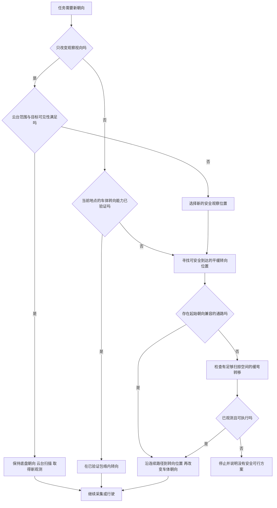

# 坡面方向调整：按任务意图区分观察与行驶

## 目标与当前状态

满足安全观察、必要的行驶方向调整和后续采集。原地保持是可选实现，不要求零滑移，也不把转速试验的结论外推为“四轮车永远不能坡面原地转”。当前R5及固定接触表达下，半速纯转候选仍有约35/30cm参考点位移，不能将Spin当作保持中心的动作。

本设计不修改定位、回访、摩擦、悬架或正常安装的默认配置。云台方案使用现有接口进行最小验证；平缓位置转向和缓弯转移是后续待接入的设计，不冒充已完成的导航能力。

## 决策流程

## 1. 观察需求优先使用云台

将任务意图区分为`observe_heading`与`travel_heading`。当前`/turn`直接改变车体朝向，不能继续把所有“看向某处”的请求都当成必须旋转底盘。

对观察请求，用当前有效车体位姿、云台TF和目标方向求可达视向，检查现有关节范围（pan约±135°、tilt约−35°至+15°）及实际视场。坡面精密指向必须使用完整三维变换；不能简单把世界方位减车头yaw当作已校准指向。本轮pan90°验证的是宽视场侧向观察，不是精密瞄准。

候选收益、目标可见性与历史观测必须采用实际相机视锥和TF，并分别记录车体yaw、云台pan/tilt及世界视向。不能只在执行端把Spin换成pan，预测和历史却仍把车头方向当作相机方向；本轮固定路线验证没有证明自然策略选点已经完成这项适配。

通过现有`pan_tilt`接口执行，沿用定位、采样、时间戳、反馈到位及续租检查。必须有真实新增观测、地形质量更新或记录证明覆盖了目标视域；仅收到动作成功不等于观察成功。记录云台实际位置及底盘实际变化。超出关节/视场或目标遮挡时重新选观察位置，不将目标角度强制截断后宣称完成。

## 2. 行驶方向必须改变时，到平缓位置再转

从已观测地形中寻找可供车体和实际转向包络容纳的转向区域。依据当地坡度、表面有效性、粗糙度、障碍/禁行区、定位与地图误差，以及已有分地形转向证据决定是否可用；不新增未经确认的统一坡度阈值，也不把现有禁行阈值当作转向能力认证。

先规划一条从当前朝向出发可以执行的路径，再在转向区域改变航向。例如沿坡上行到已观测的平缓段，停稳并复核后再掉头或换方向。平缓位置若在未知区域、没有通路或驶达本身需要先在陡坡原地转，就不属于有效替代方案。

位置、净空和是否停稳分别检查；现有普通到点容差不自动等于已经进入可转向区域。恢复或重新派发须延续动作阶段，不重复启动已经完成的驶达步骤。该状态要求吸取历史机动重启重复退让的问题，不直接恢复那些撤回候选。

## 3. 没有邻近平缓位置时，评估缓弯转移

允许车体在规划的位置变化中改变方向，明确标记为机动，不命名为原地转向。使用带起始朝向与曲率约束的路径，并检查整段扫掠包络、已观测支撑、净空和预算，不只验证几个离散终点。

接入Nav2时须同时检查路径跟随器的自动`rotate_to_heading`及行为树的Spin恢复动作：如果到平缓位置前又触发坡面原地旋转，替代设计没有实现。需要任务专用执行配置或行为树，在这段机动中停止/重规划取代未经验证的原地旋转恢复，不能全局关闭平地仍需的转向能力。实际指令、路径、偏移、暂停和续接均须记录。

无足够已观测空间、定位失效、预算不足或路径不可执行时，安全停下并报告限制；不以强推未知区域、缩小footprint或放宽定位门制造可行性。

## 最小接入范围与验证顺序

1. 当前先验证云台替代：同坡面到达后pan90°、回正、继续小段行驶；保留已有独立视觉失效问题，不承诺整坡通行。
2. 后续若要接入工作台，在观察意图中优先选择云台；车体方向请求保留显式语义和分地形可用性。默认行为需在适用范围验证后再切换。
3. 再实现平缓转向区域选择与单个有界导航事务；确认不会发生隐式Spin和重复驶达。
4. 缓弯只在前两种办法不满足需求时另做验证。无须同时重写所有规划器、定位或回访。

结果与实际验证边界以同日坡面朝向试验报告为准。
