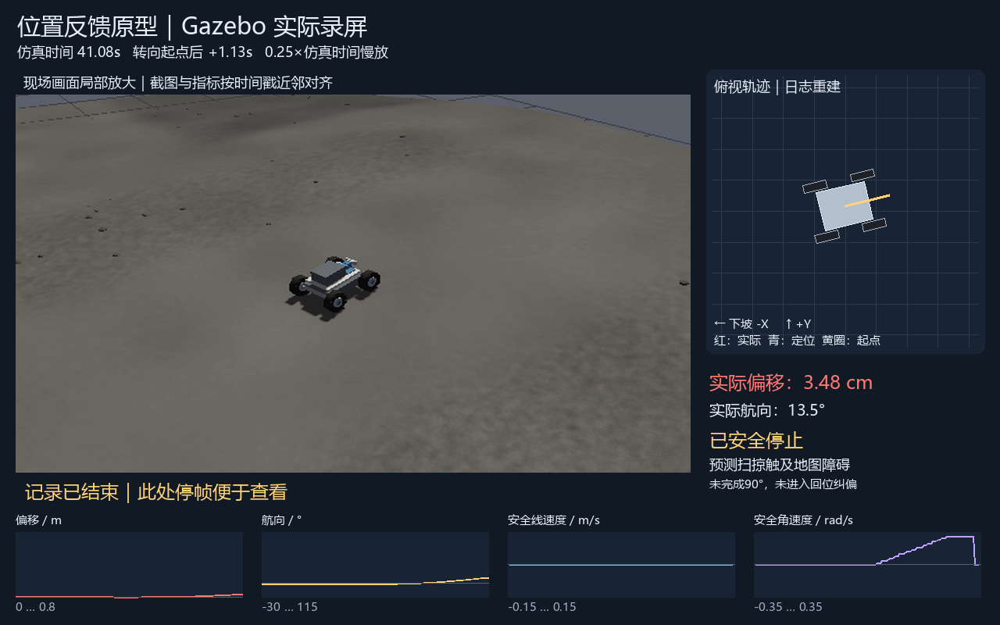

# 寻迹者探测车：位置反馈转向尝试与视频记录

2026-11-10 补充了[新原型全程视频](feedback_turn_video_20261105/feedback-turn-full-process.mp4)、[新原型逐轮短片](feedback_turn_video_20261105/feedback-turn-diagnostic-four-wheels.mp4)和[旧方案逐轮回放](feedback_turn_video_20261105/baseline-turn-replay-four-wheels.mp4)。全程版从首批车轮记录到最后一帧逐轮数据，实录从 28.79 仿真秒起。车体记录结束后，车轮仍在减速。转速和累计滚动由关节姿态推算，轮心横移由车体与悬架姿态推算。

复算停车时的导航地图，找到首个触发格中心 (3.85, 0.95) m，代价 99。预测 1.90 秒处格心进入额外放大的检查框。保留原有带安全余量的车身矩形，用矩形与格子重叠复核，整个 2 秒预测区间保持间隙。[停车触发图](feedback_turn_video_20261105/turn-stop-grid.png)

日期：2026-11-05（用户时区）。视频已生成并逐帧抽查，两份MP4完整解码通过。原型未完成90°转向，因此本轮不能宣称优化有效，也不能用短程3厘米偏移与旧方案完整两次转向的67厘米直接比较。

## 可以直接观看的材料

- [位置反馈原型：Gazebo现场录屏与诊断叠加](feedback_turn_video_20261105/feedback-turn-diagnostic.mp4)：11.35秒，1280×800，H264，20fps。动作部分为0.25倍仿真时间慢放，末尾有2秒明确标注的停帧。左侧是实际GUI画面的局部放大；右侧是独立真值与定位的俯视轨迹，底部是实际偏移、航向及安全中继后的速度。
- [旧默认方案：独立真值日志回放](feedback_turn_video_20261105/baseline-turn-replay.mp4)：35.60秒，同分辨率和编码，0.5倍仿真时间慢放，末尾停帧。重建20261104两次转向及停留，能看到车体转向中和转后仍在偏移。**旧实验没有现场录像，这份是日志图形回放，不冒充Gazebo录屏。**轮形仅为示意，不重建未记录的车轮转角、悬架或接触力。

红色为实际轨迹，青色为定位轨迹，黄色圆为转向起点。实际GUI与数值按每帧截图墙钟和工作台墙钟/仿真时钟采样近邻对齐，不保证接触事件的逐物理步同步。没有生成图像补帧或重新仿真。GUI纹理画面仅裁剪放大；所有叠加图层均来自记录。时间轴上的“记录结束”只说明该段证据结束。

## 本轮原型做了什么

预声明方案见[试验计划](../docs/feedback_turn_video_plan_20261105.md)。仅验证模式feedback_observe启用独立动作控制器；默认工作台、定位、回访、轮地物理、悬架及前后轴固定分配不变。控制输入只有已有定位位置和朝向，IMU通过原定位链参与，不把真值或地形参考送入控制。

先依据位置误差在车头方向的投影调整小幅进退，同时追踪目标航向。若到达目标朝向后位置仍偏离，最多执行一次向起点回位的弧线及一次最终转向。它不是四轮主动打舵，也不是严格无平移旋转。v≤0.12m/s，w≤0.3rad/s；运行时间、位移与内部终止规则在计划中列出，均不是新增项目验收指标。

候选不与Spin并行发布非零速度；通过原安全中继及定位、续租、地图新鲜度、区域守卫。新增每次命令的2仿真秒足迹扫掠预测，覆盖进退和弧线，拒绝未知或障碍区域。采用既有边界足迹并另加0.10m保守缓冲；常速预测不能保证覆盖真实滑移，所以持续重查并设位移上限。

## 实际运行结果

实际候选实验`experiment-448a7594983c`，测试提交`304ff3473124bb0bbad55a0f1bb7711369ed0f27`，源摘要`b3923d07df710111f9c3ccd927130a83360d2e3e012069ee8539335f9b444862`。原R5/independent_linear_v1/0.25ms/rgbd_window，无主动回访；同V2坡面和起点，目标仍为move1/2.5/4、侧转90°、回正、move4.3。

| 项目 | 实测 |
|---|---:|
| 前3个上坡行驶动作 | 全部完成 |
| 首次转向起始/停止命令时刻 | 39.9555 / 41.00825仿真秒 |
| 控制动作持续时间 | 1.05275仿真秒 |
| 至停止命令附近实际航向变化 | 约12.71° |
| 至真值记录结束实际航向变化 | 约14.02°，末绝对航向约13.5° |
| 控制窗口最大XY偏移 | 约3.11cm |
| 至真值记录结束最大XY偏移 | 约3.48cm |
| 候选计算的线速度绝对峰值 | 约0.00124m/s |
| 候选计算的角速度绝对峰值 | 0.3rad/s |
| 是否进入回位纠偏段 | 没有 |
| 停止原因 | predicted_obstacle_footprint |
| 后续回正和续行 | 未执行 |

地图扫掠守卫在转动早期预测到障碍，停止命令经原安全链生效。**这是预测检查拒绝，不是观察到真实车体碰撞。**还没有区分地图分类、膨胀与保守足迹各自的影响，不把它当成已证实的真实障碍或控制补偿失败。线速度纠偏尚很小，回位段没有执行；没有足够证据评价这套控制能否减少完整转向偏移。本轮不放宽安全检查、不扫参数，也不追加候选世界。

旧视频来自已完成的固定组`experiment-87ae029097e0`、提交`7db785ca7bf0804702fac3bb7fc18c94cd143b15`。其观察及停留最大偏移0.6733m；详情见[原同任务对照报告](CAMERA_MODE_COMPARISON_20261104.md)。它是历史背景，和本次不同版本、不同完成程度，且本轮开启GUI与编码，不能当公平的耗时A/B或改进比例。

## 录制故障、版本与保留范围

共创建2个世界，只有1个实际候选尝试。第一个`experiment-5fff2b3880a3`在派发任务前，资源见证把GUI和server识别为两个物理进程，约31秒中止；没有执行纠偏。修正进程选择器并增加回归后才运行上述候选，首轮证据原样保留。首轮退出期GUI崩溃也保留，不冒充正常结束。

初始录像还发现嵌套Xvfb：外层录制与实际GUI显示屏不同，导致黑屏。实际运行期间通过独立录制助手读取**该实验所属GUI进程**的DISPLAY和XAUTHORITY，录下293张有效截图，原始CFR视频编码返回0。失败的外层录像和一次缺鉴权录制也保留。已将显示与鉴权自动跟随修复纳入正式录制工具；该收尾修复提交`157b683a8a017e91ff959336437dac9c0bd7f57a`，不冒充实跑提交，也没有为它追加世界。等价显示/鉴权选择已由实际助手和回归检查验证，整套新入口尚未再做完整在线试跑。

运行期间控制代码未改。结束后对659冻结源核对，差异仅有record_screen.py和run_heading_trial.py这两个录制文件，算法和物理源码保持实跑版本；收尾版本重新冻结并核验120关键安装文件与R5库通过。根目录最终211项检查通过。驱动按任务未完成返回1；后端0，实际显示录制器0。最终进程清单只有容器init和sleep，无残留车辆服务。GUI与编码固定CPU5，定位仍0–1、物理仍2–5，因此本轮不评价相对旧无GUI实验的墙钟效率。

完整原始证据保存在`tmp/ros_acceptance/feedback-turn-video-20261105/`，含所有失败启动、实际屏幕录像及逐帧抓取时刻、真值/定位/速度、控制循环和退出收据。小体积成片、预览及[机器可读结果](feedback_turn_video_20261105/trial-summary.json)纳入Git；[离线视频源码](feedback_turn_video_20261105/render_video.py)和[原始证据SHA索引](feedback_turn_video_20261105/evidence-index.json)可用于复核。副本也保存在`output/turn-video-20261105/`。
