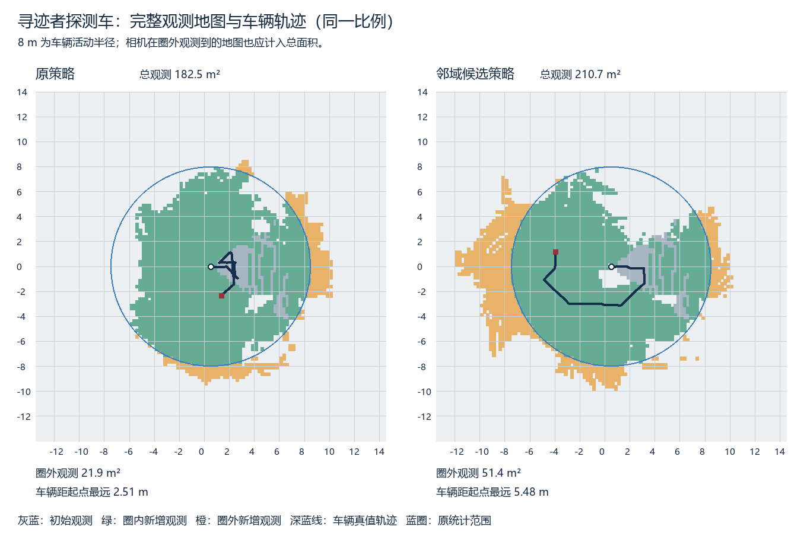

# V2 两种地形策略的自主探测与全程录像

日期：2026-11-16。测试源码 `d359750fc9fb1952944d9f691d3050a8b884b3fb`，分支 `dev/terrain-mapping-workbench`。原策略为 `baseline`，候选策略为 `elevation_neighborhood_v1`。本轮只切换地形判定策略，默认方案仍为原策略。

完整视频：[原策略，2 分 57.3 秒](baseline/baseline-autonomy.mp4)；[邻域候选策略，3 分 2.25 秒](candidate/candidate-autonomy.mp4)。两条视频均含随车小地图和四轮状态，成片时长含启动、收尾与片尾停帧，因此不等于实际探测时长。

[左右并排对照视频，3 分 2.45 秒](v2-autonomy-side-by-side.mp4)：左侧原策略，右侧邻域候选策略，保留两边全部画面、小地图与四轮面板。按共同仿真时钟对齐，候选组起始补 4 帧（0.2 秒），原策略末尾补 103 帧（5.15 秒）停车画面，未删减原视频。输出 2560×1072、20 fps，生成脚本为 `combine.py`，完整解码、帧数与 SHA256 核验见 `combined-summary.json`。

## 对照条件

- 原生 V2 场景 `survey_v2_native`、R5 支承模型、默认 `rgbd_window` 定位，无主动回访。
- 同一起点 `(0.5, 0, 0)`；全场边界 `[-15,-15,15,15]`；距起点最远 8 m。
- 每组预算 180 仿真秒，含起点观察。若剩余时间不足以完成下一动作，可提前正常结束；健康或安全问题也可提前停车。1800 墙钟秒为单组采集上限。
- 共用 `surface_view_v2` 自主选点。两组分别根据自己实际收到的地形图选择动作，因此路线可以不同。这是自然自主探测对照，并非强制复现同一路线。
- 顺序运行原策略、候选策略，每种一次。定位固定 CPU 0–1，物理固定 CPU 2–5，GUI/录屏固定 CPU 5，BLAS 单线程。源码与安装均在开始前核验，中途未修改产品代码。
- 实际 Gazebo GUI 每墙钟秒抓取 3 帧；所有原始画面均保存。GUI 相机跟随车辆，已经收到实际跟随状态及相机位姿的确认。

## 视频与图层含义

成片按 1 倍仿真时间播放，保留完整录制范围和任务结束后的减速阶段，片尾额外停帧 2 秒。原始墙钟视频另存，不以成片时长代表计算耗时。

左上角小地图北向固定、以车辆定位为中心，仅使用画面采集时已经收到的导航地图及定位。灰色为未知，绿色为已知通行格，褐色为附加代价，橙色为安全余量，红色为禁行。蓝线为估计轨迹，黄色标记为航向或目标。

四轮面板来自实际关节与车体记录，显示轮速、累计滚动角、横向运动和悬架变化，累计量以自主任务开始为零。真值仅用于离线误差统计和显示，未输入规划或控制。

## 结果与边界

**2026-11-16 复核更正：**此前把“起点 8 m 圆域内已观测面积”概括为“总观测面积”，由此得出“总覆盖未增加”的结论不正确。8 m 限制的是车辆候选位置，传感器可以观测到圈外。新策略向外行驶后，更多新增观测落在圈外，原来的汇总排除了这部分优势。保留原圆域数字供核对，同时补充完整场地内的总观测与外扩指标。

| 指标 | 原策略 | 邻域候选策略 |
| --- | ---: | ---: |
| 任务预算／仿真秒 | 180 | 180 |
| 实际探测／仿真秒 | 169.6 | 175.2 |
| 成功／选取动作数 | 11／11 | 11／11 |
| 其中前进动作数 | 8 | 10 |
| 定位暂停次数 | 0 | 0 |
| 真值轨迹长度／m | 10.73 | 16.12 |
| 完整场地已观测投影面积／m² | 182.500 | 210.688 |
| 圈外已观测投影面积／m² | 21.875 | 51.438 |
| 车辆离起点最远距离／m | 2.51 | 5.48 |
| 同为 169.6 秒时的完整观测面积／m² | 182.500 | 208.375 |
| 起点 8 m 圈内已观测投影面积／m² | 160.625 | 159.250 |
| 起点 8 m 圈内观测比例 | 79.62% | 78.93% |
| 完整场地采样质量达到 0.8 的面积／m² | 86.875 | 116.375 |
| 完整场地有效表面拟合面积／m² | 157.500 | 180.313 |
| 定位平面误差中位数／cm | 1.17 | 1.71 |
| 定位平面误差 P95／cm | 2.10 | 3.15 |
| 定位平面误差最大值／cm | 2.40 | 3.24 |
| 单组墙钟耗时（含启动收尾）／秒 | 945.91 | 952.07 |
| 实际 GUI 抓帧数 | 2807 | 2824 |

两组都以 `budget_completed` 结束：系统发现剩余预算不足以完成下一候选观察动作后正常停车，未出现安全故障或定位暂停。原策略的车辆始终处在距起点约 2.51 m 内，出现较多局部折返和重复观察；候选策略最远扩展到约 5.48 m，前进动作更多，完整场地总观测面积增加约 15.4%，采样质量达到 0.8 的面积也增加约 34.0%。这次运行支持候选策略向外探索更有效，不能再用圆域内面积相近否定这种优势。原策略所有动作成功，不等于它在持续向外扩展；目前也未将其局部往返直接判作导航执行故障。

用原始点云及归档传感器位姿逐帧重算，复现了两组最终质量图的全部观测格。另将两组截到共同的 169.6 仿真秒，原策略为 182.500 m²，候选策略为 208.375 m²，候选仍多约 14.2%；面积优势并非仅由候选组多运行 5.6 秒造成。复核脚本、数值及原始文件 SHA256 见 `audit_coverage.py`、`coverage-audit.json`。

两组实际墙钟总耗时相差约 6.2 秒（0.65%），本轮没有显示明显的整体变慢。这个结果不推翻此前离线地形处理耗时更高的测量：在线总耗时还受不同路线、转向、观察等待、GUI 和仿真调度影响。定位器未更换，路线也不同，候选组误差更高不能直接归因于地形策略本身。

两组实际结果见 `summary.json`；逐视频元数据见各子目录的 `summary.json`。面积来自任务结束时最后收到的质量图，两组均累计 310 帧，并非将仿真结束瞬间的地面真值当成已观测地图。实际探测时间不同，是同一预算下动作调度的结果。

完整场地观测面积统计 `[-15,15] × [-15,15]` 内曾被传感器观测到的投影格，起点 8 m 圆域另列。两者都包含障碍，不代表车轮实际驶过面积，也不代表全场完成率。车辆即使在小范围内转向，传感器仍可采到几米外的地形，因此车辆轨迹范围与传感器总观测面积不能互相替代。有效表面面积是已形成有效表面拟合的区域，不能独立用作准确率。

定位误差由观测器按同一时间的 Gazebo 真值与定位变换离线对齐计算；轨迹长度为真值位置按约 10 Hz 采样累加。墙钟总耗时包括启动和收尾，不能直接等同于单次地形判定耗时，也不能直接与无 GUI 的旧测试比较。

单次运行只能说明这次的行为、连续性和覆盖差异，不能据此估计成功率或断言某策略在所有地形上更好。候选策略仍为参考文献方法的局部 NumPy 实现，尚非完整概率高程地图。

## 复核与原始证据

原始文件位于工作目录下 `tmp/ros_acceptance/autonomy-terrain-video-20261116/`，含两个运行目录、对应 sessions、冻结清单、安装核验回执、状态/导航图/真值记录及原始墙钟录像。大体积原始数据留在本机，通过 `evidence-sha256.json` 索引；本目录保存成片、关键截图和汇总。

开始前修复了测试工具在生命周期服务回复丢失后不再查询的问题。现在 2 秒墙钟超时后取消并重新查询，只有真实收到四个节点的新鲜 active 回复才允许测试派发。延迟首个服务回复 3 秒的独立 ROS 预检确认恢复成功；本轮在线运行也实际通过了该确认。

`summarize.py` 生成统一统计；`verify.py` 完整解码两条成片并检查逐帧地图/定位没有使用未来收到的数据，输出 `verification.json`。源录像、关键日志、成片与叠加时间索引的 SHA256 见 `evidence-sha256.json`。

核验结果：两条成片共 7191 帧，完整解码均通过，未来数据违规为 0；开始、中段及停车截图已经检查。实验前后均核验 121 个安装文件与冻结源码一致，产品源码未变。测试工具与地形策略相关回归检查 22 项通过。两个运行的驱动器、录屏器与后端均以 0 退出，世界与辅助进程均已结束。

重放合成入口为 `reports/turn_minimap_20261111/render_video.py --autonomy`，另加 `--trial`、`--output`、`--label` 和 `--filename`。实验协议详见 `docs/autonomy_video_comparison_20261116.md`。
