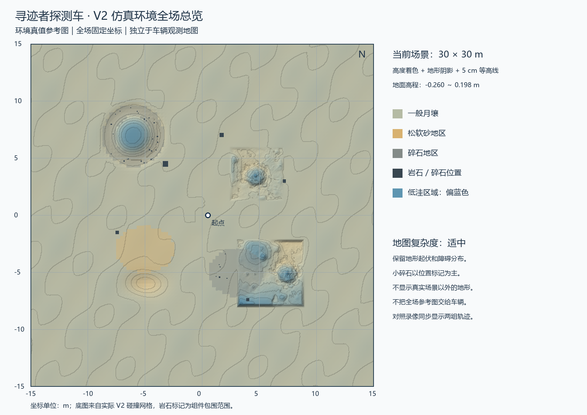

# V2 无起点半径限制自主探测

2026-11-16。测试源码 `e673a5e15f466c5013b78c9b3df2d3b7252b5e11`，分支 `dev/terrain-mapping-workbench`。

已取消工作台新任务的起点半径限制，实际在线请求及任务状态均为 `radius: null`。车辆仍遵守 V2 场地边界、真实观测通行条件、健康保护和时间预算。历史任务显式数字半径仍可复现，不影响新任务默认行为。默认定位和默认地形判定未更换。

新面积口径为 `survey-metrics-v2`：所有实际观测到的投影格按坐标去重累计，不按起点距离或坐标裁剪。重复观察不重复计面积；同时列出扣除任务开始基线的新增面积。面积包含障碍表面，不等于车轮驶过面积或可通行地面完成率，不再用任意圆域作分母计算覆盖率。

## 视频和第三张地图

[完整对比视频](v2-unbounded-comparison.mp4)：上方左侧原策略、右侧邻域候选策略，各自保留随车小地图与四轮状态；下方为独立固定全场参考图，叠加两组当时已收到的定位轨迹、位置及全部观测格面积。面积面板使用不晚于对应画面仿真时刻的记录。较早结束的一侧保持停车画面。

成片 3 分 2.85 秒、2560×1840、20 fps。两条随车基底共 7229 帧、最终合成 3657 帧均通过完整解码；随车地图/定位及全场轨迹/面积图层的时间核对均未发现未来数据。开始、中段与结束画面已核对，原始完整录像保留。

[独立 V2 全场地图](v2-environment-overview.png)覆盖固定 30×30 m，保持北向朝上，采用适中的显示细节：高度底色、地形阴影、5 cm 等高线、月壤/砂地/碎石分区、岩石和碎石位置、5 m 坐标刻度与起点。5 cm 是离线图示采样间隔，不表示增加了物理地形的细节。底图根据实际碰撞三角网格生成，细测量补片也在内；小碎石以组件包围范围示意，最小显示一像素。

环境参考图是观看辅助，未输入车辆定位、建图、候选选择或控制。随车小地图仍有局部显示窗口，该缩放窗口不限制运动或面积统计。沿用原生 V2 地形，没有提高或改变场景复杂度。

## 本轮实测

两组均使用原生 `survey_v2_native`、R5 支承配置、`rgbd_window` 定位、相同起点 `(0.5,0,0)`，每组 180 仿真秒预算、1800 墙钟秒采集上限，每墙钟秒抓取 3 帧实际 Gazebo 画面。定位 CPU 0–1、物理 CPU 2–5、GUI/录屏 CPU 5，BLAS 单线程。顺序运行原策略与候选策略，使用相同冻结源码和已核验安装，中途未修改产品代码。

| 指标 | 原策略 | 邻域候选策略 |
| --- | ---: | ---: |
| 起点活动半径 | 不设 | 不设 |
| 实际探测／仿真秒 | 175.2 | 171.0 |
| 完整观测面积／m² | 218.125 | 214.375 |
| 任务新增面积／m² | 204.875 | 201.125 |
| 同为 171 秒时的完整观测面积／m² | 218.125 | 214.375 |
| 采样质量达到 0.8 的面积／m² | 100.250 | 102.438 |
| 有效表面拟合面积／m² | 179.563 | 180.813 |
| 真值轨迹长度／m | 12.00 | 13.41 |
| 车辆距起点最远距离／m | 4.43 | 3.77 |
| 成功／选取动作 | 13／13 | 12／12 |
| 其中前进动作 | 9 | 9 |
| 定位暂停次数 | 0 | 0 |
| 定位平面误差中位数／cm | 0.84 | 1.44 |
| 定位平面误差 P95／cm | 2.21 | 2.02 |
| 墙钟耗时，含启动收尾／秒 | 925.45 | 926.73 |

两组均以 `budget_completed` 正常结束，原因是剩余时间不足以完成下一个候选观察动作，没有因半径停车。两组的驱动器、录屏器和后端退出码均为 0，定位暂停均为 0。

本轮原策略总面积略多，新策略路径略长、但离起点最远距离较小。结果与上一轮不同：取消半径也改变了候选位置和预期观测收益，因而路线随之变化。本轮是重新运行，不能将上一轮新策略外扩更好的结论直接套用，也不能凭这一轮宣布原策略普遍更好。180 秒是短时行为对照，不代表全场已经覆盖或长时间运行已经验证。

## 核验与复现

- 原始证据：工作目录下 `tmp/ros_acceptance/autonomy-unbounded-20261116/`，包含两组 sessions、原始墙钟录像、状态、导航图、真值/位姿对齐与关节记录。
- 原策略实验 `experiment-766826188a9c`；候选实验 `experiment-30668eb64280`。各运行的完整结果也保存为本目录的 `baseline-result.json` 和 `candidate-result.json`。
- `summarize.py` 汇总全部观测格面积和实际轨迹。`verify_area.py` 从原始深度帧及归档传感器位姿独立重建全部 XY 格，确认与最终质量图逐格相同，并核对共同 171 秒的面积，见 `area-verification.json`。
- 160 项规划与恢复回归通过，记录见 `planner-verification.json`；面积、报告生成及测试工具首批 24 项检查通过，两批有重叠，不加总。工作台 JavaScript 语法检查通过。
- `runtime-source.json` 冻结 663 个产品源码文件；`runtime-before.json`、`runtime-after.json` 核对源码与 121 个安装文件及实际支承库。两组运行后世界和辅助进程均已结束。
- `scene_overview.py` 生成独立地形参考，`environment-metadata.json` 记录实际场景 SHA256。`compose.py` 生成第三地图图层并合成完整视频；逐帧叠加时间索引和完整解码结果见 `overlay-timing.jsonl`、`video-summary.json`。
- 两条随车成片和原始墙钟录像保留在原始证据目录，合成入口为 `reports/turn_minimap_20261111/render_video.py --autonomy`。详细实验协议见 `docs/autonomy_unbounded_20261116.md`。
