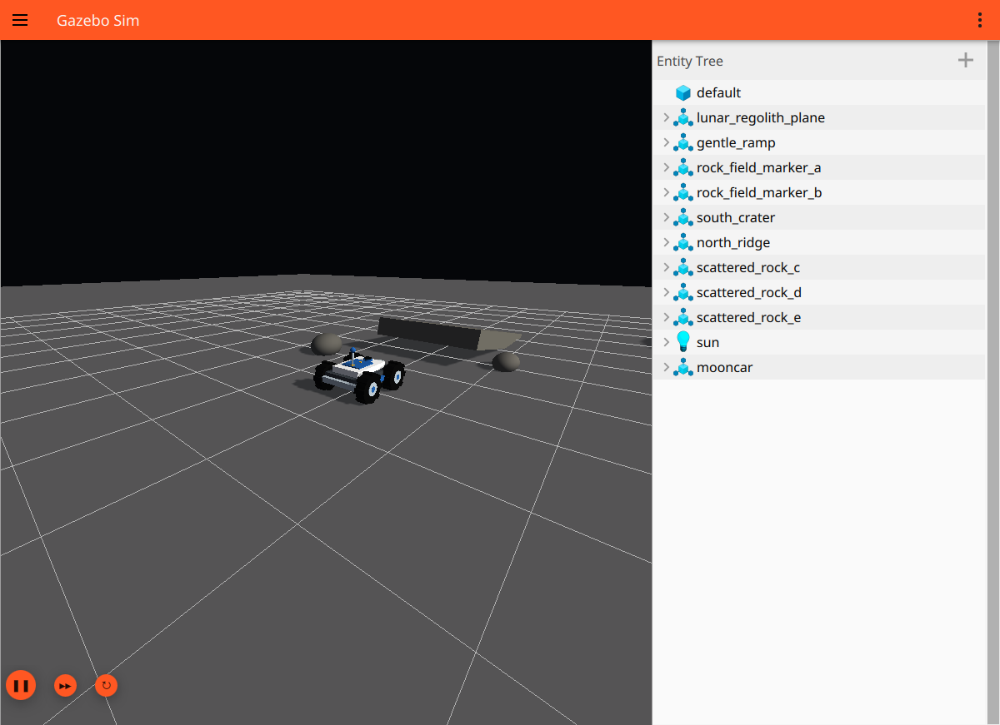
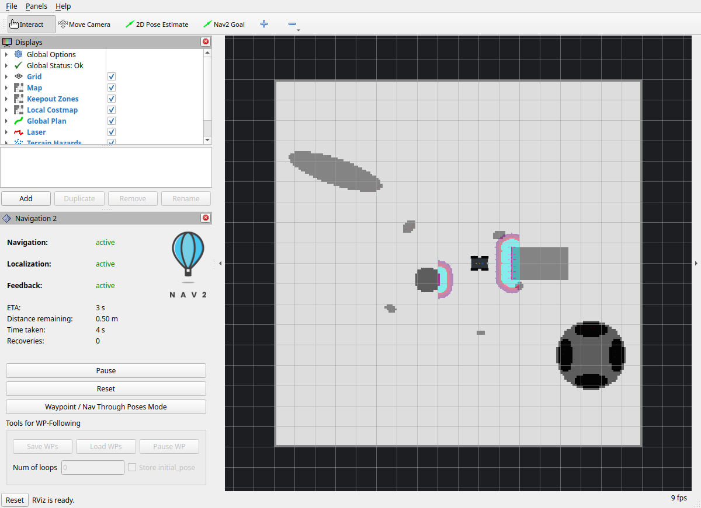

# MoonCar 软件阶段交付报告

日期：2026-09-05。范围：M0-M6 仿真与硬件接入准备。最终期限沿用需求文档的 2027-01-10。

## 交付结论

M0-M6 的软件原型已推进到可进入硬件台架阶段：仿真建图、地形约束导航、连续目标、
虚拟串口与便携控制核心均已有运行证据。下一主线是 M7 的实物采购确认、接线、HAL 和标定。
本次交付不是已调通的实体月球车，也不是户外可靠性或安全认证。

## 已实现的软件

| 模块 | 交付内容 | 边界 |
| --- | --- | --- |
| M1 模型 | 四轮底盘、传感器坐标系、惯性与碰撞结构、改进外观 | 尺寸与惯性仍是仿真值，独立悬挂实物未建模标定 |
| M2 仿真 | Gazebo Harmonic 月面风格场景、50m x 50m 地面、坡道/碎石/坑沿 | 坑是视觉底面和实体坑沿，不是真实可塌陷负地形 |
| M3 控制 | 四轮差速、键盘/脚本控制、限速、指令失效停车、轮里程计 | 滑移参数和有效轮距只在仿真中使用 |
| M4 建图 | 激光、IMU、EKF、SLAM Toolbox、0.05m 栅格建图和地图保存 | 户外精度、全场闭环与弱纹理表现尚无实车证据 |
| M5 导航 | AMCL、NavFn、Regulated Pure Pursuit、行为树、自动验收 | 固定验收地图为 18m x 18m、0.1m/格，不等于完成全 50m 场地测绘 |
| M6 地形 | 深度投影、坡度/粗糙度/凸起/可见凹陷几何风险，人工禁行区 | 几何阈值原型，不识别土壤承载力；未知空间不被算法宣称安全 |
| M6 交互 | RViz 地图、代价图、风险点、路径、Nav2 目标工具及状态面板 | GUI 的人工点选操作与自动目标测试须区分 |
| M6 通信 | 带 CRC/长度/序号的 UART、默认锁定、编码器回传、ROS 解锁服务 | 已验证虚拟串口；尚未接实体 MCU/电机 |
| M6 底层核心 | 便携 C11 四轮速度 PID、通信看门狗、急停锁存、计数回绕 | 没有猜测板级 HAL、引脚、PWM 极性，也没有可直接烧录的镜像 |

## 本次修复

- 修正深度与相机内参的 Gazebo 源话题；ROS 对外话题名保持不变。
- 深度帧等待对应时间戳的 TF，验证内参尺寸/坐标系；持续失效会阻止运动。
- 修正 Jazzy 静态层最大值合并参数的命名空间，隔离雷达清障与地形风险图层。
- 地形风险采用不清除的保守标记；虚假风险可能持续到 costmap 清理/重启，不承诺无误报。
- 用 ROS 生命周期服务取代反复启动命令行的就绪查询，保留墙钟超时。
- 导航保留 ROS 仿真时间预算、墙钟总预算和时钟停滞看门狗，避免慢 VM 被误判为 180 秒失败。
- VMware 使用软件渲染 Ogre，避免“窗口可见但激光/深度无效”；SSH 无显示器时自动使用 Xvfb。
- 验收默认使用 Cyclone DDS，错开定位管理器、导航管理器和 RViz 的启动，降低服务发现竞争。
- EKF 增加零横向速度约束，轮速使用非零名义协方差；实车仍需按滑移情况标定。
- 深度点仅成一条线或空间分布退化时标为未知，不再误判成 90 度坡面。
- 仿真转向使用 0.8 rad/s 指令跨越四轮滑移底盘的起转死区；驱动仍限加速度，真车参数不沿用此结论。
- 每个 M6 目标除 Nav2 成功外，还检查 Gazebo 真实位置误差不超过 0.4m；EKF 位置方差异常则失败。
- 旧硬件清单中的驱动通道数量、雷达强光/量程、防护等级表述已校核。

## 验证证据

测试环境：Ubuntu 24.04 VM，4 vCPU、8GB 内存，ROS 2 Jazzy，Gazebo Sim 8；实物未参与。

| 检查 | 当前记录 |
| --- | --- |
| Python 回归 | 15 项：地形几何与深度格式/退化采样、安全门控、串口协议、真实 C 核心虚拟串口、ROS 桥、生命周期、定位质量、导航超时 |
| C 核心 | gcc C11、Wall/Wextra/Werror、UBSan；CRC、帧同步、序号、250ms 看门狗、急停、回绕、无效反馈 |
| GitHub CI | 运行代码 `0cc383e` 的 [Software checks 已通过](https://github.com/WastonGura/MoonCar/actions/runs/33923366718)；交付文档提交同样要求 CI 通过后合并 |
| 全量构建 | 8 个 ROS 包通过 |
| M6 GUI 全流程 | 通过；有效激光 146 点、深度投影 3185 点；禁行区中心间距 1.329m；新增障碍重规划中心间距 1.000m |
| 连续目标 | `(1.5,0)` 与 `(3.5,3)` 均成功；Gazebo 真值误差 0.173m / 0.282m，门槛 0.400m；第二段约 183 秒墙钟、3.78m 里程计净位移 |
| M4 回归 | 通过；保存 298 x 201、0.05m/格地图，不等于全场测绘完成 |
| GUI 观察 | Gazebo 场景非空；RViz Global Status 为 Ok，导航/定位 active；人工鼠标点选不计入本次自动目标证据 |

原始材料：[M6 JSON](evidence/mooncar_m6_acceptance.json)、[M6 完整命令输出](evidence/mooncar-m6-gui.log)、
[M4 命令输出](evidence/mooncar-m6-mapping.log)、[地图 YAML](evidence/mooncar_m6_mapping_regression.yaml)、
[地图 PGM](evidence/mooncar_m6_mapping_regression.pgm)。测试代码为 `0cc383e`，后续交付提交仅增加文档与这些材料。

代码与审查入口：[PR #51](https://github.com/WastonGura/MoonCar/pull/51)。
CI 只验证可自动化的软件逻辑与语法；不运行 GPU 仿真，也不是硬件认证。

Gazebo 与 RViz 实际运行截图（不是设计图）：





## 复验方式

在 VM 关闭其他 MoonCar 仿真后执行：

```bash
~/MoonCar/scripts/accept_m6.sh
```

无 GUI：`~/MoonCar/scripts/accept_m6.sh --server-only`。
仅软件：`~/MoonCar/scripts/check_software.sh`。
M4 建图保留 `~/MoonCar/scripts/accept_m4.sh`。

成功证据为 `~/mooncar_m6_acceptance.json`，包含地形观测、禁行区绕行、临时障碍重规划和两个导航目标。
失败返回非零；启动新任务前删除同名旧成功文件。日志在 `/tmp/mooncar_m6_acceptance.log`。
GUI 模式完成后按 Enter 退出；中断也会清理本次进程组。

## 必须有硬件的下一步

M7 已建立，5 项均标记 `hardware-required`，当前没有硬件任务被冒充完成：

1. [#52 电源、接线与 BOM](https://github.com/WastonGura/MoonCar/issues/52)：实际电机堵转电流、编码器电平、四通道驱动、原理图、保险与物理急停。
2. [#53 STM32 电机台架](https://github.com/WastonGura/MoonCar/issues/53)：板级 HAL、PWM/编码器/UART、独立看门狗、架空轮测试与 PID 标定。
3. [#54 树莓派和实物传感器](https://github.com/WastonGura/MoonCar/issues/54)：驱动版本、外参、IMU 协方差、轮距/轮径、性能和供电。
4. [#55 近距联锁与 OLED](https://github.com/WastonGura/MoonCar/issues/55)：具体器件的 I2C/电平/距离阈值及强光失效检测。
5. [#56 场地验证](https://github.com/WastonGura/MoonCar/issues/56)：地球重力下的沙地滑移、真实坑沿、坡度、制动距离、终点误差、续航和热负载。

这些工作需要实测，不宜继续用猜测的参数补齐。优先拿到电机、驱动、STM32 板和电源/急停资料，先完成台架，再接整车导航。

## 未承诺的能力

- 尚未验证整个 50m x 50m 场地的自动覆盖建图、长时间运行或树莓派帧率；当前固定导航图为 18m x 18m。
- 地形未知不等于安全；当前 Nav2 仍允许未知栅格规划，不能直接用于无人工保护的真实坑沿。
- 深度风险是几何阈值原型，可能漏检/误报；保守障碍会保留到清图或重启，不是成熟的动态语义地图。
- 真实负地形、沙土承载力、独立悬挂、强光测距、近距红外、OLED、电池续航和停止距离尚未通过实物验收。
- 没有为未确认的板卡编造 GPIO 接线、PWM 极性、PID 标定值或可直接烧录的固件。

因此，“到硬件边界”指下一轮有效集成需要真实器件和数据，并非宣称全部需求已经达到实车交付标准。

## 文件与接管

- [硬件交接清单](../docs/hardware_handoff.md)：采购校核、首次上电顺序、ROS 合同、真机验收门槛。
- [UART 协议](../docs/uart_protocol.md)：线格式、单位、看门狗和台架启动。
- [固件核心说明](../firmware/stm32/README.md)：HAL 集成合同及未实现的板级部分。
- [工作上下文](../docs/working_context.md)：分支、VM、里程碑状态。

本次使用独立工作区开发，没有覆盖原 Windows 工作区的未提交改动。
主开发分支是 `main`；GitHub 默认分支仍为历史 `master`，PR 必须显式选择 `main`。
