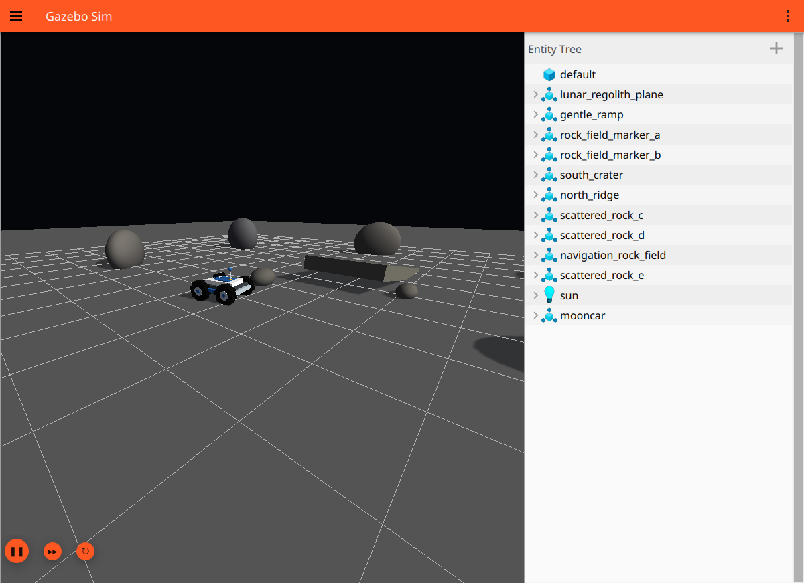
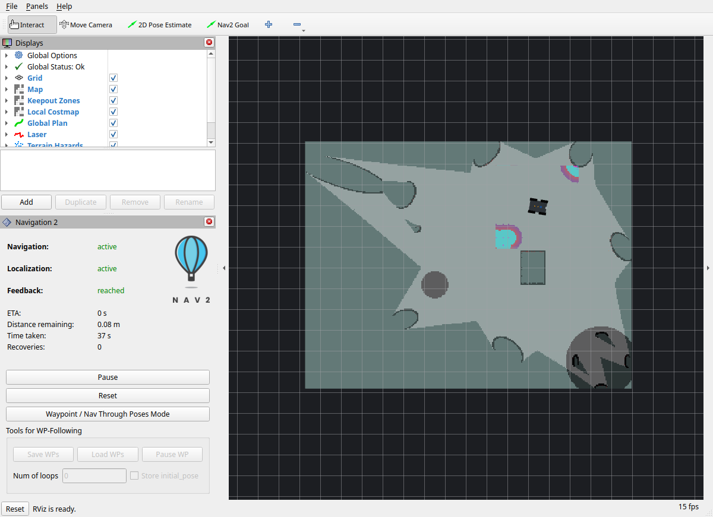

# MoonCar 软件阶段交付报告

日期：2026-09-05。范围：M0-M6 仿真与硬件接入准备。最终期限沿用需求文档的 2027-01-10。

## 交付结论

M0-M6 的软件原型已具备仿真建图、地形约束导航、连续目标、虚拟串口与便携控制核心。
PR #51 首次通过后，生产复测出现 0.52m 到达误差，因此重新打开 M6 验收。
PR #57 修复定位输入、仿真接触与地图覆盖后，隔离环境无 GUI、GUI，以及日常目录
`~/MoonCar` 无 GUI 三轮全流程均通过，6 次目标真值误差为 0.052-0.079m，门槛为 0.400m。
M6 软件验收达到本阶段交付条件；三轮通过仍不等于长期可靠性统计。
下一主线是 M7 的实物采购确认、接线、HAL 和标定。
本次交付不是已调通的实体月球车，也不是户外可靠性或安全认证。

## 已实现的软件

| 模块 | 交付内容 | 边界 |
| --- | --- | --- |
| M1 模型 | 四轮底盘、传感器坐标系、惯性与碰撞结构、改进外观 | 尺寸与惯性仍是仿真值，独立悬挂实物未建模标定 |
| M2 仿真 | Gazebo Harmonic 月面风格场景、50m x 50m 地面、坡道/碎石/坑沿 | 坑是视觉底面和实体坑沿，不是真实可塌陷负地形 |
| M3 控制 | 四轮差速、键盘/脚本控制、限速、指令失效停车、轮里程计 | 滑移参数和有效轮距只在仿真中使用 |
| M4 建图 | 激光、IMU、EKF、SLAM Toolbox、0.05m 栅格建图和地图保存 | 户外精度、全场闭环与弱纹理表现尚无实车证据 |
| M5 导航 | AMCL、NavFn、Regulated Pure Pursuit、行为树、自动验收 | 固定扫描地图为 15.7m x 11.9m、0.05m/格；低于雷达平面的障碍需使用 M6 深度地形配置 |
| M6 地形 | 深度投影、坡度/粗糙度/凸起/可见凹陷几何风险，人工禁行区 | 几何阈值原型，不识别土壤承载力；未知空间不被算法宣称安全 |
| M6 交互 | RViz 地图、代价图、风险点、路径、Nav2 目标工具及状态面板 | GUI 的人工点选操作与自动目标测试须区分 |
| M6 通信 | 带 CRC/长度/序号的 UART、默认锁定、编码器回传、ROS 解锁服务 | 已验证虚拟串口；尚未接实体 MCU/电机 |
| M6 底层核心 | 便携 C11 四轮速度 PID、通信看门狗、急停锁存、计数回绕 | 没有猜测板级 HAL、引脚、PWM 极性，也没有可直接烧录的镜像 |

## 本次修复

- 修正深度与相机内参的 Gazebo 源话题；ROS 对外话题名保持不变。
- 深度帧等待对应时间戳的 TF，验证内参尺寸/坐标系；持续失效会阻止运动。
- 修正 Jazzy 静态层最大值合并参数的命名空间，隔离雷达清障与地形风险图层。
- 地形风险采用不清除的保守标记；虚假风险可能持续到 costmap 清理/重启，不承诺无误报。
- 用 ROS 生命周期服务取代反复启动命令行的就绪查询，保留墙钟超时。
- 导航保留 ROS 仿真时间预算、墙钟总预算和时钟停滞看门狗，避免慢 VM 被误判为 180 秒失败。
- VMware 使用软件渲染 Ogre，避免“窗口可见但激光/深度无效”；SSH 无显示器时自动使用 Xvfb。
- 验收使用 Jazzy 自带 Fast DDS；就绪检查限制为每秒一次，避免快速响应触发的无间隔重复查询挤占生命周期服务。
- EKF 增加零横向速度约束，轮速使用非零名义协方差；实车仍需按滑移情况标定。
- 深度点仅成一条线或空间分布退化时标为未知，不再误判成 90 度坡面。
- 复测发现车体自身的 10 个激光回波，增加标准包围盒过滤，保留原始话题；过滤后这些回波为未知，不伪造自由空间。依据：[laser_filters 实现](https://github.com/ros-perception/laser_filters/blob/ros2/include/laser_filters/box_filter.h)。
- 四轮滑移转向补充碰撞局部坐标系中的摩擦方向及横向/纵向系数；这是名义仿真接触模型，不是实测月壤参数。方向定义依据：[SDFormat 碰撞规范](https://sdformat.org/spec/1.11/collision/)。
- 机器人 XML 显式声明字符串类型，避免 XML 注释中的冒号被 ROS launch 当作 YAML 解析。
- 测试场外围补充六块雷达可见岩石，沿已知通道闭环采集真实扫描地图；不把短距离烟测地图当作完整导航地图。
- 虚拟串口测试等待目标序号，去除读写竞争；软件回归关闭 ROS 自动发现，避免测试编码器数据混入运行系统。
- 每个 M6 目标除 Nav2 成功外，还检查 Gazebo 真实位置误差不超过 0.4m；EKF 位置方差异常则失败。
- 旧硬件清单中的驱动通道数量、雷达强光/量程、防护等级表述已校核。

## 验证证据

测试环境：Ubuntu 24.04 VM，4 vCPU、8GB 内存，ROS 2 Jazzy，Gazebo Sim 8；实物未参与。

| 检查 | 当前记录 |
| --- | --- |
| Python 回归 | 18 项：地形几何与深度格式/退化采样、蒙版未知语义、安全门控、串口协议、真实 C 核心虚拟串口、ROS 桥、生命周期限频、激光自车过滤、定位质量、导航超时 |
| C 核心 | gcc C11、Wall/Wextra/Werror、UBSan；CRC、帧同步、序号、250ms 看门狗、急停、回绕、无效反馈 |
| GitHub CI | 运行代码和地图 `de10bfa` 的 [Software checks 已通过](https://github.com/WastonGura/MoonCar/actions/runs/33930904950)；交付文档提交同样要求 CI 通过后合并 |
| 全量构建 | 8 个 ROS 包通过 |
| M6 无 GUI 全流程 | 通过；两个目标真值误差 0.067m / 0.067m，最大 EKF 位置方差 3.131m² |
| M6 GUI 全流程 | 通过；两个目标真值误差 0.079m / 0.052m，最大 EKF 位置方差 2.853m²；第二段约 178 秒墙钟、3.57m 里程计净位移 |
| 日常目录部署复验 | `~/MoonCar`、默认地图、无 GUI 通过；两个目标真值误差 0.074m / 0.075m，最大 EKF 位置方差 3.059m² |
| 三轮感知与规划 | 有效激光 256 点、深度投影 3185 点；禁行区中心间距 1.250m；临时障碍前路径间距 0.011m、重规划后 0.899m |
| M4 闭环采图 | 保存 314 x 238、0.05m/格地图；返回停车点的 SLAM 与真值差约 0.026m，不等于实车精度或全场测绘完成 |
| GUI 观察 | Gazebo 场景非空；RViz Global Status 为 Ok，导航/定位 active；人工鼠标点选不计入本次自动目标证据 |

最终原始材料：[无 GUI JSON](evidence/mooncar-m6-survey-headless.json)、[无 GUI 输出](evidence/mooncar-m6-survey-headless.log)、
[GUI JSON](evidence/mooncar-m6-survey-gui.json)、[GUI 输出](evidence/mooncar-m6-survey-gui.log)、
[GUI 节点日志](evidence/mooncar-m6-survey-gui-launch.log)、[地图保存日志](evidence/mooncar-clean-map-save.log)、
[采图路线日志](evidence/mooncar-clean-survey-route.log)、[返回点真值](evidence/mooncar-clean-survey-truth.log)。
[日常目录 JSON](evidence/mooncar-m6-release-production.json)、[部署复验输出](evidence/mooncar-m6-release-production.log)、
[部署复验节点日志](evidence/mooncar-m6-release-production-launch.log)。
GUI 与日常目录运行基线为 `de10bfa`；首轮无 GUI 使用 `a8c9513` 代码加同一份新地图，运行内容与 `de10bfa` 一致。
地图像素、原点和生成条件见 [地图说明](../ros2_ws/src/mooncar_navigation/maps/README.md)。

复测追溯：PR #51 的首次 GUI 通过后，[生产重复运行](evidence/mooncar-m6-production.log)
出现 0.52m 真实终点误差，因此重新打开验收。`4de123d` 曾 GUI 通过，但
[再次无 GUI 复测](evidence/mooncar-m6-final-repeat.log) 仍出现 0.53m 误差，未作为交付基线。
PR #57 修复自车回波、低速滑移转向和就绪查询过密，并以闭环真实扫描地图替换短程地图；
保留 0.4m 真值门槛，没有放宽误差来获得通过。
中途若干手动采图实验误引用旧工作区，已作废；最终采图显式确认了隔离工作区的 ROS 包路径。
固定地图 37775/74732 个栅格有自由/占用观测，其余为未知。六块外围岩石提供定位特征，
不能据此声称无特征荒地定位已解决。低矮石块仍需靠 M6 深度层识别。

代码与审查入口：[PR #51](https://github.com/WastonGura/MoonCar/pull/51)、[PR #57](https://github.com/WastonGura/MoonCar/pull/57)。
CI 只验证可自动化的软件逻辑与语法；不运行 GPU 仿真，也不是硬件认证。

Gazebo 与 RViz 实际运行截图（不是设计图）：





## 复验方式

在 VM 关闭其他 MoonCar 仿真后执行：

```bash
~/MoonCar/scripts/accept_m6.sh
```

无 GUI：`~/MoonCar/scripts/accept_m6.sh --server-only`。
仅软件：`~/MoonCar/scripts/check_software.sh`。
M4 建图保留 `~/MoonCar/scripts/accept_m4.sh`。

成功证据为 `~/mooncar_m6_acceptance.json`，包含地形观测、禁行区绕行、临时障碍重规划和两个导航目标。
失败返回非零；启动新任务前删除同名旧成功文件。日志在 `/tmp/mooncar_m6_acceptance.log`。
GUI 模式完成后按 Enter 退出；中断也会清理本次进程组。

## 必须有硬件的下一步

M7 已建立，5 项均标记 `hardware-required`，当前没有硬件任务被冒充完成：

1. [#52 电源、接线与 BOM](https://github.com/WastonGura/MoonCar/issues/52)：实际电机堵转电流、编码器电平、四通道驱动、原理图、保险与物理急停。
2. [#53 STM32 电机台架](https://github.com/WastonGura/MoonCar/issues/53)：板级 HAL、PWM/编码器/UART、独立看门狗、架空轮测试与 PID 标定。
3. [#54 树莓派和实物传感器](https://github.com/WastonGura/MoonCar/issues/54)：驱动版本、外参、IMU 协方差、轮距/轮径、性能和供电。
4. [#55 近距联锁与 OLED](https://github.com/WastonGura/MoonCar/issues/55)：具体器件的 I2C/电平/距离阈值及强光失效检测。
5. [#56 场地验证](https://github.com/WastonGura/MoonCar/issues/56)：地球重力下的沙地滑移、真实坑沿、坡度、制动距离、终点误差、续航和热负载。

这些工作需要实测，不宜继续用猜测的参数补齐。优先拿到电机、驱动、STM32 板和电源/急停资料，先完成台架，再接整车导航。

## 未承诺的能力

- 尚未验证整个 50m x 50m 场地的自动覆盖建图、长时间运行或树莓派帧率；当前固定导航图边界为 15.7m x 11.9m，内部仍有约一半未知区域。
- 地形未知不等于安全；当前 Nav2 仍允许未知栅格规划，不能直接用于无人工保护的真实坑沿。
- 深度风险是几何阈值原型，可能漏检/误报；保守障碍会保留到清图或重启，不是成熟的动态语义地图。
- 真实负地形、沙土承载力、独立悬挂、强光测距、近距红外、OLED、电池续航和停止距离尚未通过实物验收。
- 没有为未确认的板卡编造 GPIO 接线、PWM 极性、PID 标定值或可直接烧录的固件。

因此，“到硬件边界”指下一轮有效集成需要真实器件和数据，并非宣称全部需求已经达到实车交付标准。

## 文件与接管

- [硬件交接清单](../docs/hardware_handoff.md)：采购校核、首次上电顺序、ROS 合同、真机验收门槛。
- [UART 协议](../docs/uart_protocol.md)：线格式、单位、看门狗和台架启动。
- [固件核心说明](../firmware/stm32/README.md)：HAL 集成合同及未实现的板级部分。
- [工作上下文](../docs/working_context.md)：分支、VM、里程碑状态。

本次使用独立工作区开发，没有覆盖原 Windows 工作区的未提交改动。
主开发分支是 `main`；GitHub 默认分支仍为历史 `master`，PR 必须显式选择 `main`。
