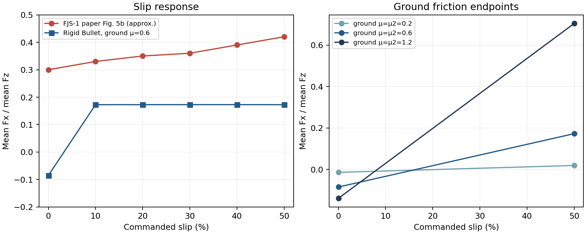

# 轮地牵引标定预试验：计算与开发记录

日期：2026-09-30。批次：`20260930T200900+0900`。

## 1. 本轮完成什么

完成一套独立单轮测量台、六个指定滑移点、四个地面摩擦边界点、两个测力控制试次以及一个 64 秒长试次，共 **13 个成功完成的试次**。这是拟合前的模型适配性检查；**没有进行参数优化，没有得到可称为“已标定月壤”的 `mu/mu2`，没有修改正式 R5 场景**。

本批修正了此前两批轮齿绕圆周的位置与旋转不匹配的问题，并加入径向几何断言。前两批保留为诊断记录，不能合并统计。初次将地面测力传感器直接装到以 world 为父节点的固定关节，Gazebo 插件拒绝这一配置；两个失败试次及当时生成器保留在 `failed-world-parent/`。随后增加 base 链接，使测力关节位于 base 与 surface 之间，全部正式预试验另生成在本目录顶层。失败试次不计入上述 13 个。

## 2. 文献、已知量与工程假设

来源：[Hurrell et al. (2025), Traction Performance Evaluation for a Rashid-1 Rover Wheel](https://link.springer.com/article/10.1007/s11214-025-01164-8)。原 PDF 和下载校验值见 [上一批 references](../20260930T185818+0900/references/README.md)。

| 输入 | 本轮值 | 依据与边界 |
| --- | --- | --- |
| 重力加速度 | 9.81 m/s² | 复现地球试验条件，不用月球重力 |
| 名义单轮载荷 | 24.5 N | 论文地面试验 |
| 轮速 | 0.2 rad/s | 论文试验条件 |
| 名义半径、轮宽 | 0.100 m、0.080 m | 论文轮子尺寸；外径解释与几何细节仍需核实 |
| 轮质量 | 1.18 kg | 论文轮子质量；惯量为工程近似 |
| 轮齿数量、径向长度 | 14、0.020 m | 参考论文轮齿说明 |
| 轮芯半径、齿厚 | 0.080 m、0.003 m | 近似几何；3 mm 齿厚不是论文实测值 |
| 地面 | 固定刚性平板 | 不包含月壤颗粒、松散度、土壤剪切与沉陷 |
| 轮面 μ=μ2 | 0.6 | 固定工程参数，不是已标定物性 |
| 地面 μ=μ2 | 0.6；边界 0.2、1.2 | 输入接触参数，试探值，不是论文牵引系数 |
| 平板质量 | 10 kg | 测力板结构参数，需扣除其 98.1 N 自重 |
| 步长、采样率 | 0.001 s、100 Hz | 本轮采集设置 |

论文图 5(b) 红色实验标记人工读图约为 0.30、0.33、0.35、0.36、0.39、0.42，对应 0%–50% 滑移。它们只是精度约 0.01 的目视读数，**没有作者原始数表和准确误差棒，不用于正式优化**。论文对象为 FJS-1 松散模拟月壤；文中的月球重力 4.1 N 结果来自 DEM 仿真，不能当作本轮的物理实验基准。

## 3. 试验台与计算式

固定导轨约束横向自由度；水平滑块驱动平移速度，竖直滑块自由浮动，车轮绕 y 轴转动。竖直滑块质量：

\[
m_z=\frac{24.5}{9.81}-1.18=1.31745\ \mathrm{kg}
\]

名义静载为 `(m_z+m_w)g=24.5 N`。水平滑块自身 0.1 kg 的重量由导轨承受，不计入轮载。

指定滑移 `i` 对应：

\[
v_x=r\omega(1-i)=0.020(1-i)\ \mathrm{m/s},\qquad
i=1-\frac{v_x}{r\omega}
\]

六个滑移点为 `i=0,0.1,0.2,0.3,0.4,0.5`；平移速度依次为 `0.020,0.018,0.016,0.014,0.012,0.010 m/s`。终点累计位移与转角用于检查实现滑移：`i_measured=1−Δx/(rΔθ)`，它包含起步段，不能解释为稳态瞬时滑移。

地面测力传感器使用本批固定坐标与默认关节方向；轮对地面的水平作用力为负向时，地面对轮的牵引为正向。计算为：

\[
F_x(t)=-F_{plate,x}(t),\qquad
F_z(t)=-F_{plate,z}(t)-m_{plate}g
\]

\[
\overline{F_x}=\frac{1}{N}\sum_{k=1}^{N}F_x(t_k),\quad
\overline{F_z}=\frac{1}{N}\sum_{k=1}^{N}F_z(t_k),\quad
k_T=\frac{\overline{F_x}}{\overline{F_z}}
\]

`k_T` 是本试次的测量牵引系数。**SDF 的 μ/μ2 是接触输入，两者不是同一个量。** 表中主结果取 5–20 s，包含两端，共 1501 个样本。它是两个平均力的比值，不是逐时刻比值的平均。

水平导轨测力用于交叉核对：`mean(F_plate,x+F_rail,x)` 接近零；瞬时差允许包含滑块加速度。CSV 中 `rail_fx_sd_N` 是同轮时间标准差 `sqrt[Σ(F−mean F)²/(N−1)]`，**不是多轮重复的离散度**。`traction_coeff_nominal` 保留旧导轨力/24.5 N 口径供核查，正式图使用独立平板力/实测轮载的 `traction_coeff_measured`。

## 4. 实际结果

| 指定滑移 | 累计实现滑移 | 平均牵引力 N | 平均轮载 N | 牵引系数 k_T | 论文实验标记，约 |
| ---: | ---: | ---: | ---: | ---: | ---: |
| 0% | 0.239% | −2.0741 | 24.4902 | −0.08469 | 0.30 |
| 10% | 10.007% | 4.2139 | 24.4077 | 0.17264 | 0.33 |
| 20% | 20.000% | 4.2300 | 24.4892 | 0.17273 | 0.35 |
| 30% | 29.988% | 4.2347 | 24.5046 | 0.17281 | 0.36 |
| 40% | 40.013% | 4.2267 | 24.4577 | 0.17282 | 0.39 |
| 50% | 50.011% | 4.2372 | 24.5399 | 0.17266 | 0.42 |

轮面摩擦固定 0.6，仅改地面摩擦的端点检查：

| 地面 μ=μ2 | 0% 滑移 k_T | 50% 滑移 k_T |
| ---: | ---: | ---: |
| 0.2 | −0.01395 | 0.01913 |
| 0.6 | −0.08469 | 0.17266 |
| 1.2 | −0.13918 | 0.70431 |

在**本轮近似轮子、刚性平面和三个等向摩擦设置**下，牵引曲线未复现论文：零滑移为负，10%–50% 基本饱和；加大摩擦没有同时恢复两端。不能由这三个设置证明所有可能的模型或非等向参数都无法拟合，也不能将该结果直接推广到 R5 真车。



## 5. 核查结果与限制

- 13 个成功试次的三路有效原始测力流均完整：20 s 为 2001 个样本，10 s 为 1001，64 s 为 6401；第一样本位于起步第一毫秒，此后按 0.01 s 间隔记录到终点。`analyze.py` 对数量与逐样本时间戳执行断言。
- 六滑移点的累计实现滑移误差小于 1 个百分点，平均轮载距 24.5 N 小于 0.5 N；轮速约 0.2 rad/s。
- 无地面接触时，水平力约 `−9.66×10⁻⁹ N`，扣重后法向力接近零。额外施加 −5 N 外力，导轨平均读数变化 `−4.99047 N`，符号与量级一致。控制仅核验测量链，不证明土壤模型正确。
- 双路平均水平测力差小于 0.1 N；零滑移瞬时差最大约 0.212 N，未将瞬时导轨力直接当成无惯性接触力。
- 50% 滑移延长至 64 s。一个轮子转动周期 `T=2π/ω≈31.416 s`；5–36.416 s 与 32–63.416 s 的整圈窗口系数分别为 `0.172887`、`0.172875`。两窗口重叠，仅用于核查平均窗口与相位影响，**不是独立重复试验**。短窗口有所变化，但这轮长试次不支持“平均力持续漂移”的说法。
- 接触消息流为空；未使用它计算法向力。竖直自由滑块关节传感器也不能替代接触轮载；本批用独立固定平板测力并扣重。
- 每条件只跑一轮，其他滑移点仅 20 s、少于整圈转动；不能估计重复误差或正式论文拟合误差。轮齿细节、惯量与接触数值设置仍为近似。
- 刚性平面不提供土壤沉陷与颗粒流动，尚不能完成论文的“牵引＋沉陷”联合验证。

## 6. 下一步如何用文献

本轮完成了“先核验测量、再判断模型是否能用于拟合”的关卡，当前不进入正式 μ/μ2 优化。

1. 核实论文轮齿外形、有效半径和各试验输入，获取作者数据或有校准误差的数字化读图数据，冻结目标及单位。
2. 选择并验证能够表达松散土壤的模型。若沿论文 DEM 路线，先按堆积角等土壤试验标定颗粒参数，再用单轮牵引与沉陷验证；若采用连续土壤接触模型，必须单独说明与验证其物性参数。不得把论文颗粒摩擦或宏观牵引系数直接抄成 SDF μ/μ2。
3. 冻结条件、目标误差、平均窗口与验证组；标定组用于调整参数，独立条件用于检验。适配性成立后再拟合，并报告模型偏差与参数不确定性。
4. 单轮验证通过后另立 R5 新场景版本，旧场景与旧六策略结果保持各自版本，重新确认迁移效果。

## 7. 文件、复算与 Git 归档

`prepare.py` 生成几何并自检；`run.py` 启动独立分区采集，已有日志时拒绝覆盖；`analyze.py` 复算全部表格并执行上述断言；`plot.py` 重绘数据图；`audit.json` 明确 `parameter_fit_performed=false`。模型 SDF、终点关节状态、服务器日志、原始三路力和失败证据均保留。

Ubuntu WSL 从工作区根目录复算（Python 标准库）：

```bash
python3 reports/evidence/terrain-v2/20260930T200900+0900/analyze.py
```

原始 JSONL 本地保留，Git 以 `raw_streams.zip` 无损归档，避免同时提交一份展开文本和一份压缩副本。取回 Git 版本后，将 ZIP 解压到同目录再运行分析。`SHA256SUMS` 同时记录原始流、压缩包及其余文件哈希，解压后可在批次目录执行 `sha256sum -c SHA256SUMS`。论文 PDF 本地保留，Git 记录来源和哈希。

运行环境：现有 Docker 镜像 `mooncar-terrain:jazzy`，镜像 ID `sha256:065aeeaf2447399d53e4f665a83e321153c355f96d06690f3c0b729e4591aa0d`；Gazebo Sim 8、Bullet Featherstone。独立短生命周期容器，没有安装全局依赖。若重新运行，将脚本复制至新时间戳目录，重新生成 SDF；不要在此覆盖已有证据。

Notion 已同步至 [项目计算书](https://app.notion.com/p/3e83a561987981fab938fd7cc4ac966f?pvs=204) 第 8 节。写入后重新读取，确认公式、六行结果、限制与路径保留；第 1–7 节内容逐字核对未改。`notion-calculation-section.md` 是本轮新增内容的本地快照。
