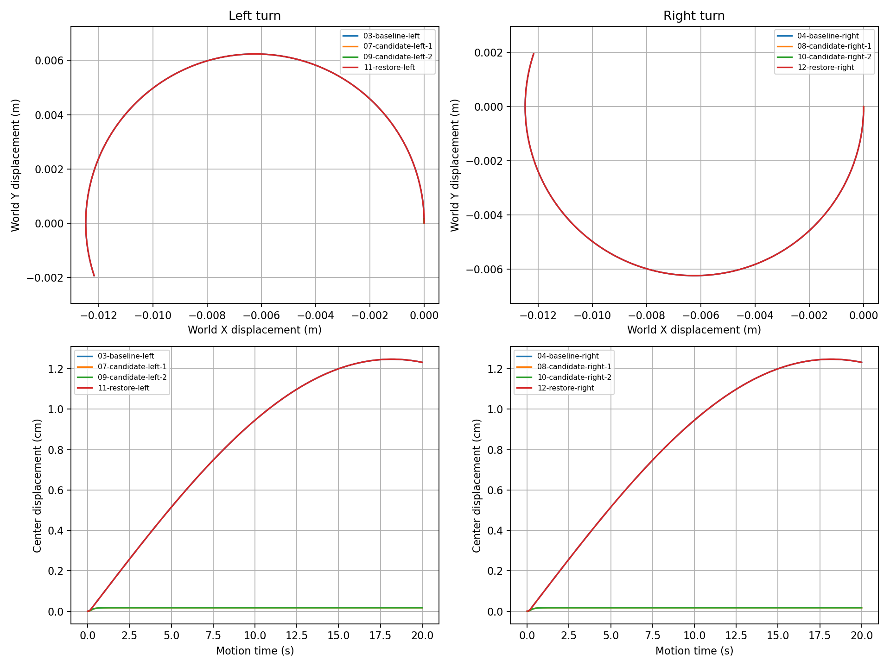
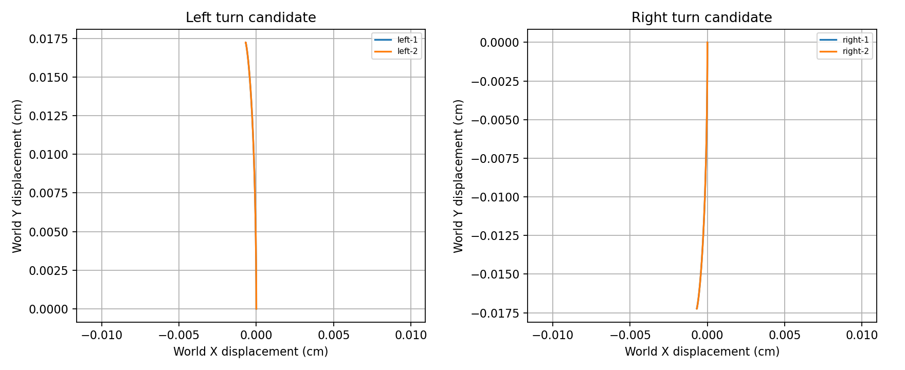

# R5 固定接触模型下的驱动分配对照，2026-10-10

本轮12次新仿真全部合格。固定上一轮测试副本的 WheelSlip 参数10/0，仅启用按模型载荷计算的前后轴轮速分配后，原地转向最大真实偏移从约12.48 mm降至0.173 mm；关闭分配后原偏移重新出现。支持这一驱动改动对当前平地仿真结果的因果影响。**正式配置未修改，尚未完成v2场景、步长一致性或整车验收。**

此前独立试验已把原约313 mm偏移降至12.48 mm。本轮基线是该固定滑移测试副本，而不是原313 mm模型；两批结果和失败候选分别保留，不混用轮次。原接触表达的后轴支点、滑移候选的质心支点及本轮几何中心附近支点，均依据真实世界姿态和接触记录判定；不代表已经证明DART存在错误或实车参数正确。

| 配置 | 转向次数 | 最大车体中心偏移 | 实际转角绝对值 |
|---|---:|---:|---:|
| 固定滑移、分配关闭 | 左右各1 | 12.475744 mm | 3.457745 rad |
| 固定滑移、分配开启 | 左右各2 | 0.172556 mm | 3.595126 rad |
| 固定滑移、恢复关闭 | 左右各1 | 12.475744 mm | 3.457745 rad |

关闭、开启配置另各运行一次零命令和一次直行。静置稳定，直行均实际前进1.989950 m；全部12轮停车末秒位移为0。两次同方向候选重复的最大偏移和转角数值相同。冻结输入配对的距离、转角积分与运动时长差均为0；每轮静置5秒、运动20秒、停车3秒，1 ms步长。当前确定性重复结果不能外推到其他地形、步长或实车。

驱动测试模块保持原链路：ROS测试发布器→安全中继→桥接→原DiffDrive及其限速→测试分配模块→DART执行器。两侧平均轮速目标守恒，纯转向时前轴乘0.960268221788626、后轴乘1.039731778211374；其他命令不改。比例按冻结模型的每轮载荷估计3.572514673566879/3.868145326433121 N解析计算，不读取Gazebo真值，不扫描参数。记录分别保留原DiffDrive目标、分配后目标及独立观察到的实际目标；明确允许这一驱动改动引入的前后轴目标差，原始记录没有归一化或覆盖。

只读观察器与执行器分配模块分开：前者不施力，后者明确写入轮速控制目标。质量、惯量、摩擦、地形、DART库、固定滑移参数与D=0云台候选保持不变；这不表示WheelSlip测试接触模型与正式模型相同。生成文件只差分配开关，恢复模型与本轮基线哈希一致。全部实际加载库、源代码、安装文件、70项资源和模型哈希保留在 `campaign/freeze.json` 及逐轮运行回执。

仿真前冻结的诊断筛选为真实最大偏移≤1 cm、稳态支点X绝对值≤2 mm、实际转角损失≤0.05 rad及纵向滑动RMS≤0.01 m/s。四轮候选均通过；实际转角增加约0.137381 rad，纵向滑动RMS最大约0.004522 m/s，稳态支点X约−3e−11 m。1 cm是此前研究筛选条件，不能冒充实车或整车性能标准。曲线中的微小残余是真实启动瞬态位移，不是将末端移回原点。

剩余事项：轮式里程计航向仍有误差。本轮左转候选末端ROS轮式里程计误差约0.384658 rad、Gazebo原生里程计误差约0.226576 rad，按实际消息时刻与真值对齐，末端样本比运动边界早6 ms；没有修改里程计。实际转角与命令积分也仍有差异。载荷估计及滑移系数没有实车标定依据，云台姿态变化、v2地形及步长变化尚未验证。因此只确认测试副本的偏移修复候选，不能发布到正式默认配置或宣布整车通过。

新增9项专项检查，覆盖载荷推导、纯转向选择、输入方向、单开关模型差异、恢复哈希及独立目标记录防伪。首次宿主工具检查发现Windows XML写文件将LF改为CRLF，原失败日志保留；修正测试夹具字节写入后通过，修正发生在任何新Gazebo启动之前。冻结后执行代码未改变。

完整软件446项、前端3项、5个前端文件语法检查、202个Python文件解析及严格C11/UBSan固件检查通过。物理性能采样与回归分开；逐轮实际运行速度、CPU、内存和证据大小见 `round-metrics.json`，外部15秒采样见 `performance.jsonl`。短窗口CPU估计可略高于4核限额，保留原值。原始CSV/JSONL、RGB/深度、接触、命令及暂停/flush回执保留本地，不提交大体积文件。

本轮容器已关闭，原工作台未重启。原文件保护及完整归档校验见 `preservation.json`、`archive-manifest.json` 和 `archive-verification.json`。下一步应验证同一测试候选在v2与不同步长下是否保持效果，并独立处理角度跟踪与里程计一致性；不继续扫描接触参数。
