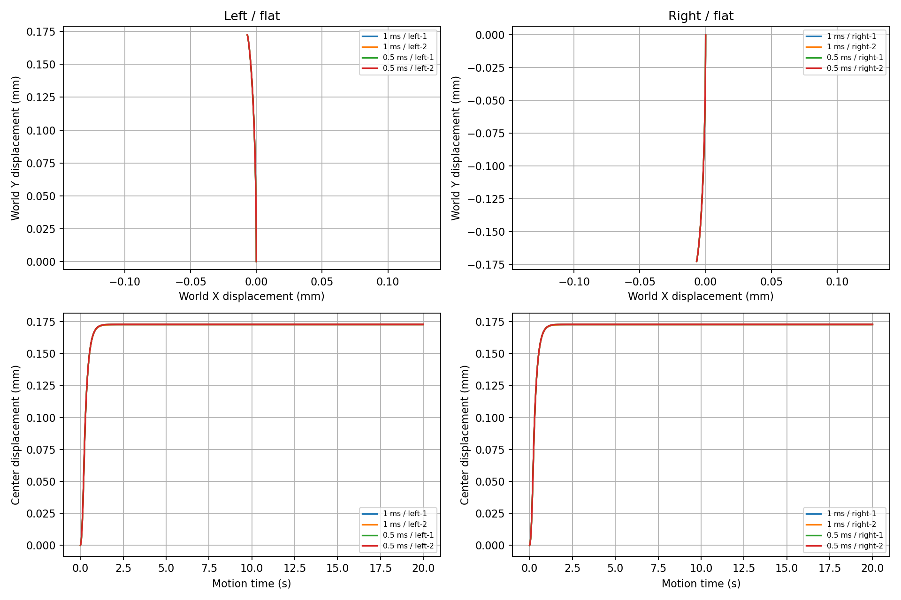
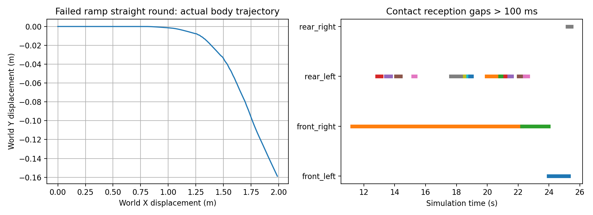

# R5 测试候选跨步长及 v2 检查，2026-10-10

**平地转向偏移与步长对照通过；v2 检查未完成，候选不能发布。** 本轮冻结矩阵最多25次新仿真，实际运行15次：前14次合格，第15次坡道直行因接触记录资格失败而停止，后续10次没有运行。失败轮没有补跑、改判或裁去暂停窗口。正式模型、控制默认值、DART库和原工作台均未改变。

用户允许仅在测试副本验证侧向滑移模型。本轮固定已验证的WheelSlip侧向10、纵向0，以及上轮载荷推导的前后轴转向轮速分配，未搜索参数。分配比例前轴0.960268221788626、后轴1.039731778211374，仅纯转向介入；其他命令保留原DiffDrive输出。D=0云台候选、质量、惯量、摩擦、几何、安全中继、相机及图片采集修复保持不变。模型、执行器、观察器、DART库与70项资源均与上一轮冻结哈希一致，见 `fixed-candidate-preflight.json`。本轮基线是上一轮已改接触表达的测试候选，不是原31 cm偏移模型。

独立容器使用原派生Jazzy镜像，4 CPU、6 GiB、512 MiB shm、ROS95、LOCALHOST，无网页端口。每轮重建世界、独立partition，沿用真实命令链路和`paused_steps`，静置5秒、运动20秒、停车3秒。实际执行源码、安装文件、模型、库和资源在首次仿真前冻结，冻结后未改变。没有0.25 ms参考或后续参数扫描。

## 平地结果

1 ms直行、左转、右转各两轮；0.5 ms另有一轮零命令，直行、左转、右转各两轮。共13轮全部通过输入、图片、常规接收、逐步观察、接触关联及暂停/flush/排空门槛。

| 动作 | 1 ms结果，两轮相同 | 0.5 ms结果，两轮相同 | 对应末端位置差 | 航向差 |
|---|---:|---:|---:|---:|
| 直行 | 前进1.989949994 m | 前进1.989974997 m | 0.0250031 mm | 约6e−17 rad |
| 左转 | 最大偏移0.172556 mm，转角+3.595126 rad | 最大偏移0.172866 mm，转角+3.595170 rad | 0.000310295 mm | 0.0000434403 rad |
| 右转 | 最大偏移0.172556 mm，转角−3.595126 rad | 最大偏移0.172866 mm，转角−3.595170 rad | 0.000310357 mm | 0.0000434403 rad |

六组对应步长比较均满足冻结的1 cm/0.01 rad门槛；对应输入的运动时长、轮速目标积分差均为0。六组同一步长重复输入检查也通过。保留1 ms作为后续测试候选的步长即可；这不是正式默认值发布。实际转角没有通过缩短动作降低，仍有命令角度跟踪与轮式里程计误差，原始数据未改写。

## 坡道失败与剩余问题

第14轮坡道零命令通过。第15轮坡道直行的图片、常规数据、实际步长、运动输入及停车检查通过，车辆无翻转；但四轮接触话题均存在超过0.1秒的空档，因此整轮保留失败。四轮最大空档：前左1.309秒、前右11.019秒、后左0.902秒、后右0.263秒。接收记录没有逐步的接触状态，不能把消息缺失当作零接触力，也不能确认是车轮离地还是传输/接收缺失。

固定版本Gazebo接触系统仅在接触集合非空时发布消息；物理系统会在没有接触时清空对应ECS接触组件。这说明旧的接触话题连续性条件需要更多逐步源状态证据，但不能据此回填本轮空档或直接宣布通过。[Contact.cc](https://raw.githubusercontent.com/gazebosim/gz-sim/gz-sim8_8.15.0/src/systems/contact/Contact.cc)、[Physics.cc](https://raw.githubusercontent.com/gazebosim/gz-sim/gz-sim8_8.15.0/src/systems/physics/Physics.cc)；下载文件及哈希保存在 `references/`。

此外，完整世界姿态记录显示运动末端正X前进 **1.988866 m**、横向Y移动 **−0.158886 m**，航向只变化约−0.00091049 rad，最大横滚/俯仰约0.076011 rad。停车末秒移动为0，实收命令为零。新分配模块在整轮中介入步数为0，分配前后四轮目标差为0，证明直行轮速没有被该模块改写。固定滑移模型依然参与接触；缺少同地形原接触模型对照，尚不能确认15.9 cm横向移动的原因。

坡道转向、弯道和综合场景尚未运行，不能宣称v2转向偏移已解决或整车通过。下一阶段应先增加只读逐步接触状态，明确“组件不可用、确认无接触、存在完整接触”三个状态，再用同输入的原接触/固定滑移对照查横向移动。当前冻结目录不再续跑；新观察工具需要新目录和新签名。不要仅放宽接触间隔，也不要直接扫描滑移、摩擦、质量或步长。

## 工具、回归与交付

新增独立矩阵入口和真实步长资格检查：旧诊断器硬编码20,000步，新层仅按实际物理步长核对20秒的整数步数，保留所有非时间门槛；0.5 ms要求40,000步，原始观测不归一化。专项7项检查覆盖矩阵顺序、步长/时长、接触等缺失、配置错误及入口导入。

首次仿真前曾出现辅助函数导入名错误，保留 `pre-simulation-entry-failure.log`；修正并补充入口测试后才冻结和启动Gazebo，当时新仿真次数为0。冻结后没有修改执行代码。本轮停止后只读分析脚本与归档检查不属于控制链路，未覆盖逐轮结果。

完整软件453项检查（7/10/129/307）无跳过，前端3项测试、5项语法检查、206个Python文件解析、Bash语法及严格C11/UBSan固件检查通过。物理运行与软件回归分开。逐轮耗时、CPU、内存、运行速度及数据量见 `round-metrics.json`，外部15秒资源采样见 `performance.jsonl`；保留短窗口CPU略高于4核的原值。

原始RGB、深度、激光、IMU、关节、命令、真值、力矩、接触、CSV与排空回执均保留本地；大体积数据不提交。`campaign/summary.json`与`ledger.json`保留真实完成次数和失败原因，`failure-analysis.json`单独记录失败轮分析，不改原判定。归档哈希、原文件保护、工作台状态核对和容器关闭见 `archive-manifest.json`、`archive-verification.json`、`preservation.json`、`closure.json`。本轮只提交工具、回归、报告及小体积证据。
