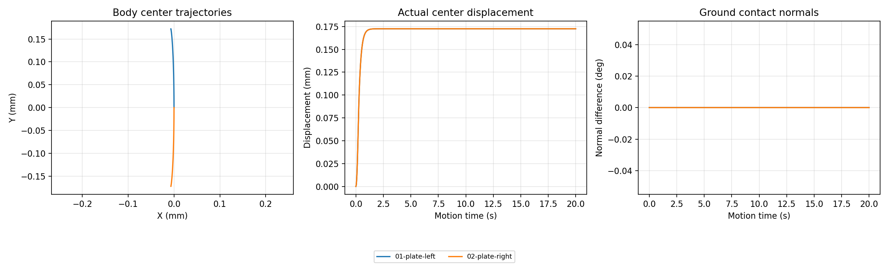

# R5 剩余转向偏移：新地面表示对照停止于无效测试网格

**幽灵碰撞尚未确认；本轮查明并修正了测试网格缺法线的问题。** 原31厘米偏移的轴侧支点解释不变，旧v2约10.29毫米残余仍需有效网格对照。本轮不发布模型、控制或运行库变更。

用户在讨论箱体/三角网格及幽灵碰撞后要求“查明一下原因吧”。沿用已授权的单项地面表示范围，建立新的独立八次诊断；没有恢复或清零旧失败目录。本轮4 CPU、6 GiB、512 MiB shm、ROS95/LOCALHOST、原Jazzy派生镜像，无网页端口，1 ms，D=0、WheelSlip 10/0、前后轴分配及纯转向门控不变。

| 新轮次 | 输入与记录资格 | 最大真实偏移 | 结果 |
|---|---|---|---|
| 箱体平板左转 | 通过，20,000运动步 | 0.172556269 mm | 有效基线 |
| 箱体平板右转 | 通过，20,000运动步 | 0.172556252 mm | 有效基线 |
| 水平网格左转 | 启动失败，没有有效运动窗口 | 缺失，不计为零或无穷大位移 | 保留失败 |
| 后五轮 | 未运行 | 缺失 | 冻结后停止 |

前两轮接触法向偏离竖直方向为0，图片、输入、关节、姿态、接触、逐步、实际暂停/flush、库回执及排空通过。完整墙钟约120.31/120.21秒。第三轮约18.64秒失败，既不是转向几何超限，也不是已观测到幽灵碰撞。全部旧数据未用于补次数。

## 第三轮为何失败

本轮新生成的诊断OBJ只写顶点和面，没有`vn`法线及面上的法线引用。真实Gazebo日志显示：载入后153600顶点、0法线，CustomMeshShape因此忽略这个子网格；随后DART/ODE创建网格碰撞对象时在OdeMesh::fillArrays崩溃。运行器正确把启动退出作为主错误，后续空逐步/接触记录是次生错误，不将其当成车体运动异常。

[固定gz-physics 7.8.0的CustomMeshShape代码](https://raw.githubusercontent.com/gazebosim/gz-physics/gz-physics7_7.8.0/dartsim/src/CustomMeshShape.cc)明确检查法线数量与顶点数量一致。运行日志与本地归档代码一致。**正式v2地形生成器原本已写法线；本次缺法线仅发生在新的诊断夹具，不能用它解释旧v2转向偏移。**

## 停止后的工具修正

执行入口、实际安装、模型、资源和库在首次仿真前冻结；停止时签名unchanged=true，140项冻结源码完整保存。停止后才修正未来生成器：写入竖直法线并为三角形顶点显式引用，原顶点/面索引及几何完全保持一致。旧fixtures和所有失败文件没有修改。

新增原生gz-common网格检查工具，在无Gazebo世界、无ROS participant的环境中实际加载OBJ。两种旧网格均被检查器拒绝：153600顶点、0法线；两种修正副本均通过：153600顶点、153600法线。顶点数组和三角形连接数组逐项相同。相关记录在`future-fixtures/`。这是加载修复验证，不是转向修复验证。

未来准备入口在启动Gazebo前运行这个原生检查；检查源码、二进制、回执和实际fixture路径一起签名。回执必须关联两份实际网格，法线缺失、索引错误、错误路径或假成功均失败。没有补丁修改DDS、DART、返回值或物理参数。修正后新增仿真0次。

## 回归、结论与交付

509项完整软件测试通过，包含法线引用/几何保持及原生回执路径绑定。前端、语法、固件C11/UBSan检查见`checks-summary.json`；回归在物理试验停止后运行。首次宿主离线绘图因缺matplotlib失败，改用原容器已有运行环境完成，只读后处理不修改执行或原始数据。

`analysis/results.json`及下图只展示两轮有效平板记录，第三轮物理量保持缺失。`campaign`保留冻结、实际次数、逐轮完整记录和失败；`future-fixtures`单独保存工具修正验证。新旧文件与工作台保留、关闭和归档校验见`closure.json`及`archive-verification.json`，这些收尾检查通过不表示物理矩阵通过。

本轮答案：箱体平板改善再次得到有效记录支持；网格接缝是否导致异常侧向接触、是否属于幽灵碰撞、以及旧v2约1厘米偏移的原因，仍未确认。修正工具后的完整新八次对照需要新签名和独立预算，不能沿本轮目录补跑。正式模型、摩擦、DART和默认配置未改变。
