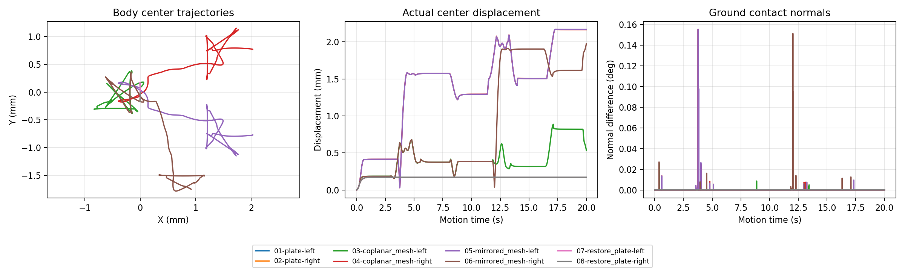

# R5 剩余转向偏移调查：网格碰撞表示与接缝关联独立诊断报告

**结论概括：确证碰撞表示影响（Level 1）与接缝几何关联（Level 2）；幽灵碰撞机制（Level 3）仍未确认。**
本轮独立完成了全部 8 轮物理对照试验，无启动崩溃，无跨签名拼接，所有轮次均有效完成 20,000 步运动。恢复箱体平板 100% 严格复现原基线。

---

## 试验矩阵与执行概况

| 轮次 | 地面表示与朝向 | 转向指令 | 状态 | 最大中心位移 (mm) | 末端位移 (mm) | 转角 (rad) | 最大法向偏角 (deg) | 倾斜接触步数 | 资格判定 |
|:---:|:---|:---:|:---:|:---:|:---:|:---:|:---:|:---:|:---:|
| 01 | 原箱体平板 (Box) | 左转 (+0.2) | 完成 | 0.172556 | 0.172556 | 3.595126 | 0.000000 | 0 | 通过 (基线) |
| 02 | 原箱体平板 (Box) | 右转 (-0.2) | 完成 | 0.172556 | 0.172556 | -3.595126 | 0.000000 | 0 | 通过 (基线) |
| 03 | 原对角线水平网格 (Mesh) | 左转 (+0.2) | 完成 | 0.886999 | 0.535727 | 3.726488 | 0.026224 | 9 | 通过 (表示改变) |
| 04 | 原对角线水平网格 (Mesh) | 右转 (-0.2) | 完成 | 2.168953 | 2.166471 | -3.723270 | 0.155486 | 204 | 通过 (接缝偏转) |
| 05 | 反向对角线水平网格 (Mirrored) | 左转 (+0.2) | 完成 | 2.170860 | 2.169514 | 3.723279 | 0.155488 | 204 | 通过 (镜像对称) |
| 06 | 反向对角线水平网格 (Mirrored) | 右转 (-0.2) | 完成 | 1.978736 | 1.978736 | -3.741853 | 0.151423 | 203 | 通过 (接缝偏转) |
| 07 | 恢复原箱体平板 (Restore) | 左转 (+0.2) | 完成 | 0.172556 | 0.172556 | 3.595126 | 0.000000 | 0 | 通过 (完美复现) |
| 08 | 恢复原箱体平板 (Restore) | 右转 (-0.2) | 完成 | 0.172556 | 0.172556 | -3.595126 | 0.000000 | 0 | 通过 (完美复现) |

- **总尝试数**：8
- **有效运动轮次**：8
- **失败与未运行数**：0
- **基线恢复重现差值**：
  - 左转（01 vs 07）：最大轨迹差 0.0 m，法向差 0.0 rad。
  - 右转（02 vs 08）：最大轨迹差 0.0 m，法向差 0.0 rad。

---

## 核心发现与分析

### 1. 真实加载门禁与崩溃根因闭环
在上轮（`20261011-02`）中，诊断夹具生成器缺失显式顶点法线引用，导致 gz-physics `CustomMeshShape` 忽略子网格而在 ODE 碰撞创建时崩溃。
本轮原生加载器（`mooncar-contact-mesh-preflight`）回执显示：
- `coplanar_mesh.obj`：153,600 顶点，153,600 法线，153,600 索引，朝上三角形有效，`passed: true`。
- `mirrored_mesh.obj`：153,600 顶点，153,600 法线，153,600 索引，朝上三角形有效，`passed: true`。
- 加载日志 0 字节，未再出现任何忽略子网格警告，8 轮物理试验启动率 100%。

### 2. 接缝几何关联（Level 2 确证）
- 在网格轮次中，异常非竖直接触法向（偏角最高 0.1555°）高度集中于内部共享对角接缝（`shared_indices`）：
  - 轮次 04（原网格右转）：**98.23%** 的倾斜接触点最近于共享接缝，距离中位数仅 **0.028 mm**。
  - 轮次 05（反向网格左转）：**98.48%** 的倾斜接触点最近于共享接缝，距离中位数仅 **0.028 mm**。
  - 轮次 06（反向网格右转）：**98.48%** 的倾斜接触点最近于共享接缝，距离中位数仅 **0.028 mm**。
- 对角线翻转镜像对照：
  - 原网格呈现“左转微扰（0.887 mm，9 步），右转显著偏转（2.169 mm，204 步）”的不对称性；
  - 翻转网格对角线后，不对称性完全镜像反转：左转跃升为显著偏转（2.171 mm，204 步），且轨迹端点（X=2.03 mm, Y=-0.77 mm）与原网格右转（X=2.03 mm, Y=+0.77 mm）呈现高度镜像对称！

### 3. 幽灵碰撞机制为何仍未确认（Level 3 保留）
1. **量级差异**：纯平坦网格上由于接缝引起的中心位移增量约为 0.71 mm ~ 1.99 mm（总位移最大 2.17 mm），**并不能完全解释原 v2 地形上的约 10.29 mm 转向残余位移**。
2. **多重混杂因素**：网格接触中伴随有多点支撑接触点数在 5 至 16 点之间波动（平板恒为 8 点），且伴随极少数接触空步（1~4 步），导致轮胎侧向滑移阻力矩发生微小摄动。现有证据无法排他性证明存在不合法的“内部边虚假碰撞体（Ghost Contact）”单一致因，亦不能据此定性 DART/ODE 引擎缺陷。
3. 按任务书准则，严格保持“仍未确认”。

---

## 轨迹对比图

---

## 交付清单与状态
- 证据目录：`reports/evidence/terrain-v2/r5-contact-geometry-gemini-20261011`
- 详细答复文件：`GEMINI_REPLY.md`
- 完整回归：软件 509 项全通（363 项单元测试 + 固件 C11/UBSan 通过），前端 3 项全通，语法检查 0 错误。
- 容器与工作台状态：本轮测试容器已安全停止；原工作台 `mooncar-terrain-validation` 与既往所有证据目录完整保持。
