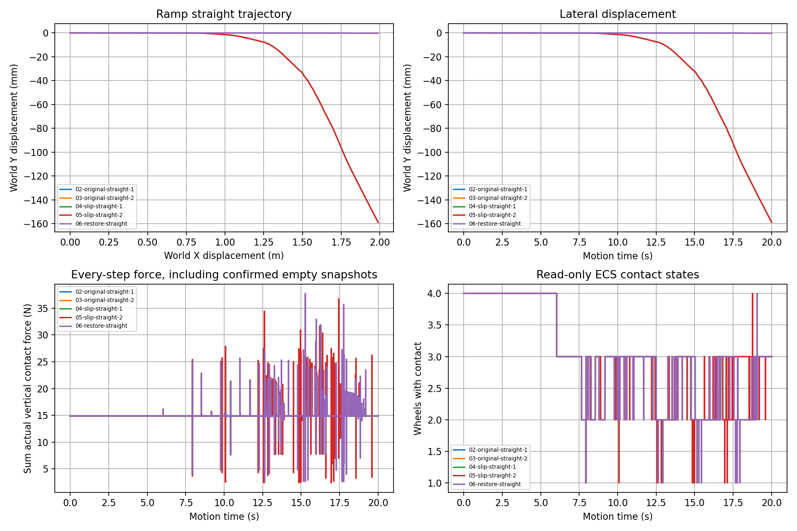

# R5 坡道横移与接触源对照，2026-10-11

**六轮独立诊断全部合格，确认本次坡道直行的15.9 cm横移由持续启用固定侧向滑移模型引起；本轮没有实施新的车辆修复。** 原接触模型两轮横移均为−0.155567 mm，固定WheelSlip10/0两轮均为−158.886082 mm，恢复原接触后再次回到−0.155567 mm。输入时长、轮速目标积分差均为0，前后轴分配模块全程未介入。质量、惯量、摩擦、几何、地形、DART、安全中继和D=0候选保持不变，唯一物理差异为此前用户允许在测试副本中添加的WheelSlip开关。正式模型与默认配置未修改。

| 阶段 | 次数 | X前进 | Y横移 |
|---|---:|---:|---:|
| 原接触静置 | 1 | 约2e−14 m | 约2e−17 m |
| 原接触直行 | 2 | 1.988867678 m | −0.000155567 m |
| 固定滑移直行 | 2 | 1.988866361 m | −0.158886082 m |
| 恢复原接触直行 | 1 | 1.988867678 m | −0.000155567 m |

各轮使用新建的独立Jazzy容器，4 CPU、6 GiB、512 MiB shm、ROS95、LOCALHOST，无网页端口；每轮重建坡道v2，独立partition，1 ms步长，沿用静置5秒、运动20秒、停车3秒及原加减速过程。预算6次、每轮10分钟，实际6次；首次仿真前冻结，之后没有改执行代码或补跑。原接触和恢复模型哈希一致，固定滑移模型与上一轮候选哈希一致；保留同一个驱动模块与相同观察条件。

## 接触空档已经区分

新增只读ECS观察插件，逐步读取四轮碰撞的`ContactSensorData`，不创建或修改组件，不施力、不发布控制。每个物理步明确记录“组件缺失/未知、存在但空、存在接触”，有接触时保存碰撞ID、实际点、法向、深度和双方力；空状态的点和力写为不可用值，不伪造零测量。日志使用8192项有界队列和独立写线程，溢出/写盘失败使轮次失败；真实暂停后排空、flush，核对迭代及选中/写入计数。

本轮每个车轮28,000步完整，碰撞及点/力关联、暂停及排空确认全部通过。逐步源中所有有接触的时间戳都在原生接触接收记录里找到：六轮的源有接触但消息未接收计数均为0，消息在源无接触时收到的计数也均为0。固定滑移直行的前右轮在11.232～22.249秒连续11.017秒明确无接触；相邻有接触消息间隔11.019秒。因此**本轮长空档是无接触时不发布消息，不是接收器漏记**。这不回填或改判上一轮失败，也不证明其他环境永不漏收。

冻结版本Gazebo的接触系统只在接触集合非空时发布；物理系统在没有接触时清空ECS组件。本轮独立实际观测与该行为相符。[Contact.cc](https://raw.githubusercontent.com/gazebosim/gz-sim/gz-sim8_8.15.0/src/systems/contact/Contact.cc)、[Physics.cc](https://raw.githubusercontent.com/gazebosim/gz-sim/gz-sim8_8.15.0/src/systems/physics/Physics.cc)。原生话题有空档时不再直接判定接触资料丢失，改用更完整的逐步源资格；缺组件、漏步或力资料缺失仍失败，原生消息及旧话题资格结果另行保留。

静态每步完整接触力的垂直分量总和与模型重量14.88132 N相差约3.12e−7的相对量，支持实际力方向及单位解释。运动中部分轮子真实卸载，两种接触配置都存在这一现象；不能把收到消息时的条件平均力相加当作整车载荷。基于实际接触点与完整轮姿态计算的滑动、力和柔顺度关系见 `round-metrics.json`。不平地形的有限差分关系残差约1.1～9.4 mm/s，未作为验收门槛，也不能宣称该模型已符合真实月壤。

## 对转向修复的意义

以前的平地结果仍成立：测试副本的固定滑移将原约31 cm转向偏移降至约1.25 cm，进一步前后轴分配降至约0.173 mm。但持续启用这种侧向柔顺会使坡道直行产生横移。本轮证明该副作用，尚未验证消除副作用的候选。

下一项唯一候选应按真实原驱动目标选择：纯原地转向保持已测的10/0滑移与轴分配，直行及其他命令关闭侧向柔顺。系数、质量、摩擦及地形不扫描，不能输入真值补偿位移。必须重新验证其实际生效、原地转向残余、直行横移、停车、步长与三个v2场景；未完成前不发布正式默认配置。轮式里程计与实际转角跟踪仍另行登记，不宣布整车通过。

## 回归与保存

10项专项检查、完整463项软件检查、前端3项测试、5项语法、210项Python解析、Bash语法与严格C11/UBSan固件检查通过。物理性能与回归分开运行。逐轮运行速度、CPU、内存及证据大小见 `round-metrics.json`，外部15秒采样见 `performance.jsonl`。镜像、源码、模型、70项资源和实际加载库哈希、逐轮判定及所有原始数据独立归档；90项实际安装文件已核验并保存快照。大体积CSV、JSONL、图片及结果原件保留本地，不提交。

本轮只关闭自己的容器，原工作台未改变；原447个文件保留，见 `preservation.json`。真实完成次数、因果判定与不变签名见 `campaign/summary.json`，归档与关闭状态见 `archive-verification.json` 和 `closure.json`。本轮提交只包含诊断工具、回归及小体积报告，下一修复使用新签名和新目录。
