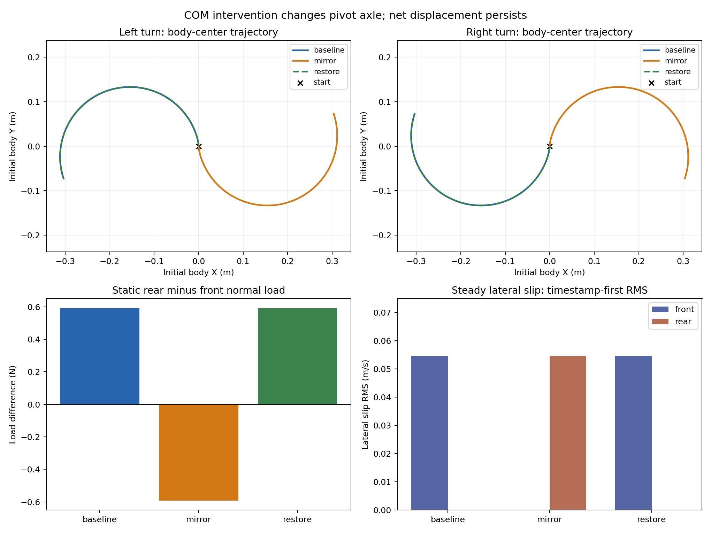

# R5 质心、载荷与转向支点：12 轮对照完成

## 结论

**确认：在当前 R5/DART 测试模型中，底盘惯性中心的前后位置会影响转动支点选择。** 原配置、质心镜像、恢复原配置的 12 次新仿真全部通过输入、采集及基本稳定性资格；没有补跑，也没有用旧轮次补数。

原配置后轴载荷较大，车体绕后轴附近转动，前轮侧滑；镜像后前轴载荷较大，支点移至前轴，后轮侧滑；恢复原配置后，原现象在左右转中均再次出现。所有动态轮次满足首次仿真前冻结的支点、载荷符号和侧滑分布预测。

**约 31 cm 的偏移仍存在，未验证消除偏移的修复。** 镜像仅改变支点所在车轴，不将支点移到车体中心。本轮不判定转向性能或整车通过，也未发布正式模型、控制、里程计或 DART 变更。

载荷解释获得强支持，但本次惯性中心改动也改变整车组合惯量，未单独拆分其动态影响；因此不声称静态载荷是唯一原因，不证明 DART 有缺陷，也不证明与实车一致。

## 单项干预与冻结

保持原 D=0 候选：P=20、I=0.1、D=0，两轴积分限幅 ±1 N·m、力矩限幅 ±5 N·m；物理步长固定 1 ms。继续使用桥接发送段 8 MiB、接收端自有段 512 KiB 的正式图片运行组件。公共接口、相机、QoS、安全中继、摩擦、地形和自主策略不变。

测试 SDF 仅修改合并底盘 `base_footprint/inertial/pose` 的 X 分量约 **+0.015434680135 m**。按初始关节位置解析完整 SDF 坐标图，整车质量 9.186 kg、初始整体质心从 `(-0.006237889179, 0, 0.127983317004)` m 镜像为 `(+0.006237889179, 0, 0.127983317004)` m。静置后实际质心与目标的最大三维差约 0.377 μm，低于 0.1 mm 门槛。

各连杆质量、各自质心处的惯量张量及方向，全部视觉、碰撞、关节、控制和传感器定义保持一致。整车组合惯量关于整体质心的变化记录在 `mass-models/manifest.json`：Iyy、Izz 各变化约 −0.000790217036 kg·m²，Ixz 变化约 −0.001163753602 kg·m²；Ixx 仅有浮点求和舍入差。此分布属于工程诊断假设，不代表真实电池移动或安装优化。

ROS robot_state_publisher 的三个伴随 URDF 完全相同，只提供原有运动学坐标；惯性干预仅施加于 Gazebo 的 SDF。恢复 SDF 与原候选逐字节一致。

| 项目 | SHA-256 |
|---|---|
| 原候选、恢复 SDF | `7190fec8a878724a4b5096b6cae0d5492d5e968c485948d8d93241375c4e5aca` |
| 镜像 SDF | `e636b7872ad7781d3e3d282e90b2c4217d8cacbf203561973e1860c351e9c67a` |
| DART 修复库 | `cfe9b7c6bf72c204645df81f1be7bc646ffbd342acea52c0684a1ad24848274c` |
| 原只读逐步观察库 | `97cdf9ddc83922ad56bcc93d8990bcb529c691399d624395dbe5451f718455a7` |

首次仿真前冻结执行源码、实际安装文件、测试模型、只读观察器、镜像、最小 RMW 运行组件及 70 项资源。逐轮及结束核验均一致。镜像为 `mooncar-terrain:r5-image-dds-20261008`，ID `sha256:f819df21c8584f8a3d1eee315106779e9b380f10cf43fdc8b7aa15c6bdec6ee3`；独立容器 4 CPU、6 GiB、512 MiB shm、ROS95、LOCALHOST，无网页端口，每轮唯一 partition 和新平地世界。

## 新轮次与实际结果

所有轮次为静置 5 秒、运动窗口 20 秒、停车 3 秒。转向零线速度、角速度 ±0.2 rad/s；零命令轮全程为零。静态载荷窗口为运动前最后 3 秒，稳态窗口为运动开始后第 3 秒至结束前第 1 秒。接触点速度先在每轮、每个源时间戳内平均，再计算时间 RMS，不按接触点数量加权。

| 配置 | 静态前轴载荷 N | 静态后轴载荷 N | 支点 X m | 前轴侧滑 RMS m/s | 后轴侧滑 RMS m/s |
|---|---:|---:|---:|---:|---:|
| 原配置 | 7.145028 | 7.736288 | −0.157000 | 0.054561 | 0.000005 |
| 镜像 | 7.736288 | 7.145029 | +0.157000 | 0.000005 | 0.054561 |
| 恢复 | 7.145028 | 7.736288 | −0.157000 | 0.054561 | 0.000005 |

前后载荷差由后轴多约 0.591260 N 反向为前轴多约 0.591259 N，再恢复。总载荷约 14.881316 N，与 `9.186 × 1.62 = 14.881320 N` 一致。动态轮次支点计算的有效样本比例全部为 100%；零命令轮无可定义的转动支点，记录为缺失，不补零。

| 轮次 | 运动末端位移 m | 全程最大偏移 m | 实际转角 rad | 完整墙钟 s | 资格 |
|---|---:|---:|---:|---:|---|
| 01 原配置零命令 | 约 0 | 约 0 | 约 0 | 115.8 | 通过 |
| 02 原配置左转 1 | 0.312100 | 0.313143 | +3.457743 | 118.1 | 通过 |
| 03 原配置右转 1 | 0.312100 | 0.313143 | −3.457743 | 118.7 | 通过 |
| 04 原配置左转 2 | 0.312100 | 0.313143 | +3.457743 | 118.0 | 通过 |
| 05 原配置右转 2 | 0.312100 | 0.313143 | −3.457743 | 118.0 | 通过 |
| 06 镜像零命令 | 约 0 | 约 0 | 约 0 | 118.3 | 通过 |
| 07 镜像左转 1 | 0.312101 | 0.313139 | +3.457743 | 115.3 | 通过 |
| 08 镜像右转 1 | 0.312101 | 0.313139 | −3.457743 | 123.6 | 通过 |
| 09 镜像左转 2 | 0.312101 | 0.313139 | +3.457743 | 119.4 | 通过 |
| 10 镜像右转 2 | 0.312101 | 0.313139 | −3.457743 | 115.6 | 通过 |
| 11 恢复左转 | 0.312100 | 0.313143 | +3.457743 | 115.2 | 通过 |
| 12 恢复右转 | 0.312100 | 0.313143 | −3.457743 | 115.9 | 通过 |

“资格通过”仅表示输入、记录、静置和停车等门槛满足，不是偏移性能达标。两种配置同方向重复轨迹的最大差、末端差、转角差均为零；恢复与原基线同方向轨迹也逐样本一致。20 组同方向重复及跨阶段输入配对全部通过，轮速目标积分和运动时长没有超出原门槛。运动末端取 20 秒最后一个物理步，停车额外位移单独记录，转向轮约 0.002742 m；停车末秒移动均 ≤1 cm。

实际 ROS 轮式里程计及 Gazebo 原生里程计仍漏掉横移，转向位置误差约 0.312 m，航向误差约 0.522 rad（约 30°）。各源消息时间偏差保留，诊断对齐未反馈给控制器或规划器。此结论不把无侧滑轮式模型的误差当成已证明的软件计算错误。

## 完整性、性能、回归与停止

12 轮均保存 RGB、深度、激光、IMU、关节、云台力矩命令、轮速目标与实测、世界及原始相对姿态、四轮接触、两级速度和两种实际里程计。**684 份选定图片**可读取、有有效内容和完成回执；RGB/深度最大间隔均 1.1 秒。其余流、逐物理步、运动输入及原间隔门槛通过；暂停交界未裁切。实际暂停、末步、flush、接收尾部和队列排空全部通过。

接触位置、法向、深度、两侧力和碰撞归属逐条核对，以整数纳秒关联到物理步；缺失值拒绝补零。原生相对姿态变换与独立世界轮姿态共核对 **96048** 个轮位置。载荷采用轮所属碰撞的世界垂直作用力，原坐标/力方向契约与当前 DART 来源保持归档。

本轮专项 19 项通过。完整软件首次覆盖 389 项：386 通过、3 因固定预检路径未存在而跳过；将本轮新预检回执按兼容路径复制并核对后，边界、模型能力、实际模型回归分别 20/11/19 项全通过，补齐这 3 项，**389 个不同软件测试全部获得通过记录**，重复运行不重复计数。前端 3 项、JS 语法、固件 C11/UBSan、82 Python/5 shell 语法检查通过。

准备约 642.7 秒，低于 45 分钟；12 轮合计墙钟约 1411.9 秒，单轮最大 123.6 秒，均低于 10 分钟。实际 RTF 为 0.647～0.685，CPU 核均值为 3.416～3.633，cgroup 内存峰值约 2.615 GiB（包含缓存）。这些是同资源限制下的运行记录，不是性能优化对照。

准备阶段首次因未暂存预检需要的基准 SDF/URDF 失败，目录及日志保留在 `prepare-failure-01/`；在首次 Gazebo 前修正。伴随 TF URDF 补齐前的模型生成记录、工具检查，以及只读源码目录中的字节码输出失败说明均保留。语法检查改用独立缓存目录后通过。物理执行代码冻结后没有修改；离线汇总图仅调整图例留白，不改变任何验收判定。

新仿真恰好 12 次，全部取得有效记录，仿真失败零次，没有其他质心、摩擦或控制参数搜索。旧仿真结果和失败记录未覆盖，旧观察数据只用于冻结前工具检查。

## 交付与后续

`campaign/` 保存新矩阵、冻结源码、每轮模型、原始数据、暂停与 DDS 回执；各轮 `load-analysis/` 包含载荷/侧滑时间序列和图。`findings.json` 保存逐轮位移、路径长度、里程计误差、重复差异和性能；`decision.json` 单独区分因果确认与未修复状态。`mass-models/manifest.json` 保存单项差异、组合惯量和三个模型哈希。

独立入口为 `prepare_r5_load.sh`、`preflight_r5_load.py`、`run_r5_load_campaign.py` 和 `check_r5_load_round.py --mass-profile original|mirror_x`。在新同镜像容器挂载 `/source` 只读源码、`/evidence` 新目录后准备并运行；新目录需先保存镜像、容器和原 70 项资源哈希。准备入口依赖已归档的原只读观察二进制及基准模型，明确校验哈希；本提交未并入以前的其他未提交依赖，复现需完整冻结工作树或归档 overlay。

下一步适合先核实真实设备质量和安装位置，再另行制定滑移感知的定位与转向控制方案。不能把镜像质量分布直接发布，也不能仅调整轮式里程计宣称车体偏移消失。

本轮仅停止独立测试容器，保留原工作台身份与状态、全部原有文件和此前证据。工作日志及本轮提交只包含新增诊断工具、回归与小体积报告，原始大数据不并入提交。
