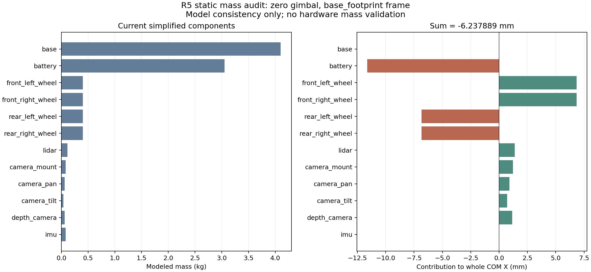

# R5 质量分布与质心审计

**结论：模型自洽，真实质量分布未确认。** 本轮没有新增 Gazebo 仿真，没有修改车辆、质心、控制、里程计或 DART。约 31 cm 转向偏移没有在本轮修复。

## 计算结果

当前源码重新展开的 URDF 与转换后的 SDF 均为 **9.186 kg**。云台和车轮关节归零，统一在 `base_footprint` 中计算整车质心：

`(-0.006237889179, 0.000000000000, 0.127983317004) m`。

整车质心由 `Σ(m_i × r_i) / Σm_i` 计算；每个部件的惯量先旋转到统一坐标，再用平行轴公式相加。URDF 独立求和与 SDF 固定关节合并结果交叉核对。

质量差 0 kg；质心最大轴差 2.78e-17 m；惯量最大项差 4.16e-17 kg·m²。分别低于 1e-6 kg、1e-6 m、1e-8 kg·m²。未发现该计算链路中的单位、坐标或固定关节合并错误。

合并后的 SDF `base_footprint` 质量为 7.425 kg，含多个原始固定连杆；不能把它再与原 URDF 底盘、电池等相加，否则会重复计重。

电池对质心 X 的贡献约 −11.621 mm；雷达、云台及相机的向前贡献抵消一部分，四轮前后贡献在当前对称假设下互相抵消，最终为 −6.238 mm。贡献取决于当前原点和假设参数，不是实测分布。

## 逐部件依据

| 部件 | 质量 kg | 质量依据 | 局部质心 / 安装 / 惯量依据 | 质心位置（车体坐标）m | X贡献 mm | 来源 |
|---|---:|---|---|---|---:|---|
| base_link | 4.100 | 工程假设 | 工程假设 / 工程假设 / 工程假设 | (0.0, 0.0, 0.1) | 0.000000 | model, procurement, invalid-r5-fetch |
| battery_link | 3.050 | 厂家标称 | 工程假设 / 工程假设 / 工程假设 | (-0.035, 0.0, 0.188) | -11.620945 | battery-manual |
| front_left_wheel_link | 0.400 | 工程假设 | 工程假设 / 工程假设 / 工程假设 | (0.157, 0.16555, 0.076) | 6.836490 | model, description |
| front_right_wheel_link | 0.400 | 工程假设 | 工程假设 / 工程假设 / 工程假设 | (0.157, -0.16555, 0.076) | 6.836490 | model, description |
| rear_left_wheel_link | 0.400 | 工程假设 | 工程假设 / 工程假设 / 工程假设 | (-0.157, 0.16555, 0.076) | -6.836490 | model, description |
| rear_right_wheel_link | 0.400 | 工程假设 | 工程假设 / 工程假设 / 工程假设 | (-0.157, -0.16555, 0.076) | -6.836490 | model, description |
| lidar_link | 0.115 | 厂家标称 | 工程假设 / 工程假设 / 工程假设 | (0.11, 0.0, 0.16065) | 1.377096 | s3-snapshot |
| camera_mount_link | 0.080 | 工程假设 | 工程假设 / 工程假设 / 工程假设 | (0.14, 0.0, 0.14) | 1.219247 | model, gaps |
| camera_pan_link | 0.060 | 工程假设 | 工程假设 / 工程假设 / 工程假设 | (0.14, 0.0, 0.17) | 0.914435 | model, gaps |
| camera_tilt_link | 0.040 | 工程假设 | 工程假设 / 工程假设 / 工程假设 | (0.165, 0.0, 0.18) | 0.718485 | model, gaps |
| depth_camera_link | 0.061 | 厂家标称 | 工程假设 / 工程假设 / 工程假设 | (0.17375, 0.0, 0.18) | 1.153794 | oak-record |
| imu_link | 0.080 | 工程假设 | 工程假设 / 工程假设 / 工程假设 | (0.0, 0.0, 0.1575) | 0.000000 | model, gaps |

所有零件的局部质心及惯量目前均采用均匀盒体/圆柱近似；安装位置均缺实物装配确认。雷达和相机的厂家外形不证明内部质量均匀。

- 裸底盘 5.7 kg 在采购文档中以条件估计出现；未找到对应四驱版本、说明重量包含范围的可靠厂家原表。模型把它拆成车体 4.1 kg、四轮各 0.4 kg，没有分件称重依据。电机、减速箱、编码器在模型中被整体抽象，具体质量归属仍未闭合。
- P7120S 3.05 kg 有归档原手册第 12 页支持；局部质心放在均匀盒体中心、装车 joint 位置 `(-0.035,0,0.088) m` 均为假设。这个 joint 的坐标系是 `base_link`，换到 `base_footprint` 后电池质心 Z 为 0.188 m，不是 0.088 m。
- S3 的 115 g 来自 2026-10-01 官方页面快照，当前网页提取未再次提供该项。OAK 61 g 来自此前官方店铺核验转录，原始店铺抓取失败，可信度弱于原始原表；当前页面提取未重新确认质量。
- 采购记录 SKU 21545 写“该销售版本无 IMU”，当前官方 OAK 页面写 BMI270。版本差异尚未闭合，不能把 61 g 当作已称重的采购版本，也不能因此取消独立 SEN0374。
- 云台结构 0.08/0.06/0.04 kg 共 0.18 kg、IMU 0.08 kg 均为工程值；采购表没有云台执行器。

## 采购与遗漏清单

以下覆盖当前采购 01–20 项，套装中的车载件与外置充电器、桌面电源、调试器分开说明。缺失质量保持空值，不作为零；“独立建模”也不代表该套装所有附件已计入。

| 编号 | 部件 | 模型状态 | 核对结果 |
|---|---|---|---|
| 01 | R5 四驱底盘；霍尔编码器／24V／27减速比；不含电池 | 归属待确认 | Chassis and four wheels modeled using assumed split. Motors/gearboxes/encoders are abstracted into bare chassis; vendor 5.7 kg inclusion and boards not confirmed. |
| 02 | 轮趣 P7120S 12Ah 磷酸铁锂电池＋原厂匹配充电器 | 独立建模 | Battery 3.05 kg body modeled; charger is external and excluded from vehicle mass. |
| 03 | 轮趣 C50C 有刷控制板；不含驱动板，含配套OLED | 归属待确认 | C50C and bundled OLED have no independent mass links; bare-chassis estimate may/may not include them. Do not add before inclusion is checked. |
| 04 | 轮趣 D50A 双路驱动；12.8A／4层PCB／防反接版 | 归属待确认 | Two D50A boards have no independent mass links; bare-chassis inclusion unknown. |
| 05 | 树莓派 5 8GB；DFR1119 | 未建模 | Pi 5 populated board, not modeled; mass and mounting unknown. |
| 06 | 微雪 Pi 5 基础配件包；SKU 26258 | 未建模 | Package contains case/cooler/card potentially onboard plus reader/desktop supply/cables offboard; split assembly inventory before counting. |
| 07 | RPLIDAR S3 套装；DFR1097 | 独立建模 | S3 body only; kit USB adapter, wiring and mounts not fully accounted. |
| 08 | OAK-D-Lite；微雪 SKU 21545 | 独立建模 | Camera body only; actual variant, cable and mounting hardware need confirmation. |
| 09 | BNO055 九轴 IMU；SEN0374 | 独立建模 | SEN0374 separate IMU, mass 80 g is assumption, not OAK internal IMU. |
| 10 | TFmini Plus 近距测距；SEN0309 | 未建模 | Four TFmini Plus: 12 g each nominal, total 48 g; positions and bracket/wiring mass absent. |
| 11 | 明纬 DDR-60G-5；9-36V输入／5V 10.8A输出 | 未建模 | DDR-60G-5 DC/DC power supply and mounting not modeled. |
| 12 | 微雪 USB 3.2 Gen1 HUB HAT；SKU 17584 | 未建模 | HUB HAT and mounting not modeled. |
| 13 | Gravity ±50A 电流模块；SEN0098-V2 | 未建模 | Current sensor and signal conditioning not modeled. |
| 14 | 施耐德 XB2BS542C 急停按钮；1NC／旋转复位 | 未建模 | Emergency-stop button and panel not modeled. |
| 15 | TE EV200AAANA 直流接触器；线圈9-36V | 未建模 | EV200 contactor, bracket and wiring not modeled. |
| 16 | STLINK-V3MINIE 调试器；微雪 SKU 22943 | 未建模 | STLINK is a bench tool, not counted onboard unless future assembly inventory specifies permanent installation. |
| 17 | 配电安全包 | 未建模 | Distribution/fuse/enable/conditioning bundle: quantities and installed mass not frozen; avoid recounting items 14/15. |
| 18 | 动力与信号线束 | 未建模 | Power and signal harnesses absent; no zero-mass assumption. |
| 19 | USB与供电线 | 未建模 | USB and power cable bundle absent; bundled kit cables must not be counted twice. |
| 20 | 安装与整套装配 | 归属待确认 | Real mounting structures not frozen. Model has hypothetical gimbal 180 g, not proof that physical assembly hardware is included. |

四个 TFmini 的名义模块质量共 48 g，尚未入模；安装位置和支架/线束质量缺失。其余遗漏器件总质量未知，不能据此算出完整实车总质量或质心误差范围。C50C、D50A 是否包含于所谓裸底盘重量不明，既不能默认已计入，也不能盲目另加导致重复。

## 参数敏感度与测量优先级

`result/components.csv` 和 `result/audit.json` 保存每个部件的三轴结果。质量敏感度为 `(r_i−C)/M`，按增加 1 g 报告；平移敏感度为 `m_i/M`，按该部件单独沿车体坐标轴移动 1 mm 报告，不联动子部件，不改变模型。它们是局部导数，不是有限改动实验，也不是物理误差界限。

以当前电池为例，单独向前移动 1 mm 会使整车质心 X 移动约 0.332 mm；增加 1 g 电池质量对应质心 X 导数约 −0.00313 mm。没有执行这些变更。未知部件无法按实际质量排序，以下优先级按现有影响和缺失范围制定。

1. **裸底盘总质量及质量范围**：Confirm exact R5 24V/27 four-wheel version, packing list; weigh chassis with documented wheels/motors/gearboxes/boards inclusion; weigh each wheel and remaining body. 5.7 kg dominates modeled mass, split and inclusion lack evidence.
2. **电池安装与局部质心**：Verify P7120S variant and weigh battery without charger; measure pose relative to base_footprint/axle midpoint; obtain CAD or balance-based local COM. Preserve uncertainty. 3.05 kg, about one third of model mass; mount is assumed.
3. **车载 BOM 与遗漏部件**：Separate onboard/offboard/bundled items; weigh electronics, power/safety components, cables, brackets, four TFmini; record mounting XYZ and ownership to avoid double counts. Unknown omitted masses cannot be bounded or set to zero; ordering is provisional.
4. **云台与 IMU**：Decide actual gimbal architecture; weigh complete actuator/brackets/camera assembly and SEN0374; record mounts and density/centroid data. 180 g gimbal and 80 g IMU are engineering values.
5. **独立整车载荷核对**：After fixed assembly, record total weight and per-wheel/front-rear static loads on level surface, axle geometry and device condition; derive horizontal COM with uncertainty. Do not infer vertical COM from level loads alone. Independent closure check against component-derived COM; real measured loads are Earth-gravity observations, not lunar simulation validation.

## 来源、复现与判定限制

新容器只做 xacro、SDF 转换、静态审计与软件检查；源目录及同级硬件资料只读挂载。`models/` 是当前源码新展开结果，`catalog-ready/` 为本轮来源快照及哈希，`result/` 保存完整数值、逐部件位姿链、来源分类和敏感度。没有用旧模型替代本轮展开。

独立入口：`audit_r5_mass.py --urdf ... --sdf ... --catalog ... --output 新目录`；输出目录已存在时拒绝覆盖，来源快照必须通过哈希核验。`prepare_r5_mass_audit.sh` 在独立 Jazzy 容器生成模型和来源；报告脚本只读审计结果。需要同级 MoonCar 采购资料及冻结工作树，单个本轮提交不包含以前的其他未提交依赖。

| 来源 ID | 日期 / 版本 | 定位 / 限制 | SHA-256 |
|---|---|---|---|
| model | 未注明 / current working tree | R5-MASS / MOUNTS / GIMBAL / UNMODELED-PAYLOAD | `b1a2c00d23730e50b9d2956eae2460d77e603ca1728b6d86234755d49b192cd7` |
| inertial-macros | 未注明 / current working tree | box_inertial / cylinder_inertial | `96fbba6291f631f0b83fd97068ff015fbf2eb14e8dc35462140573dd6fd8add1` |
| description | 2026-10-02 / R5 proposal | R5 proposal model | `75447f9ab65054bd89ac87ef56674a7c2543beb85ca31823b970d133e223a504` |
| gaps | 2026-10-02 / hardware gap audit | R5-MASS / MOUNTS / GIMBAL | `4cfe5f49e08978f3a822204453944d6d7ee54b8d07b0add9091204181ca19f97` |
| procurement | 2026-09-08 / v2, proposed, not frozen or purchased | 20 rows; size/weight clause 72 | `813af419e5996b8703c3361441c46d7281fc358ea7a41d2b5fb4c0d0dc22acfc` |
| selection-history | 2026-09-08 / historical drivetrain route, withdrawn as procurement mainline | 8 kg goal / alternative motors, not current R5 | `5cc8345fdf3fca89320ecfd4a3444487e2290b16297085d4ee49db8f10eca7ac` |
| battery-manual | 未注明 / archived WHEELTEC 24 V manual, revision not printed in reviewed table | PDF page 12, P7120S column, dimensions and weight; visually checked | `29d61c232052dace7349b435a29070142d4290eb21476f4cf060e00928340f78` |
| s3-snapshot | 2026-10-01 / official page snapshot; current live parser omits dimensions | lines 107-109: 115 g, 55.6 x 55.6 x 41.3 mm | `c477ad4aedcebffe74f31705053b2fa9445b5dc43c2918febd305bd2a42c598c` |
| oak-record | 2026-10-01 / reviewer transcription, raw store fetch 429 retained previously | manufacturer_values.mass_g=61; dimensions_mm; weaker than original raw snapshot | `ad0089b3d682a77b69674cb7fda5166244282494846350aa7d42c46701ca3671` |
| invalid-r5-fetch | 2026-10-02 / homepage response, rejected as R5 specification evidence | no valid corresponding R5 mass breakdown | `4a39f496c3da6bae467dc038480794081b2216ed569f48115573175eda955cce` |
| excluded-r550 | 2026-10-02 / R550 educational robot; not selected R5 | excluded vehicle identity | `db58bae48f345a9c414d63be34aa115a8e903534ee9dd077139f57c34c2a541a` |
| pi-mechanical | 未注明 / archived official mechanical drawing | page 1; dimensions do not establish populated mass/installation | `5dd680d6c1f5e7aa9c7b020695e315d04aac862df82ff01d4e9041cd0668d7f2` |
| live-check | 未注明 / current page extraction; no hidden content guessed | records | `64ed8dedb55bd67f634387d04b439f89bdf69ba3ec37589d0a3b773149044b65` |

来源冲突与不同方案保留在 `result/audit.json`，不平均：旧 8 kg 整备目标不是新实测值；历史分买电机路线不计入当前 R5；R550 资料与普通京东首页不适用于所选 R5，已排除。

当前结果只证明简化模型的质量计算一致。没有完整实物数据，不能判定实际质心准确，也不能把“质心影响支点”改写成“质心设置错误”。未生成修复候选，未消除 31 cm 偏移，未判定转向或整车通过。

`measurement-template.csv` 提供后续装配、称重和坐标记录空表；所有未测字段保持空白。软件检查、原文件保留及容器结束记录见 `completion.json`；工作日志保存本轮结论和后续测量任务。
