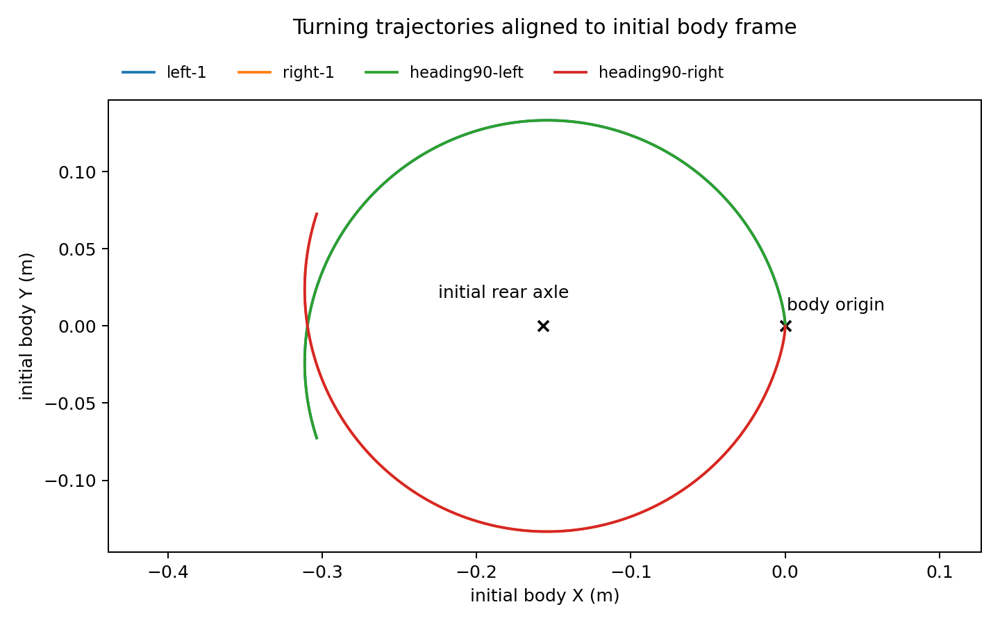

# R5 原地转向偏移：八轮诊断有效，未达到软件修复条件

## 结论

约 31 cm 是车体原点在转向期间的真实水平位移，不是不同步长之间的差异，也不是坐标解析制造的位移。本轮新建世界的八次实验全部满足输入与采集资格；左右转均复现约 **0.312100 m** 末端位移，全程最大偏移约 **0.313143 m**。这些“有效”判定不代表转向性能或整车通过。

直接观测到的运动机制是：**车体绕后轴附近转动，前轮明显横向滑动，后轮横向滑动接近零。** 稳态转动中心在车体坐标中约为 `(-0.157000, ±0.000014) m`，对应原后轴位置；车体中心轨迹拟合半径约 0.156879 m。

因果根因未确认，最小修复未验证。前后载荷差、质心位置和现有摩擦/接触模型共同作用是有数据支持的解释，但没有单项 A/B/A 对照证明它，也没有发现可证实的驱动、模型定义或 DART 软件错误。按计划在八轮基线后停止：修复候选、恢复对照、DART 补丁和额外步长实验均为零次，22 次上限仍有 14 次未使用。没有通过调整质量、惯量、摩擦或控制参数追求偏移变小。

## 证据

- 车体原点位于四轮几何中心的水平投影，四轮中心高度约 0.076 m；整体质量 9.186 kg，质心向后约 6.238 mm。原点和质心是不同概念，没有移动原点。
- 四轮目标速度与实际速度在稳态的最大误差约 `9e-11 rad/s`。左右轮及前后轮方向、连续输入、原加减速和停车零命令均正常；运动输入实际持续 20 秒。
- 左转稳态车体横向速度约 0.027280 m/s，实际角速度约 0.173760 rad/s；右转镜像。接触点速度由逐步世界姿态差分与真实接触位置计算，前轮横向约 0.05456 m/s，后轮约 `±5e-6 m/s`，不是人为设为零。
- 左转前轮法向载荷合计约 7.161629 N，后轮约 7.719691 N，总计 14.881320 N，与 `9.186 × 1.62` 一致。前轮沿第一摩擦方向的接触力/法向载荷比约 0.1995，后轮约 0.1870。这是接触状态证据，不单独证明容量、后端或某个参数有缺陷。
- 第一摩擦方向在车体坐标中为 `(0,-1,0)`；DART 默认方向参考 ShapeFrame 的接口定义、gz-physics 世界接触力/位置契约及转换代码已归档。保留原摩擦数值与定义。
- 初始朝向改为 +90° 后，将轨迹变换回初始车体坐标，与零朝向对应轨迹的最大差约 `5.49e-8 m`；同方向两次重复轨迹差为零。这支持偏移跟随车体，未发现世界方向导致的明显差异；不是不同步长验收。
- PosePublisher 的连杆消息明确以 `mooncar` 为父坐标系。变换后的轮心世界位置与独立 ECM 世界姿态观测一致，误差约 `2.3e-16 m`，旧相对消息原样保留。
- 停车阶段额外位移约 0.002742 m，与运动 20 秒末端位移分别记录；停车末秒移动不超过 1 cm，两级输入保持零。

## 里程计影响

实际 ROS 轮式里程计与 Gazebo 原生轮式里程计都记录近零横移，未能描述真实的约 31 cm 横向位移；与对应时间的真值比较，转向位置误差约 0.312 m，航向误差约 0.52 rad（约 30°）。直行约 1.989950 m，两种里程计与真值基本一致。

里程计数值来自实际消息，保留发布时间戳、坐标系和接收时间。只做诊断时的刚体坐标对齐；源报告保存端点附近实际消息的时间偏差（约 −6 ms / +28 ms），没有补造运动结束时的里程计消息。车体运动末端统一采用第 20 秒最后一个物理步。真值没有进入控制器、里程计或规划器。

轮式里程计依赖无侧滑运动假设，这里的偏差不能仅凭现象认定为其计算代码错误。影响包括转向时的障碍扫掠范围扩大及轮式定位误差；没有进行自主策略或建图精度验收。

## 新轮次、采集与性能

| 轮次 | 末端位移 m | 全程最大 m | 实际转角 rad | 完整墙钟 s | RTF | CPU 核均值 | cgroup 峰值 GiB | 输入/记录 |
|---|---:|---:|---:|---:|---:|---:|---:|---|
| 01-zero | 0.000000 | 0.000000 | 0.000000 | 121.0 | 0.477 | 3.77 | 1.85 | 有效 |
| 02-straight | 1.989950 | 1.989950 | -0.000000 | 111.7 | 0.525 | 3.73 | 1.93 | 有效 |
| 03-left-1 | 0.312100 | 0.313143 | 3.457743 | 117.2 | 0.510 | 3.74 | 1.97 | 有效 |
| 04-right-1 | 0.312100 | 0.313143 | -3.457743 | 112.7 | 0.505 | 3.74 | 2.04 | 有效 |
| 05-left-2 | 0.312100 | 0.313143 | 3.457743 | 113.6 | 0.531 | 3.73 | 2.10 | 有效 |
| 06-right-2 | 0.312100 | 0.313143 | -3.457743 | 124.5 | 0.498 | 3.36 | 2.18 | 有效 |
| 07-heading90-left | 0.312100 | 0.313143 | 3.457743 | 105.6 | 0.538 | 3.73 | 2.26 | 有效 |
| 08-heading90-right | 0.312100 | 0.313143 | -3.457743 | 97.2 | 0.630 | 3.65 | 2.32 | 有效 |

左右转各两次的实际输入时长、轮速目标积分距离差和转角差均为零，满足 1 ms、1 mm、0.002 rad 门槛。每轮运动 20000 个物理步；完整 CSV 无漏步。RGB/深度、激光、IMU、关节、姿态、安全速度间隔及暂停边界全部按原门槛核验，**460 份选定图片**可读取、有有效内容和完成回执。实际暂停、末步、flush、接收尾部及队列排空均通过。

自有段归属、桥接发送段 8 MiB、接收段 512 KiB和环境隔离全部通过。继续加载最小 RMW 8.4.4、原 Fast DDS 2.14.6及已验收 DART 7.8.0修复库。诊断平地夹具调用正式桥接组件；不把它冒充正式 launch 或三个 v2 场景验收。

零命令轮复用原 drive 夹具，原有“直行至少 1 m”条件不适用；`raw_fixture_passed=false` 和原 stdout 保留。首次仿真前已准备独立零命令资格检查，实际零命令位移约 `2e-14 m`，静置、姿态、接触、停车及数据门槛均有效，没有裁切失败窗口。

RTF/CPU来自既有观测窗口口径，墙钟包含启动、排空、检查及分析；cgroup 内存包含缓存。逐步增加世界姿态与接触诊断有开销，未开展关闭观察器的性能对照，不能用这些数值证明性能改善。每轮完整墙钟均低于 600 秒，准备与构建约 16 分钟，低于 45 分钟上限。

## 实现、回归与复现

新增独立 `check_r5_origin_round.py`、`run_r5_origin_campaign.py`、`preflight_r5_origin.py`、ROS/原生里程计记录和只读世界姿态/质心观察插件。两级速度仍走原 ROS 发布器、安全中继、桥接和 DiffDrive；正式话题、launch 参数、网页 API 和控制默认值未变。

正式执行源码、实际安装文件、镜像、D=0 模型、70 项资源、库及观察插件在首次仿真前冻结；逐轮及结束检查一致。D=0 SDF 哈希仍为 `7190fec8a878724a4b5096b6cae0d5492d5e968c485948d8d93241375c4e5aca`；DART 库仍为 `cfe9b7c6bf72c204645df81f1be7bc646ffbd342acea52c0684a1ad24848274c`。各轮输出使用新目录，不覆盖旧结果。

复现须在同镜像构建当前冻结工作树的 overlay，并设置 `/source` 只读源码、`/evidence` 新目录、`/work` 独立工作目录；按 `preflight_r5_origin.py` 校验、创建独立 D=0 候选和观察二进制后，执行：

```bash
python3 /source/scripts/run_r5_origin_campaign.py --output /evidence/campaign
python3 /evidence/derive_origin_evidence.py --evidence /evidence
```

本提交只包含本轮文件，已有未提交依赖和场景资源没有并入；完整测试针对本次冻结工作树。独立入口默认只完成八轮基线并等待证据决策，不自动扩大参数搜索；本次 `decision.json` 明确禁止进入没有具体错误和冻结预测的候选阶段。

回归覆盖世界/相对坐标、四元数、航向跨 ±π、重复输入配对、接触空档/缺失力与真实零值、整数纳秒、候选前提及既有暂停、flush、排空、停止规则。软件 **365 项通过、5 项明确跳过**，覆盖370项（7 控制、10 导航、129 地形、224 Gazebo），前端 3 项、固件 UBSan、82 Python/4 shell 语法检查通过。新增本轮专项 16 项全通过。

准备中的 apt 名称、PYTHONPATH及基线文件暂存失败保留；均发生在 Gazebo 前。物理实验结束后，离线关联工具先因作用域名称、随后因浮点检索跨到下一步失败；修正为显式 `mooncar::` 名称、父坐标核验和整数纳秒关联，失败源码、日志及部分 CSV保留，没有修改观察器或补跑仿真。首次软件回归因未加载 overlay 找不到包，日志保留，正确环境下复跑通过。

## 归档与停止

- `campaign/`：八轮世界、配置、原始传感器/接触/关节/力矩/姿态/两级命令/两种实际里程计，逐轮结果与源快照、冻结哈希；每轮 `origin-analysis/` 含轨迹、接触点滑动 CSV 和图像。
- `findings.json`、`decision.json`：逐轮量化和停止决定；`turn-comparison.png` 为轨迹对照。
- `source-audit/`、`origin-preflight.json`、`overlay.tar.gz`、`environment-packages.txt`、`image.json`：来源、环境与实际安装；准备、回归和离线分析失败均保留。
- `preservation-check.json`：163 项原有非证据文件哈希及原工作台身份/状态不变；旧证据只读，没有复用旧轮次。

本轮未修复车体偏移，未确认其因果根因，未发布车辆、云台或 DART 默认变更。下一步需要先决定如何独立验证载荷/接触机制，以及是否允许滑移建模或转向补偿；本轮不代替该决策。仅关闭本轮测试容器，保留原工作台和旧证据。


