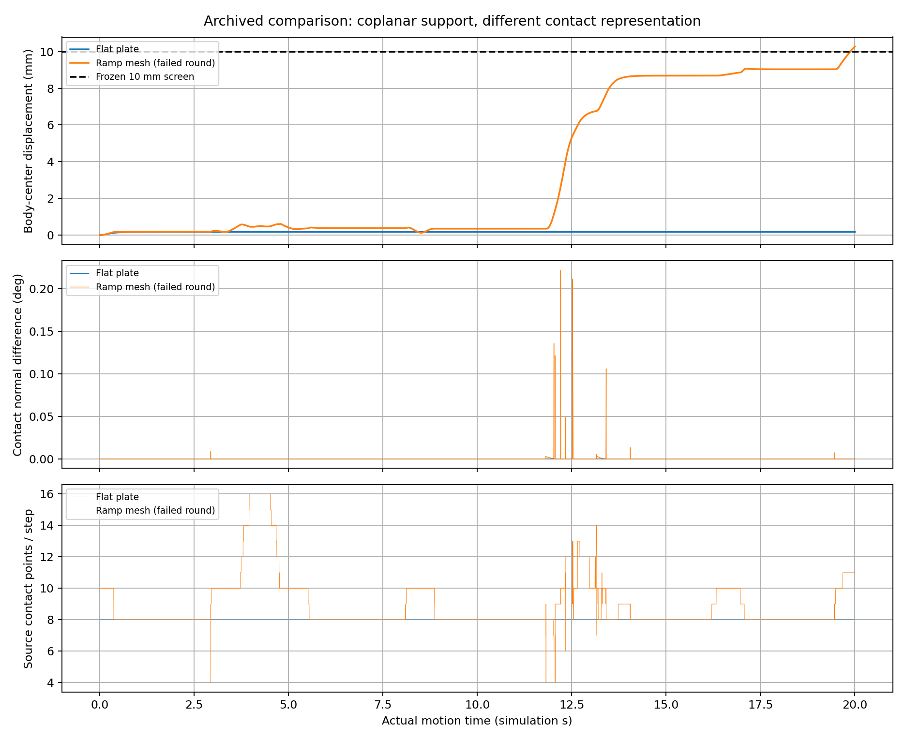
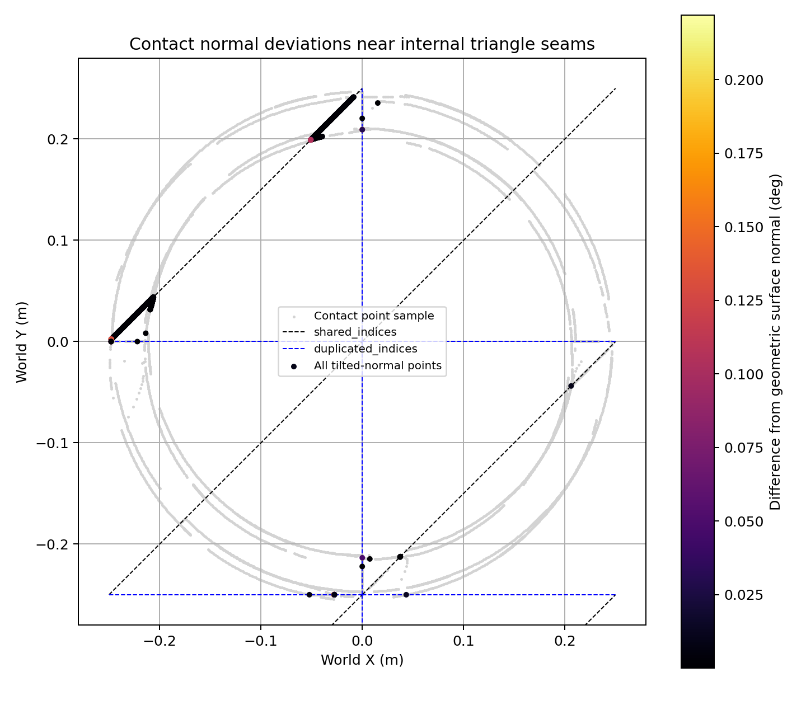

# R5 转向剩余偏移：离线接触与地面几何核对

本轮没有新增仿真，没有改正式车辆、地形、控制默认值或 DART 库。旧矩阵仍按第14轮失败停止。目标“解决31 cm转向偏移”尚未完成：测试候选在平板上明显改善，但v2剩余偏移的原因与修复尚未验证。

## 结果与证据

读取同一冻结签名的第03轮平板左转及第14轮坡道左转。两轮均为1 ms、实际运动20秒，保留原命令链路、10/0侧向/纵向柔顺、固定前后轴分配与纯转向门控。旧结果不计入任何新实验次数。

| 观测量 | 平板03 | 坡道14（旧失败） |
|---|---:|---:|
| 运动物理步 | 20,000 | 20,000 |
| 最大真实车体中心位移 | 0.172556 mm | 10.285963 mm |
| 有效原始接触点记录 | 160,000 | 179,033 |
| 接触法向与实际地面三角形法向的最大夹角 | 0° | 0.221956° |
| 夹角大于1e-6 rad的物理步 | 0 | 495 |
| 每步接触点数量 | 始终8 | 4～16 |

坡道轮实际接触投影涉及12个三角形，全部顶点Z=0，几何法向全部为世界坐标(0,0,1)。接触点距这个平面的最大距离约2.51 μm。因此“坡道场景”不能直接解释为这一轮车轮实际行驶在坡面上。

970个偏转接触点中，96.49%距离共享顶点的内部对角接缝更近，3.51%距离重复顶点的地块边界更近；偏转点到内部对角接缝的距离中位数为0.0367 mm。这里1e-6 rad是离线报告分辨率，1 mm是空间关联描述，两者都不是新验收门槛。分析不据此认定合并重复顶点能够修复问题。

**结论仅为接触表示与接缝的诊断线索。** 平板与坡道原世界仍存在其他差异，点数、接触位置及法向也同时变化；这不是单项因果对照，不能认定法向偏转独自导致位移，不能认定DART或ODE有软件错误。碰撞另一侧实体ID为7，但旧观察记录没有保存其完整名称注册表，本文明确保留这一缺项，不以几何投影冒充完整实体身份。

## 固定版本源码核对

当前容器的DART头文件为6.13.2、HAVE_ODE=1，原件留于`provenance/dart-config.hpp`。gz-physics 7.8.0源码的空世界默认使用GzOdeCollisionDetector；gz-sim仅在SDF明确提供collision_detector时增加覆盖组件。旧测试SDF未指定该项。这支持默认代码路径的核对，但旧运行没有保存最终碰撞检测器对象名称，不能冒充实际运行对象回执。

依据：[gz-physics默认世界](https://raw.githubusercontent.com/gazebosim/gz-physics/gz-physics7_7.8.0/dartsim/src/EntityManagementFeatures.cc)、[gz-sim SDF实体创建](https://raw.githubusercontent.com/gazebosim/gz-sim/gz-sim8_8.15.0/src/SdfEntityCreator.cc)、[DART 6.13.2 ODE接触转换](https://raw.githubusercontent.com/dartsim/dart/v6.13.2/dart/collision/ode/OdeCollisionDetector.cpp)。这些源码不能替代物理因果实验。

## 工具、未运行副本与回归

新增只读入口`audit_r5_ramp_contact.py`，核验旧输入哈希、逐步时间关联、坐标、三角形投影与内部接缝。缺失接触力不补零。新增`prepare_r5_contact_geometry.py`生成三种**未运行**测试世界：原平板、同一上表面的水平网格、反向对角线网格。

副本仅改变测试地面的碰撞几何表示。网格是开口上表面，不能声称其整个碰撞体与40×40×0.1 m箱体等价；车辆、摩擦、视觉表面、控制、传感器及步长的XML保持一致。两个网格均为0.25 m网格、51,200个三角形。三个SDF通过实际`gz sdf -k`解析检查，保留已有gz_frame_id扩展告警。检查不表示已通过Gazebo运行。

完整软件回归497项（含新增14项；5项按既有条件跳过，其余通过）、前端3项测试与5项语法、222个Python文件解析、严格C11/UBSan固件检查通过。首次软件回归因未加载项目overlay产生1项包路径错误；构建当前mooncar_gazebo隔离overlay后完整回归通过。首次前端命令只执行1项，修正真实文件路径后3项全通过；核验脚本首次误用UTF-16读取日志，修正为UTF-8后通过。上述工具失败日志保留，不隐去，也不计作物理仿真。

旧2,183个归档文件全部重新核验哈希，原465个工作文件不变，原工作台身份/状态/配置不变，本轮没有启动或恢复旧测试容器。两个无网络离线检查容器均自动移除。`verification-complete.json`记录独立检查。

## 下一步

具体待批准诊断见[NEXT_DIAGNOSIS.md](NEXT_DIAGNOSIS.md)。需要新的最多8次预算及仅测试地面碰撞表示的范围授权。此前保持地形不变，且旧矩阵已经触发停止规则，不能在旧目录内追加运行。批准前不启动新Gazebo，不发布正式修复。

首次离线审计不支持旧平板的合法link Z偏移而报错，保留于相邻`r5-ramp-contact-audit-20261011-run.log`；修正组合坐标后第二、第三次离线分析分别存于独立02、03目录。没有补写或改判旧失败记录。

首次归档遇到Windows无法解析已退出Linux容器的临时安装符号链接；先排除明确声明的offline-work再检查文件，重做归档成功，失败日志仍保留。原始CSV/OBJ及下载源码在本机保存，提交小体积报告、图、哈希与工具。哈希针对原始文件字节；Git的文本行尾转换不用于跨签名配对，后续运行必须重新生成独立冻结签名。
