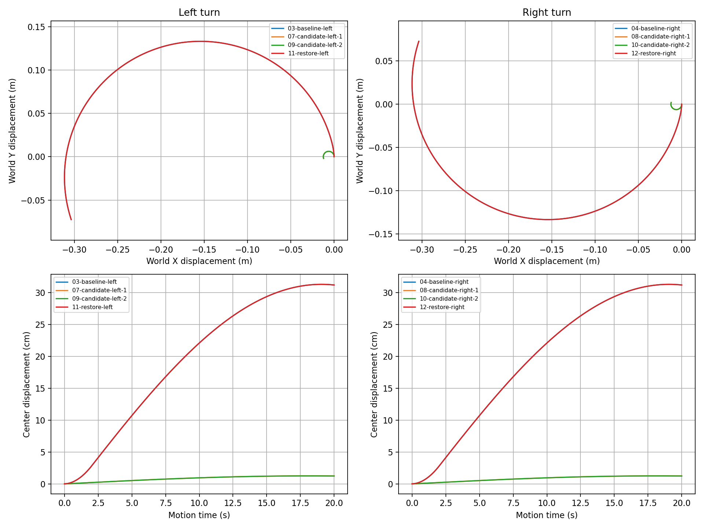
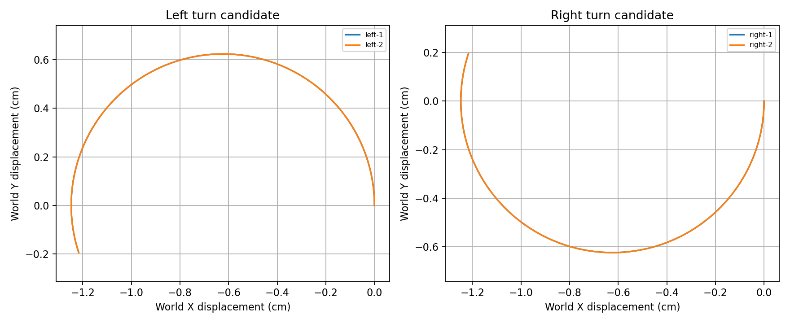

# R5 原地转向：侧向滑移模型独立验证

日期：2026-10-10。**平地测试副本的最大中心偏移从 31.314 cm 降至 1.248 cm，减少约 96.016%。原配置 → 候选 → 恢复原配置对照成立。** 剩余偏移没有消失，不宣布整车验收通过，不发布正式模型。

## 授权与单项差异

用户明确回复“允许测试侧向滑移模型，仅限测试副本”，记录在 `authorization.json`。此前驱动载荷交替候选失败的全部四轮证据仍在 `r5-turn-control-20261010`，没有覆盖或补数。

独立容器 `mooncar-r5-slip-probe-20261010`，原派生镜像 SHA256 `f819df21c8584f8a3d1eee315106779e9b380f10cf43fdc8b7aa15c6bdec6ee3`，4 CPU、6 GiB、512 MiB shm、ROS95、LOCALHOST，无网页端口。每轮重建平地世界及独立 Gazebo partition。实际 Gazebo 8.15.0、SDF 14.9.0、DART 6.13.2。DART 修复库 SHA256 `cfe9b7c6bf72c204645df81f1be7bc646ffbd342acea52c0684a1ad24848274c` 未变。

云台仍是仅供测试的 D=0 候选，1 ms 步长，原安全中继、桥接、DiffDrive 和加减速路径，静置5秒、运动20秒、停车3秒。输入为零命令、0.1 m/s直行或 ±0.2 rad/s零线速度转向。Gazebo 真值只进观察与分析，不进控制。

候选只给展开后的测试 SDF 增加原生 WheelSlip 系统：四轮侧向无量纲柔顺度 **10**、纵向 **0**；轮半径0.076 m；每只前轮固定法向载荷估计3.572514674 N、后轮3.868145326 N，按当前模型质量、质心、轴距和1.62 m/s²重力计算。保留质量、惯量、几何、关节及原摩擦系数。**增加柔顺度改变了接触物理表达，不称为“物理完全未变”。** 10是单个工程候选，没有实物轮胎/月壤标定，不做参数搜索。

[固定版本 WheelSlip 源码](https://raw.githubusercontent.com/gazebosim/gz-sim/gz-sim8_8.15.0/src/systems/wheel_slip/WheelSlip.cc)按实际轮周向速度与固定法向载荷估计计算柔顺度；零轮速时柔顺度趋零。逐步只读观察器新增组件是否存在、两方向柔顺度指令、该步前实际轮速。原配置中不存在的组件记录为缺失及明确的存在标志，未伪造为实际接收的零值。

## 12轮新结果

全部12轮输入、常规采集、逐步记录、接触关联、实际暂停、flush、收尾和库核验合格。无替换或追加轮次。

| 配置 | 轮次 | 最大真实中心偏移 | 实际转角绝对值 | 稳态支点X（车体系） |
|---|---:|---:|---:|---:|
| 原配置左/右 | 各1 | 31.3143076 cm | 3.45774347 rad | 约−157.000 mm，后轴 |
| 候选左/右 | 各2 | 1.2475744 cm | 3.45774538 rad | 约−6.237870 mm，质心附近 |
| 恢复左/右 | 各1 | 31.3143076 cm | 3.45774347 rad | 约−157.000 mm，后轴 |

原配置和候选另各完成一次零命令及直行。零命令稳定，直行均实际前进1.989950 m，未见翻转、穿地或停车异常；12轮停车末秒测得位移均为0。每轮独立的完整结果和失败字段保留在 `campaign/`；逐轮指标在 `round-metrics.json`。

四组候选配对及两组恢复配对的轮速目标积分距离差、转角差和运动时长差均为0。每个运动窗口实际20000个物理步、20秒。候选没有减少实际转角，旧1 cm研究筛选条件继续记录为 **未通过**。

逐步柔顺度指令与实际轮速计算公式的最大误差为0；候选转向期间全部四轮实际接触均可关联。接触点滑动速度与“−切向力×柔顺度”的最大残差 RMS 为 `1.57034e-5 m/s`，远低于预先登记的0.005 m/s机制核验限值。原来后轮近乎不侧滑，候选下前后轮均有侧滑，支点由后轴移到质心附近。实际进程加载插件、系统库和原修复库的路径及哈希保存于各轮 `actual-gazebo-libraries.json`。

同方向两次候选的最大偏移及转角数值完全一致。这是当前确定性平地试验的重复结果，不能外推到实车噪声、不同地形或其他步长。

## 原因、修复与剩余问题分别判定

**原因机制获得支持。** 在原接触表达下后轴近乎粘住、前轴侧滑，使几何中心绕后轴移动；增加单项侧向柔顺度后支点移到质心附近；恢复原模型后原支点与约31 cm偏移再现。单项改动、相同输入及恢复对照支持这一仿真机制的因果影响。它不证明 DART 存在软件错误，也不证明真实车辆的正确接触参数就是10。

**候选作用已验证，但未消除全部真实偏移。** 本轮冻结的机制诊断条件为最大偏移≤3 cm、转角损失≤0.05 rad，以及指令/接触关系核验；这些条件通过。此前1 cm研究筛选条件未通过，不更改条件或将机制通过冒充性能达标。解析预测的半圈偏移 `2×6.237889 mm≈1.247578 cm` 与实测接近；剩余运动依然是真实车体中心轨迹，不是里程计误差修正。

**正式配置未发布。** 模型、控制默认值、摩擦系数、DART默认库、图片采集修复及原工作台均未替换。质量分布仍是自洽的工程模型，尚无完整实物数据确认。本轮只有平地和1 ms，未开展v2场景、步长一致性或完整整车验收。

下一步先对剩余约1.25 cm明确工程性能要求与修复边界，再验证同一候选在v2场景和步长变化下是否稳定。侧向柔顺度属于接触模型，应依据轮胎/地表与实物资料校核；不能只为降低数字继续扫描参数。候选单独归档，可审查，不自动接入正式流程。

## 回归、性能与归档

新增静态审计7项、滑移候选7项专项回归。测试使用本轮生成的同哈希小模型快照，便于随本轮提交复现；修改的只是测试资源引用，物理执行代码、观察器和模型冻结未变。

437项软件检查最终全部通过，新增14项专项检查包含其中。第一次完整检查未加载 overlay，导致找不到包，原日志 `software-regression.log` 保留；加载实际本轮 overlay 后重跑，记录在 `software-regression-overlay.log`。其中3项因当前准备证据目录名与旧测试固定路径不同而跳过：把本轮真实预检目录复制到测试要求的路径，哈希核对后单独执行这3项，全部通过，记录在 `software-preflight-tests.log`。没有新造通过回执，也没有重跑物理轮次。前端3项、5个JavaScript文件语法、固件C11严格编译/UBSan检查及198个Python语法检查通过；最终状态以 `completion.json` 为准。

物理试验的实际实时率0.4923～0.6589；采样峰值内存2,907,947,008 bytes，CPU短窗口峰值4.087核（容器配额4核，短窗口采样不等同配额设置）。记录计算开销，不从不同轮次的单次性能差异推断因果。完整软件回归在物理试验结束后运行。

原始RGB/深度/激光、IMU、关节、力矩、轮速、两级速度、车体/连杆真值、接触、里程计、逐步CSV、队列及库回执全部留在本地证据目录，归档 manifest 校验其哈希。保留所有此前失败记录与原有未提交文件；本轮提交工具、小模型、报告和摘要，排除大体积原始数据。
