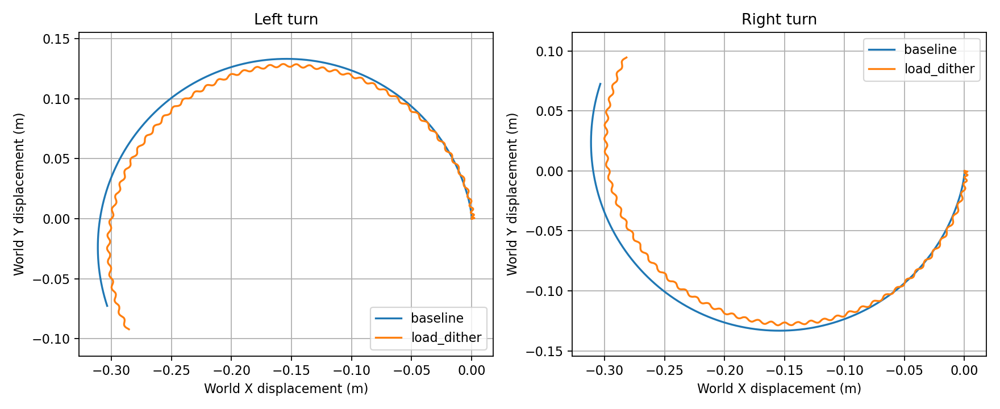

# R5 驱动控制可行性试验：前后载荷交替候选未消除偏移

结论：**31 cm 转向偏移没有修复。** 本轮排除了一个驱动控制候选；四轮试验的输入、采集和静置/停车资格通过，不代表修复通过。正式模型、物理参数、DART、云台默认值、安全中继及图片修复均未修改。

用户选择的边界是“保留物理参数，先修驱动控制”。本轮只在独立测试发布器中尝试驱动补偿，不新增生产控制 profile，不向控制器提供真值。

## 候选及冻结预测

候选仍给定 ±0.2 rad/s 转向，在运动窗口内部加入幅度 ±0.025 m/s、周期 0.4 仿真秒的连续三角形前后速度，名义斜率 ±0.25 m/s²。波形按 ROS 仿真时钟计算，沿原发布器 → 安全中继 → 原安装桥接 → DiffDrive 链路发送；实际轮速目标仍受到原 0.5 m/s²、1 rad/s² 加速度限制。零命令和结束阶段不使用波形。它不是每一步都保持零线速度的原输入，而是明确登记的控制候选。

冻结假设：前后加速可使载荷反向，进而交换不滑动的车轴，使横移抵消。基于旧数据的准静态估算，载荷反向所需纵向加速度约 0.079 m/s²；该估算没有包含侧向速度转换的动态过程，不能代替试验。

首次仿真前记录 prediction.json；执行脚本、实际安装文件、模型、镜像、70 项资源及运行库签名见 campaign/freeze.json。整个四轮矩阵签名保持一致。测试前后没有调整候选参数，也没有扩大搜索。

试验筛选条件预先选为全程中心偏移 ≤1 cm、实际转角不比同方向基线少 0.05 rad，另核对输入预算。这只是本次候选筛选条件，不是用户已确认的实车转向验收标准，也不作为今后的默认性能门槛。实际结果仍超过 30 cm，已足以否定“消除原偏移”的预测。

## 新试验结果

固定平地、D=0 候选、1 ms、5/20/3 秒流程。每轮重建世界、独立 partition，4 CPU、6 GiB、512 MiB shm、ROS95/LOCALHOST，无网页端口。

| 轮次 | 输入/采集资格 | 末端位移 | 全程最大偏移 | 实际转角 |
|---|---|---:|---:|---:|
| 原配置左转 | 通过 | 31.210 cm | 31.314 cm | +3.45774 rad |
| 原配置右转 | 通过 | 31.210 cm | 31.314 cm | −3.45774 rad |
| 控制候选左转 | 通过 | 29.989 cm | 30.543 cm | +3.60816 rad |
| 控制候选右转 | 通过 | 29.720 cm | 30.277 cm | −3.62041 rad |

候选最大偏移仅减小约 0.77～1.04 cm，实际转角还增加约 0.15～0.16 rad，不能只凭末端位移减小宣称消除了漂移。轨迹仍然是大圆弧，另外增加了小幅前后摆动。

两组对应输入的运动窗口均为 20 秒/20000 物理步。角速度目标积分均为 ±4 rad，差不到 1e−15 rad；候选与基线的线速度目标积分差分别为 0.295 mm 和 0.039 mm。原加减速限制、停车零命令、暂停迭代和 flush、图片归档回执、参与者段归属及排空检查均通过。轮速实际值与目标的最大差低于 1.8e−10 rad/s，未发现轮子没有执行目标的问题。

各轮 RGB/深度、激光、IMU、关节、姿态、安全速度、两种里程计和接触记录通过原资格检查；逐步记录完整。逐项间隔、性能及文件规模见 rounds.json，原始记录在 campaign 的四个轮次目录中。旧轮次未补足任何新试验次数。

## 载荷及支点证据

| 配置 | 稳态后轴减前轴载荷范围 | 前轴明显更重的时间比例 | 支点 X 中位值 | 前轴侧滑 RMS | 后轴侧滑 RMS |
|---|---:|---:|---:|---:|---:|
| 基线左/右 | 约 +0.558 N | 0% | −0.15700 m | 0.05456 m/s | 0.000005 m/s |
| 候选左 | −3.385～+4.490 N | 40.66% | −0.15335 m | 0.05611 m/s | 0.00120 m/s |
| 候选右 | −3.385～+4.490 N | 40.87% | −0.15302 m | 0.05628 m/s | 0.00130 m/s |

前后载荷确实瞬时反转，但支点中位位置没有从后轴交换到前轴；前轴仍持续侧滑，后轴只有少量侧滑。冻结的“反转载荷即可交换支点并抵消横移”预测没有获得支持。每个候选方向只运行一次，本轮没有恢复对照，也没有同方向候选重复，不能新增因果确认或重复性结论。

这不推翻此前质心镜像试验得到的“质量分布影响支点选择”结论：静态移动质心与短暂动态载荷反转不是同一干预。

## 对下一步控制工作的限制

在后轴持续不侧滑、固定轮轴、恒定纵向速度和角速度的条件下，车体中心横向速度为 `vy = 0.157 * omega`，支点 X 为 −0.157 m。添加恒定前后速度只能改变支点 Y；中心轨迹半径为 `sqrt(0.157² + (vx/omega)²)`，不会变成零。因此继续尝试常数线速度偏置或仅改航向跟踪，没有消除该支点偏移的依据。这是有条件的运动学分析，**不是所有非稳态控制方案都不可能的证明**。

当前容器头文件确认 DART 为 6.13.2。该版本源码对两个切向约束分别设置以法向冲量为索引的摩擦限幅，见 [固定版本 ContactConstraint.cpp](https://raw.githubusercontent.com/dartsim/dart/v6.13.2/dart/constraint/ContactConstraint.cpp) 的 getInformation。这支持继续核对接触约束与固定轮滑移转向的适用性；不能据此称 DART 有软件错误，也不能代表实车行为。未构建或修改任何接触库。

下一步先进行只读的驱动可控性、接触约束及可用实际反馈核对。若需改变接触数学模型或接受分段转向机动，应先把具体方案和边界差异说明清楚；本轮没有擅自改摩擦、质量、惯量、几何或接触表达。当前实车质量分布仍未确认。

## 工具、检查和保存

新增独立可复现入口 scripts/run_r5_turn_control_probe.py，以及测试波形、动态输入资格判定和运行包装器。常规输入资格没有被放宽；候选动态线速度单独验证，不能冒充原零线速度指令。

软件回归 423 项通过、零跳过；前端 3 项及 JavaScript 语法检查通过；固件 C11 严格警告及 UBSan 通过；新增 7 项回归覆盖时钟异常、连续波形、结束零命令、输入掉零/陈旧/漏步/残留和加速度/轴间目标错误。回归在物理试验后运行，与性能采样分开。89 个 Python 文件语法检查及准备脚本 shell 语法检查通过。

后处理首次发生质量审计返回值解包错误，未启动额外仿真；保留 analysis-initial-failure.log 和初始脚本。修正的后处理仅使用已取得的数据，没有修改物理试验执行代码或原始记录。

413 个原有非证据文件哈希保持不变。所有原始数据、失败候选、旧证据保留；大体积观测不纳入 Git。只关闭本轮容器，原工作台维持此前状态。completion.json 中明确记录 goal_achieved=false、turn_displacement_repaired=false。
