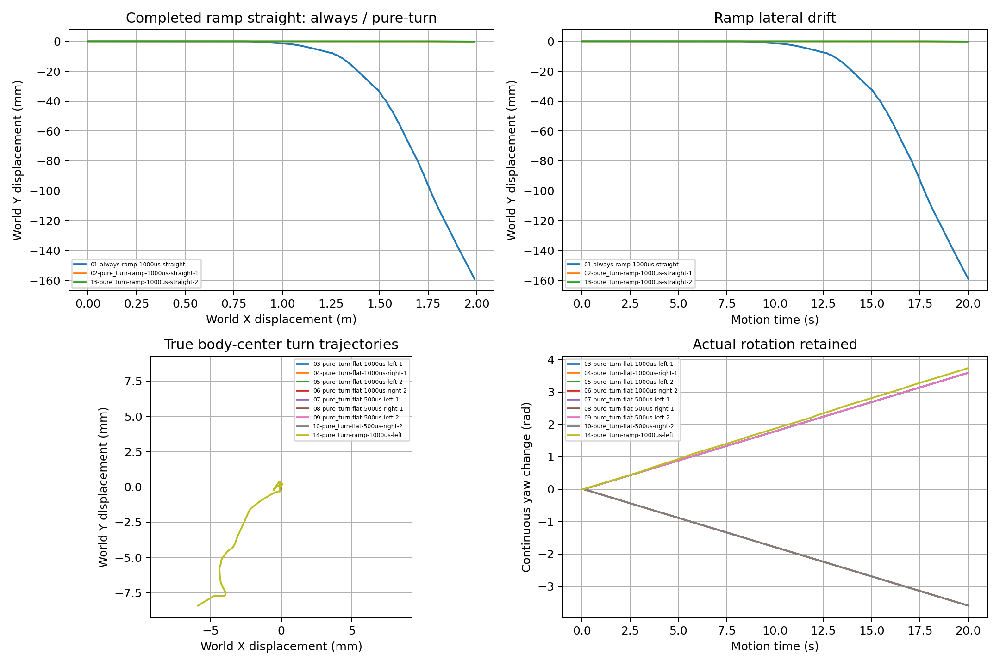

# R5 转向测试副本：新矩阵停止于坡道左转

本轮取得可重复的改善，但没有通过完整v2验证。新24轮矩阵实际尝试14轮：13轮合格，第14轮坡道左转的真实中心偏移为10.285963 mm，超过首次仿真前冻结的10 mm工程筛选线。剩余10轮未运行，恢复对照未完成；不补跑、不放宽门槛、不修改参数。正式模型、云台默认值及DART库不发布变更。

## 实际取得的结果

| 本轮检查 | 结果 |
|---|---|
| 坡道直行、持续启用侧向柔顺 | X前进1.988866 m，Y横移−158.886082 mm |
| 坡道直行、仅纯转向启用柔顺，两轮 | X前进1.988868 m，Y横移−0.155567 mm；重复结果一致 |
| 平板1 ms左右转，各两轮 | 最大中心偏移0.172556 mm，实际转角约±3.595126 rad |
| 平板0.5 ms左右转，各两轮 | 最大中心偏移0.172866 mm，实际转角约±3.595170 rad |
| 四组1/0.5 ms对应转向 | 最大末端位置差0.000310357 mm、航向差0.0000434403 rad；输入时长及轮速目标积分差为0 |
| 平板0.5 ms、坡道1 ms零命令 | 静置、零命令及停车检查通过 |
| 坡道1 ms左转 | 最大中心偏移10.285963 mm，轨迹长14.500874 mm，实际转角3.743688 rad；该轮失败 |

原配置约313.143 mm转向偏移是此前实验背景，不替代本轮基线或重复次数。当前平板结果表明测试组合有明显效果；坡道结果表明不能把平板改善直接推广到三个v2世界。弯道、综合场景、坡道右转与最终恢复轮次均未完成。

图中XY转向坐标采用相同尺度。平板轨迹在坡道尺度下很小，具体数值见表格及`round-metrics.json`。图中没有未运行的恢复曲线。

## 第14轮为什么失败

这是实测运动门槛失败：中心世界位移终点为X −5.904746 mm、Y −8.422293 mm，合成位移10.285963 mm，超出门槛0.285963 mm。实际运动窗口20秒，轮速目标方向、原加减速、角度积分4.000000 rad及停车零命令合格；停车末秒位移0，最大横滚/俯仰约7.57e−6 rad。原始结果保留失败，不用“接近门槛”改判。

该轮图片、深度、激光、IMU、关节、姿态、安全速度、逐步观察、实际暂停/flush及排空均通过原门槛。门控与独立观察器实际命令核对误差为0，接触源记录覆盖每轮每物理步。详细独立判定见`failure-analysis.json`，原始`result.json`与ledger未改写。

前左/前右轮在运动期间分别有207/243步明确的接触源空状态，后左/后右为2/4步；正源接触记录没有未收到的消息。空状态与缺失数据分开，未给缺失力补零。第一次前轮空状态出现在8.142秒，此时中心偏移约0.182749 mm。总路径中约1.995001 mm发生在前轮源空步，约12.505873 mm发生在前轮源非空步，不能仅凭这些空状态解释全部偏移。

本轮只支持“当前固定组合在平板与坡道网格上的结果不同”及接触不对称线索。平板与坡道可通行地表定义的摩擦数值均为0.8/0.72，实际地形、接触点变化仍需分别分析。只有一次坡道左转，未完成恢复对照，剩余10.286 mm的具体因果机制未确认；不宣称DART软件错误，也不借调摩擦追求通过。

`failure-contact-timeline.csv`按真实迭代号关联车体位置和四轮接触源状态，速度是相邻真实物理步差分；没有插值或控制反馈。此前接触源审计与原/slip/restore实验保留在[旧接触对照报告](../r5-contact-source-20261011/README.md)。旧结论与本轮未完成的恢复阶段分开。

## 测试实现及范围

采用用户允许的测试副本：原生WheelSlip侧向10、纵向0，固定原法向载荷估计；保留之前冻结的前后轴分配（前轴0.960268221788626，后轴1.039731778211374，左右平均目标及原命令预算保持一致）。只在实际四轮目标形成纯转向时保留侧向柔顺，其他目标将侧向柔顺命令置零。纵向命令不变，不写车体状态或修正记录坐标，不向控制器提供Gazebo车体真值。

质量、惯量、尺寸、摩擦、地形、安全中继、传感器与原加减速保持不变；轮地接触模型确实改变，因此只用于授权的测试副本。D=0仍是测试云台候选，正式控制默认值不改。仅靠驱动控制和质心镜像的此前结果不被改写成已消除偏移。

新入口使用`244d47e`的测试专用启动核验副本：仅对ENODATA保留操作路径/堆栈并在原10秒期限内重试，完整初始化回执、版本、哈希、实际库和8 MiB容量门禁不变，其他错误仍失败；正式guard保持原哈希。本轮14次启动均取得就绪回执，未触发ENODATA重试，不能由此确认旧启动异常的原因或根治情况。旧失败目录不续跑、不清零。

## 仍未解决及发布结论

候选在平板上的中心偏移和步长一致性得到重复验证，坡道直行副作用处理也重复有效；完整v2候选未通过，不发布正式配置。固定参数在网格接触下的剩余偏移、混合曲线命令、轮式里程计和转角跟踪仍需独立研究。

本轮平板左转首轮的原生里程计末端航向误差约0.226576 rad，ROS轮式里程计约0.384658 rad；两者实际采样均距运动终点−0.006秒，保留对齐含义。坡道失败轮对应误差约0.078089/0.236170 rad。里程计改善不代替真实偏移改善。本轮没有完整车辆、硬件或真实月壤动力学验收结论。

下一步优先只读核对失败轮的接触点、法向、地面三角形及左右载荷与微小平移的时间关系，检验固定轴分配对网格接触的假设。新实验须另行冻结方案及预算；不在已停止矩阵中继续改参数或补数。

## 冻结、回归及交付

原Jazzy派生镜像`mooncar-terrain:r5-image-dds-20261008`，4 CPU、6 GiB、512 MiB shm、ROS95、LOCALHOST、独立partition、无网页端口，每轮重建世界。实际加载原Fast DDS、已通过的最小8 MiB桥接RMW及DART修复库；发送/接收容量和进程环境隔离逐轮核验。17项物理输入预检查、70项资源、实际安装的90项文件及规范化执行冻结核对通过。

完整483项软件检查（7/10/129/337）、前端3项测试/5项语法、219个Python文件解析、Bash语法及严格C11/UBSan固件检查通过；软件回归在物理试验终止后运行。只读后处理首次因ROS setup与nounset顺序失败，已记录并修正；没有新增仿真或修改冻结执行文件。

本轮实际运行速度为实时的0.381～0.637，记录的平均CPU约3.48～3.64核，最高记录内存4,883,779,584字节，单轮完整墙钟最长201.683秒。逐轮原值与数据量见`round-metrics.json`，外部资源记录见`performance.jsonl`。

原始图片、深度、激光、IMU、关节、两级命令、里程计、世界姿态、力矩、逐步接触、全部失败及签名留在本地，并以`archive-manifest.json`和`archive-verification.json`归档核验，不提交大体积数据。只关闭本轮测试容器，原工作台ID、状态与配置保持一致；原文件保护结果见`preservation.json`，实际次数与关闭记录见`closure.json`。
