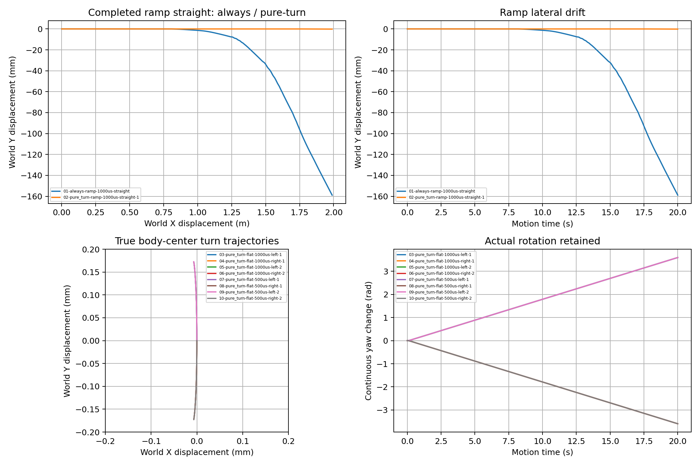

# R5 测试副本：纯转向滑移门控

本轮取得有效改善结果，但完整矩阵未通过。24轮计划实际尝试11轮，前10轮合格，第11轮桥接启动核验失败，剩余13轮未运行；旧轮次不补足次数，不续跑本目录。正式模型、控制默认值、DART及工作台不发布变更。

## 已取得的结果

| 新试验 | 结果 |
|---|---|
| 坡道持续启用侧向滑移直行 | X前进1.988866 m，Y横移−158.886082 mm |
| 坡道仅纯转向启用滑移，直行 | X前进1.988868 m，Y横移−0.155567 mm；停车末秒移动0 |
| 平地1 ms左/右转，各两次 | 最大中心偏移0.172556 mm；实际转角约±3.595126 rad |
| 平地0.5 ms左/右转，各两次 | 最大中心偏移0.172866 mm；实际转角约±3.595170 rad |
| 四组对应步长比较 | 最大位置差0.000310357 mm，航向差0.0000434403 rad，全部通过1 cm/0.01 rad工程筛选 |
| 对应输入及同一步长重复 | 时长、等效轮速目标距离/转角积分差均0；同一步长世界姿态结果一致 |

此前原接触模型约313.143 mm最大转向偏移、固定滑移与轴分配的改善和恢复对照属于历史背景。本轮八次平地转向证明新增门控保留0.173 mm量级的改善，并未缩短20秒动作或减小实际转角。新坡道直行对照支持关闭非纯转向侧向柔顺能去掉已知横移副作用；本轮恢复阶段尚未运行，不能独立声称完整因果对照已完成。

四组步长比较来自本轮同一冻结签名下已合格的八轮，不混用历史记录。`completed-pairs.json`是停止后的只读配对报告，不改`summary.json`或逐轮失败判定。

图中只包括已完成的持续启用与纯转向门控结果，不含未运行的恢复轮次。转向XY图采用相同轴尺度；坡道图与转向图的单位及范围不同。

## 实现与实际配置

新增测试接触控制模块，运行于原DiffDrive及固定轴分配之后，读取真实四轮速度目标，只在左右均值相反且非零时保留原生WheelSlip10/0；其他目标将侧向柔顺命令置零。纵向柔顺保持0，前后轴分配和原加减速过程不变。它不读取车体真值、接触、里程计，不写轮速或车体状态。质量、惯量、几何及摩擦系数保留；轮地接触行为确实发生改变，只用于授权的测试副本。详细说明见[implementation.md](implementation.md)。

前10轮逐步命令与独立观察器完全相符，原生侧向公式核对误差为0，暂停末步/flush完整。图像、源接触状态与点/法向/深度/力关联、两级命令和原常规采集门槛均合格。

原Jazzy派生镜像`mooncar-terrain:r5-image-dds-20261008`，4 CPU、6 GiB、512 MiB shm、ROS95、LOCALHOST、独立partition、无网页端口。继续用已验收的最小8 MiB桥接RMW及原Fast DDS、DART修复库；每轮实际加载路径和哈希单独核验。D=0仅测试云台配置；正式云台默认不变。

测试SDF：always/restore SHA256 `a568d32bf1eddaba3bbb6419dcb0b41e1d119cafbc3e4cd3dd7d8ed78ee6e058`；pure_turn `5c19449015582b0c7fd9045f6e1da7d4268fa0e600548dca969707b2483deb0d`。三个模型只有已声明的门控mode差异，恢复模型与always字节一致。11项物理输入一致性预检查通过；70项资源、既有模型及库与上一轮保持一致。

## 第11轮失败与未完成项

第11轮是0.5 ms平地零命令。原始结果显示仿真时间0、调度阶段空、没有物理步；桥接日志先报`OSError(61, 'No data available')`，随后终止桥接并出现rclcpp上下文失效。初始化回执已记录PID5791、容量8388608、端口队列512、两种自定义传输及participant已创建，但没有ready回执。记录器队列排空，选定图片为0。

后续资格器又报“Slip controller grid missing or duplicated”，这是启动失败后没有数据的次生错误，不能据此认定控制器失稳或车辆翻转。详细原始链路保留在`failure-analysis.json`，不覆盖`result.json`和ledger。缺少原异常堆栈，无法确定ENODATA来自哪个文件操作，也不能宣称它已修复。

无Gazebo的辅助启动检查保留于`startup-probe*`：最初工具入口使用了错误安装路径，修正后四次就绪即停止和一次延迟1秒停止都未重现ENODATA；但SIGINT后均以−11退出，不能作为完整启动/关停通过证据，也不能与第11轮原异常混为一个机制。辅助检查没有启动Gazebo，新增物理尝试为0，未修改正式guard或DDS控制流程。

后续平地静置、三场景完整矩阵与恢复对照未完成，本轮不发布候选，不宣布整车或真实月壤验收通过。轮式里程计误差、转角跟踪、混合曲线命令切换和实车质量分布仍需单独验证。成功左转首轮原生里程计末端角度误差约0.226576 rad；ROS里程计约0.385278 rad，分别保留实际采样偏移，未把里程计修正当作车体偏移修复。

下一步先给桥接启动核验补齐堆栈与操作路径，确认ENODATA及关停异常的具体位置，再验证最小工具修复。新的物理验证须新目录、新冻结签名，保留本轮10个成功和1个失败结果，不跨签名补数，不盲目调整滑移或车辆参数。

## 回归与归档

专项8项Python检查、C++策略检查，以及完整471项软件检查（7/10/129/325，无跳过）、前端3项测试、5项语法、214个Python文件解析、Bash语法和严格C11/UBSan固件检查通过。物理性能采样与软件回归分开运行。停止后已核对实际安装的90项文件并保存副本；执行内容的规范化哈希比较仍一致，原始Python矩阵tuple/list反序列化差异另有记录，并非源码变化。

成功轮运行速度为实时的0.330～0.599，平均CPU约3.48～3.69核，最大记录内存3,781,337,088字节，单轮完整墙钟最长219.203秒。逐轮原值及数据量见`round-metrics.json`，外部15秒资源采样见`performance.jsonl`。原始RGB、深度、激光、IMU、关节、两级命令、世界姿态、控制力矩、逐步接触及全部失败保留本地，不把大数据提交Git。

归档校验、原456项文件保护与工作台/本轮容器状态核对见`archive-manifest.json`、`archive-verification.json`、`preservation.json`及`closure.json`。仅提交本轮测试工具、回归、报告和小体积证据，保留此前其他未提交改动。
