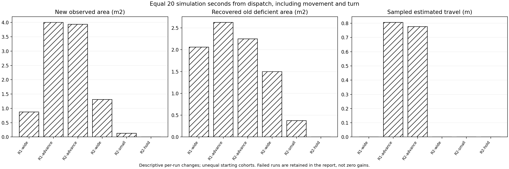
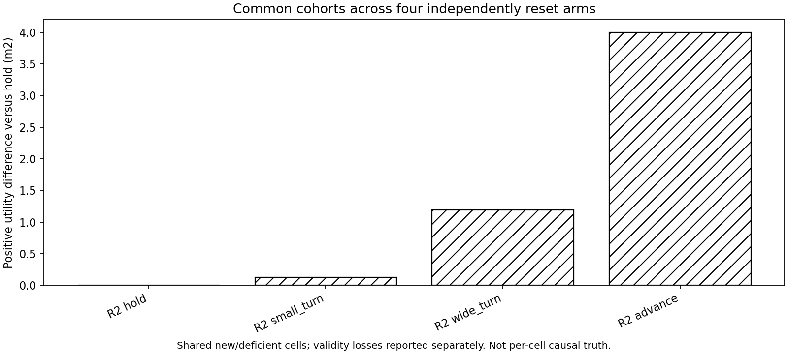
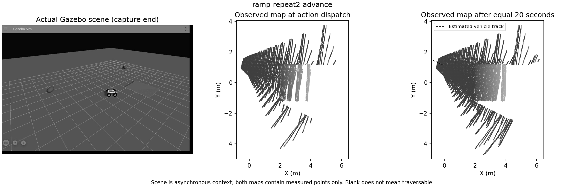
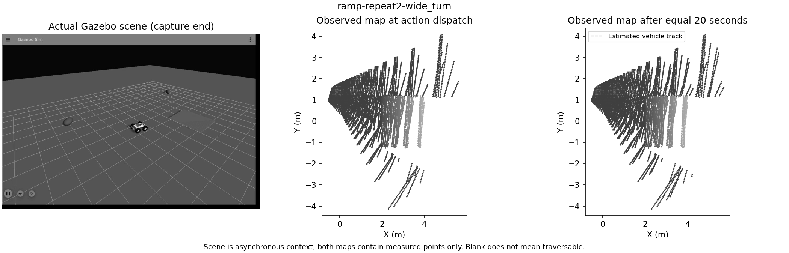

# 转向与换位的同预算采集比较

日期：2026-09-13。软件仿真研究，在线三种策略没有替换。

预定8次独立重置，6次形成可评价窗口；完整性判定：未满足，失败或未完成项保留。这不是创新效果或在线停止规则验收。

## 本轮解决的问题

把“某个补采目标有没有恢复”扩展为“在相同时间里，转向或换位获得了什么”。所有动作按命令发出后20仿真秒评价，包含运动、转向和观察；保持组也使用同样时间，避免把几乎零运动成本作为除数。

复用survey_evaluation.gain：收益=新增观测投影面积+原有采样不足格恢复为可拟合的面积。两部分分别列出，新增格不会再算作旧格补采。当前目标内、目标外的恢复，以及原本有效但后来失效的面积另行保存；正收益不能掩盖失效。恢复不是精度改善，新覆盖也不等于可通行地面。

## 事前固定的条件

坡面场景，两次重复，第二次反转四组执行顺序：保持不动、+0.02rad小角度、+0.4rad较大角度、Nav2换位后恢复决策时朝向。起点(-1.4,1.55,-0.3rad)，共同先到(-0.65,1.3)，下一位置(0.1,1.05)m。每次60仿真秒，起步前至少观察5秒并固定不足格，到达后共同保持5秒。

全部四组都查询下一位置的实际Nav2路径，再发出预定动作；路径检查拒绝越过当前地图未知或占据格。区域统计采用起始位置周围半径8m，不是整个50×50m场景的完成率。传感器前缀不超过5秒旧且至少剩余22秒；源代码和协议在新数据产生前冻结。

## 实际结果

| 试验 | 新增观测m² | 旧格恢复m² | 目标内/外恢复格 | 有效面积损失m² | 采样路程m | 动作耗时s |
|---|---:|---:|---:|---:|---:|---:|
| ramp-repeat1-hold | 失败：Initial approach/capture failed | — | — | — | — | — |
| ramp-repeat1-small_turn | 失败：Initial approach/capture failed | — | — | — | — | — |
| ramp-repeat1-wide_turn | 0.8750 | 2.0625 | 1/32 | 0.0000 | 0.000 | 1.394 |
| ramp-repeat1-advance | 4.0000 | 2.6250 | 9/33 | 0.0000 | 0.805 | 5.939 |
| ramp-repeat2-advance | 3.9375 | 2.2500 | 10/26 | 0.0000 | 0.776 | 6.613 |
| ramp-repeat2-wide_turn | 1.3125 | 1.5000 | 0/24 | 0.0625 | 0.000 | 1.302 |
| ramp-repeat2-small_turn | 0.1250 | 0.3750 | 0/6 | 0.1250 | 0.000 | 0.395 |
| ramp-repeat2-hold | 0.0000 | 0.0000 | 0/0 | 0.0000 | 0.000 | 0.000 |

失败记录明细：

- ramp-repeat1-hold：[Errno 61] No data available
- ramp-repeat1-small_turn：Terrain pixel offset is not declared as a double

投影参数旧错误文案同时覆盖请求未完成、空响应与类型不匹配；单凭该文案不能认定参数类型真的配错。文件读取错误没有完整调用栈，也不能据此宣布其根因已修复。

以上是每组相对自身动作前地图的变化；独立重置产生的初始观测差异存在，不能直接把两列相减当成因果收益。动作耗时来自控制事件，采样路程来自估计位姿，含定位漂移并可能低估采样间运动。所有收益率统一除以20秒，详见trials.csv。

## 共同格子比较

只有四个组都有可评价数据的重复才进入此表。共同不足格取四组动作前不足格的交集；共同新格排除四组动作前地图的并集，再统计各组实际新观测。固定目标的交集单列，避免把沿途新发现的不足格误算成原目标收益。

| 重复 | 动作 | 共同新格 | 共同不足格恢复 | 其中共同原目标恢复 | 相对保持正向收益差m² |
|---|---|---:|---:|---:|---:|
| 2 | hold | 0 | 0 | 0 | +0.0000 |
| 2 | small_turn | 0 | 2 | 0 | +0.1250 |
| 2 | wide_turn | 7 | 12 | 0 | +1.1875 |
| 2 | advance | 52 | 12 | 6 | +4.0000 |

本批唯一完整的第二轮，共同不足格34格，其中10格属于共同的原始目标。保持、小转角、较大转角、换位的正向收益差依次为0、0.125、1.1875、4.0000m²。换位与较大转角都恢复12个共同不足格，但换位新增52格，较大转角新增7格；换位还恢复6个共同原目标，三个原地组均为0。这里换位的优势主要体现在新覆盖及原目标恢复，不能推广成所有地形都应优先移动。

第二轮较大转角另有1个原本有效格失效，小转角有2个，分别为0.0625、0.125m²；保持和换位没有此类损失。正向收益差没有扣除这项分组损失，也不是风险或精度净收益。后续决策必须保留退化项，不能只奖励恢复。

## 模型与实测仍需对齐

本轮没有把不同模型的分数强行排成统一推荐顺序。转向继续使用v4支撑预测；换位继续用既有路径观察机会模型。二者不是同一标尺，预测均未给出可信的新增覆盖量，所以joint_predicted_rank为空。forecasts.csv保留各自的误报、漏报和命令前已变化的格子，不能称为已经可靠预测总收益。

stages.csv记录换位完成、转向完成相对同一命令前地图的累计变化，不能把这些累计值相加。阶段中的收益率也统一按20秒预算归一化，不是该阶段瞬时速率。scene-map图右侧取精确20秒窗口的观测地图；Gazebo截图来自采集结束时，只用于场景对照。

## 下一步

先处理本批暴露的启动/记录失败并补齐独立对照；根据误报/漏报核对转向和换位模型，使其能估计同一种收益及时间成本。随后扩展曲面、遮挡和不同起点，固定规则后接入surface_view_v1，再做完整三策略比较。不能从两个坡面重复推出普遍最优策略，也不能从目标内零恢复推出应该停止探索。

## 可复核材料

captures保存原始深度、同步位姿、前缀、真实Nav2路径、控制事件、成功及失败记录、冻结协议与源码；analysis保存逐格表、阶段表、预测表、结果图和现场对照图。python check_evidence.py验证哈希和汇总；冻结evaluate_action_value.py在现有NumPy环境中逐数组核对前缀并重建地图评价。
