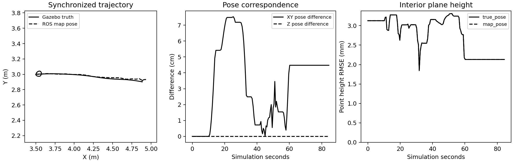

# 同步轨迹与高度基准核验 · 2026-09-13

本轮已跑通独立的真值轨迹记录，并完成一次包含转向、前进和停车的现场仿真实验。它将“相机采到了多少”进一步分解为“定位是否对应、安装坐标是否一致、深度点还原后的高度差有多大”。

**本轮只验证了一段短距离平地轨迹，不是全场地、坡面或实物精度验收。** 没有修改导航算法、相机标定、旧地图或硬件验收结论。

## 实验结果

实验 `experiment-edb683fc4ee7`，起点 (3.5, 3) 米、朝向 0°。自主任务 `autonomy-c6626caf60` 的预算为 60 仿真秒、活动半径为 8 米，实际运行 54.5 秒，完成 6 次转向和 1 次前进，7 个动作均成功。因剩余预算内没有合适的新候选而正常停车，不表示整个场地已经探测完成。

独立记录覆盖任务前后的停车阶段：选取 154 组时间同步的深度观测及位姿，跨度 84.4 仿真秒；本轮没有因匹配失败而拒绝的选中样本。记录程序按至少 0.5 仿真秒间隔选择观测，不是每个原始深度帧都保存。

| 检查项 | 本轮结果 | 解释 |
|---|---:|---|
| 采样真值路径长度 | 1.665 m | 包含转向时的车体位置变化，不是轮速里程 |
| 平面位置差 RMSE | 4.10 cm | 同时刻 ROS 定位与 Gazebo 位置的差 |
| 最大平面位置差 | 7.53 cm | 保留误差，没有重新配准来消除它 |
| 最大朝向差 | 0.268° | 同步样本中的最大值 |
| 模型与 TF 相机安装变换 | 一致至约 5×10⁻¹² 的矩阵元素差 | 检查配置一致性，不代表实机安装标定 |
| 相机高度差 | 约 10⁻⁹ m 的数值量级 | 本轮平地条件下，无可辨识的安装高度差；不能写成纳米级测量精度 |

## 高度误差应该怎样看

同一批光学坐标系深度点分别用两套相机位姿还原：一套来自 Gazebo 模型真值和模型中的相机安装位置，一套来自 ROS map→相机变换。整个过程未拟合平移、旋转或高度修正。

| 评价范围 | 点数 | 真值位姿还原的高度 RMSE | 平均高度偏差 |
|---|---:|---:|---:|
| 所有落在参考平地投影范围的点 | 311742 | 35.01 mm | +6.07 mm |
| 离障碍外包框至少 0.25 m 的平地内部 | 288029 | 2.85 mm | +2.27 mm |

“平地投影范围”仅按世界坐标 XY 上方的最高参考表面归属判断，不能保证每个点都来自真实平地。障碍边界、渲染几何差异及错误投影会混入其中。因此额外给出保守的平地内部统计：用独立场景几何，将所有非平面视觉体的世界轴对齐外包框向外扩 0.25 米，再排除这些范围内的点。**没有按高度误差大小筛掉坏点**；被排除的 23713 点仍保留在完整范围统计与原始数据中。

换成 ROS 定位位姿后，上述两组高度指标在显示精度内相同。此次平地的安装高度与位姿 Z 差很小，单纯调整安装高度不是有证据支持的修复。后续应检查深度投影、渲染与边界表面对应；尚不能由这次实验确定具体根因。

2.85 mm 是本轮特定平地内部、相关点样本的诊断结果，不是整张地图的毫米级精度，也不能外推至石块、坡面或真实相机。不同帧会反复看到同一地面，点数不能作为独立实验次数。

右侧两条曲线重合，是两种位姿得到的平地高度结果近乎相同，不是少画了一条线。

## 保存了什么

- `trajectory-01/truth.jsonl`：连续 Gazebo 模型真值及仿真时间戳。
- `trajectory-01/samples.npz`：选中的原始光学点、每帧偏移、时间戳、ROS 位姿和独立真值位姿矩阵。
- `trajectory-01/frames.csv`：每帧的位置、朝向、高度及两组平地统计。
- `trajectory-01/robot.urdf`、`robot.sdf`、`camera-info.json`：运行时机器人描述、转换后的传感器安装结构和相机内参。当前节点的机器人描述与转换源逐字核对一致。
- `trajectory-01/manifest.json`、`drops.json`：记录范围、匹配上限、选样间隔和拒绝原因。
- `trajectory-01/capture_source.py`：实际采集时的脚本；其余脚本快照对应最终离线分析。采集后仅完善了分析分组、图形和未来采集的代码快照保存。
- `autonomy-c6626caf60/`：正常自主任务的地图档案、动作、遥测、原始数据和三张有变化的现场截图；新增 87 个地图关键帧。
- `reference-analysis/`：本轮实际自动生成的独立参考地图诊断，仍标注未完成全局精度验收。

独立记录的 154 个选样与地图记录器的 87 个新增关键帧采用不同选样规则，不能混为一组数量。`hashes.json` 和 `check_evidence.py` 用于复核文件及计算口径。

## 核验范围与后续

真值只进入这个离线评价工具，未送入在线地图、导航或自主目标选择。深度时刻必须由相邻真值样本包围，间隔不超过 0.05 仿真秒；位置线性插值，四元数沿最短旋转弧插值，禁止外推。该时间差上限限制插值范围，不等同于插值误差已标定。

下一步先保存少量原始深度图，对照相机内参与渲染投影，核查平地残差；再验证坡面与障碍边缘的可见表面对应。之后才适合把“有效地形覆盖与精度”用于补采收益估计及策略对照。旧三组实验仍缺少全程同步真值，不能因本轮通过局部核验就追认旧数据精度。

启动时发现原实验的 ROS 发现不完整，已通过正常应用流程保存旧记录并新建实验；没有更改 Windows 网络设置。Windows 前端服务已恢复到 http://127.0.0.1:8765/。实验结束后车辆保持停止。
