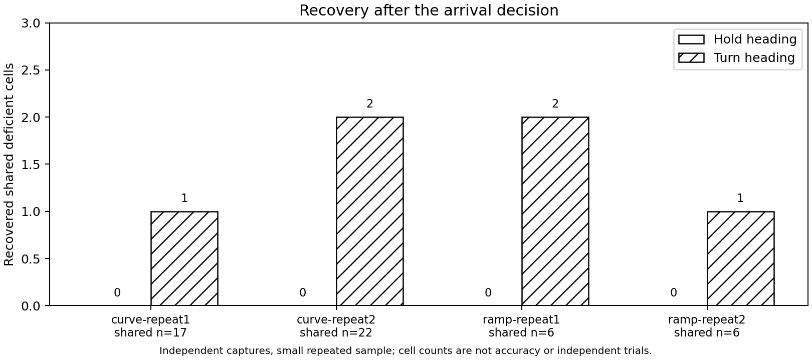

# 到达后是否还值得观察：阶段归因与候选规则验证

2026-09-13。已实现阶段回放与到达后重评候选规则，并完成新起点、两种几何、两次重复的8轮独立采集。规则仅作影子判断，车辆仍按预先固定的转向／保持朝向条件运行；尚未部署到第三种自主策略。

## 这一步解决什么

将累计结果按导航完成事件拆成：初始基线 → 移动前 → 到达 → 共同静置1秒后的决策点 → 转向完成（若执行）→ 结束。每段同时记录恢复、退化和净变化，避免把沿途已采好的格子再次算成转向收益。切片只使用不晚于事件时间的同步观测。

到达后重评只读取当时的估计位姿和地表采样统计，排除已有效、陡面和高残差格子，复用已有距离、方位、视场机会规则；预算不足或没有预测机会时建议跳过该补采朝向。跳过补采不等于全场探索完成。

## 旧数据提供的线索

前轮相同预算对照的坡面两组在到达时都恢复38/39个纯目标不足格，结束时39/39；曲面两组到达时已恢复16/16。大部分收益发生在移动阶段；坡面最后一格在不转向等待时同样能够恢复。阶段关联不能直接解释为转向因果收益。旧数据的阶段结果单独保存于retrospective目录。

## 新验证设置

坡面起点(-1,1.2,-0.15rad)，目标(-0.3,1)；曲面起点(-1.5,1.8,-0.35rad)，目标(-0.8,1.6)。相比前轮，目标地形更远、起始朝向改变。两场景各转向／保持朝向两次，轮换执行顺序，每次重置Gazebo、SLAM和档案。预算35仿真秒，含5秒基线及到达后的1秒共同静置；转向组目标朝向0rad，转向时间计入预算。

采集方案与候选规则在修正起点后、正式批次运行前冻结；汇总实现于运行期间完成，分析前保存源码与校验值。没有根据本批结果调参。

## 目标表面的阶段恢复

下表各行使用各自最初不足的纯目标表面格子；不同采集的初始集合可能不同，不能直接相减作对照。

| 实验 | 初始不足格 | 到达已恢复 | 决策时已恢复 | 转向结束已恢复 | 最终恢复 |
|---|---:|---:|---:|---:|---:|
| 坡面 R1 / 保持朝向 | 46 | 43 | 44 | — | 44 |
| 坡面 R1 / 转向 | 46 | 43 | 45 | 45 | 45 |
| 曲面 R1 / 转向 | 20 | 17 | 17 | 17 | 17 |
| 曲面 R1 / 保持朝向 | 20 | 16 | 17 | — | 17 |
| 坡面 R2 / 转向 | 46 | 43 | 43 | 43 | 43 |
| 坡面 R2 / 保持朝向 | 46 | 43 | 44 | — | 44 |
| 曲面 R2 / 保持朝向 | 20 | 18 | 18 | — | 18 |
| 曲面 R2 / 转向 | 20 | 18 | 18 | 18 | 19 |

## 决策时共同不足格的配对结果

这里改用两次实验在决策时都仍不足的同一批格子。数量为0表示没有这个评价集合，不能写成100%成功。

| 场景 / 重复 | 集合 | 共同仍不足格 | 保持朝向恢复 | 转向恢复 | 净差 |
|---|---|---:|---:|---:|---:|
| visible_curve_v1-repeat1 | 全部共同格 | 17 | 0 | 1 | +1 |
| visible_curve_v1-repeat1 | 纯目标表面 | 2 | 0 | 0 | +0 |
| visible_curve_v1-repeat2 | 全部共同格 | 22 | 0 | 2 | +2 |
| visible_curve_v1-repeat2 | 纯目标表面 | 2 | 0 | 1 | +1 |
| visible_ramp_v1-repeat1 | 全部共同格 | 6 | 0 | 2 | +2 |
| visible_ramp_v1-repeat1 | 纯目标表面 | 0 | 0 | 0 | +0 |
| visible_ramp_v1-repeat2 | 全部共同格 | 6 | 0 | 1 | +1 |
| visible_ramp_v1-repeat2 | 纯目标表面 | 1 | 0 | 0 | +0 |

## 候选规则是否可以上线

本批影子校验：**未通过，暂不上线**。建议转向0次、建议跳过8次。

四次实际转向在决策后仍恢复2、1、1、3个格次，保持朝向组均为0；但两组共同剩余集合只包含其中6个恢复格次，不能把7与配对表的6混用。该结果否定了候选规则的“零机会”判断，仍不足以证明总体策略优势。

| 实验 | 候选建议 | 剩余不足格 | 预测机会格 | 决策后实际恢复 |
|---|---|---:|---:|---:|
| 坡面 R1 / 保持朝向 | no_predicted_remaining_recovery | 11 | 0 | 0 |
| 坡面 R1 / 转向 | no_predicted_remaining_recovery | 7 | 0 | 2 |
| 曲面 R1 / 转向 | no_predicted_remaining_recovery | 22 | 0 | 1 |
| 曲面 R1 / 保持朝向 | no_predicted_remaining_recovery | 20 | 0 | 0 |
| 坡面 R2 / 转向 | no_predicted_remaining_recovery | 9 | 0 | 1 |
| 坡面 R2 / 保持朝向 | no_predicted_remaining_recovery | 8 | 0 | 0 |
| 曲面 R2 / 保持朝向 | no_predicted_remaining_recovery | 23 | 0 | 0 |
| 曲面 R2 / 转向 | no_predicted_remaining_recovery | 23 | 0 | 3 |

拒绝项保存在`stages/gate-assessment.json`：
- {"folder": "visible_ramp_v1-repeat1-turn", "reason": "zero_opportunity_but_later_recovery", "cells": 2}
- {"folder": "visible_curve_v1-repeat1-turn", "reason": "zero_opportunity_but_later_recovery", "cells": 1}
- {"folder": "visible_ramp_v1-repeat2-turn", "reason": "zero_opportunity_but_later_recovery", "cells": 1}
- {"folder": "visible_curve_v1-repeat2-turn", "reason": "zero_opportunity_but_later_recovery", "cells": 3}
- {"pair": "visible_curve_v1-repeat1", "reason": "skip_would_miss_paired_turn_only_recovery", "cells": 1}
- {"pair": "visible_curve_v1-repeat2", "reason": "skip_would_miss_paired_turn_only_recovery", "cells": 2}
- {"pair": "visible_ramp_v1-repeat1", "reason": "skip_would_miss_paired_turn_only_recovery", "cells": 2}
- {"pair": "visible_ramp_v1-repeat2", "reason": "skip_would_miss_paired_turn_only_recovery", "cells": 1}
- {"reason": "both_decision_branches_not_validated", "try_turn": 0, "skip_turn": 8}

“预测零机会但后来恢复”说明这条停止依据不够可靠；保持朝向也可能恢复，不能据此声称转向造成改善。配对实验也存在轻微轨迹与定位差异，格子并非独立统计样本。

## 后续安排

逐格诊断见`stages/decision-features.csv`与`miss-diagnostics.json`。7次漏判中5次属于体素点数不足、2次属于XY展布不足，全部未跨越原来的方位分箱，但体素点数均增加；6次位于参考地面、1次位于曲面。另有2个格心在最终名义视场之外，需要检查转向扫视过程和格子部分可见性，当前没有证实唯一成因。

先定位误判格子的距离、格内点分布、残差和新视场情况，区分继续静置就能恢复与真正需要新角度的目标，再修正剩余收益估计和短时观察停止条件。新规则需留出场景验证，不能直接把本批回放当成验证集。通过后才接入第三种策略，重新执行共同预算、共同安全约束的三策略实验。当前在线三策略保持原版本。

## 数据、截图及校验

- captures：8轮原始深度与同步位姿、行动前Nav2路径／地图快照、动作事件和现场截图。
- analysis：地图、真值表面审计、原预测模型逐格数据与图表。
- stages：阶段状态、恢复／退化表、候选建议、配对结果和验收判断。
- retrospective：前8轮已有数据的阶段回放，原档案未改动。
- aborted-batch：首次起点碰到人工禁行区的尝试；运动前中止，修正后重新冻结正式批次。SIGINT清理时的ROS重复关闭异常已用try_shutdown修复并检查。
- provenance：脚本和运行日志。`python check_evidence.py`只读核验来源摘要、事件先后、配对集合及统计一致性。程序检查通过不代表候选算法验证通过。

每轮现场／地图对照：

- [坡面 R1 / 保持朝向](analysis/visible_ramp_v1-repeat1-no_turn-approach/scene-and-map.png)
- [坡面 R1 / 转向](analysis/visible_ramp_v1-repeat1-turn-approach/scene-and-map.png)
- [曲面 R1 / 转向](analysis/visible_curve_v1-repeat1-turn-approach/scene-and-map.png)
- [曲面 R1 / 保持朝向](analysis/visible_curve_v1-repeat1-no_turn-approach/scene-and-map.png)
- [坡面 R2 / 转向](analysis/visible_ramp_v1-repeat2-turn-approach/scene-and-map.png)
- [坡面 R2 / 保持朝向](analysis/visible_ramp_v1-repeat2-no_turn-approach/scene-and-map.png)
- [曲面 R2 / 保持朝向](analysis/visible_curve_v1-repeat2-no_turn-approach/scene-and-map.png)
- [曲面 R2 / 转向](analysis/visible_curve_v1-repeat2-turn-approach/scene-and-map.png)

本轮均为软件仿真；有效平面拟合不代表测量准确率、可通行概率或硬件验收。
