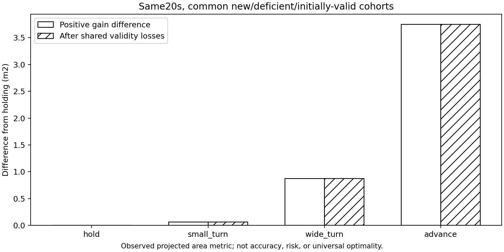
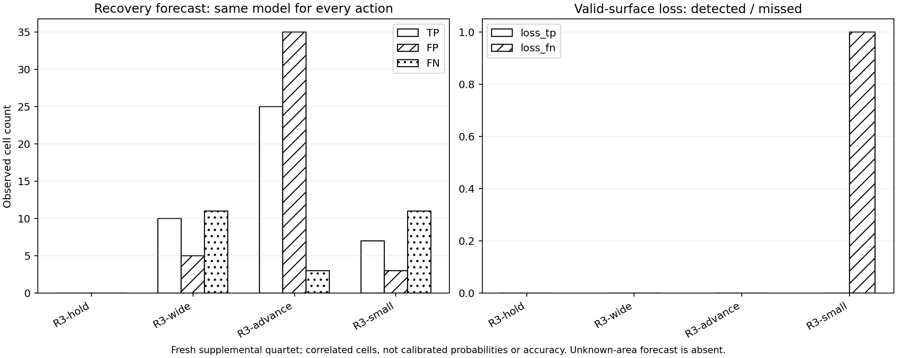
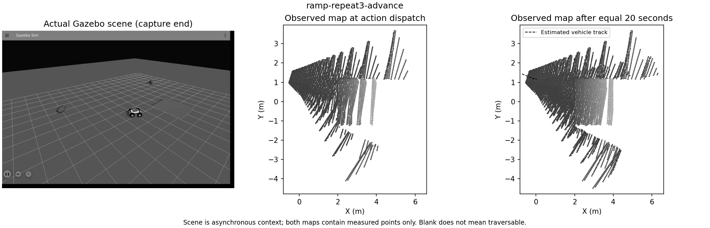
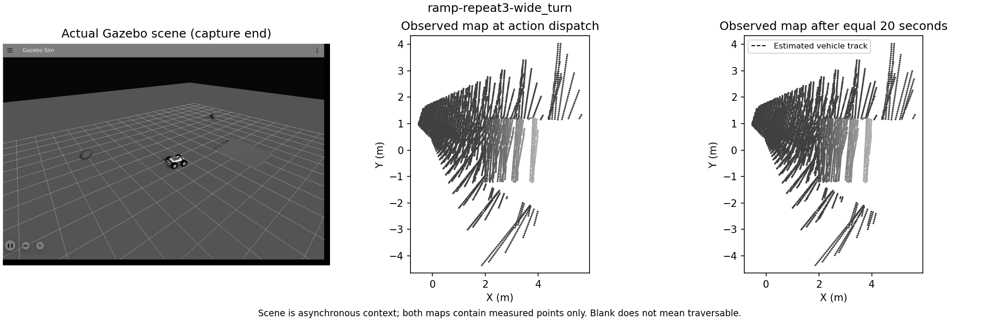

# 启动修正、统一地表预测与补充四组实验

日期：2026-09-13。软件仿真研究；在线自主策略没有替换。

本次4次补充尝试中，4次形成有效评价窗口；四组完整性：通过。旧8次尝试及其中2次失败没有被覆盖或改判。

## 启动问题的证据与修正

在真实Windows证据目录的Docker挂载上进行1000次原子JSON替换，1754次成功读取期间出现2次ENODATA。新的轮询处理将它视为暂时不可读，下一轮继续，最终读到序号1000；写入错误和未处理读取错误均为0。只有ENODATA采用此处理，权限等其他错误仍抛出。旧失败没有完整栈，无法把历史异常百分之百定位到某个文件调用；本次复现验证了该类读取缺口。

标定参数读取现在分别记录服务不可用、回复超时、空/异常响应和类型错误。服务不可用或回复超时最多尝试两次，每次等待有上限；错误类型、非有限值或越界值直接失败，没有0.5等默认替代值。真实ROS90隔离测试中，服务故意延迟首个回复，客户端在10秒后取消第一次等待，第二次读取成功返回0.5。第一次测试在销毁期间出现警告，修正测试清理并等待延迟回复后重跑，结果及日志均保留。

原采集的“未声明为double”文本混合了多种情况，因此不能倒推旧失败究竟是哪一种；本批成功也不等于以后永不超时。采集异常现在额外保存调用栈与阶段。

## 数学口径统一到哪一步

转向和换位共用action_support.forecast：将Nav2路径转换为相机视角序列，包含路径切线朝向、相机偏移和最终朝向；按相同名义速度与20秒预算截取。对已观测格使用同一组水平面片射线假设、体素合并和现有TerrainMap平面拟合规则，预测不足格恢复及有效格失效。

已观测地表的预测净值 = 格面积 ×（预测恢复格数 − 预测失效格数）；同预算速率统一除以20秒。原地保持不加入假设新点；所有假设只进入离线临时拟合对象，真实地图和档案只保留实测数据。

候选实测总净值 = 新增观测面积 + 旧不足格恢复面积 − 原有效格损失面积。三个分项同时保留。失效也可能是更多观测揭示原拟合不可靠，不一定意味着测量精度变差；因此扣除失效只是一项待验证指标，不能直接把发现危险地形惩罚为坏动作。未知区域新覆盖尚无可信预测，predicted_new_area_m2和total_action_rank保留为空，因此这是统一的已观测地表模型，并非已完成的总收益自动规划器。

模型仍使用未校准的水平面片、路径切线朝向及速度近似；忽略完整遮挡、噪声和重复融合造成的均值漂移。旧数据开发回放中换位误报53/60格，3个真实失效格全部漏报。统一计算口径不代表性能提高。参数和规则在新采集前冻结，没有针对新结果再调整。

## 补充实验

新开4次独立实验，记为第三轮：保持、较大转角、换位、小转角。场景、起点、共同前置路线、下一位置和20秒评价窗口沿用上批条件，每次60仿真秒。输入快照不超过5秒旧且至少剩余22秒，前置目标在移动前冻结。旧第二轮可作独立重复的描述性对照，旧第一轮两条缺失不补写为成功。

| 动作 | 新观测m² | 恢复m² | 损失m² | 实测净值m² | 动作耗时s |
|---|---:|---:|---:|---:|---:|
| hold | 0.0000 | 0.0000 | 0.0000 | 0.0000 | 0.0 |
| wide_turn | 0.6250 | 1.3125 | 0.0000 | 1.9375 | 1.4149999999999991 |
| advance | 3.6250 | 1.7500 | 0.0000 | 5.3750 | 6.023 |
| small_turn | 0.0625 | 1.1250 | 0.0625 | 1.1250 | 0.36599999999999966 |

每组首先相对自身命令前地图统计。下表才使用四组共同不足格、共同初始有效格，以及四组初始地图之外的新格作对照；仍不是严格逐格因果真值。

| 动作 | 共同新格 | 共同恢复 | 共同有效格损失 | 扣除损失后相对保持差m² |
|---|---:|---:|---:|---:|
| hold | 0 | 0 | 0 | +0.0000 |
| small_turn | 0 | 1 | 0 | +0.0625 |
| wide_turn | 5 | 9 | 0 | +0.8750 |
| advance | 50 | 10 | 0 | +3.7500 |

新一轮共同不足格37格、共同初始有效格204格。扣除共同失效后，保持/小转角/较大转角/换位相对保持的差值为0/0.0625/0.875/3.75m²。旧第二轮按相同损失口径重算为0/0/1.1875/4m²；两轮描述性顺序一致，但只有两次完整重复，不能据此声称显著优势。

新小转角组实际失效1格，它没有进入四组共同初始有效格交集，所以共同损失表中为0；不能把共同表的0解释成该组没有失效。

## 新数据上的预测误差

| 动作 | 恢复命中 | 恢复误报 | 恢复漏报 | 失效命中 | 失效误报 | 失效漏报 |
|---|---:|---:|---:|---:|---:|---:|
| ramp-repeat3-hold | 0 | 0 | 0 | 0 | 0 | 0 |
| ramp-repeat3-wide_turn | 10 | 5 | 11 | 0 | 0 | 0 |
| ramp-repeat3-advance | 25 | 35 | 3 | 0 | 0 | 0 |
| ramp-repeat3-small_turn | 7 | 3 | 11 | 0 | 0 | 1 |

新换位预测恢复60格，实测恢复28格：命中25、误报35、漏报3；新小转角的1个失效格被漏报。统一模型尚不准确，不接入在线选择。预测已知地表净值与实测含新覆盖的总净值范围不同，不能直接比较二者数值来声称预测准确。

## 下一步与结论边界

先根据已记录的名义路径视角与实测相机轨迹核查换位过度预测的来源，并检查有效格失效时的体素均值及拟合门槛变化。保持规则固定，扩展曲面、遮挡和不同起点后再判断模型是否足以接入surface_view_v1。未知新覆盖预测仍需单独建立并验证；完整三策略对照尚未重跑。

恢复仅表示满足地表拟合条件，面积是二维投影，不代表测量精度、通行安全或硬件性能；不能据此宣称普遍最优、统计显著或论文创新已证实。

## 复核

captures：新原始深度、点云、同步位姿、两个传感器前缀、路径、标定读取记录、控制事件和冻结源码。analysis：新独立数据结果；development：旧数据上的开发回放，不混为新验证。polling-diagnosis：真实挂载压力复现；provenance：ROS重试测试、脚本和日志。

python check_evidence.py使用标准库检查哈希、协议、标定记录、净值与共同样本统计。冻结evaluate_common_action.py另逐数组检查传感器前缀与最终记录一致，并重建目标集合及地图；需要现有NumPy环境。
