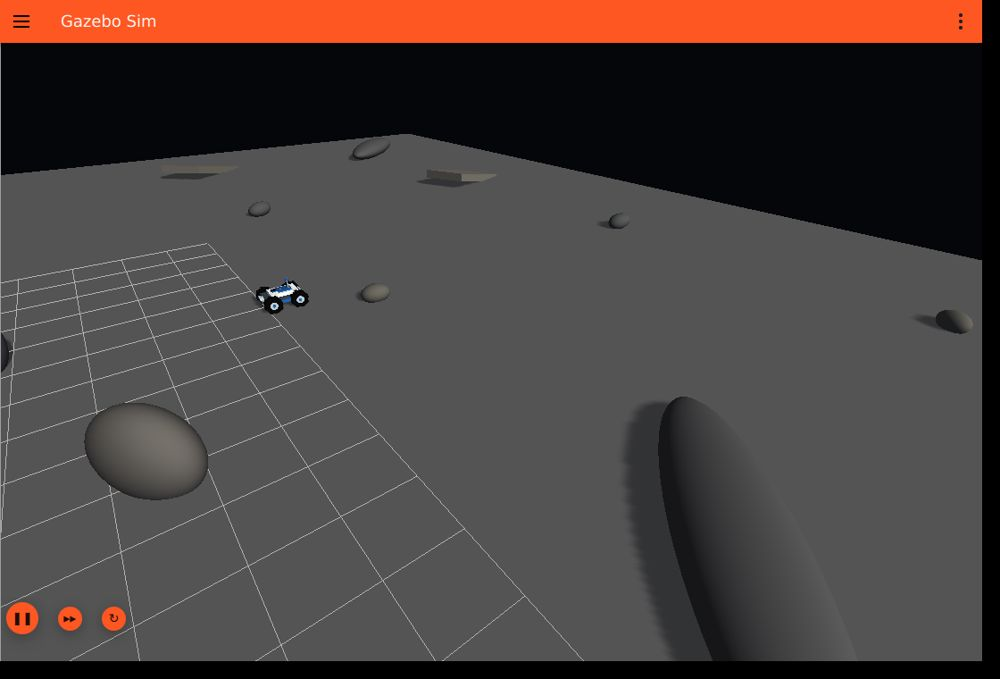
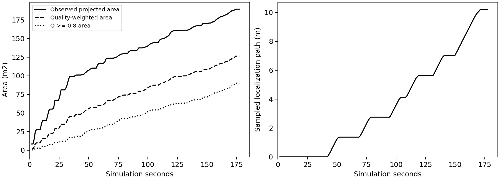

# 导航更新、现场画面与自主探测连续验收

2026-09-12：本次限定范围验收通过。50×50 米仿真场地，三个不同起点，每轮 180 仿真秒预算、距起点最远 10 米；验证连续探测、换实验、现场画面、预算停车及真实地图失效停车。

## 连续运行结果

| 起点与朝向 | 仿真秒 / 预算 | 成功前进 | 成功转向 | 预算中断 | 新增深度关键帧 | 定位采样路径 |
| --- | ---: | ---: | ---: | ---: | ---: | ---: |
| (3.5, 3)，0° | 174.4 / 180 | 6 | 11 | 0 | 321 | 10.92 m |
| (-6, -3)，90° | 180.0 / 180 | 5 | 14 | 1 | 295 | 10.06 m |
| (12, 0)，0° | 177.4 / 180 | 6 | 13 | 0 | 286 | 10.21 m |

共 55 次动作成功，1 次因预算用尽中断，新增 902 个深度关键帧。第一、三轮在剩余预算无法执行下一候选动作时正常停止；不代表环境已全部探测。第二轮最后一次导航未完成，明确保留为 interrupted，没有计入成功。

三轮停车后的安全速度六个分量均为零。每轮自动保存的 7 张现场图均有变化；独立监测分别捕获 106、103、110 个不同画面。已在 Chrome 核对真实 Gazebo 车辆、当前 Nav2 路径、位置、观测地图和实验档案切换。

完整记录：
- [第一轮](autonomy-137ca52327/README.md)
- [第二轮](autonomy-d10f89c13a/README.md)
- [第三轮](autonomy-64d68b8b56/README.md)




## 修复及证据

- **地图时效**：原 5 秒墙钟限制与低实时率下按仿真时间发布的地图不匹配。统一使用消息相对 ROS 时钟的年龄（最多 3 仿真秒），并保留 30 秒墙钟断连保护。目标检查、运动许可和自主规划共用判断。`map-clock-after.json` 实测约 5 秒墙钟间隔对应约 1 秒仿真时间，消息本身仍然新鲜。
- **现场车辆缺失**：Gazebo 服务器先启动；确认其场景已包含 mooncar 后再连接 GUI，截取实际 GUI 画面。三轮不同起点都确认车辆可见并随运动更新。实验刚切换、GUI 尚未就绪时仍可能短暂显示等待画面。
- **启动确认超时**：复制研究源码快照移到后台，在允许车辆运动前准备完毕；HTTP 先返回 accepted。第二、三轮分别用 0.125、0.079 秒确认启动，记录初始化失败则停止。未通过重复发送指令掩盖超时。
- **切换实验后的旧定位**：原 Buffer 没有使用节点的仿真时钟，旧发布者又可能在提前 reset 后重新填入缓存。改用 Buffer(node=self)，并在旧发布进程退出后清空缓存。同一后端内先启动 (-6,-3) 静止实验，再切换到 (12,0) 成功定位并完成第三轮。见 `clock-switch/`；ROS 真实时间回退与退出顺序回归测试通过。

14 项针对性测试通过，见 `targeted-tests.txt`。测试日志中的 400/403 来自无效路径和跨来源请求的拒绝检查。

## 地图失效停车与恢复

`map-fault-moving/` 保存独立故障测试：车辆实际前进时停用 `/global_costmap/global_costmap` 的发布，约 11.49 秒墙钟后观测到地图失效，自主任务 fault，运动状态 cancelled，原因“导航地图失效，已停止运动”。停用前线速度非零，停止后三次采样全部为零。恢复地图节点后 ready=true，车辆与自主任务均保持停止，没有自动续跑。

`map-fault/` 保留更早的一次检查：失效发生在转向完成后的观察阶段，不能代替上述行驶中取消证据。两次故障均有独立研究记录；故障样本不混入三轮正常运行统计。

## 保留的失败与边界

第三轮首次切换 experiment-1f39903fb4d9 未就绪，没有启动自主任务。独立 tf2_echo 已有 (12,0) 新定位，后端却持续 TF_OLD_DATA。错误和状态保存在 `startup-failure/`；修复后重新验证，没有将这次失败隐藏为通过样本。原拟起点 (-3,-3,90°) 被放置碰撞检查拒绝，未放置车辆，改为 (-6,-3,90°)。

每包 `source.zip` 保存该次实际源码，`survey_yard.sdf` 保存场景，`observations.npz` 保存原始观测，`hashes.json` 核验文件完整性。第一轮之后补了启动确认与 ready 判断，第二轮之后补了定位缓存切换修复；各版的对应行为分别有运行证据，不能把它们直接当作同版本算法优劣对照。

本验收不证明 50×50 米全场覆盖、地图几何精度、最优探测策略或任何实物硬件通过。采样充分度不是准确率；路径来自定位采样，含漂移。高度与坡度真值误差仍为未测。

## 离线复核

在项目已有 Python 环境运行：

```text
python reports/evidence/terrain-workbench/continuous-20260912/check_evidence.py
```

检查三种起点、时长、动作、原始时间戳、质量计算、哈希、现场图变化、停车速度和地图失效后的恢复状态。运行原始监测仍保留在 `tmp/continuous-20260912/`，仿真日志与所有自动研究包在 `tmp/ros_acceptance/frontend-experiments/`。
