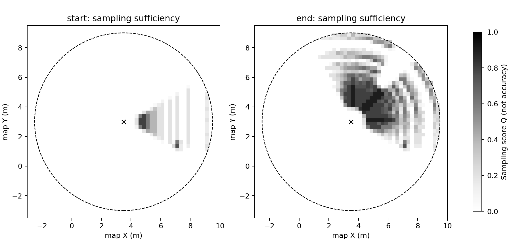
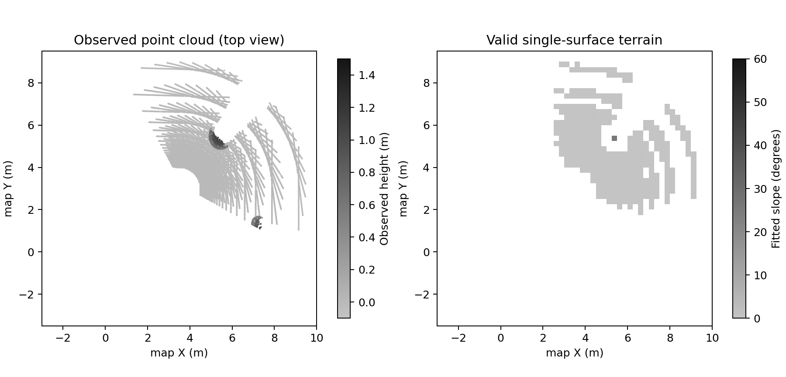
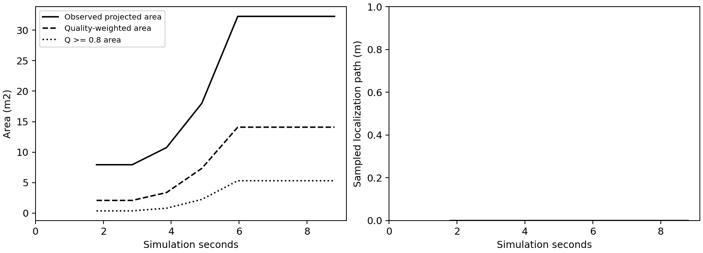

# 自动研究记录与统一评价：验收样例

2026-09-12，在现有 Docker/Gazebo 与 Windows Chrome 工作台上验证。每次点击“从当前位置自主探测”自动生成独立目录；任务结束后调用已有保存服务，复制原始档案并生成图表和 CSV。未采购、安装依赖、上传、提交或修改主目录/M6。

## 直接查看

- [自动汇总表 CSV](runs.csv)
- [预算内结束的完整样例](autonomy-bd26b75ec6/README.md)
- [较长探测后保护停止的完整样例](autonomy-7765f802ea/README.md)
- [已有地图基础上续采失败的完整样例](autonomy-f19b380559/README.md)
- [指标、文件用途和日常使用说明](../../../../docs/survey_evaluation.md)

## 实跑结果

| 任务 | 预算 / 实际仿真秒 | 结束原因 | 新增观测投影面积 | 质量面积增量 | 新增深度关键帧 |
|---|---|---|---|---|---|
| 7765f802ea | 60 / 40.6 | 导航地图未更新，保护停止；此前完成 6 次转向 | 70.44 m² | 41.41 m² | 72 |
| bd26b75ec6 | 15 / 8.8 | 剩余预算不足以执行下一候选；完成 1 次转向 | 24.31 m² | 12.00 m² | 14 |
| f19b380559 | 15 / 2.0 | 同场续采，决策前导航地图超时 | 0 m² | 0 m² | 0 |

三次证据状态均为 captured / report ready。第一次用于初版记录接入验证，后两次验证最终后端保存流程；代码快照哈希不同，不能合并成同版本算法对照。图表经过可读性调整后，从冻结原始档案重新生成，具体报告程序哈希另存于 manifest.json。

第三次的开始基线已包含前一次地图，最终新增值为零，说明没有把历史成果重复计入。末尾速度指令六个分量均为零，见 stopped-velocity.txt。

**本轮通过的是记录与评价流程，不是导航稳定性验收。** 导航地图新鲜度保护两次触发，原因仍需单独诊断。没有绕过保护条件，也没有把失败样本删除。中断动作保留与撤销运动许可另有自动化测试；本次没有完成真实仿真中的手动中断动作测试。

## 图表示例

以下来自预算内结束的样例。左右使用相同坐标范围与 Q 色标，不调整显示范围来夸大成果。

现场截图均自动保存，但每次任务内的画面字节相同，报告已明确标注：只能用于展示场景，不证明车辆的运动或视角变化。现场截图也不是与深度观测严格同步的真值。当前样例均为原地转向，没有平移导航验证。

Q 是采样充分度，不是准确率。高度 RMSE / 坡度 MAE 均为未测；仅用人工构造的数学样例测试参考数据导入和误差计算公式。不能宣称真实地图精度已通过验收。

## 核验

相关检查：评价 3 项、自主探测 4 项、运动保护 3 项、仿真实验/API 3 项、档案 API 2 项通过；前端语法检查通过。真实 Chrome 运行中决策文字正常，检查时没有控制台错误。研究目录中的原始档案副本不混入普通采集记录下拉框。

用已有 Python/NumPy 环境运行本目录 `check_evidence.py`，核查 3 个完整证据包的哈希、固定范围统计、末尾档案时刻、预测/实际收益口径、失败保留与零速度输出。文件拷贝后已经执行通过。

当前证据仅用于验证研究工具，不是论文的三策略对照实验。后续需固定场景、起点、初始地图、预算与传感器配置，按相同口径运行基线和改进方法。
