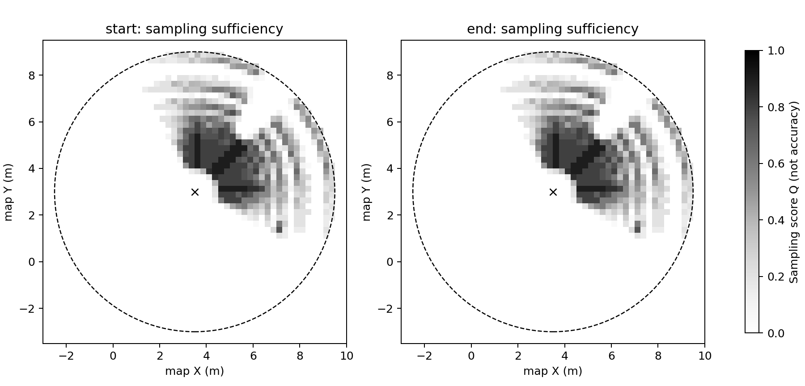
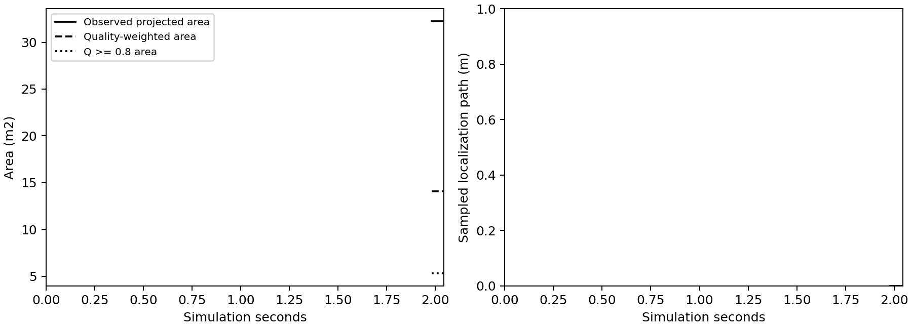
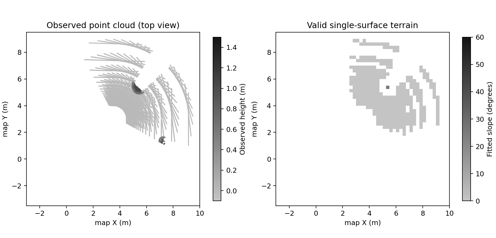

# 自主探测实验 autonomy-f19b380559

- 结束状态：fault；自主探测已停止：导航地图未更新
- 证据状态：captured；版本：survey-metrics-v1
- 仿真时间：2.0 / 15 秒；定位采样路径：0.00 米
- 固定评价面积：112.75 平方米；新增投影观测面积：0.00 平方米
- 质量加权面积增量：0.00 平方米；新增深度关键帧：0
- 动作：0；未成功动作：0。取消或预算中断计入未成功，原因见 actions.csv。
- 高度 RMSE（米）：None；坡度 MAE（度）：None。None 表示未测；参考状态：not_provided。

scene-*.jpg 为异步 Gazebo 现场截图；checkpoint-*.json 记录抓取时间及画面缺失。
现场图片检查：2 张，1 个不同画面；All saved scene images identical; use only as scene context, not evidence of vehicle motion。
observations.npz 是原始深度与位姿档案，可能包含本任务之前的观测。任务时间窗口和开始基线见 manifest.json/telemetry.csv；不能把整个档案当成此次新增成果。
mission.json/actions.csv 保留决策及失败；source.zip 与 survey_yard.sdf 保存实际代码和场景。
CSV 可导入 Excel，PNG 可插入论文，PDF 图可用于排版。hashes.json 用于核验文件完整性。

Q 只是采样充分度。观测投影面积可能包含障碍表面，不能解释为可通行地面覆盖率；空白是未观测。
路径来自定位采样，含定位漂移；未做轮速里程真值验证。单次实验不构成算法优越性证据。
