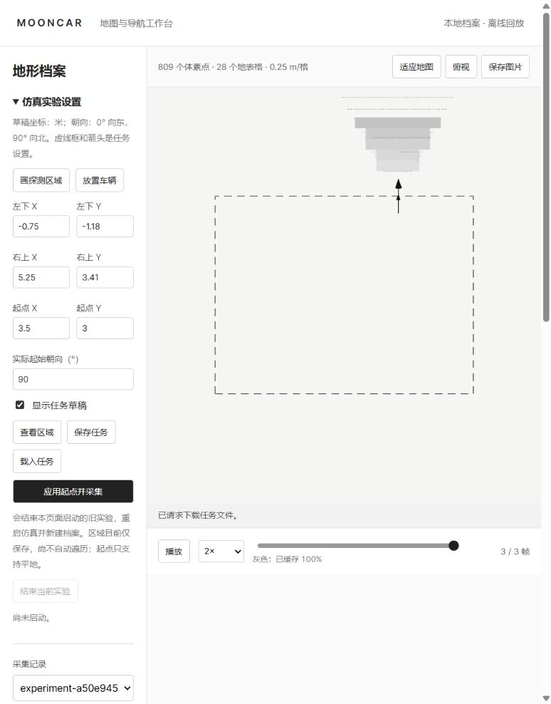

# 网页仿真实验设置验收

日期：2026-09-10。代码工作区：`MoonCar-mapping`，本轮修改未提交。
环境：已有 Docker 容器 `mooncar-terrain-validation`，ROS 2 Jazzy、Gazebo 8；本轮未安装依赖，未连接或改动独立 Ubuntu 虚拟机。

## 实際位姿与采集

两组实验均由浏览器“应用起点并采集”按钮启动。位姿真值来自 Gazebo 的 `/world/lunar_yard/dynamic_pose/info`，不是请求参数回显或单独读取 AMCL。

| 实验 | 设定起点 X / Y / 朝向 | Gazebo 检查 | 档案关键帧 | 体素点 | 有效地表格 |
|---|---|---|---:|---:|---:|
| a470c17236d6 | 0.5 m / 0 m / 0° | 位置与朝向误差均小于 1e-6（米/弧度） | 3 | 1182 | 30 |
| a50e945f191e | 3.5 m / 3 m / 90° | 位置与朝向误差均小于 1e-6（米/弧度） | 3 | 809 | 28 |

数值仅说明仿真初始化正确，不代表定位精度或实物精度达到该水平。车辆未获运动许可，静止产生初始关键帧；不是区域探测完成。
每个子目录保存任务配置、Gazebo 位姿消息和对应 NPZ 原始观测档案；`results.json` 记录提取结果及档案中的车体位姿。
设置矩形为 `[-0.75, -1.18, 5.25, 3.41]`，该边界只保存于任务文件，尚不裁剪观测数据或限制导航。

## 检查结果

- 从第一组切换至第二组后，进程表仅存在新实验进程组；旧 ROS / Gazebo / Xvfb 均已退出。
- 在第二组运行时设置起点 `(2, 1.4, 0°)`（石块位置），接口拒绝并显示原因，原实验 ID 与档案未改变。
- 点击“结束当前实验”后状态为 stopped，进程表只剩工作台服务和容器主进程，两份 NPZ 仍可读取。
- 应用内浏览器实际完成矩形两角选点、车辆位置与方向两次选点、数值输入、载入 task.json、刷新恢复草稿、自动切换新采集档案。
- 任务保存改用普通 HTTP 附件下载后，浏览器 download 事件成功返回；任务下载接口内容与输入配置一致。
- 自动回放缓存就绪，进度条为 100%；2× 回放实际推进至 2 / 3 帧，再正常结束。浏览器未记录脚本错误。
- Python 检查覆盖任务范围、NaN / 布尔值、坡面 / 石块碰撞、超时 / 进程退出状态、同源请求和嵌套档案路径；既有回放 API 与缓存单元检查通过。

Chrome 的 127.0.0.1 / localhost 访问均超时；本轮浏览器验收使用应用内浏览器，不声称 Chrome 已验证。未修改网络设置。

## 范围

支持矩形任务草稿、实际平地出生点和朝向、独立会话采集与保留档案。启动仍依赖已有二维地图进行 AMCL 定位。
未实现自主覆盖探测、三种探测策略、按区域动态生成运动路线或实车部署；本次没有硬件验收结论。
启动方式及操作见 `web/README.md`。测试结束后已停止整车仿真，工作台服务保留在 `http://127.0.0.1:8766/`，重新启动实验需要点击按钮。
