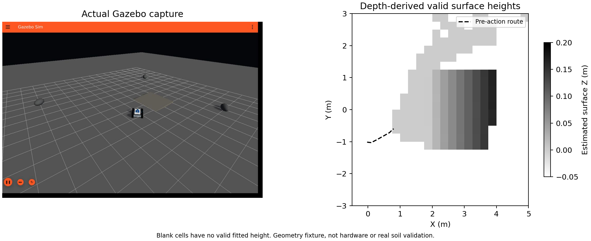
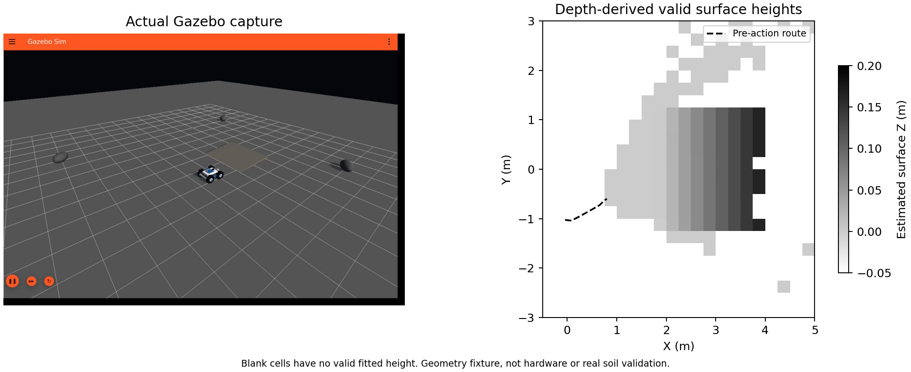
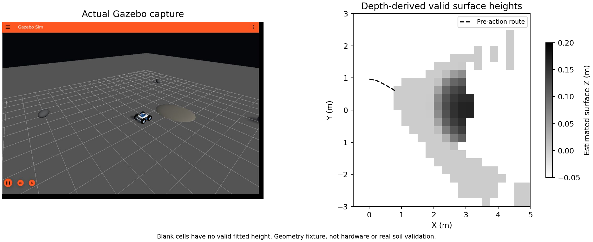
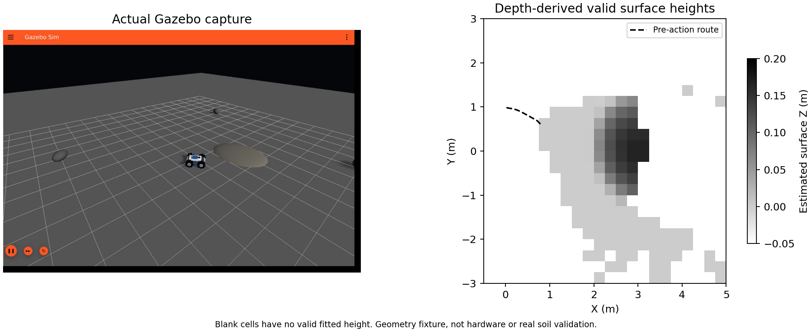

# 新起点、相同预算的转向补采对照

2026-09-13。两个独立几何场景，各完成一次到点转向、一次保持到达朝向。每次重置仿真、重新建图；原始观测、位姿、行动前路径、地图快照和现场截图均已保存。

## 实验设置

坡面起点 `(0, -1, 26.565°)`，目标 `(0.8, -0.6)`；曲面起点 `(0, 1, -26.565°)`，目标 `(0.8, 0.6)`。与上轮起点不同。两组统一35仿真秒，含前5秒静止基线。转向组到点后执行Nav2 Spin至0°；对照组保持到达朝向，转向耗时计入同一预算。坡面先不转向、曲面先转向，执行顺序事前确定。

## 共同不足格子的恢复结果

恢复指观测融合后能够拟合有效地表平面，不表示地图准确率或安全概率。仅比较两次基线都不足的格子；坡面/曲面归属由独立真值审计在评价阶段标注，未参与选路或预测。

| 场景 / 评价集合 | 共同格数 | 不转向恢复 | 转向恢复 | 净变化 |
|---|---:|---:|---:|---:|
| 曲面 / 全部共同不足格 | 63 | 49 | 48 | -1 |
| 曲面 / 纯目标表面 | 16 | 16 | 16 | +0 |
| 曲面 / 初始统计也一致 | 63 | 49 | 48 | -1 |
| 坡面 / 全部共同不足格 | 75 | 57 | 60 | +3 |
| 坡面 / 纯目标表面 | 39 | 39 | 39 | +0 |
| 坡面 / 初始统计也一致 | 75 | 57 | 60 | +3 |

初始统计一致指点数、拟合状态、格内覆盖率、观察方向数相同；不代表两次原始观测完全相同。混合表面不计入纯目标表面。缺失结果数量保存在CSV，未充当恢复。

## 执行与时间

| 场景 / 动作 | 同步帧数 | 首末观测跨度（秒） | 转向耗时（秒） | 到位后观测（秒） | 最终有效面积（平方米） |
|---|---:|---:|---:|---:|---:|
| 坡面 / 不转向 | 63 | 34.30 | — | 22.36 | 10.938 |
| 坡面 / 转向 | 64 | 34.80 | 2.16 | 20.75 | 11.688 |
| 曲面 / 转向 | 63 | 34.80 | 1.79 | 21.30 | 11.312 |
| 曲面 / 不转向 | 63 | 34.50 | — | 22.89 | 10.562 |

最终有效面积包含新增视野，作为补充指标，不能替代共同格补采比较。35秒是计划窗口；表中首末同步帧跨度受采样周期影响，实际数值逐次保留。

## 结论边界与后续

转向组在全部共同不足格上的净变化为坡面+3、曲面−1；纯坡面39格、纯曲面16格在两种动作下均全部恢复，目标表面存在恢复率上限效应。两场景最终有效面积均增加0.75平方米，但主要评价的目标补采没有额外提升。因此这组证据不支持每次到点都转向，也不能用面积增加代替目标质量改善。

这是两种几何场景、每条件一次的机制对照。相同起点目标不保证真实轨迹完全相同；格子空间相关，不能把格子数量当作独立实验次数。结果不足以证明第三种自主策略总体更优。

当前保持在线三策略不变。下一步先区分“沿途已经恢复”和“转向才能新增恢复”，用到达后的剩余不足格评价转向边际收益，加入无需再观察的停止条件；在不会轻易全部恢复的距离、朝向下做重复验证。确认可靠后再接入在线选点，并做同预算三策略对照。这里是后续计划，尚未实现或验证。

## 图像与原始数据

### 坡面 / 不转向

### 坡面 / 转向

### 曲面 / 转向

### 曲面 / 不转向

- `captures/plan.json`：事前设置、源代码摘要；每轮有原始深度、估计及真实位姿、路径快照、动作状态和现场图。
- `analysis/heading-pairs.csv` / `heading-trials.csv`：共同基线对比及逐次执行数据。
- `analysis/samples.csv` / `rule-check.csv`：逐格特征、标签、原有几何机会规则检查。
- `provenance/`：本轮脚本、排序修复与检查代码、运行日志。

## 采集记录排序修复

前端按文件内UTC采集时间倒序，精确到微秒，不再按随机实验ID排序；无可解析时间的记录置后。首次无历史选择时打开最新记录，刷新保留当前选择。无需重命名旧档案或重启服务。

Chrome 127.0.0.1:8765 实际刷新验证：原51份记录从17:40:33、17:38:00、17:35:28向下排列，选中的17:31:33保留；新实验18:04:26自动排到顶部。排序、默认选择及保留选择的Node检查通过。

只读核验：`python check_evidence.py`。排序检查：在工作区执行 `node web/session_order.test.mjs`。
