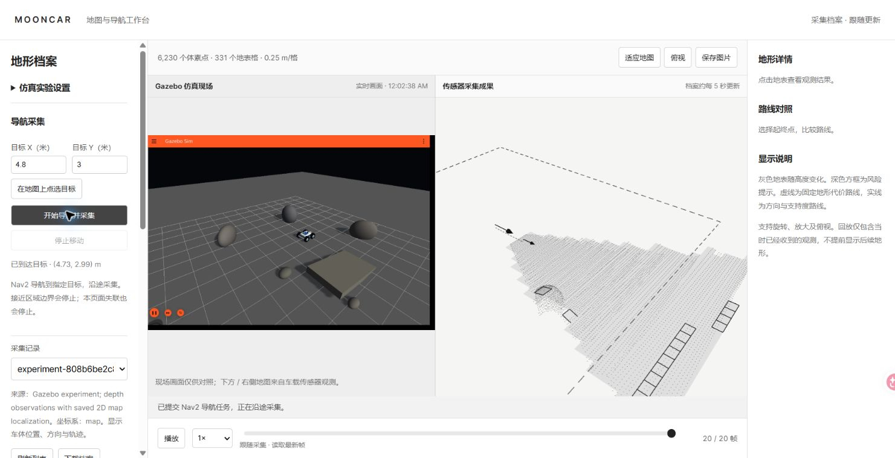

# Chrome 实时仿真与交互验收

日期：2026-09-11。工作区：MoonCar-mapping。本轮未修改 Windows 网络设置、未安装依赖、未采购、未提交代码。

## 用户可见结果

- Chrome 在 `http://127.0.0.1:8765/` 打开 Windows 本机前端，并通过同源接口连接容器 8766 的仿真控制。原 Chrome 直接访问 8766 超时，本轮不声称已修复其底层网络原因；本机入口实测可用。
- “拖动画区域”按住左键绘制，松开完成；模式内滚轮缩放实测有效。真实浏览器绘制得到 `[-1.27,-2.38,8.81,7.39]`。右键平移沿用 OrbitControls，取消绘制恢复左键视角控制。
- 页面左侧是运行中的实际 Gazebo GUI 截图流（Xvfb/Pillow，约 2 帧/秒），右侧是车辆深度观测生成的地图。现场图像不参与建图。
- 已接入带页面续租的 Nav2 指定目标导航，可开始、手动停止及在失联后自动停止。没有实现整块区域覆盖或三种自主探索策略。

## 实际运行数据

实验：`experiment-808b6be2c81a`。起点 `(3.5,3.0,0°)`，第一次目标 `(4.8,3.0)`。

| 指标 | 起点静止 | 第一段到达 |
|---|---:|---:|
| 关键帧 | 3 | 20 |
| 体素点 | 970 | 6230 |
| 有效地表格 | 28 | 331 |

Nav2 返回 succeeded，定位约 `(4.727,2.995)`；独立读取 Gazebo `/world/lunar_yard/dynamic_pose/info`，车体真值约 `(4.737,2.982)`。`gazebo-arrival.json` 保存原消息，`arrival.json` 保存前端接口状态，`motion-samples.json` 保存行驶与到达时的连续状态。

随后向 `(6,3)` 行驶，在 Chrome 点击“停止移动”，页面返回“已停车”，约 `(5.86,2.99)`。
再发送目标 `(6.6,3)` 而不续租，3 秒后状态为 cancelled，原因“页面失联，已停止运动”；ROS `/mooncar/cmd_vel_safe` 的六个速度分量均为 0。
`disconnect-stop.json` 保存失联停止状态；`observations.npz` 包括第一段及后续停车检查的观测，可按前 3 帧与前 20 帧独立复核第一次增长。

## 校验与限制

任务/代理接口的三个 Python 检查、原有回放 API 的两个检查、ROS 环境的运动许可检查、两个浏览器缓存检查均通过。代理拒绝外部地址和跨源控制请求；实跑验证了现场位姿变化、档案增长、手动停车及不续租停车。
`tmp/check_live_demo.py` 可重新核对已保存的观测、真值及失联证据，不启动仿真。
绘制代码保留右键与滚轮；本轮真实浏览器重点验证左键拖动和绘制中缩放，未声称完成所有设备的触摸交互验收。

地图按仿真时间每 5 秒保存，墙钟刷新速度取决于仿真实时率。区域目前用于起终点包络检查和运行时边界停车，没有作为 Nav2 全局规划的硬边界，因此遇到需要越界绕行的情况会停车。
新导航沿用已有 Nav2 基线；不把它表述为新的探索算法，也不构成任何实物硬件验收。

PowerShell 启动：`& 'D:\Document\Repositories\MoonCar-mapping\scripts\start_workbench.ps1'`。已有服务会复用；新启动本机前端时应保持该 PowerShell 窗口打开。
