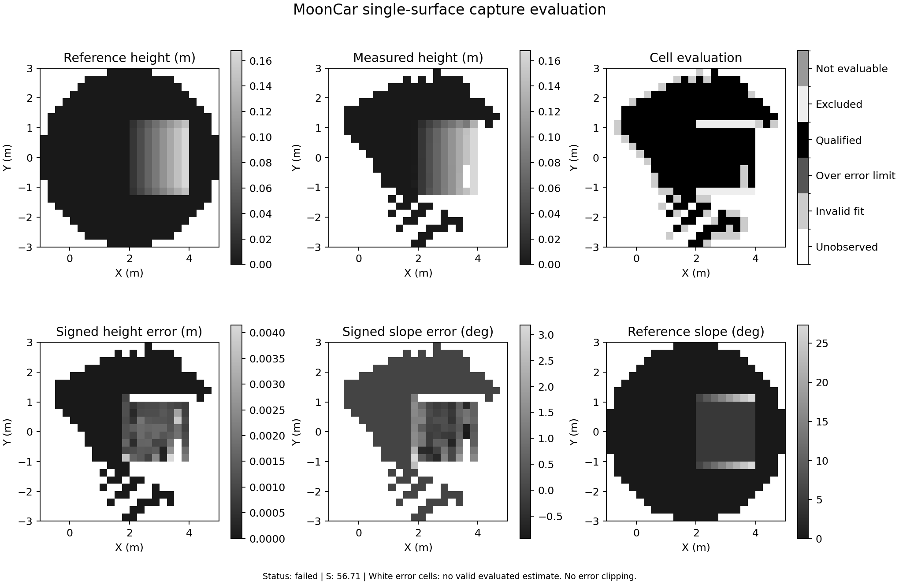

# 地形采集评价：首版交付

2026-09-14。本阶段完成的是可复算的离线评价流程；不代表整车已通过验收，也不是探测策略优越性的证明。

## 已交付

| 内容 | 文件 |
| --- | --- |
| 指标、公式、分母、候选阈值和复算命令 | [评价标准](../../../../docs/mapping_acceptance.md) |
| 采集前冻结的参考地表、范围、预算和哈希 | [reference/reference.json](reference/reference.json) |
| 一份真正移动的仿真采集评价 | [中文报告](report-motion/README.md)、[JSON](report-motion/summary.json)、[逐格 CSV](report-motion/cells.csv) |
| 参考与采集地图、状态及误差分布 | [PDF 图](report-motion/maps.pdf)、[PNG 图](report-motion/maps.png) |
| 原始深度、点云、估计位姿、真值诊断和运行配置 | [采集清单](capture-motion/approach/manifest.json)、[坐标契约](capture-motion/approach/coordinate-contract.json) |
| 现场图像 | [开始截图](capture-motion/approach-start.jpg)、[结束截图](capture-motion/approach-end.jpg) |
| 已知偏差、漏采和缺失证据的验证 | [验证表](validation-cases.csv)、[验证结果](validation.json)、[测试日志](tests.log) |
| 未执行移动的失败尝试，完整保留 | [失败报告](report-unstarted/README.md) |

## 实际结果如何理解

评价预算为首个同步深度帧起 30 秒。区域是以 (2,0) m 为中心、半径 3 m 的圆形；按 0.25 m 格心计入后，任务面积为 28 m²。其中 1 m² 为事前参考标出的复杂混合边缘，单列排除；评价面积固定为 **27 m²，共 432 格**。

| 指标 | 移动记录结果 |
| --- | ---: |
| 原始观测覆盖率 | 66.44% |
| 有效重建覆盖率 C | 56.71% |
| 已重建部分几何达标率 P | 100% |
| 达标地表覆盖分 S | **56.71 / 100** |
| 达标地表 | 245 格，15.3125 m² |
| 高度 RMSE | 0.846 mm |
| 坡度 MAE | 0.209° |
| 首帧 S₀ / 增量 ΔS | 6.94 / 49.77 |
| 平地 / 坡面有效覆盖率 | 50.00% / 95.31% |
| 判定 | **覆盖不足，几何验收未通过；安全未认证** |

“P=100%”只表示这次 245 个有效估计格满足暂定的高度 5 cm、坡度 5°门槛，不表示测量零误差、整片区域采完或硬件精度达到毫米级。这是理想仿真深度与单层平面/坡面样例；不能推断真实沙土、碎石或 OAK-D-Lite 的测量能力。

尤其需要注意：该坡道约 4.58°，5°坡度容差不足以单独验证能否区分这类缓坡与平地。这里同时报告连续坡度误差与高度误差，不因结果漂亮便声称阈值已合理标定；正式任务需要另行确定精度要求并冻结新版本。

## 评分依据与验证

公式为 **S=100×达标采集面积/固定评价面积=100×C×P**。合格必须同时满足高度和坡度误差要求；无法拟合、未探测的格子仍占分母。误差超标格保留在精度与误差统计中。所有计算保持估计相机位姿，未将真值位姿用于地图重建，也未对结果做配准修正。

- 53 帧点云全部能由同一时刻的原始深度图逐位重算。记录另有 2 次选帧丢失，保留原因；成绩评价已记录的 53 帧，不冒充前端完整关键帧序列。
- 参考 17×17 / 33×33 采样没有分类分歧、缺失或超出收敛限值；当前为解析平面与盒体坡面，复杂曲面与更细结构不能据此自动认证。
- 运行坐标配置、起点锚定 TF、相机固定几何和实际部署启动文件核验通过。全段 XY 定位 RMSE 约 4.65 cm，原样保留在地图误差中；它与“地表高度 RMSE”是不同指标。
- CSV 中重新逐格计数得到同样的 S，并独立重新计算高度 RMSE。
- 将真实结果的高度人为整体加 20 cm：C 保持 56.71%，P 和 S 降为 0。
- 人为隔格删减：S 降为 29.40；清空有效记录：S 为 0、P 无定义；移除可信坐标条件：S 为空，状态为不可评价。
- 独立已知面算例还验证斜面水平平移、坡度错误、重复格、非有限值、错误深度来源、时间截止和平地掩盖坡面失败等边界。人工修改只用于测试评价器，不作为新策略实验。

## 保留的失败及运行状态

第一轮原计划移动，但外层控制脚本运行在 ROS 域 0、采集在域 89，控制脚本的仿真时间没有推进，未发出移动动作。其原始 `completed` 仅代表采集子进程结束；新报告明确标记 **Recorded execution fault**，不能算成功导航。

已在控制脚本入口加入域检查；第二轮统一域 89 后，实际驶至约 (-0.060,1.299) m，Nav2 返回成功。两轮都保留，没有替换或删除失败样本。这里的补采仅用于核验评价工具，不把两轮成绩当作算法对照。

收尾时仿真已停止，运动和自主探测均不活跃。未修改在线探测策略，未安装依赖、训练模型或上传文件。

后续可以用这套流程评价新实验；正式三策略对照应先固定任务精度目标和预算，并为每轮保存同样的原始与坐标证据。旧六轮对照仍只是有效拟合面积的历史比较，不回填一个未经核验的准确率。
