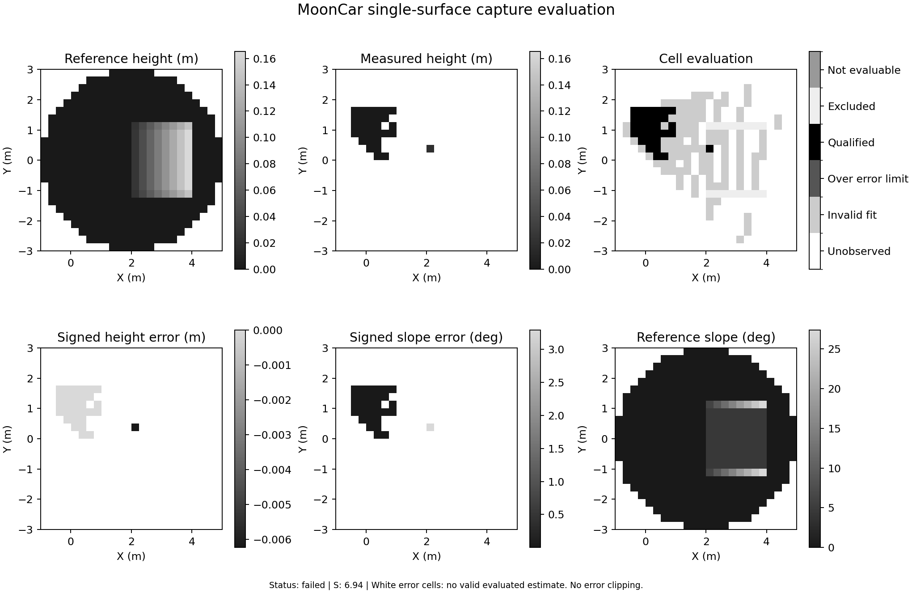

# MoonCar 地形采集评价报告

状态：`failed`。这是评价流程的真实记录示例，不是三策略优劣结论或实物验收。
未通过项：all: coverage below target; ground: coverage below target; terrain: coverage below target; Recorded execution fault。

| 指标 | 结果 |
| --- | ---: |
| 达标地表覆盖分 S（0–100） | 6.9444 |
| 原始观测覆盖率（0–1） | 0.3333 |
| 有效重建覆盖率 C（0–1） | 0.0694 |
| 几何达标率 P（0–1） | 1.0000 |
| 高度 RMSE（m） | 0.0011 |
| 坡度 MAE（°） | 0.1098 |
| 评价面积（m²） | 27.0000 |
| 表示范围外面积（m²） | 1.0000 |
| 首帧分数 S₀ | 6.9444 |
| 本次分数增量 | 0.0000 |

S = 100 × 几何达标采集面积 / 固定评价面积。高度和坡度必须同时满足冻结阈值；未观测和错误估计不从分母删除。
高度容差 0.05 m，坡度容差 5.0°，均为暂定仿真目标。
安全记录未在本评价器中认证，因此几何达标也不自动代表整体验收通过。

黑白图中深色“Qualified”为合格，浅灰或空白不意味着合格。高度/坡度误差图保留全部有效估计的误差；没有可信对应时不画达标结论。

评价区域、参考收敛检查、平地/地形分项、时间截止、原始深度重投影核验、坐标核验及输入哈希见 `summary.json`。
逐格数据见 `cells.csv`，重建后的传感器档案见 `observations.npz`。记录每约 0.5 秒选帧；不宣称覆盖前端所有关键帧。
参考来自冻结 SDF 的解析视觉几何与中央 80% 网格采样；曲面网格化、细于采样间距的特征仍有近似误差。
本结果保留估计相机位姿误差，未使用真值位姿替换，也未对最终地图进行配准修正。

证据问题：未发现阻止几何计分的证据缺口；安全状态仍未认证。
