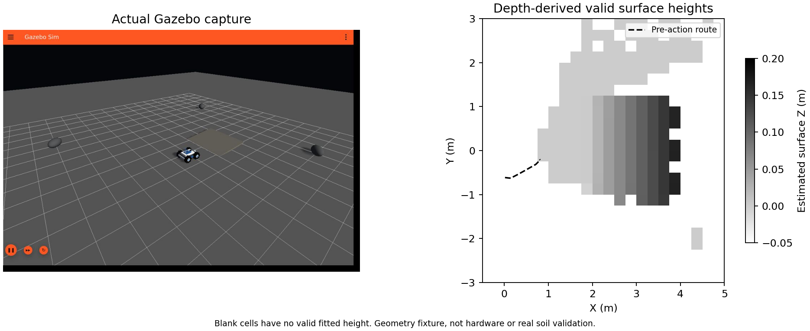
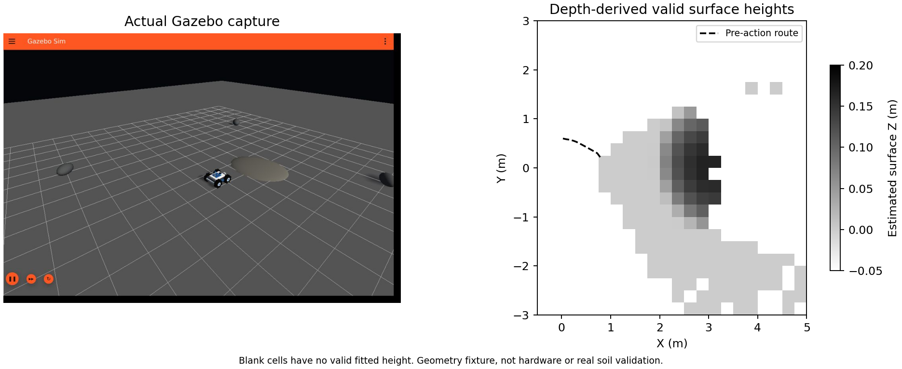

# 行动前 Nav2 路径与观察朝向验证

日期：2026-09-13。状态：受控实验执行与离线预测验证；在线自主选点策略未替换。

本轮让小车先查询 Nav2 路线、保存路径与当前地图快照，再执行导航，到达后通过 Nav2 Spin 转向指定观察方向。查询本身不发布运动命令。终点和路径必须有已观测地图支持；检查会拒绝路径穿过未知格、障碍或地图外部。导航与转向继续使用原有心跳许可、传感器、区域边界与 Nav2 碰撞保护。

试验在低坡面、低矮曲面两个世界各重复两次。每次重启、新建采集，计划35仿真秒、前5秒基线，最终观察朝向统一为0°，容许误差预定为0.1弧度（约5.7°）。两次重复使用相同起点，不是多起点泛化；规则与参数在执行前冻结，未训练模型。

## 执行核查

| 场景与轮次 | 实验 | 帧数 | 路径点数 | 查询在运动前 | 观察朝向达标 | 朝向误差 | 转向后有效观测时长 |
|---|---|---:|---:|---|---|---:|---:|
| ramp-repeat1 | 1d50c65d2873 | 63 | 18 | 是 | 是 | -0.30° | 20.06 s |
| curve-repeat1 | 4df840bb3e12 | 63 | 17 | 是 | 是 | 0.56° | 20.39 s |
| ramp-repeat2 | 398d17bcf7f9 | 63 | 18 | 是 | 是 | -0.35° | 19.73 s |
| curve-repeat2 | 5fc18793bef3 | 64 | 17 | 是 | 是 | 0.02° | 20.84 s |

ComputePathToPose 返回的是行动前路线快照，NavigateToPose 执行时仍可能重规划。途中相机朝向目前按路径切线近似，路径消息中的姿态也不等于执行保证；本轮明确执行并验收的是到达后的最终观察朝向。导航成功、转向成功与朝向误差达标分别记录，不互相替代。

## 同一采集结果上的预测比较

三个离线预测器分别是：旧终点距离/方向规则、沿查询路径的机会并集、路径并集加最终观察朝向。相同格子只计一次；预测只使用行动前观测、路径和预定朝向。后续帧仅提供评价标签，世界几何和真实位姿仅用于独立审计。

下面只统计基线中的纯目标表面、且点数不足或二维分布不足的格子。补采成功表示恢复有效地表拟合，不能解释为地图精度或安全概率。表面分类只用于评价分组。

| 场景与轮次 | 预测器 | 初始不足格 | 实际恢复格 | 命中 TP | 误报 FP | 漏报 FN | 正确排除 TN |
|---|---|---:|---:|---:|---:|---:|---:|
| ramp-repeat1 | 终点 | 39 | 38 | 20 | 1 | 18 | 0 |
| ramp-repeat1 | Nav2 路径 | 39 | 38 | 31 | 1 | 7 | 0 |
| ramp-repeat1 | 路径＋观察朝向 | 39 | 38 | 31 | 1 | 7 | 0 |
| curve-repeat1 | 终点 | 15 | 14 | 4 | 0 | 10 | 1 |
| curve-repeat1 | Nav2 路径 | 15 | 14 | 8 | 1 | 6 | 0 |
| curve-repeat1 | 路径＋观察朝向 | 15 | 14 | 10 | 1 | 4 | 0 |
| ramp-repeat2 | 终点 | 39 | 37 | 19 | 2 | 18 | 0 |
| ramp-repeat2 | Nav2 路径 | 39 | 37 | 30 | 2 | 7 | 0 |
| ramp-repeat2 | 路径＋观察朝向 | 39 | 37 | 30 | 2 | 7 | 0 |
| curve-repeat2 | 终点 | 15 | 14 | 4 | 0 | 10 | 1 |
| curve-repeat2 | Nav2 路径 | 15 | 14 | 8 | 1 | 6 | 0 |
| curve-repeat2 | 路径＋观察朝向 | 15 | 14 | 10 | 1 | 4 | 0 |

含地面、混合边缘的全体不足格结果同时保留在 analysis/rule-check.csv，不通过只选坡面改变评价分母。完整逐格预测和标签在 analysis/samples.csv。两次重复均保留，未按结果挑选展示。

**这不是三种自主探测策略的效率对照。** 三个预测器使用同一条实际采集轨迹作离线评价，没有分别控制车辆选择不同目标。本轮不能证明任何策略采得更快、更完整；也不能单独证明转向造成了多少改善，因为没有同预算不转向对照。

## 现场与采集地图

左图为实际 Gazebo 截图；右图由测得深度与估计位姿融合。虚线是事前查询的 Nav2 路线，空白没有有效拟合高度。独立真实位姿审计在各 visible-audit 子目录，不混入在线特征。

## 失败、限制和后续

首次批次在查询前发生 within_region 模块导入错误，车辆未执行移动；随后停止该批次，修正导入并重新冻结新批次。原失败记录与被终止批次参数保留在 aborted-batch/，不混入模型统计。另有 ROS 导入及静止前提回归检查，防止同类接线错误再次遗漏。

仍需检验途中朝向与实际路径偏差、遮挡和点数代理误差。曲面与坡面为理想几何，沿用现有月面仿真物理、传感器和融合参数，不是实机或真实沙土验证；相邻格子和连续帧相关，不能充当大量独立样本。

本轮支持保留 Nav2 路径及最终朝向作为候选模型输入：坡面两次命中由终点的20/19增至31/30；曲面两次均由4增至10，误报由0增至1。单独比较路径与路径＋朝向，曲面两次均多命中2格且没有新增误报，坡面没有额外提升。样本量仍小，尚未推广至在线策略。下一步补充不同起点和相同预算的不转向对照，再将固定模型接入第三种自主选点策略，重跑共享预算下的三策略对照。

## 复核

captures/ 含每次行动前查询、地图快照、原始深度、位姿、截图、阶段终止状态和冻结源码。analysis/ 含CSV、图表与独立可见性审计。provenance/ 含脚本和检查日志。运行本目录 `python check_evidence.py` 可只读复核哈希、事前路径、已知空间路径检查、朝向验收及全部混淆矩阵。旧 visible-path-20260913 证据已另行校验，未改写。重跑分析请先复制采集目录至新的临时目录。
