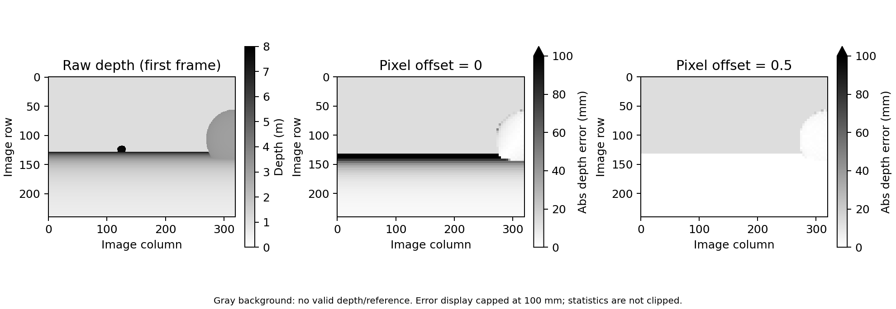

# 深度投影核查与仿真修正

2026-09-13，实际工作区 `D:/Document/Repositories/MoonCar-mapping`。

本轮定位并修正了当前 Gazebo Ogre2 深度图与点云投影之间的半像素约定差异。新采集的 147 帧原始深度图均能逐点重建实际发布点云；自主探测完成 6 次转向和 1 次前进，正常停车。**这是仿真投影链路的验证，不是全场地三维地图或实机精度验收。**

## 问题与修正

原投影为 `X=(u-cx)Z/fx, Y=(v-cy)Z/fy`。固定原始深度、相机内参、同时间戳的独立真值位姿及场景几何，仅将像素坐标改为 `(u+0.5,v+0.5)`，误差明显下降。该规律先在静止原始深度复现，再由上一轮已冻结的移动记录复核，最后用修正后的新实跑验证。

本地安装的 Ogre2 顶点/片段着色器保存在 `renderer-source/`：深度通过插值后的相机射线重建。这与像素中心约定的解释一致；具体修正依据是本项目当前渲染器、内参及多组同步数据的核查，不推断所有 Gazebo 或实物相机都应增加半像素。

共享 `project_depth` 增加 `pixel_offset`，默认 0；Gazebo 导航启动文件和独立仿真采集脚本显式设置 `depth_pixel_offset=0.5`。风险检测和地图观测共用修正后的点。没有改变深度值、拟合内参、调整安全阈值或向导航输入真值。新实验使用新配置，旧数据保持原样。

## 同一组深度上的射线对比

评价量是光轴深度与沿相机视线的**最近可见解析视觉表面**之间的残差，单位 mm。盒体侧面、椭球、圆柱侧面与顶底盖、地面均参与遮挡求交；不把障碍侧面直接当成最高地表。

| 数据 | 帧数 | 偏移 0 的 RMSE | 偏移 0.5 的 RMSE | 无参考像素数：0 / 0.5 |
|---|---:|---:|---:|---:|
| 修正前静止原始深度 | 14 | 297.09 | 0.405 | 42 / 0 |
| 上一轮冻结移动点云，无原始图 | 154 | 189.38 | 4.905 | 357 / 0 |
| 修正后新静止原始深度 | 14 | 47.98 | 0.968 | 28 / 0 |
| 修正后新移动原始深度 | 147 | 211.00 | 5.592 | 369 / 0 |

每行都是同一组观测的两种绝对像素约定复算；修正后数据的偏移 0 是反事实计算，不是又进行了一次旧配置实验。各行位置、视角与轨迹不同，不能跨行当作同条件性能比较。没有按误差剔除异常点；两种射线得到的有效参考数、首个可见表面变化数均保留。点和连续帧相关，不作为独立重复实验。

新移动记录含 352,513 个有效观测像素，147 帧原始深度与发布点云全部位级一致。偏移 0.5 时平面射线 RMSE 为 0.101 mm，实体表面为 13.633 mm；实体边缘和渲染网格近似仍产生较大残差。显示图将误差色阶截在 100 mm，统计不截断；灰色背景表示无有效深度或无参考，不能视为已观测的自由空间。



各分析目录均有 PNG、PDF、逐帧/分组 CSV、逐点残差 NPZ 和代码快照。上图展示新移动记录的第一个选中帧，统计使用整段记录。

## 新实跑与剩余误差

实验 `experiment-7670cb590c1d`，任务 `autonomy-a5c5e2ce5e`，50×50 米场景中的局部验证，起点 `(3.5,3.0,0)`，评价半径 8 米，预算 60 仿真秒。

- 任务在 53.9 秒因预算内无新安全候选正常结束，6 次转向与 1 次前进均成功；不代表整个场地已完成探测。
- 新增 85 个地图关键帧；新增投影观测面积 102.4375 m²，固定评价区域内最终观测比例 54.89%。这是采样覆盖，不是可通行地面完成率或精度。
- 自动保存原始档案、动作、评价表、参考诊断和 3 张内容不同的现场截图。截图是异步 GUI 证据，不用于像素时间对齐。
- 独立同步记录覆盖 79.6 仿真秒，147 帧。启动时 1 帧没有真值前后包围而被拒绝；静止验证也有 1 帧相同原因拒绝，记录均保留。其余时间包围间隔不超过 0.05 秒。
- 新移动记录的 XY 定位 RMSE 为 4.15 cm，最大 7.39 cm；真值采样轨迹长 1.632 m。投影修正没有解决定位偏差。
- 按此前“最高地表”方法计算，包含边缘的平地投影集合仍有 27.73 mm 高度 RMSE；理想平地内部接近数值误差。说明可见侧面、边缘与地图表面表示仍需分开研究，不能用低射线残差宣称整图高精度。
- 停车后连续采到 73 条安全速度指令，线速度和角速度均为零。运行时机器人描述与此前独立转换的参考模型一致。

## 证据与复核

- `raw-02/`：修正前原始深度、发布点和同步真值。
- `fixed-raw-02/`、`fixed-motion/`：新静止/移动原始深度、节点参数、时间同步数据、拒绝记录及高度诊断。
- `raw-analysis/`、`trajectory-analysis/`、`fixed-raw-analysis/`、`fixed-motion-analysis/`：分开的射线分析。旧移动输入仍位于相邻的 `alignment-20260913/trajectory-01/`，由输入哈希关联。
- `autonomy-a5c5e2ce5e/`、`reference-analysis/`：常规任务自动生成的完整研究证据。
- `runtime-before/`：运行环境更新前文件及更新前后哈希；没有覆盖主目录、M6 或 efc4 工作区。
- `failures/`：两次诊断工具启动失败的原目录；第一次使用了 rclpy 无法检查签名的内建回调，第二次误用了参数客户端方法名。均在开始有效采集前失败，修正后另建目录；原始 `starting` 状态不代表成功记录。

9 项针对性数学/投影回归检查通过；新静止和移动原始图均进行实际点云核对。`check_evidence.py` 重算残差统计、分母，核对原始图/点云、任务前进与停车指令和所有归档哈希：

```powershell
docker exec -e OPENBLAS_NUM_THREADS=1 mooncar-terrain-validation python3 /source/reports/evidence/terrain-workbench/projection-20260913/check_evidence.py
```

本轮原始深度同步工具仍是独立启动的评价工具，尚未成为普通自主任务的默认附加项。没有完成全场地、斜坡、实物相机或三策略优越性验收。

下一步：在新投影配置下检查坡面和复杂边缘的表面对应，明确哪些格子能用于高度/坡度比较，再验证 Q 是否反映可用观测，最后进行同场景、同起点、同预算的探测策略对照。
