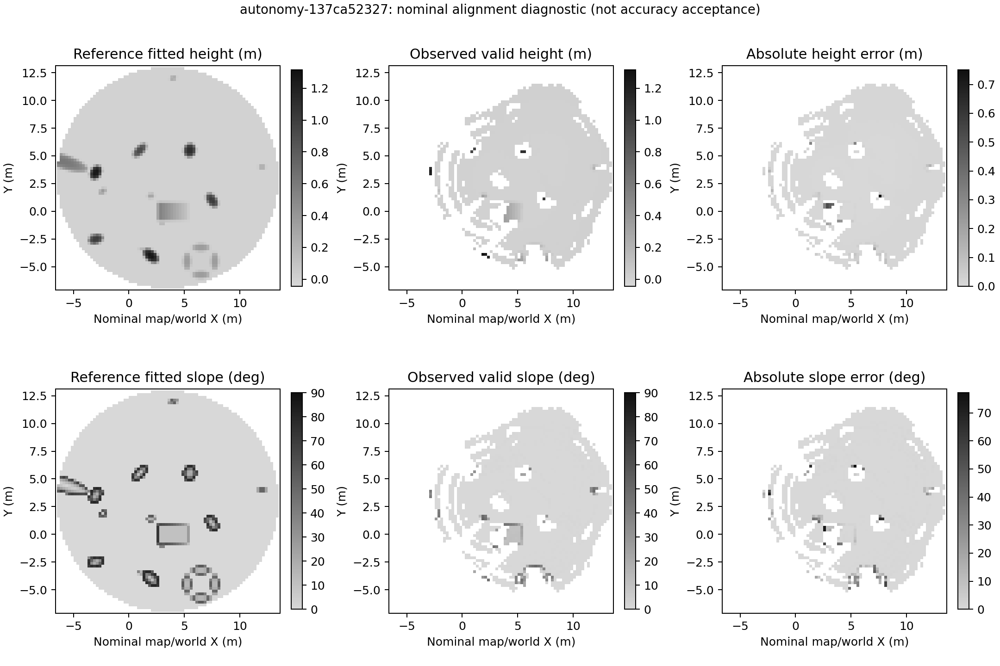
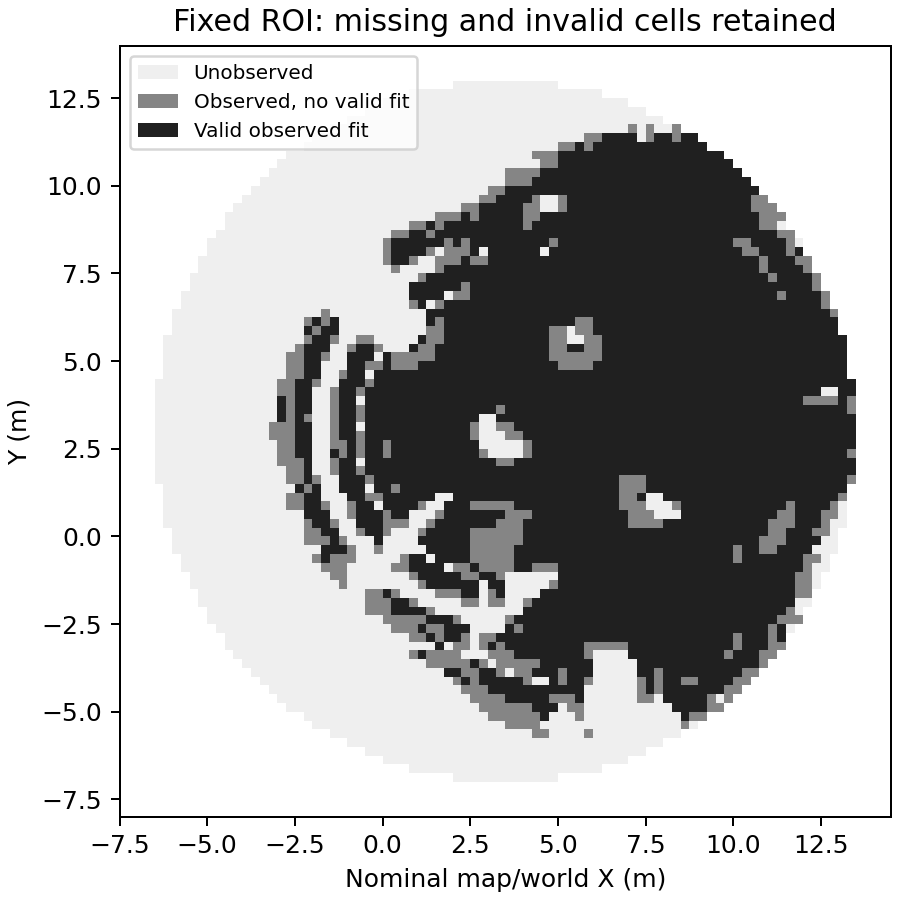

# 地形参考与采集误差诊断 · 2026-09-12

已完成三组已有仿真记录的独立参考生成、误差地图、缺失统计及 Q 分箱分析。今后的自主实验结束后也会自动生成这一组诊断文件。原始实验报告和原始观测均保留。

**目前是诊断，不是精度验收。** 旧记录没有同步真值轨迹，地图与场景暂按启动配置对应；没有用采集结果拟合一个修正来消除误差。误差还包含定位、地表表示及可见侧面与最高表面不一致的影响。

## 三组结果

每组固定评价面积均为 314 平方米、5024 格；格边长 0.25 米。误差只对有有效观测和参考的匹配格计算，未采到和拟合无效的格子另列，不计作零误差。

| 起点 | 记录 | 未观测格 | 观测但拟合无效格 | 有效匹配格 | 总体高度 RMSE |
|---|---|---:|---:|---:|---:|
| (3.5, 3)，0° | 137ca52327 | 1993 | 518 | 2513 | 3.25 cm |
| (-6, -3)，90° | d10f89c13a | 1907 | 424 | 2693 | 1.39 cm |
| (12, 0)，0° | 64d68b8b56 | 1993 | 404 | 2627 | 1.62 cm |

总体数字主要被平地占据，不能据此声称复杂地形采集已达到厘米级精度：

| 记录 | 平地高度 RMSE | 单一地形表面高度 RMSE（匹配格数） | 边缘/复杂格高度 RMSE（匹配格数） | 边缘/复杂格坡度 MAE |
|---|---:|---:|---:|---:|
| 137ca52327 | 0.68 cm | 14.09 cm（60） | 13.58 cm（73） | 21.74° |
| d10f89c13a | 0.68 cm | 3.78 cm（16） | 14.45 cm（18） | 21.46° |
| 64d68b8b56 | 0.66 cm | 1.47 cm（12） | 11.72 cm（42） | 23.29° |

三组起点、可见地形和有效样本不同，这张表用于定位问题，不用于排名或合并宣称算法优势。

## 图和数据

每个 `autonomy-*` 子目录中：

- `surface-comparison.png` / `.pdf`：参考与采集高度、坡度及绝对误差，六图共用位置范围。
- `coverage-status.png` / `.pdf`：未观测、观测但拟合无效、有效拟合的分布。
- `quality-error.png` / `.pdf`：不同地形类别中 Q 与高度误差、有效样本数量。
- `cells.csv`：全部评价格的参考、观测、Q、缺失状态与误差，便于重新分析。
- `terrain-groups.csv`、`quality-bins.csv`、`summary.json`：完整统计和数据来源。
- `reference.json`、三个分析脚本快照及 `hashes.json`：复现与完整性检查。

## Q 的实际含义

Q 目前衡量子格覆盖和观察方向多样性，不是准确率。在 137ca52327 的单一地形表面组中，Q≥0.8 的 67 个观测格仍有 31 格无法得到有效地表拟合；剩下 36 格的高度 RMSE 约为 15.84 cm。因此不能将“Q 达到 80%”表述成“地图精度达到 80%”。

这还不能证明高 Q 导致高误差：不同箱中的地形难度、可见侧面与样本数不同，格子也非独立重复实验。它说明后续必须把有效地表表示和误差验证加入评价，而不能只增加点数或观察方向。

## 对齐检查与限制

`alignment-parked.json` 是当前 experiment-23b486559f42 的只读现场检查：用同一仿真时间戳查询 Gazebo 模型位置与 ROS map→base_footprint。三个停车样本的平面位置差均约 2.17 cm，朝向差接近数值零。车辆没有为这次检查移动。

这只检查了当前一个位置，没有证明旧实验全程都一致，也没有完成高度标定。原实验中的正式高度/坡度验收字段仍为 null；新诊断均保留 `accepted_accuracy: false`。

参考来自冻结场景的视觉几何。每格均匀取 5×5 个位置，以最高表面拟合；表面交界、残差超过 2.5 cm 或坡度至少 60° 单列为复杂格，不删除。该表示不能完整描述垂直壁面；相机看到的障碍侧面也不一定对应最高表面。窄于 5 cm 的细节可能漏采样，解析椭球与渲染网格亦可能有细小差异。

## 后续顺序

1. 新实验同步记录真值轨迹和相机位姿，核验多位置、行驶中及不同朝向的坐标误差；检查高度基准与可见表面对应，保留定位误差。
2. 在可靠对齐的记录上，分析何时补采确实提高有效地形覆盖与精度，再调整采样指标和预期收益估计。
3. 以同场景、同起点、同时间预算运行基线与改进策略，保留失败并重复实验，再讨论论文中的方法优势。

已运行几何回归检查及完整自动后处理入口测试；原三次连续运行证据的哈希核查通过。没有修改硬件验收结论，也没有上传、采购或安装依赖。
