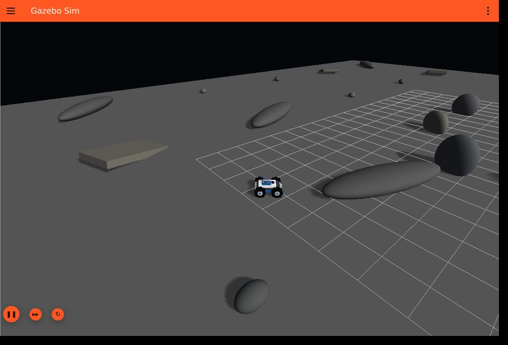

# 漏判分析与不同区域验证 · 2026-09-13

结论：当前距离规则漏算了途中可用视角，不能只按终点距离推算收益。本轮完成同数据帧子集回放，并在另一处地形区域新增原地/靠近两次实跑；没有更改在线策略或调模型阈值。

## 30 个漏判格子发生了什么

使用上一轮短距离采集 experiment-9d39b7482383 的同一份冻结数据，所有回放共用相同初始观测。30 个漏判格子原本都是体素点数不足，其中 24 个在计划终点的名义视场内，6 个在视场外。将计划终点换成实际终点作事后检查，也没有挽回这些漏判。

| 初始观测加上哪些帧 | 30 个漏判格子中恢复拟合的数量 |
| --- | ---: |
| 运动前等待帧 | 0 |
| 所有途中帧 | 25 |
| 停车稳定后的帧 | 17 |
| 仅最后一帧 | 15 |
| 途中与停车后帧 | 30 |
| 完整回放 | 30 |

逐格回看途中单帧时，24 个格子各自能由至少一张途中图像补好；但这是给每格事后选最好的一帧，不是同一张图像能恢复 24 格。四张途中图像分别恢复 6、19、16、18 格，最多的一张是 19 格。相比只加入最后一帧的 15 格，途中确有更有价值的视角。

途中与停车后两组回放中，14 格都能恢复，11 格只在途中组恢复，3 格只在停车后组恢复，2 格需要把两组结合才能恢复。数量互有重叠，不能相加当成独立贡献率。各组帧数和观测时长不相同，这也不是独立的因果试验。

较长靠近记录也呈现同样方向：26 个漏判格子中，途中帧能恢复 25 个，最后一帧只能恢复 12 个。它支持后续评估“沿路径的观测集合”，尚不能证明任何在线新算法优越。

[回放对照图 PDF](attribution/subsets.pdf) · [逐格数据](attribution/cells.csv) · [各子集统计](attribution/subsets.csv)

## 新增区域实跑

未改评分规则，转到 north_ridge 附近，起点 (-9.8,6.8,-0.528074 rad)，目标 (-9.2,6.45)。原地和靠近各 30 仿真秒，每轮重置仿真、定位与采集；两组各保存 54 个同步帧。靠近组 Nav2 成功，记录的真值轨迹长度约 0.586 m，仅用于运动核查。

原地组初始 95 个不足格子没有恢复；靠近组有 65 个恢复。以下为靠近组的不足格子全集，包含地面及边缘：

| 固定规则 | 命中恢复 | 错报机会 | 漏掉恢复 | 正确判断未恢复 |
| --- | ---: | ---: | ---: | ---: |
| 仅方向 | 0 | 1 | 65 | 29 |
| 方向 + 距离 | 13 | 6 | 52 | 24 |

距离规则查准率 68.4%、召回率 20%；只看名义候选视场内时召回率为 33.3%，分母不同。此结果没有提供稳定、完整的预测能力证据。规则在运行前冻结，没有看到结果后调参。

**表面审计限制**：虽然该区域有曲面山脊，实际观测格子经独立可见表面检查为地面 146 格、混合边缘 24 格、无可见参考 1 格；纯曲面顶面格子为 0。因此这是一组不同位置的地面/边缘检查，不能称为曲面顶面验证，更不是独立仿真世界的泛化验证。混合面误差不作为单层地形精度证据。

[新区域规则检查 PDF](ridge-model/rule-check.pdf) · [新样本](ridge-model/samples.csv) · [混淆矩阵](ridge-model/rule-check.csv) · [表面审计分类](ridge-visible-audit/groups.csv)

## 下一步如何改模型

现有 n×(r0/r1)² 把当前累计体素点数按距离缩放，却没有预测新视角的点会落在哪些尚未采到的体素位置。下一版应评价候选路径上多个视角的观测并集，同时处理重复覆盖；不能直接把每帧收益相加，也不能将事后最优帧当作预测器。

先保留本轮结果，建立能确实观察到目标坡面/曲面、含明确独立训练与验证场景的新试验集，再检验沿路径视角收益。需要先验证表面可见性，避免再次把地面占多数的总指标当作曲面能力。当前没有训练机器学习模型，也没有替换车上的在线规划。

## 复核与文件

- attribution/：旧冻结数据的回放、原始输入哈希及分析源码。全帧回放标签逐格与上一轮对照一致；静止组没有运动开始时间。
- ridge-captures/：两次新增原始深度/估计与真值位姿/控制记录/截图。新增采集工具支持显式起点，并记录收到导航结束状态的仿真时间，不将其当成 Nav2 内部精确到达时间。
- ridge-model/：原固定规则检验。预测特征只有动作前传感器观测、估计位姿及计划目标；最终拟合是标签。
- ridge-visible-audit/：独立真值位姿和同射线参考表面审计，仅作离线诊断，没有进入特征或在线决策。
- provenance/：运行前计划、测试、日志和采集脚本。旧证据不重写。

执行 `python check_evidence.py` 核对哈希、输入引用、重叠计数和混淆矩阵。仿真已停车，前后端服务保留。
