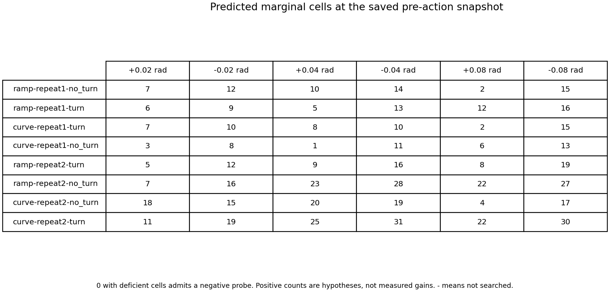
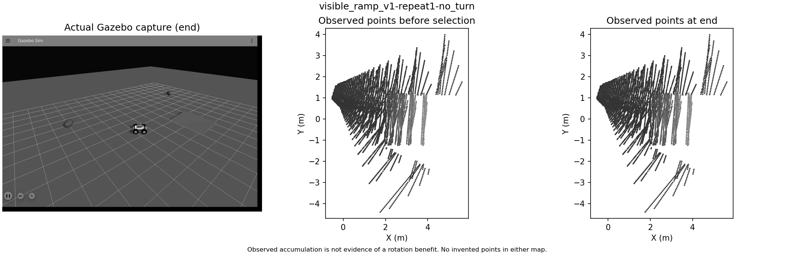

# 建议跳过的观察动作：定向验证

日期：2026-09-13。软件仿真实验；在线三种策略未修改，未进行硬件验收。

## 要验证什么

模型认为一个非零转向没有额外补采价值时，实际执行它，是否仍会比保持朝向采到更多有效地表。跳过该动作不等于停止探索，也不等于保持观察没有收益。

## 事前规则

两个场景，每场景转向/保持各两次，交替次序，共8次独立重置。每次60仿真秒，含5秒基线和到达后5秒共同保持。事前获取Nav2路径；保留原导航与安全保护。

到达后由记录器保存不可变的传感器前缀（点云、估计相机/车体位姿、CameraInfo），不包含真值数组。按 +0.02、-0.02、+0.04、-0.04、+0.08、-0.08 rad 顺序选择第一个仍有不足格、但v3预测无边际支撑的候选。冻结候选后，转向组才发起动作；保持组不发起转向。

预测完成时快照年龄须不超过5仿真秒、剩余时间至少8秒；找不到候选或执行失败均保留，不当作停止判断正确。回放严格使用同一前缀，而非计算结束后新收到的观测。

事前工程准入：至少4个真实执行的非零负例、4组完整配对，且共同不足格中不得出现转向独有恢复。实际转角要求方向正确、至少达到请求量一半、误差不超过0.02rad加请求量25%。这些是保守筛查要求，不是统计显著性。

## 结果

停止规则准入：未通过。本批实际负例覆盖不足，详细原因见analysis/assessment.json。

导航成功8次，采集完成8次；事前共评估48个候选，选出负例0次，实际转向命令0次，执行合格负例0次。这几个数量必须分开。

| 尝试 | 采集状态 | 选择的相对角度rad | 执行资格 | 实际转向到达 |
|---|---|---:|---|---|
| visible_ramp_v1-repeat1-no_turn | completed | 无候选 | False | False |
| visible_ramp_v1-repeat1-turn | completed | 无候选 | False | False |
| visible_curve_v1-repeat1-turn | completed | 无候选 | False | False |
| visible_curve_v1-repeat1-no_turn | completed | 无候选 | False | False |
| visible_ramp_v1-repeat2-turn | completed | 无候选 | False | False |
| visible_ramp_v1-repeat2-no_turn | completed | 无候选 | False | False |
| visible_curve_v1-repeat2-no_turn | completed | 无候选 | False | False |
| visible_curve_v1-repeat2-turn | completed | 无候选 | False | False |

保持组的“执行资格”只表示该反事实候选能否执行；保持组始终没有转向。两组根据各自快照选角，不能声称绝对视角和观测历史完全相同。

| 配对 | 范围 | 共同不足格 | 转向独有恢复 | 保持独有恢复 | 净差 |
|---|---|---:|---:|---:|---:|
| visible_curve_v1-repeat1 | 配对不完整 | — | — | — | — |
| visible_curve_v1-repeat2 | 配对不完整 | — | — | — | — |
| visible_ramp_v1-repeat1 | 配对不完整 | — | — | — | — |
| visible_ramp_v1-repeat2 | 配对不完整 | — | — | — | — |

同一场景两次均正净差：无。

恢复标签指真实观测累积后满足地表拟合条件，不是测量精度提高。格次相关、独立重置后的轨迹和采样时间不同；配对净差不能当作逐格因果真值。未发现收益也不能证明模型在所有地形上可靠。

## 行动时刻补充审计

analysis/dispatch-window-audit.json 另检查发出转向命令时仍不足的格子，并比较之后固定10仿真秒的恢复，排除计算期间已经恢复的格子。该审计不修改冻结的主准入规则；估计位姿漂移和独立轨迹差异仍存在。

analysis/hold-baseline-audit.json 单独核对未发出转向命令时的预测基准与实际恢复，并记录真实/估计姿态变化。若没有合格负例，配对/命令窗口统计为空就是覆盖不足，不能解读为零漏判率。

本批8次均未下发转向。模型对保持观察共预测14格次可补足；发出决策后的10秒内，实际恢复0格次。这个结果不支持“低估保持收益”的初始猜测，反而提示保持预测存在误报。此处格次相关，不是14个独立样本，也不能据此判定未执行转向的效果。

## 未执行候选与开发诊断

如果预定转向组未找到候选，它实际保持朝向，不是已执行的负例。通用summary中的Observation heading not reached此时表示没有执行观察动作，不应解读为Nav2移动失败。保持组未选出候选时，通用预测回放中的默认yaw不属于被选中的动作，其预测统计不用于证明停止正确。以selection.json和assessment中的真实执行计数为准。

development目录包含已保存快照的扩角扫描和较晚保持前缀扫描，只分析候选可用性，没有执行这些假设动作，不能当作额外独立实验或改变本批准入。

## 资料与复核

- captures：原始深度、点云、同步位姿、现场截图、事前路径、冻结方案与源码。
- 每次approach/checkpoint.npz与selection.json：行动前传感器前缀、候选顺序、预测和完成时间。
- analysis：逐格CSV、分母明确的汇总、配对、执行审计、现场/观测地图对比PNG。
- provenance：本批运行、分析和出图脚本及日志。

运行 `python check_evidence.py` 检查文件哈希、冻结源码、候选顺序、行动前时间边界、已知空间路径与配对统计。verify_skip_prefixes.py 对包括无候选尝试在内的前缀逐数组核对，并从相同传感器输入重算候选；结果见prefix-audit.json，需要现有NumPy环境。

线上仍使用原有surface_view_v1。只有负例验证支持停止规则后，才考虑在线接入；之后重新进行统一预算三策略比较，不能将本组机制实验当作总体策略优势。
