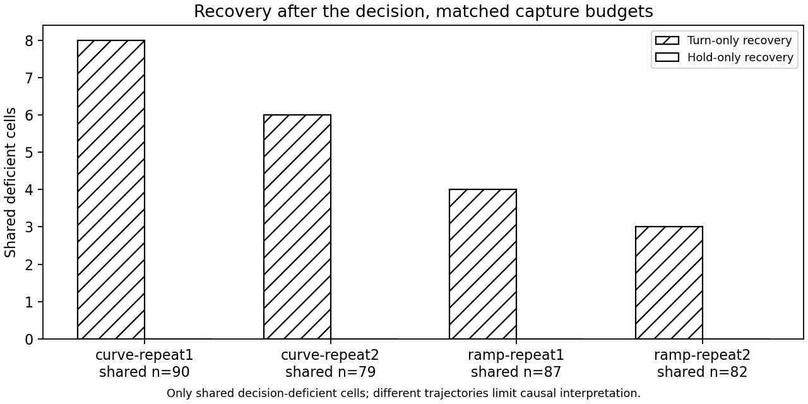
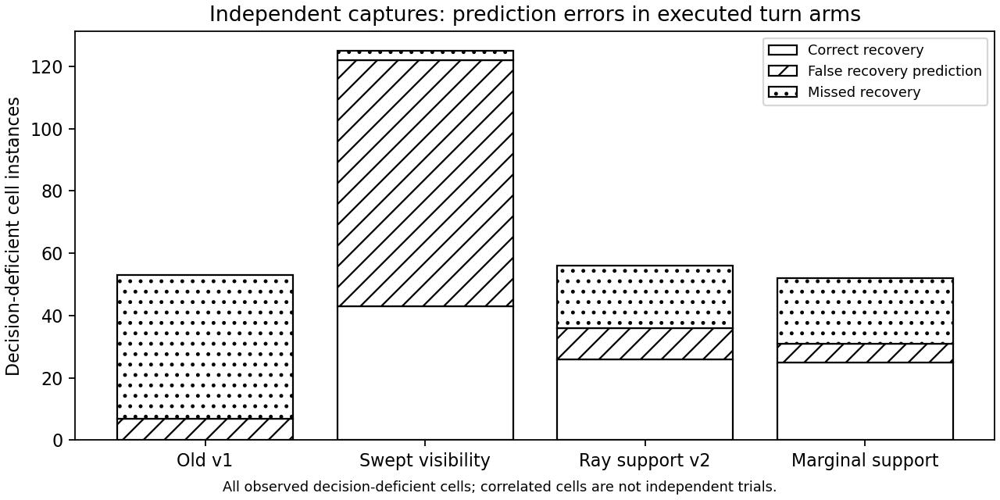

# 小角度补采与重复观察：v3决策验证

日期：2026-09-13。软件仿真实验；未进行硬件验收或新的三策略总体对照。

## 修改

将“车辆朝向已对齐”与“没有额外补采价值”分开。v3取消0.12rad角度容差对补采建议的直接否决，继续检查预算和预测边际支撑；v2的点云/射线支撑模型及门槛保持不变，v2评估入口仍保留，线上三种策略未改动。

跳过意味着模型没有预测到相对保持朝向的额外支撑，不代表静止观察不会恢复、总信息收益为零或整个环境已完成。当前仍是未部署的旁路候选。

## 预先冻结的验证

两个新起点/目标，两个相对转角，转向与保持各重复两次并交替次序，共8轮。每次重建仿真及采集档案。35仿真秒包括5秒基线、到达后5秒共同观察；“重复观察后低收益”是被检验的假设，不是预先确认的结果。

| 场景 | 起点X/Y/朝向rad | 目标X/Y | 请求相对转角rad |
|---|---|---|---|
| visible_ramp_v1 | [-1.4, 1.55, -0.3] | [-0.65, 1.3] | 0.02 |
| visible_curve_v1 | [-1.75, 2.2, -0.4] | [-1.0, 1.8] | 0.08 |

控制脚本在决策时根据估计车体朝向解析绝对目标并记录位姿、目标与时间。两个实验组均解析同样的相对角度规则，只有转向组发送Spin；两组独立运行，绝对朝向/轨迹可能略有不同。预先获取的Nav2路径仍单独保存并检查已知空间。

转向执行门槛：实际估计转角方向正确、至少请求量一半、误差不超过0.02rad+请求量25%。另保存同步传感器帧间的估计/真值转角，仅事后诊断，不更改准入条件。新规则没有削弱在线运动或碰撞保护。

准入沿用precision/recall各至少0.5、不得漏掉配对独有恢复、无正净收益的建议转向配对最多1组，以及完整8轮和真正的转向/无边际支撑两个分支覆盖。零角度合成检查只验证逻辑，不算低收益实跑证据。所有门槛均为探索性工程要求，不是统计显著性标准。

## 实际结果

事前初步检查：通过。但复核认为停止分支的证据仍不足，不能据此接入在线策略；原初步判定保留不变。

| 实验 | 执行评估 | v2建议 | v3建议 | 转向耗时（仿真秒） |
|---|---|---|---|---|
| visible_ramp_v1-repeat1-no_turn | evaluated | already_aligned | try_observation | 0.000 |
| visible_ramp_v1-repeat1-turn | evaluated | already_aligned | try_observation | 0.371 |
| visible_curve_v1-repeat1-turn | evaluated | already_aligned | try_observation | 0.565 |
| visible_curve_v1-repeat1-no_turn | evaluated | already_aligned | try_observation | 0.000 |
| visible_ramp_v1-repeat2-turn | evaluated | already_aligned | try_observation | 0.303 |
| visible_ramp_v1-repeat2-no_turn | evaluated | already_aligned | no_modelled_marginal_support | 0.000 |
| visible_curve_v1-repeat2-no_turn | evaluated | already_aligned | try_observation | 0.000 |
| visible_curve_v1-repeat2-turn | evaluated | already_aligned | try_observation | 0.614 |

| 转向实验 | 请求转角rad | 实际估计转角rad | 执行门槛 |
|---|---:|---:|---|
| visible_ramp_v1-repeat1-turn | 0.020000 | 0.029748 | True |
| visible_curve_v1-repeat1-turn | 0.080000 | 0.082392 | True |
| visible_ramp_v1-repeat2-turn | 0.020000 | 0.021926 | True |
| visible_curve_v1-repeat2-turn | 0.080000 | 0.088370 | True |

只对实际转向组评价恢复预测。支撑预测仍是v2几何模型，v3改变的是是否执行建议。

| 统计范围 | 预测规则 | 命中 | 误报 | 漏报 | precision | recall |
|---|---|---:|---:|---:|---:|---:|
| all_decision_deficient | v1_prediction | 0 | 7 | 46 | 0.0% | 0.0% |
| all_decision_deficient | swept_visible | 43 | 79 | 3 | 35.2% | 93.5% |
| all_decision_deficient | swept_prediction | 26 | 10 | 20 | 72.2% | 56.5% |
| all_decision_deficient | marginal_prediction | 25 | 6 | 21 | 80.6% | 54.3% |
| initial_deficient | v1_prediction | 0 | 7 | 1 | 0.0% | 0.0% |
| initial_deficient | swept_visible | 1 | 4 | 0 | 20.0% | 100.0% |
| initial_deficient | swept_prediction | 1 | 0 | 0 | 100.0% | 100.0% |
| initial_deficient | marginal_prediction | 0 | 0 | 1 | 无分母 | 0.0% |

all_decision_deficient是决策时全部不足格，initial_deficient仅含最初已不足且此时仍不足格；不能混用分母。恢复为真实观测累计后TerrainMap拟合有效，不是几何测量准确率。

| 配对 | 范围 | 共同不足格 | 转向独有恢复 | 保持独有恢复 | 净差 | v3是否建议转向 |
|---|---|---:|---:|---:|---:|---|
| visible_curve_v1-repeat1 | all_decision_deficient | 90 | 8 | 0 | 8 | True |
| visible_curve_v1-repeat1 | initial_deficient | 9 | 0 | 0 | 0 | True |
| visible_curve_v1-repeat2 | all_decision_deficient | 79 | 6 | 0 | 6 | True |
| visible_curve_v1-repeat2 | initial_deficient | 11 | 0 | 0 | 0 | True |
| visible_ramp_v1-repeat1 | all_decision_deficient | 87 | 4 | 0 | 4 | True |
| visible_ramp_v1-repeat1 | initial_deficient | 16 | 0 | 0 | 0 | True |
| visible_ramp_v1-repeat2 | all_decision_deficient | 82 | 3 | 0 | 3 | True |
| visible_ramp_v1-repeat2 | initial_deficient | 17 | 0 | 0 | 0 | True |

格次相互相关，不是独立样本。配对包含共同决策不足格，不能消除轨迹、观测时序和定位误差；净差不是逐格因果真值。未计算新的几何准确率。

## 结论及验证缺口

全部8次采集/导航、4次转向成功，并通过预先设定的实际估计转角门槛。每轮61至65帧、丢弃1个选中帧，实际记录跨度34.5至34.8仿真秒。仿真已停止。

本批实际转向组，决策不足格共46格次恢复。未改动的支撑预测命中26、误报10、漏20，precision72.2%、recall56.5%；边际支撑预测命中25、误报6、漏21。v3改变行动建议，不应把不同批次的预测比例差异说成v3提高了几何模型精度。

配对共同决策不足格：曲面两次净差+8、+6，坡面+4、+3，保持组独有恢复均0。共同最初不足格的净差均0。这批收益主要仍来自沿途新出现的不足格，不能证明最初目标缺口改善或整个第三策略优胜。

关键复核：7次try_observation、1次no_modelled_marginal_support满足原先按全部实验统计的分支条件；但唯一跳过建议来自visible_ramp_v1-repeat2-no_turn。4次实际转向的v3建议全是“转向”。因此，没有任何被模型建议跳过的非零转向真正被执行过，不能证明跳过不会漏掉收益。

同一配对的转向组又建议“转向”，并有3个独有恢复格；两组的决策快照不同，既不能用它宣称那一次跳过已验证正确，也不能直接断言那一次跳过一定错误。补充审查记录在analysis/stop-coverage-audit.json；这是复核发现的证据完整性缺口，原始事前assessment.json没有改写。

旋转诊断：控制端动作完成时的估计转角通过门槛；跨同步传感器帧的真值转角约为坡面0.04rad、曲面0.10至0.11rad，与对应估计值接近。该窗口包含动作前后间隔，不能当成精确动作区间或直接归因于惯性，但说明请求角度不能代替实际观察姿态。

下一步定向补负例：先保存模型建议跳过的决策快照，再实际执行对应非零转角；配套保持朝向的重复对照，保留筛选不到负例或执行失败的尝试。筛选只看当时观测，不看后续收益；验收须明确统计“被建议跳过但实际执行”的样本。通过后才接入在线第三策略和统一预算三策略对照。当前不重复盲跑一批全是建议转向的样本。

两个场景各只对应一种角度，不能据场景间差异单独标定角度效应。严格配对漏判门槛也不等于长期收益/耗时最优的证明。

## 旧数据仅作开发回放

上一批swept-support的8轮回放中，原先5.38°转角触发的already_aligned建议已变成try_observation。几何预测逐格结果未因v3门槛分离而改善；这个回放不算独立验证。来源为相邻swept-support-20260913/captures。

## 资料与复核

- captures：原始深度、点云、同步位姿、事前路径/地图、控制事件与现场截图、冻结源码和方案。
- analysis/cells.csv、metrics.csv、pairs.json、assessment.json：逐格记录、统计和准入；rotation-audit.json是事后旋转诊断。
- analysis/*-scene-map.png：实际现场、决策时和最终的观测点云；方框仅为预测标记，没有写入地图。
- development：旧数据v3回放；provenance：运行/分析/绘图脚本与日志。

运行 `python check_evidence.py` 可用标准库校验哈希、8个独立采集、相对目标解析、已知空间事前路径、事件时间边界、统计范围与配对结果。预测逻辑检查在仓库test_swept_resampling.py及provenance/check_small_angle_semantics.py，需要已有NumPy/ROS环境。

模型限制保留：中位高度水平面片未建模遮挡、坡度、噪声和采样时刻；支撑矩阵用样本均值中心，真实地表拟合用格心中心。预算代理仍为角度/0.5+3秒；不等同真实转向耗时。
