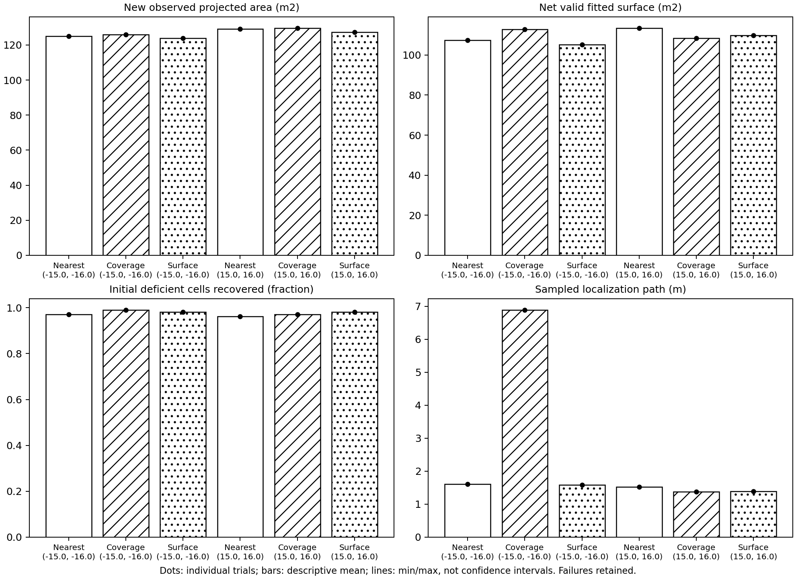

# MoonCar 软件仿真阶段收尾 · 2026-09-13 启动批次

报告生成时间（UTC）：2026-09-13T15:13:10.120804+00:00。本批次跨日至 2026-09-14 完成（Asia/Tokyo）。

六次预定尝试已结束，得到 6 份数值报告；全部完整采集且无运行故障：True。未满足预先约定的“一致描述性优势”条件，不能宣称地表补采策略稳定优于基线。

实验执行后的收尾脚本曾退出 1：已有 runner 发起异步停车，外层 finally 又立即停车，收到 HTTP 400“正在切换实验”。六次采集均已结束，未受此重复请求影响。已独立确认仿真停止、冻结源码未变，再离线生成汇总，没有重跑或替换数据。原始错误见 orchestration-error.json；因此不能把整条自动编排说成无错误完成。

## 本轮结果

当前三种在线 v1 策略，两个外围新起点，每个条件一次；每次重置 Gazebo、SLAM 和采集档案。预算上限 90 仿真秒，半径 8 米。无候选可提前结束；实际耗时如下，不把提前停止说成完整运行 90 秒。

主要指标为有效拟合地表面积的最终值减初始值，包含新增有效地表及既有格拟合状态变化；不是高度精度，也不是整个场地的完成率。

| 次数 | 起点 m | 策略 | 有效地表净增 m²（主要） | 新观测 m² | 定位路程 m | 实际仿真秒 | 结束状态 |
| --- | --- | --- | ---: | ---: | ---: | ---: | --- |
| 1 | [-15.0, -16.0] | 就近观察 | 107.31 | 125.00 | 1.61 | 86.80 | no_candidates |
| 2 | [-15.0, -16.0] | 覆盖优先 | 112.81 | 125.88 | 6.89 | 90.00 | budget_reached |
| 3 | [-15.0, -16.0] | 地表补采 | 105.25 | 123.81 | 1.58 | 84.10 | no_candidates |
| 4 | [15.0, 16.0] | 覆盖优先 | 108.38 | 129.69 | 1.38 | 86.10 | no_candidates |
| 5 | [15.0, 16.0] | 地表补采 | 109.75 | 127.25 | 1.39 | 87.10 | no_candidates |
| 6 | [15.0, 16.0] | 就近观察 | 113.44 | 129.25 | 1.52 | 83.80 | no_candidates |

[逐轮数据](comparison/comparison.csv) · [动作预测与实际](comparison/prediction-errors.csv) · [冻结规则](protocol.json) · [收尾结论](conclusion.json)

## 如何理解这次验证

- 此前被用于修改规则的数据都属于开发证据。本次运行前冻结了源码、起点、主要指标和停止条件；源码未按本次结果调整。
- 两个起点未出现在保存的历史任务清单中，但仍使用同一世界的地形模板。不能称为严格独立的新世界测试，也不保证 ROI 每个格子此前从未被观测。
- 每条件仅一次运行；不做显著性检验、不估计重复运行方差。初始采集到达时序有差异，初始面积保留在逐轮 CSV。
- 原有在线补采权重仍是启发式效用。最近研究的离线 v5 没有接入本次对照，仍存在收益误报与失效漏报，未通过验证。
- 预算中断动作与导航失败分列在 comparison.csv。全部失败尝试保留，不补零、不替换、不只挑有利指标。
- 自动保留各轮原始档案、起止地图、截图、遥测、决策、实际场景与源码。现场截图异步，仅用于环境对照；地图来自实际传感器观测。

## 到这里完成什么

已完成本轮有限对照和证据整理；车辆已停止。保留现有自主探测平台，停止本阶段的默认模型调参和实验扩展。
论文可以写系统实现、三策略定义、评价与自动记录方法及本轮差异；不能写“已证明算法普遍更优”“已解决过拟合”或硬件已验收。
后续如有新的明确任务，可基于这些成果进行演示、论文初稿或实物集成；不把继续优化预测模型作为项目交付前提。

## 复核

在本目录执行 `python check_evidence.py`：核对文件哈希、六次计划与记录、实际源码与事前冻结版本、主要指标算术以及最终停止状态。
source-before.zip 包含实验前源码；comparison/runs/ 包含运行时源码和传感器证据；experiment-diagnostics/ 保留逐次启动配置与仿真日志。
原始一次性 wrapper 连同收尾错误保留作追溯，不作为可直接复用的稳定入口。
comparison/README.md 仅修正复用模板的“重复两次”文字为实际一次，数值未改。
