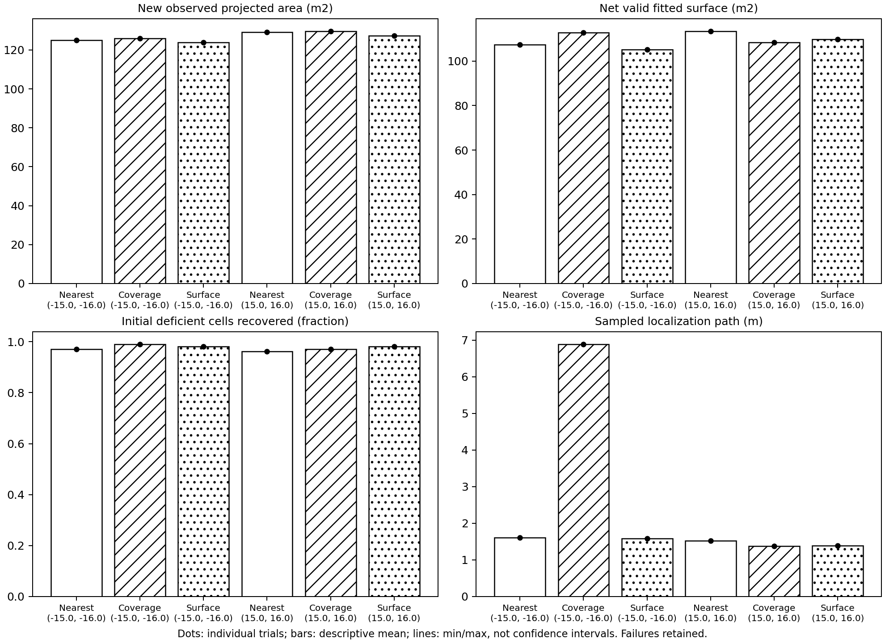
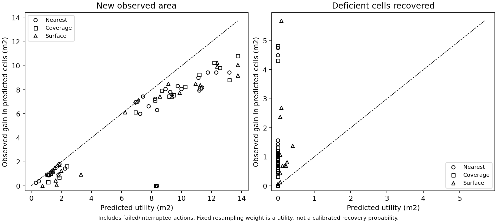

# 三策略同条件可行性实验

6 个预先列入本地计划的轮次；通过启动校验后才新建仿真和空白 SLAM/采集档案。重要运行源文件在各轮记录中一致：True。
完整的初始基线、失败/中断、补采恢复率和动作见 comparison.csv 与各轮 runs/；grouped.csv 按起点分别汇总。
actions_failed 与 actions_interrupted 分开记录动作失败和预算/停止中断；原始 failed_actions 包含所有未成功动作，不能一概当成导航故障。

| 轮次 | 起点 | 策略 | 新观测 m² | 有效拟合净增 m² | 路程 m | 结束状态 |
| --- | --- | --- | ---: | ---: | ---: | --- |
| 1 | [-15.0, -16.0] | Nearest | 125.00 | 107.31 | 1.61 | no_candidates |
| 2 | [-15.0, -16.0] | Coverage | 125.88 | 112.81 | 6.89 | budget_reached |
| 3 | [-15.0, -16.0] | Surface | 123.81 | 105.25 | 1.58 | no_candidates |
| 4 | [15.0, 16.0] | Coverage | 129.69 | 108.38 | 1.38 | no_candidates |
| 5 | [15.0, 16.0] | Surface | 127.25 | 109.75 | 1.39 | no_candidates |
| 6 | [15.0, 16.0] | Nearest | 129.25 | 113.44 | 1.52 | no_candidates |

预测散点图包含失败和中断动作；补采权重仍是未标定效用。prediction-errors.csv 可用于后续标定，当前数据不同时充当训练集和独立验证集。

每个策略/起点只有一次运行，只描述本轮差异，不做显著性检验或最优性结论。条形均值和极差不是置信区间。
图和均值使用有数值报告的轮次；启动失败不补零，保留在清单中，grouped.csv 同时列出计划轮数和有报告轮数。
Q、有效拟合面积、未知环境完成率和准确率是不同概念。恢复率以本轮开始时采样不足格子为分母，包含途中顺带改善，不能等同专门补采动作成功率。
定位路径包含漂移；起始条件统一但传感器到达时序和初始基线需据记录核对。精度尚未给三策略填入可靠共同真值，不以名义最高表面误差代替。
Nav2 和传感器模型共用，尚不涉及机器学习训练、实物硬件验收、返航或全场覆盖保证。
