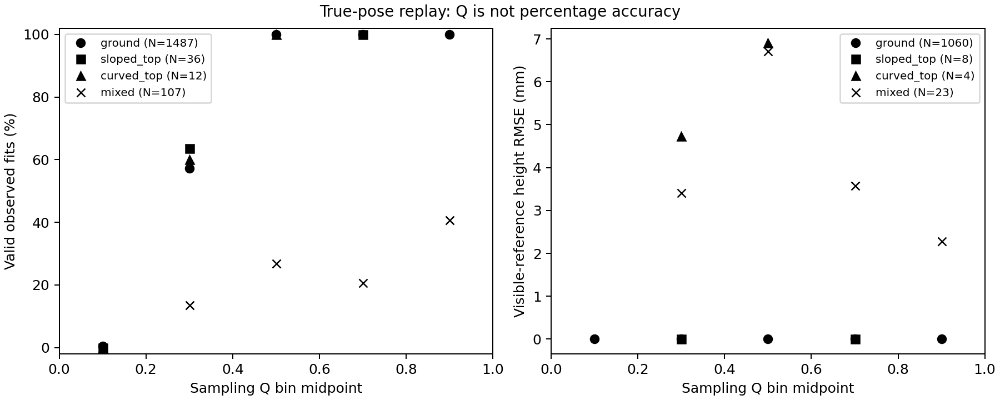
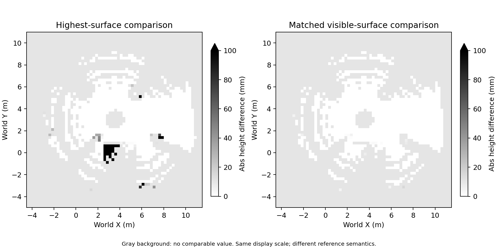

# 坡面、边缘与 Q 指标核查

2026-09-13。结论：**Q 可以保留为采样充分度，但不能作为准确率，也不能单独决定是否继续补采。** 本轮得到的是区分补采问题的证据，没有修改在线策略、Q 权重或安全阈值。

## 这次做了什么

复用上一轮修正后的 147 帧同步原始观测，使用记录下来的独立真值位姿进行离线重放。对同一组相机射线，分别建立“实际测量深度”和“最近可见解析表面”的地图；两者共用现有 5 cm 体素、25 cm 地形格、平面拟合和 Q 公式。没有重新跑车，也没有把真值送进导航。

这能减少定位偏差的干扰，专门检查几何观测与地图表示；**离线重放图不是在线实际定位生成的地图**。147 帧是同步评价的选帧规则，和普通任务关键帧不同，本报告的 Q、面积及格子数不能混入上一轮任务汇总。

参考表面由独立射线交点确定，分为地面、坡顶、平顶、弯曲上表面、陡侧面和混合表面。盒体的不同面分别标记，同格出现不同视觉体、不同面或不同类别时归为混合；不通过挑选“最接近观测高度”的表面降低误差。非地面参考法向与竖直方向夹角至少 60° 时列为陡侧面；非曲面坡度超过 3° 时列为坡顶。这些是分析分类阈值，不是通行阈值。

两个地图各自体素化，跨格或体素合并差异仍会进入结果。只有两边都存在有效拟合时才计算拟合高度/坡度差；未观测、无有效拟合和混合格均保留。混合格的拟合差仅供表示诊断，不计作单一地表精度。

## 发现的问题

固定半径 8 米区域有 3,228 格，其中测量重放图已观测 1,657 格。548 格没有有效地表拟合，1,095 格有成对有效拟合，其中仅 1,072 格属于单一可见表面。其余未观测格仍在分母中。

| 表面类别 | 已观测格子 | 有效测量拟合 | 可成对比较 | 主要发现 |
|---|---:|---:|---:|---|
| 地面 | 1,487 | 1,069 | 1,060 | 大量低 Q 格子的采样仍不足 |
| 坡顶 | 36 | 8 | 8 | 28 格均因体素点少于 6 个而未拟合 |
| 弯曲上表面 | 12 | 5 | 4 | 成对高度 RMSE 约 5.92 mm，坡度 MAE 约 2.47°，样本很少 |
| 陡侧面 | 13 | 0 | 0 | 不能把它当作普通单一高度地表 |
| 混合表面 | 107 | 27 | 23 | 80 格无有效拟合；成对数值也不等于可用地表 |

另外有 2 个测量格没有对应的可见参考格，单独保留；这与整个场景没有几何参考不是一回事。

**坡道目前主要缺的是可拟合的空间采样。** 有效的 8 个坡顶格，在这个理想解析平面场景中与同射线参考几乎一致；不能据此宣称整个坡道已测好，另有 28 格仍不能拟合。后续应测试换观察位置、缩短观察距离或增加横向采样支撑是否能改善它们。

**高 Q 不保证有可用地表。**

| Q≥0.8 的格子 | 数量 | 无有效拟合 | 有效拟合率 |
|---|---:|---:|---:|
| 地面 | 307 | 0 | 100% |
| 混合表面 | 27 | 16 | 40.7% |
| 合计 | 334 | 16 | 95.2% |

总体看起来很高，是因为 334 格中有 307 格为地面。高 Q 的 16 个无效混合格中，11 格拟合过陡，5 格残差过大；不能把总体 95.2% 写成“地图准确率”，也不能承诺继续提高 Q 就能解决多表面表示冲突。



图例 N 是各类参与统计的格子总数；每个分箱的有效、无效、成对数量见 `quality-bins.csv`。无样本的分箱不画点，未插值连接。右图的低误差只涉及成对有效拟合；混合类是表示诊断。



两图采用相同显示范围与色阶，灰底为无可比较值。右图差异变小来自参考对象改为相机实际可见表面，**不是本轮提升了在线建图算法**。纯平面误差接近数值精度是理想仿真条件，不是实物相机精度。

## 对后续自动探测的具体安排

1. 保留 Q 表示空间覆盖与观察方向；另列地表状态：未观测、采样不足、有效拟合、陡面/多高度冲突，避免用一个百分比包办全部含义。
2. 先做坡道定点补采实验：同一初始记录、相同时间预算，比较保持原位和换位观察，统计原本不足的格子变为有效拟合的比例、实际增益与行驶代价。
3. 混合边缘单独记录：比较换位后是否减少冲突，不能只奖励点数或 Q 增加。不能用单面表示的格子应继续保留为未知/复杂状态，再考虑多表面表示。
4. 实验成立后再接入自主候选评分，并与当前策略做同条件对照；目前尚未证明策略优越性。

上述表面类别来自离线真值，**在线策略不能直接使用这些真值标签**。实际可用输入是点数、空间分布、拟合坡度/残差、历史高度分布等传感器可计算量。需要分别检验这些量对采样不足与表示冲突的区分能力。

## 文件与验证

`analysis/` 保存逐格 CSV、分类统计、Q 分箱、黑白 PNG/PDF、两套独立评价地图 NPZ、摘要、来源哈希和代码快照。`measured-true-pose.npz` 与 `visible-reference.npz` 均仅供离线评价，不能作为车辆探测成果导入导航。

新增检查覆盖旋转坡顶/侧面识别，以及两个明确的反例：同格多层数据可以达到 Q=1 但拟合无效；带固定高度偏差的数据也可以达到 Q=1 且拟合有效。反例是人工测试数据，和上面的 Gazebo 实采统计分开。

复现分析（使用新输出目录）：

```powershell
docker exec -e OPENBLAS_NUM_THREADS=1 mooncar-terrain-validation python3 /source/scripts/surface_quality_evaluation.py /source/reports/evidence/terrain-workbench/projection-20260913/fixed-motion /evidence/<新分析目录>
docker exec -e OPENBLAS_NUM_THREADS=1 mooncar-terrain-validation python3 /source/reports/evidence/terrain-workbench/surface-quality-20260913/check_evidence.py
```

这是一条轨迹的描述性诊断，相邻格和连续帧相关，缺少独立重复实验。没有校准准确率或通行概率，没有做硬件验收，也没有修改既有证据。
