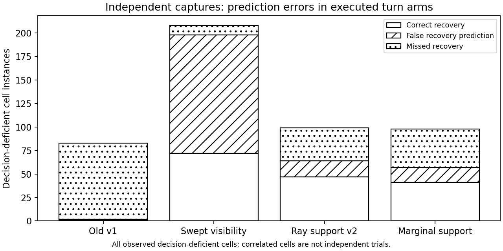
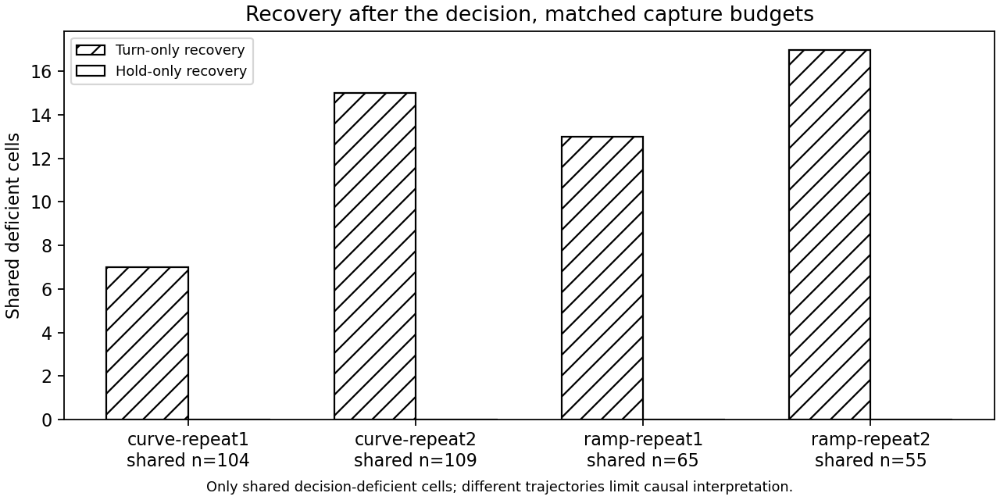

# 转向扫掠与点支撑模型：独立验证

日期：2026-09-13。全部为软件仿真，不是硬件验收或三策略总体优越性证明。

## 这一轮做了什么

新增离线候选 swept-support-v2。使用决策之前的点云、估计位姿和相机内参，计算最短转向过程中可能新增的体素与XY展布；同时预测保持朝向的支撑，比较是否值得转向。候选射线交点绝不写入采集地图。旧v1及在线三种策略保持原样。

相机按照最多0.25rad角度间隔积分，保留实测偏置与倾斜。点云按原生产端stride=4采样；假设格子高度为已有点中位数，光轴深度0.1至6米，体素0.05米。拟合支撑门槛复用至少6点及最小奇异值/√N≥格长5%。这是水平面片假设，尚未建模遮挡、坡度、噪声和采样相位，不是概率或真实精度。

## 实验与准入

新起点、距离和最终朝向；两个场景×转向/保持两组×两次重复，共8轮，每轮重建仿真及采集档案。统一35仿真秒，含5秒基线及到达后1秒共同静置，组间次序交替。每轮先查询并保存Nav2已知空间路径，再移动。两组均按预定方案执行，模型只给出旁路建议，不左右实验结果。

| 场景 | 起点X/Y/朝向rad | 目标X/Y | 最终观察朝向rad |
|---|---|---|---|
| visible_ramp_v1 | [-1.3, 1.3, -0.4] | [-0.6, 1.05] | 0.25 |
| visible_curve_v1 | [-1.8, 2.0, -0.25] | [-1.05, 1.65] | -0.8 |

运行前冻结预测源码及准入条件：完整执行8轮；全部决策不足格上支撑预测的precision、recall均至少0.5，且recall超过v1；不得错误跳过配对独有恢复，建议转向却无正净收益的配对最多1组；必须实际覆盖“尝试转向”和“没有边际支撑”两个分支。对齐/预算不足不能替代停止分支验证。门槛是探索性工程要求，不是统计显著性标准。

## 结果

旁路准入检查：未通过。在线策略未修改，未启动新的完整三策略对照。

拒绝原因：一次跳过建议会遗漏配对恢复；没有覆盖真正的“无边际支撑”停止分支。对应机器记录为false_skip_of_paired_recovery、residual_stop_and_turn_not_both_validated。

| 实验 | 采集/导航评估 | 建议 | 实际转向耗时（仿真秒） |
|---|---|---|---|
| visible_ramp_v1-repeat1-no_turn | evaluated | try_observation | 0.000 |
| visible_ramp_v1-repeat1-turn | evaluated | try_observation | 1.977 |
| visible_curve_v1-repeat1-turn | evaluated | already_aligned | 0.683 |
| visible_curve_v1-repeat1-no_turn | evaluated | try_observation | 0.000 |
| visible_ramp_v1-repeat2-turn | evaluated | try_observation | 2.152 |
| visible_ramp_v1-repeat2-no_turn | evaluated | try_observation | 0.000 |
| visible_curve_v1-repeat2-no_turn | evaluated | try_observation | 0.000 |
| visible_curve_v1-repeat2-turn | evaluated | try_observation | 0.867 |

以下仅对实际转向组评价预测。保持组的转向预测为未执行的假设，不用来证明转向有效。

| 统计范围 | 规则 | 命中 | 误报 | 漏报 | precision | recall |
|---|---|---:|---:|---:|---:|---:|
| all_decision_deficient | v1_prediction | 1 | 1 | 81 | 50.0% | 1.2% |
| all_decision_deficient | swept_visible | 72 | 126 | 10 | 36.4% | 87.8% |
| all_decision_deficient | swept_prediction | 47 | 17 | 35 | 73.4% | 57.3% |
| all_decision_deficient | marginal_prediction | 41 | 16 | 41 | 71.9% | 50.0% |
| initial_deficient | v1_prediction | 0 | 0 | 4 | 无分母 | 0.0% |
| initial_deficient | swept_visible | 2 | 10 | 2 | 16.7% | 50.0% |
| initial_deficient | swept_prediction | 2 | 2 | 2 | 50.0% | 50.0% |
| initial_deficient | marginal_prediction | 2 | 2 | 2 | 50.0% | 50.0% |

all_decision_deficient包含沿途新发现的不足格；initial_deficient仅保留最初已不足且决策时仍不足的格。二者不能混用分母。precision是预测恢复中实际恢复的比例；recall是实际恢复中被预测命中的比例；它们均不是测量精度。

| 配对 | 范围 | 共同剩余不足格 | 仅转向组恢复 | 仅保持组恢复 | 净差 |
|---|---|---:|---:|---:|---:|
| visible_curve_v1-repeat1 | all_decision_deficient | 104 | 7 | 0 | 7 |
| visible_curve_v1-repeat1 | initial_deficient | 16 | 0 | 0 | 0 |
| visible_curve_v1-repeat2 | all_decision_deficient | 109 | 15 | 0 | 15 |
| visible_curve_v1-repeat2 | initial_deficient | 16 | 0 | 0 | 0 |
| visible_ramp_v1-repeat1 | all_decision_deficient | 65 | 13 | 0 | 13 |
| visible_ramp_v1-repeat1 | initial_deficient | 16 | 0 | 0 | 0 |
| visible_ramp_v1-repeat2 | all_decision_deficient | 55 | 17 | 0 | 17 |
| visible_ramp_v1-repeat2 | initial_deficient | 18 | 1 | 0 | 1 |

同一格在两组决策时均不足才进入配对比较。组间实际轨迹和传感器时序略有差异，净差不是逐格因果真值。格次彼此相关，不是独立试验重复。没有计算新的几何精度指标。

## 开发数据与独立数据

上一批arrival-decision的8轮只作为开发回放，存于development。最初不足格的7次实际恢复，v1命中0次；新支撑规则命中3次、漏4次、误报0次。该结果不属于独立验证。当前新8轮源码冻结后未根据结果修改门槛。

## 结论与后续安排

所有8次采集/导航和4次观察转向均成功，仿真已停止。每次记录62至64帧，丢弃1至2个选中帧；实际首末帧跨度34.2至34.7仿真秒。名义预算一致不表示时间序列完全相同。

实际转向组的全部决策不足格，共82格次恢复。v1命中1、误报1、漏81；新支撑预测命中47、误报17、漏35，precision=73.4%、recall=57.3%。仅判断能否看到则误报126次，说明加入点分布门槛能够排除部分空泛机会，但仍不是可靠的恢复概率。

只看“最初就不足的格”：共4格次恢复，新规则命中2、误报2、漏2。配对共同最初不足格的净差仅0、0、0、1；全部决策不足格的配对净差为曲面7/15、坡面13/17。大多数恢复来自沿途新发现的不足格，不能据此声称最初目标缺口已大幅改善。

曲面第1次转向组的决策转角为0.093957rad（约5.38°），触发原先0.12rad“已经对齐”门槛，尽管模型仍有5格边际机会。按实验计划实际转向耗时0.683仿真秒，配对共有104个剩余不足格，转向组独有恢复7格。这个描述性差异不隔离定位/轨迹差异，但足以说明现有跳过判断未通过预设检查。不能把运动朝向容差直接当作信息收益为零。

本批7次建议观察、1次因为对齐跳过，0次因“无边际支撑”停止。预测指标改善不等于停止规则验证通过，因此不接入在线第三策略，也不把这8轮说成新的三策略对照。

下一步先分开“朝向已对齐”和“无补采价值”两个判断，验证小角度重观测、重复相同视角、支撑饱和与遮挡等低收益条件；比较保持观察的实际恢复、转向增量和耗时，再冻结规则并独立复验。通过后才接入第三策略并重跑统一预算的三策略对照。当前不依据这批结果临时降低门槛或宣称改进已通过。

## 文件与复核

- captures：每轮原始深度、点云、同步位姿、控制事件、Nav2事前路径/地图、现场截图、冻结源码与方案。
- analysis/cells.csv：逐格预测与最终标签；metrics.csv、pairs.json、assessment.json：可重算的统计与判定。
- analysis/*-scene-map.png：实际现场、决策时观测点云、最终观测点云；方框是预测标记，不是实测点。
- development：旧批次开发回放，来源为相邻arrival-decision-20260913/captures。
- provenance：运行与分析脚本、日志、环境版本和补充检查；hashes.json保护冻结文件。

在本目录运行 `python check_evidence.py` 可用标准库核对哈希、实际执行、先规划后移动、无未来帧输入边界、两种统计范围和配对结果。模型逻辑检查位于仓库ros2_ws/src/mooncar_terrain/tests/test_swept_resampling.py，在已有ROS容器中运行。

实现细节：v2的XY支撑矩阵以样本均值为中心，现有TerrainMap最终拟合矩阵以格心为中心；复用的是6点和格长5%的门槛，矩阵并非完全相同。候选支撑判断不能替代真实TerrainMap拟合结果，后者始终作为本轮恢复标签。
