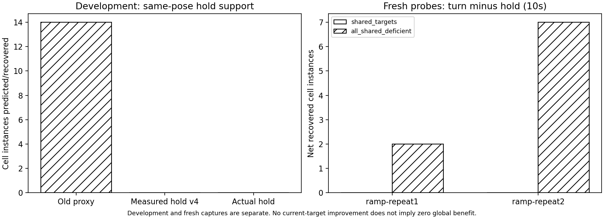
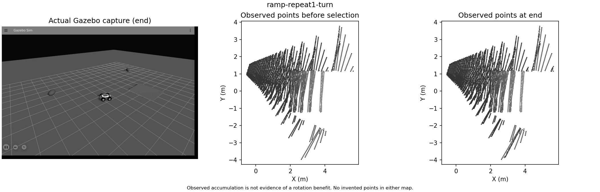

# 保持预测修正与固定补采目标验证

日期：2026-09-13。软件仿真研究；默认模型与在线三种策略均未替换。

本轮固定目标筛查：通过；合格非零目标负例：2/2。此结论仅针对预先固定的补采目标和本批两个坡面重复，不是全图停止规则验收。

## 误报来源与修改

上一批14个保持误报格中，水平面片射线引入的新增体素没有一个得到对应实测深度的支持；直接回放同姿态实测射线，14格均不能变得可拟合。误差既有水平面近似改变交点的情况，也有微小高度差跨过体素边界的情况。假设点只存在预测器，原始采集地图没有被填入这些点。

候选v4以已有观测作为同姿态保持基准，不再补入初始姿态的假设面片交点；未来转向仍使用待验证的几何近似。支撑矩阵以格心为中心，与地形拟合约定一致。固定姿态/静态场景是近似条件，不代表真实相机噪声、抖动或动态物体不会产生变化。

旧v2保持默认，新模型须显式model_version=v4。已有48个候选的旧预测数量重现一致，保持预测在开发数据上由14格次降为0。零转角检查属于逻辑验证，不能当作实际非零负例。

| 旧数据开发回放：实际转向组 | 命中TP | 误报FP：旧→v4 | 漏报FN |
|---|---:|---:|---:|
| small-angle的4次转向 | 26 | 10→7 | 20 |
| swept-support的4次转向 | 47 | 17→14 | 35 |

以上只说明旧数据上的变化，不是独立性能验证；相关格次不能当作独立样本。未来视角仍未建模完整遮挡、坡面和观测噪声。

## 为什么固定补采目标

全局48个候选在v4下仍都有预测收益。因此单独修正保持基准没有解决全局停止判断。这里新增一个明确的子任务：出发前把当时采样不足的格子保存为目标集合；到达后检验这批目标是否值得为某个转角继续观察。沿途新发现的不足格继续记录，但作为另外的候选目标。

这是评价范围的明确变化，不能用子任务结果替代旧版全图停止规则的验证。目标集合完全来自出发前的传感器数据；不根据后续是否恢复来挑格子，也不使用Gazebo真值选择目标。

## 事前冻结的新实验

同一坡面场景两次重复，转向/保持各一次并交替顺序，共4次独立重置，每次40仿真秒。先观察至少5秒并保存目标集合，再由Nav2移动，到达后共同保持5秒。按±0.02、±0.04、±0.08rad选择第一个仍有目标不足格、但预测无目标边际支撑的转角；没有目标或没有候选均不算负例。

选定后，转向组实际执行模型建议跳过的动作；保持组不转。要求输入不超过5秒旧、至少剩余12秒。实际转角方向一致、至少请求量一半、误差不超过0.02rad加请求量25%。主要比较发出动作后10秒内两组共同剩余目标的恢复；同时保留目标外与全部共同不足格的变化。

## 新采集结果

| 记录 | 初始目标数 | 命令时剩余目标 | 目标恢复 | 目标外恢复 | 合格负例 |
|---|---:|---:|---:|---:|---|
| ramp-repeat1-no_turn | 131 | 20 | 0 | 1 | False |
| ramp-repeat1-turn | 131 | 20 | 0 | 5 | True |
| ramp-repeat2-turn | 131 | 15 | 0 | 8 | True |
| ramp-repeat2-no_turn | 131 | 19 | 0 | 0 | False |

| 转向记录 | 请求转角rad | 实际估计转角rad | 转向耗时sim秒 |
|---|---:|---:|---:|
| ramp-repeat1-turn | 0.02000 | 0.02848 | 0.405 |
| ramp-repeat2-turn | 0.02000 | 0.02949 | 0.354 |

小角度实际执行量与请求量不同，已保留误差；不能将本批直接当成精确角度响应标定。

| 配对 | 统计范围 | 共同不足格 | 转向独有恢复 | 保持独有恢复 | 净差 |
|---|---|---:|---:|---:|---:|
| ramp-repeat1 | shared_targets | 18 | 0 | 0 | 0 |
| ramp-repeat1 | all_shared_deficient | 70 | 3 | 1 | 2 |
| ramp-repeat2 | shared_targets | 14 | 0 | 0 | 0 |
| ramp-repeat2 | all_shared_deficient | 97 | 7 | 0 | 7 |

shared_targets只含两组出发前均已列为目标、命令时仍不足的格；all_shared_deficient也包含新发现的不足格。两组独立重置后目标集合、轨迹和观测时间存在差异，配对净差不是逐格因果真值。恢复表示真实观测满足拟合条件，不代表几何精度提高。

拒绝原因：无，窄范围工程筛查通过。

第一组保持对照在目标外仍恢复1格，说明固定保持基准并非未来零恢复的保证；需要继续检查重复融合和拟合门槛附近的变化。不能把旧数据14次误报修正解释成保持预测已经全面校准。

## 结论边界与下一步

跳过某个转角对当前目标的补采，不等于整个区域完成，也不等于该转角没有目标外收益；其他角度和下一位置仍需比较收益/耗时。本批只有两个坡面重复，尚未完成曲面、遮挡、多起点和完整三策略对照，在线策略仍保持原样。

下一步扩展固定目标验证条件，并把当前转向与下一候选位置的收益、耗时放在一起评估，再决定如何接入第三种策略。不能直接以“只要一格有潜在收益”作为无限继续观察的理由。

## 复核资料

captures保存4次原始深度/点云/同步位姿、现场截图、preaction与checkpoint传感器前缀、出发前目标集合、选择结果、控制记录和冻结源码。analysis保存逐格CSV、配对、判定和图。diagnosis是上一批14个误报格的深度核对；development是已有24次采集上的开发分析，原始数据仍在相邻三个旧报告目录中。

运行python check_evidence.py可用标准库验证哈希、目标时间边界、范围和配对统计。冻结evaluate_target_probes.py另逐数组验证两个前缀与最终原始记录一致，并重建目标集合、重算候选；需要现有NumPy/ROS依赖环境。
