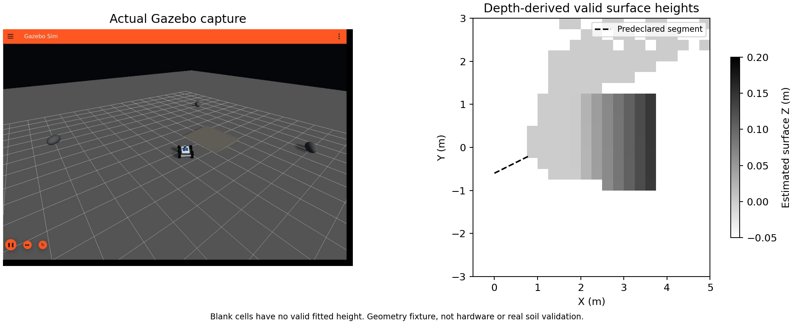
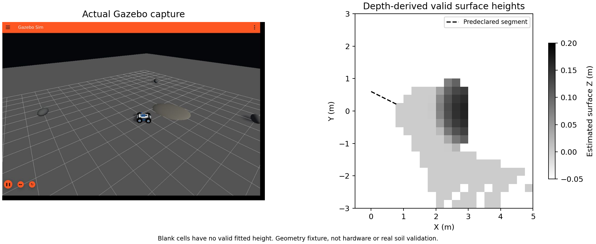

# 可见地形与沿路径补采预测验证

日期：2026-09-13。状态：四次真实 Gazebo 采集完成；离线模型初步验证，尚未替换在线自主探测策略。

这轮确认了两点：固定相机确实可以通过移动车辆补采低坡面和低矮曲面；把沿途视角纳入预测，在本轮两个场景中比只看终点少漏掉一些补采机会。当前证据仍只有每个场景一组静止/移动试验，不能据此宣布第三种策略已优于另外两种。

## 实验条件与采集结果

新建两个独立的 SDF 世界，分别放置低坡面、低矮曲面及远处定位标志，不再用旧场地不同区域代替独立场景。保留现有传感器、导航、安全限制和地图融合参数。相机仍固定，前伸 0.435 m、高 0.235 m；网格 0.25 m、体素 0.05 m。底层仍是原有月面重力等仿真条件，不是地面实车或真实沙土试验。

每次重启并建立新档案；计划采集 25 仿真秒，前 5 秒作为行动前基线。规则、直线计划路径、场景与参数在采集前保存在 captures/plan.json，并记录源码 SHA-256。先做独立几何射线可见性检查，再用真实深度图复核。

| 场景 | 起点 → 目标（米） | 静止/移动有效帧 | 移动导航 | 实际采样路程 |
|---|---|---:|---|---:|
| 低坡面 | (0, −0.6) → (0.8, −0.2) | 45 / 44 | succeeded | 0.837 m |
| 低矮曲面 | (0, 0.6) → (0.8, 0.2) | 47 / 46 | succeeded | 0.797 m |

有效帧数量和有效时间窗有小幅差异；丢弃原因保存在各采集的 drops.json。两次移动有效时间窗分别 24.3 / 24.7 秒。四次实验编号依次为 de36034fbaf0、622800100952、7983ce4c6913、7c8a9a6d1f25，均带 experiment- 前缀。

| 只统计基线已观测的纯目标表面 | 初始拟合不足格 | 静止后变为有效拟合 | 移动后变为有效拟合 |
|---|---:|---:|---:|
| 坡面 | 39 | 0 | 36 |
| 曲面 | 15 | 0 | 14 |

这里的“有效”指融合点足以满足平面拟合条件，不是精度百分比，也不等于可通行。两次重置的基线样本数恰好相同，仍是分别统计各自基线，不能当作随机对照的同一组独立样本。

“初始不足”仅包含点数不足或二维分布不足（too_few_voxels / insufficient_xy_spread），不把陡坡、非平面或混合表面直接当作可以靠补采修复的目标。

## 终点预测与沿路径预测

终点基线沿用上轮距离与方向规则。新模型在**采集前约定的直线段**上每不超过 0.1 m 取一个候选视角，假设相机朝向沿路径切线，对每格取既有规则的并集；同一格只计一次。没有训练模型，没有使用未来帧、真实世界几何或真实位姿作为预测特征。

当前使用预定直线段，**还不是行动前向 Nav2 查询的实际全局路径**。它是检验沿途视角价值的简化模型，不是已经集成的在线规划器。终点规则仍按原实现从行动前定位到目标计算朝向；路径规则按冻结的计划线段计算朝向，两者可能有很小的初始定位差异。

| 纯目标表面 | 终点正确识别 / 实际补采成功 | 沿路径正确识别 / 实际补采成功 | 终点→沿路径误报 | 终点→沿路径漏报 |
|---|---:|---:|---:|---:|
| 坡面 | 19 / 36（52.8%） | 24 / 36（66.7%） | 2 → 2 | 17 → 12 |
| 曲面 | 4 / 14（28.6%） | 8 / 14（57.1%） | 0 → 1 | 10 → 6 |

以上百分比是对真实补采成功格的**召回率**，不是地图精度或成功概率。含地面和边缘的全部初始不足格结果如下，避免只挑目标表面报喜：

| 全部初始不足格 | 总数 | 规则 | 命中 TP | 误报 FP | 漏报 FN | 正确排除 TN |
|---|---:|---|---:|---:|---:|---:|
| 坡面场景移动 | 87 | 终点 | 24 | 5 | 44 | 14 |
| 坡面场景移动 | 87 | 沿路径 | 31 | 5 | 37 | 14 |
| 曲面场景移动 | 71 | 终点 | 14 | 2 | 36 | 19 |
| 曲面场景移动 | 71 | 沿路径 | 19 | 3 | 31 | 18 |

两次静止均无初始不足格恢复，两种规则也均无正预测。每格预测与结果见 analysis/samples.csv，完整矩阵见 analysis/rule-check.csv。

## 可视证据与边界

左侧是实际 Gazebo 截图，右侧由测得深度与估计位姿融合；空白表示没有有效拟合高度。黑色虚线仅表示事先约定的试验线段，不是实际 Nav2 路径。图中可见目标表面的高度变化。

独立的同射线、真实位姿可见性审计，在移动结果中确认了 **65 个纯坡面格、34 个纯曲面格**；各自有 59 / 23 个观测与参考都可拟合的格。此审计采用真实坐标，不能与上述估计坐标下的“初始不足格”直接合并分母。基线表面分类只用于评价分组，按独立射线命中的表面标签归入测量所在估计坐标格；混合标签单列，未输入模型。

参考误差来自理想几何与相同射线：曲面配对高度 RMSE 约 1.19 mm，坡面约 0.00038 mm。这主要检验无噪声仿真投影和表示一致性，绝不表示实机精度；混合边缘、未观测和拟合失败仍保留在单独统计中。

实际轨迹偏离预定直线最大约 0.137 / 0.113 m，车头相对预定切线方向最大偏差约 26.45° / 15.25°。这些是事后诊断，不参与预测；也说明后续必须处理 Nav2 实际路径和相机朝向。曲面多出的一个误报提示：扩大候选视角不能直接等同于可靠的信息增益。

## 下一步

1. 在移动前获取 Nav2 可执行路径，并明确观察朝向及其允许误差；先在离线检查中替换当前直线假设。
2. 固定规则后增加起点与重复次数，保留失败、漏报和误报；检验沿路径改善是否稳定，并加入遮挡、二维采样分布等因素。
3. 达到可接受预测表现后，再把改进接入第三种策略，用原有统一预算、重置和记录流程重跑三策略对照。当前在线三策略及安全阈值未改动。

## 证据校验

captures/ 保存原始深度、同步位姿、现场截图、场景及采集源码；analysis/ 保存每格结果、可见性审计和图表；provenance/ 保存执行脚本和日志。hashes.json 覆盖冻结文件。运行本目录的 `python check_evidence.py` 可只读检查哈希、四次采集、两个不同世界、真实目标可见性和全部混淆矩阵。重做分析应先复制 captures 到新临时目录，避免改写冻结证据。

已通过路径去重、未来帧不泄漏、新场景校验、原默认场景及 HTTP 隔离检查；旧 resampling-model 与 resampling-attribution 证据校验也通过。仿真已结束，前端服务保留。
