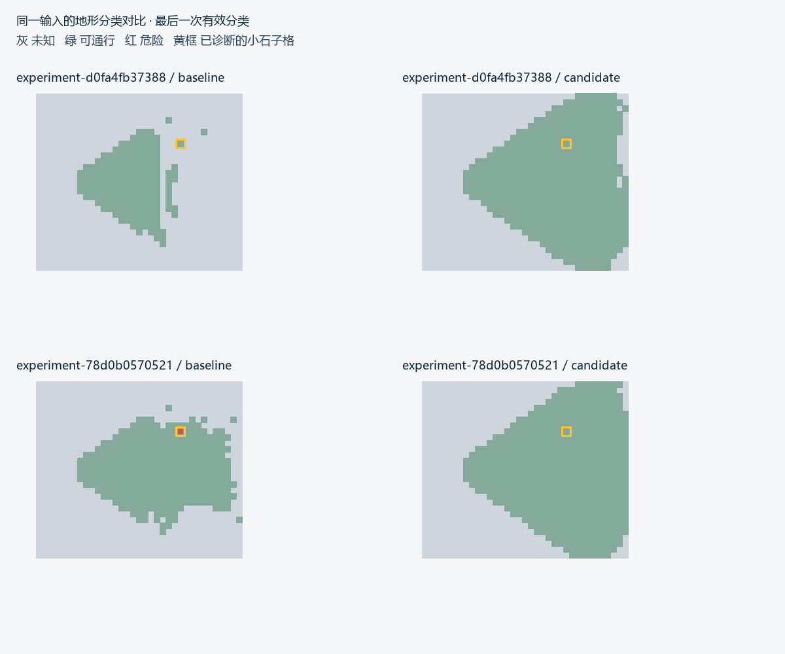

# 地形策略对照结果

2026-11-15。寻迹者探测车。

文献启发的候选在本次保存数据中减少了小石子引起的危险判定和证据不足，处理耗时增加。在线任务对照因状态见证超时而未完成，现有结果只支持离线地形分类比较。

## 两种策略

原策略对每帧、每个 20 cm 格子单独拟合地面。候选先维护 5 cm 高程格，按多帧观测统计高度与经验方差，再在半径 36 cm 的邻域中计算地面法向和粗糙度。中心观测相对邻域地面的高度异常单独检查，以保留孤立障碍与落差。

算法依据包括 Fankhauser 等 2018 年的概率高程建图工作，以及 ETH / ANYbotics 的高程地图、法向、坡度、粗糙度和高度差滤波器。候选为 NumPy 适配原型，经验方差没有替代经过标定的深度和位姿协方差。本轮没有实现原论文完整概率建图系统。

- [Fankhauser 等 2018 年论文](https://doi.org/10.1109/LRA.2018.2849506)
- [高程建图实现](https://github.com/ANYbotics/elevation_mapping)
- [可通行性评估实现](https://github.com/leggedrobotics/traversability_estimation)
- [法向滤波实现](https://github.com/ANYbotics/grid_map)

## 固定输入的离线比较

两种策略顺序接收同样的原始传感器点、归档相机位姿、车体位姿与自车过滤结果，共 2 份档案、79 个关键帧。两组共享 18° 坡度、4 cm 粗糙度、18 cm 台阶、12 cm 落差阈值。候选只分类有实际观测点的输出格。所有耗时都在同一 Python 环境、单线程数值库设置下记录，单次回放耗时受到运行环境波动影响。

下表针对主要的 64 帧档案。其中已诊断的小石子格在 35 帧中有测量点，另外 29 帧未观测到该格。

| 指标 | 原策略 | 候选策略 |
|---|---:|---:|
| 小石子格判为可通行 | 10 次 | 35 次 |
| 小石子格判为危险 | 1 次 | 0 次 |
| 小石子格有点但证据不足 | 24 次 | 0 次 |
| 平均每帧分类耗时 | 57.7 ms | 202.2 ms |
| 每帧分类耗时 P95 | 110.6 ms | 370.1 ms |

另一份 15 帧档案中，该格原策略为 1 次可通行、14 次证据不足，候选为 15 次可通行。该档案中原策略没有将此格判为危险。

危险判定次数是保存关键帧逐次重算的结果。原在线地图保留过历史危险格，且部分在线分类帧没有进入关键帧档案，故不能把本表直接当成原在线误判率或任务成功率。

图中黄色框对应被诊断的小石子格。灰色表示没有有效分类，绿色表示当前规则下可通行，红色表示危险。图保留每格最后一次有效分类，表示历史观测范围内的输出。

## 危险与未知检查

候选在 9 类独立构造场景中均得到预期结果。平地、10° 缓坡可通行，25° 陡坡、25 cm 台阶、25 cm 落差、约 6 cm RMS 的粗糙地面、孤立 25 cm 高障碍、孤立 25 cm 落差均被判为危险。单扫描线保留未知。已有地面上新出现高障碍的回归检查也通过。

这些是检查特定几何情况的受控输入，不构成实车危险识别率的统计验证。

## 原型修订与耗时

初始候选在主要档案中平均耗时 499.3 ms。将细格分组和邻域查询矢量化后降到 176.7 ms。优化前后的 79 帧、19334 条输出逐项一致，最大数值差为 0。

随后补充的孤立障碍反例暴露了第一版的漏判。候选增加源观测高度范围相对邻域平面的检查后重新回放，得到表中的 202.2 ms。早期结果完整保留在本目录根部和 optimized 子目录，最终结果位于 final 子目录。参数没有按录像结果搜索。

## 在线集成状态

加入了显式验证选项 terrain-strategy=elevation_neighborhood_v1，原策略仍为默认。两个选择都经相同地形节点和标准导航地图输出。软件安装核验也包含候选源码。

在线原策略尝试 experiment-de078b222be4 在约 153.6 墙钟秒后结束。产品快照显示就绪，但独立生命周期见证只确认了 behavior_server，未确认全部要求的节点，验证器因此没有派发车辆动作。结果为状态确认超时，候选在线任务暂缓。因此本轮没有获得转向完成、回正和续行的在线 A/B 结果。

原始尝试保存在 tmp/ros_acceptance/literature-terrain-ab-20261115/baseline。未修改原来的转向预测相交检查。

## 版本与复核材料

| 提交 | 内容 |
|---|---|
| b4756e8 | 固定对比设计、输入和评价规则 |
| 9214592 | 初始候选及离线回放 |
| f34ce4b | 数值输出一致的计算优化 |
| f878f15 | 显式在线验证入口 |
| 6a5416e | 孤立高度异常检查与最终离线对照 |

- [最终逐帧统计](final/frames.csv)
- [最终结果与全部构造场景](final/results.json)
- [最终输入与源码哈希](final/protocol.json)
- [计算优化等价检查](optimization-equivalence.json)
- [候选实现](../../scripts/literature_terrain.py)
- [对照入口](../../scripts/compare_terrain_strategies.py)
- [预先固定的方案及后续修订](../../docs/terrain_strategy_comparison_20261115.md)
