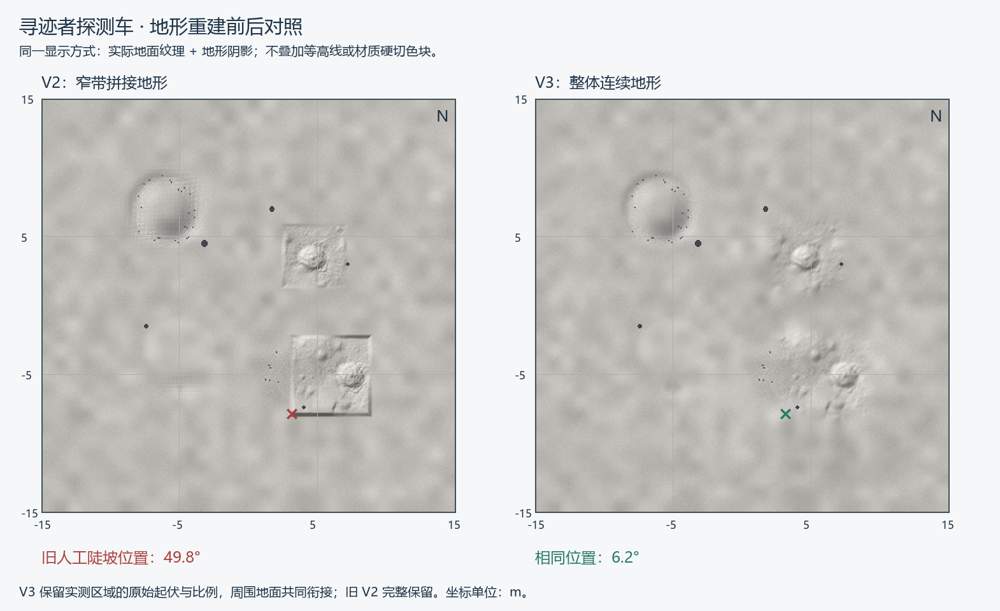

# Terrain V3 连续地形重建与通行验证

2026-11-17。已完成新地形构建并作为工作台新实验默认场景 `survey_v3_native`。旧 V2 世界和资产未改动，可继续复现历史实验。实测源码提交 `3caf0c0cd564b4967981bdf5d4209ef528a10c59`，分支 `dev/terrain-mapping-workbench`。

## 主要变化

- 同一张 30×30 m、10 cm 间隔的连续网格，共 90,601 顶点、180,000 三角面。材质分区共用完全一致的边界顶点，显示和碰撞引用同一网格。
- 用可复现的多尺度背景起伏取代规则波纹背景。保留陨坑、缓丘及两块实测地形的原始水平和竖直比例；5 cm 来源数据采样到共同 10 cm 网格，没有为了通行压平真实坑坡。
- 固定实测内部和受保护区域，通过全局最小曲率修正共同衔接周围地面，去掉旧 35 cm 窄带混合。插值长度是工程构造参数，不是车辆限制或通行阈值。方法和 [SciPy 求解器来源](https://docs.scipy.org/doc/scipy/reference/generated/scipy.sparse.linalg.spsolve.html)详见 `docs/terrain_v3_20261117.md`。
- 岩石、碎石保留原水平布局、尺寸和形状，按新地面重新放置。纹理共用世界坐标并柔和混合；新总览采用自然灰度纹理和地形阴影，不叠加密集等高线和材质硬切色块。
- 默认定位、地形判定策略、R5 支承物理、导航安全保护、无起点半径及全部观测面积统计保持原方案。

[新版全场地图及实际验证轨迹](terrain-v3-overview.png)；[完整通行验证视频，55.55 秒](v3-terrain-crossing.mp4)。视频是实际 Gazebo 录屏，按仿真时间播放，保留启动、观察、行驶和停车过程，片尾停帧 2 秒；原始墙钟录像另存。视频中的细直线是 Gazebo 的显示辅助坐标网格，不属于地形或碰撞结构。

## 实际网格检查

独立读取写出的 OBJ，不以生成器内存中的曲面代替碰撞模型检查。确认投影面积 900 m²、无内部开口或重叠三角面、所有内部边双重邻接、只有场地外边单邻接、面朝向正确、写出模型与高度档案一致、显示与碰撞几何一致。

| 指标 | 旧 V2 | 新 V3 |
| --- | ---: | ---: |
| 原人工陡坡位置的实际三角面坡度 | 49.83° | 6.21° |
| 右下块内侧 35 cm 对照带中超过 18° 的面积 | 3.0275 m² | 0.1200 m² |
| 右下块内侧对照带坡度 P95 | 39.84° | 14.36° |

新 V3 的实测内部不再参与混合，边缘剩余的陡面来自保留的采样地形。全场最大实际三角面坡度仍约 39.57°，真实陡坑不会被全部压到 18° 以下。18° 在这里用于对照当前分类器，并非要求所有自然地形都可通过。

完整数值见 `geometry-verification.json`，检查入口为 `scripts/check_terrain_v3.py`。旧 V2 世界 SHA256 保持 `08e9837e09b53e06fa0569423e0dc4775b1456508ca999cfef6fdf3444fb1555`。

## 实际车辆通行

实验 `experiment-b236f4d6edff`。从 `(-2.3,-10.1)` 朝向约 32.24° 起步，先俯视观察地面，再按四段不超过 2.5 m 的 Nav2 目标驶向 `(4.2,-6.0)`，穿过旧实测背景块的西侧边界，实际交叉位置约 `(3.0,-6.74)`。这条路线没有覆盖每一处边缘，也不是恰好沿 49.83° 极值点行驶；该极值点的改善由独立网格检查确认。

| 本次记录 | 结果 |
| --- | ---: |
| 导航段成功 | 4／4 |
| 云台观察动作 | 成功 |
| 真值采样轨迹长度 | 7.60 m |
| 终点真值与目标距离 | 0.181 m，使用原 Nav2 到达容差 |
| 行驶期间定位不健康快照 | 0／1280 |
| 同时刻定位平面误差 P95／最大值 | 3.72／3.94 cm |
| 最大绝对车身横滚／俯仰 | 5.47／5.74° |
| 墙钟时间，含启动收尾 | 414.93 s |
| 原始 GUI 抓帧数 | 1216 |
| 驱动器、录屏器、后端退出码 | 全部为 0 |

真值只用于初始摆放检查、被动观察及离线评价，不输入导航或定位。车辆使用实际相机/深度/IMU、原默认定位和地形分类器，没有放松危险判定来通过测试。详见 `crossing-result.json`、`crossing-summary.json`、`crossing-protocol.json`。

成片 1120×760、20 fps，共 1111 帧，完整解码通过；开始、中段及结束画面已检查。录屏时刻与状态接收时刻按因果顺序匹配，仿真时轴来自墙钟/仿真钟记录的插值，属于行为观察，非精密视频同步测量。

## 验证边界与后续

这是一次受控路线验证，不等于新版地形已通过全场、长时间或所有陡坡验证。地形网格变细，仿真计算开销增加；本次墙钟时间仅是该运行记录，不是与 V2 匹配的性能基准。接触系数仍是工程假设，轮胎/月壤牵引力尚未实车标定。V3 是保留实测形状的工程仿真场景，不宣称复原完整真实月面。

23 项相关离线检查最终通过，含实测数据约束、网格完整性、旧假陡坡回归、场景选择、旧 V2 兼容、支承集成、资源及测试工具。首次有一项因跨环境浮点面积 `900.0000000000005` 与 `900` 严格相等比较失败，改为数值容差后单独重跑通过；其余 22 项已通过。JavaScript 语法检查通过。详见 `offline-checks.json`。

运行前后均核验冻结的 679 个产品源码文件和 134 个安装资源及实际支承库，未发生中途换版本；回执为 `runtime-source.json`、`runtime-before.json`、`runtime-after.json`。世界和测试辅助进程已结束。

原始证据目录为工作目录下 `tmp/ros_acceptance/terrain-v3-validation-20261117/`，含原始墙钟录像、真实轨迹、TF 对齐、状态、生命周期确认和关节记录。报告脚本保存在本目录，主要证据及交付物校验和见 `evidence-sha256.json`。
