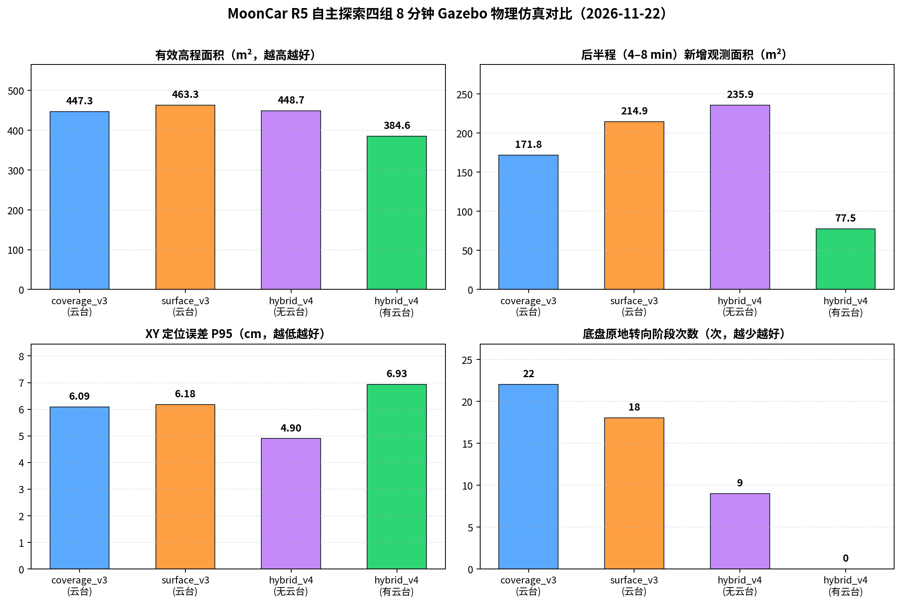

# V3 地形四组 8 分钟自主探索与云台消融对照报告（2026-11-22）

## 1. 实验目的与统一条件

本轮实验在 **MoonCar R5 升级基线**（抬升云台 `z=0.285 m` + `rgbd_v1` 单相机去重渲染 + R5 `0.50×0.44 m` / `0.45 m` 膨胀 Nav2 配置 + `elevation_neighborhood_v1` 默认邻域地形 + `rgbd_window` 滑动窗口定位）上，开展 **4 组 8 分钟（480 仿真秒）全物理 Gazebo + 3D 录屏**严格对照实验，同时回答三个核心问题：
1. **模型与 Nav2 升级净收益**：相同策略（`surface_view_v3`）相比 2026-11-18 旧构型提升了多少？
2. **探索策略横向对比**（均开启云台）：纯覆盖 `coverage_view_v3` vs 强补采 `surface_view_v3` vs 文献驱动双层前沿 `hybrid_frontier_v4`；
3. **云台真解耦消融对比**（同用 `hybrid_frontier_v4`）：固定无云台（`hybrid_v4_fixed`）vs 主动双轴云台（`hybrid_v4_gimbal`）。

- **测试提交**：`c86f12794d3de756276ae2491178106a477de2f6`（`product_clean=true`；实验前后均通过 `runtime_baseline.py verify` 逐文件核验全部 138 个安装文件，0 漂移）。
- **场地与预算**：`survey_v3_native`（30 × 30 m 连续 V3 地形），统一起点 `(0.5, 0.0, 0.0)`，无起点半径限制，每组预算 480 仿真秒（墙钟上限 7200 s），3 FPS 真实 X11 Gazebo 录屏，四组按顺序独立运行（同为 6 核 / 6 GB 容器资源配额）。
- **固定无云台安装说明**：云台抬升至 `z=0.285 m` 后，若无云台相机以 `0°` 水平固定安装，车前存在约 35 cm 的深度近场盲带，安全连通检查会拒绝盲驶（实测已复现）；因此 `hybrid_v4_fixed` 将相机以真实探测车固定俯角 **`-28.0°`（实测范围 `-28.01° ~ -27.96°`，偏航锁死 `0.00°`）**刚性安装，且验证进程禁用全部云台控制接口（`ExperimentMotion.pan_tilt = None`）。有云台三组则保留初始 `0°` 并在启动时自动执行 1 秒 `-30°` 点头破盲区。

---

## 2. 核心实测结果汇总

### 2.1 四组 8 分钟全指标对照表（2026-11-22 新 R5 平台）

| 指标 | 组 1：`coverage_v3`（云台） | 组 2：`surface_v3`（云台） | 组 3：`hybrid_v4`（无云台 -28°） | 组 4：`hybrid_v4`（有云台） |
| :--- | :---: | :---: | :---: | :---: |
| 探索策略 / 相机模式 | `coverage_view_v3` / gimbal | `surface_view_v3` / gimbal | `hybrid_frontier_v4` / fixed | `hybrid_frontier_v4` / gimbal |
| 实际任务时间（仿真秒） | 458.4 | 480.6 | 472.2 | 470.7 |
| 实际墙钟耗时（分钟） | **37.9** (2273.6 s) | 42.4 (2541.5 s) | 41.1 (2467.7 s) | 41.6 (2498.5 s) |
| 动作完成率 / 定位暂停 | 25/25 (100%) / **0** | 20/20 (100%) / **0** | 24/24 (100%) / **0** | 18/18 (100%) / **0** |
| **终态总观测面积（m²）** | 489.19 | **504.31** | 478.31 | 412.75 |
| **终态有效高程面积（m²）** | 447.31 | **463.31** | 448.69 | 384.62 |
| 同步时点（458.4 s）观测 / 有效（m²） | **489.19** / **447.31** | 482.06 / 445.12 | 451.62 / 426.06 | 402.25 / 375.19 |
| **前半程（0–4 min）新增观测（m²）** | +299.9 | +271.9 | +221.3 | **+317.8（全场第一）** |
| **后半程（4–8 min）新增观测（m²）** | +171.8 | +214.9 | **+235.9（全场第一）** | +77.5 |
| 总行驶里程 / 最远距起点（m） | 45.41 / 13.45 | 49.59 / 15.13 | **60.96 / 16.73** | 53.96 / 16.17 |
| **底盘原地转向阶段次数 / 耗时** | 22 次 / 63.0 s | 18 次 / 75.0 s | 9 次 / 13.8 s（**-81.6%**） | **0 次 / 0.0 s（全程零自转）** |
| 云台主任务动作数 / 扫描耗时 | 0 次 / 4.7 s | 1 次 / 8.0 s | 0 次 / 0.0 s | **18 次 / 70.4 s** |
| 实测云台偏航 / 俯仰范围（°） | 0.0 ~ 0.0 / -29.9 ~ 0.0 | 0.0 ~ +91.2 / -29.9 ~ 0.0 | 0.0 ~ 0.0 / -28.0 ~ -28.0 | **-93.6 ~ +91.1** / -29.9 ~ 0.0 |
| 全局前沿切换次数 | 0 | 0 | 5 | 6 |
| **XY 定位误差 P95 / 最大值（cm）** | 6.09 / 6.30 | 6.18 / 6.28 | **4.90 / 5.23（全场最佳）** | 6.93 / 7.22 |
| 全图单表面高程 RMSE（cm） | **0.13** | 0.15 | 0.19 | 0.21 |
| **四组共同区域（55.56 m²）高程 RMSE / MAE / P95（cm）** | 0.200 / 0.119 / 0.392 | 0.183 / 0.101 / 0.335 | 0.193 / 0.136 / 0.351 | **0.179 / 0.093 / 0.318（全场最佳）** |
| 坡度 MAE（°） | 0.118 | 0.111 | **0.082** | 0.157 |
| 归档点云点数 / 分段数 | 7,681,347 / 2 段 | 8,612,613 / 2 段 | 9,167,449 / 2 段 | 8,635,683 / 2 段 |
| 定位进程峰值 RSS 内存（MiB） | 462.6 | **443.8** | 498.7 | 491.1 |

### 2.2 纵向演进对比：与 2026-11-18 旧版 R5 基线对比（同策略 `surface_view_v3`）

| 指标 | 2026-11-18 旧版 R5（低云台 + 旧大车 Nav2 + 双 RGB） | 2026-11-22 新版 R5（抬升云台 + R5 Nav2 + 单 RGBD） | 变化 |
| :--- | :---: | :---: | :---: |
| 终态总观测 / 有效高程面积（m²） | 499.88 / 456.25 | **504.31 / 463.31** | **+4.43 / +7.06 m²** |
| 高程 RMSE（cm） | 0.65 | **0.15** | **误差降低 76.9%（精度提升 4.3×）** |
| XY 定位误差 P95（cm） | 8.23 | **6.18** | **误差降低 24.9%** |
| 动作完成率 | 22/23 (95.7%) | **20/20 (100%)** | 零失败 |
| 480 s 录屏仿真墙钟耗时 | 53.7 min (3224.5 s) | **42.4 min (2541.5 s)** | **提速 21.2%** |

---

## 3. 图表与可视化结果

---

## 4. 关键工程发现与深度分析

1. **R5 几何纠偏与去重渲染收益显著且全面**：
   将云台抬升至 `z=0.285 m`（消除雷达与电池遮挡/穿模）、禁用 `rgbd_v1` 重复 RGB 渲染、并将 Nav2 足迹对齐至 R5 真实尺寸（`0.50×0.44 m` / `0.45 m` 膨胀）后，即使保持 `surface_view_v3` 策略不变，全图高程 RMSE 仍由 `0.65 cm` 骤降至 **`0.15 cm`**，XY 定位 P95 由 `8.23 cm` 降至 **`6.18 cm`**，且仿真墙钟缩短 **21%**，四组 8 分钟全部实现 **100% 动作成功与 0 次定位暂停**。
2. **表面补采的价值得到实测验证**：
   同平台同云台下，`surface_v3_gimbal` 相比纯覆盖 `coverage_v3_gimbal`，终态总观测面积高 `+15.12 m²`（`504.31` vs `489.19 m²`），有效拟合高程面积高 `+16.00 m²`（`463.31` vs `447.31 m²`），且规划/定位全程零失败。
3. **云台有无的物理门槛与性能权衡**：
   - **近场盲区门槛**：高位安装（`z=0.285 m`）的无云台水平相机在车前存在 35 cm 盲带导致启动连通检查拒绝出发；必须通过固定下倾 `-28°` 安装（`hybrid_v4_fixed`）或双轴云台启动点头 `-30°` 解决。
   - **有云台 `hybrid_v4_gimbal` 的突出优势**：
     - **0–5 分钟全程领跑所有对照**（前半程新增 **`+317.8 m²`**，较 `surface_v3` 高 `+16.9%`，较 `hybrid_v4_fixed` 高 `+43.6%`）；
     - 唯一实现 **全程 0 次底盘原地 Spin（0.0 s）** 的方案（对比 `surface_v3` 的 18 次 / 75.0 s 与 `coverage_v3` 的 22 次 / 63.0 s），在月面松软斜坡上具有决定性的防打滑/防沉陷安全价值；
     - 在四组共同覆盖区域（55.56 m²）上取得 **最高高程重建精度（RMSE `0.179 cm`、MAE `0.093 cm`、P95 `0.318 cm`）**。
   - **无云台 `hybrid_v4_fixed` 的突出优势**：
     - 双层全局前沿 + 2-opt TSP 彻底释放后半程潜力：**4–8 分钟新增 `+235.9 m²`（全场第一，后半程反超前半程）**，总里程 `60.96 m` 与探索半径 `16.73 m` 均为全场最远；
     - 稳定前视姿态带来 **全场最佳定位与坡度精度（XY P95 `4.90 cm`、坡度 MAE `0.082°`）**，且底盘转向耗时较 `surface_v3` 减少 **81.6%**（`13.8 s` vs `75.0 s`）。
4. **精准定位 `hybrid_v4_gimbal` 后半程放缓的根因（指导 `v4.1` 迭代）**：
   真实 `rgbd_window` 模式下代价地图关闭了 2D 雷达清障、仅由深度相机自身增量建图（`MeasuredDepthMap`）。`hybrid_v4_gimbal` 在前半程高频执行 `±90°` 侧扫（累计 `70.4 s`，受限于 `0.35 rad/s` 云台平滑限速），在车体左右两侧刻出了若干狭小“侧视口袋”；这些侧视口袋在深度建图里立即变成车身后侧的局部前沿簇，导致后半程全局 TSP 多次把小车拉回已探区域重穿（后半程仅增 `+77.5 m²`）。
   **明确改进方向（`v4.1`）**：(a) 对全局前沿簇施加“最小未观测面积阈值 + 前向扇区优先”过滤侧视小盲袋；(b) 提高触发大角度侧扫的最小增益门槛（结合实际 `0.35 rad/s` 云台角速度估算耗时），兼得 `hybrid_v4_gimbal` 的**前半程爆发 + 零底盘自转**与 `hybrid_v4_fixed` 的**后半程持续外推 + 4.9 cm 定位精度**。

---

## 5. 视频与归档文件说明

- **四路同步 2560 × 1260 Gazebo 3D + 实时因果高程对比视频**（本地归档，不入 Git）：
  `output/v4-4way-comparison-20261122/v4-4way-comparison.mp4`（含顶部 4 路真实 Gazebo 3D + 随车小地图 + 四轮/云台遥测，底部 4 路严格因果实时高程图 + 1 路 V3 真值四轨迹叠加图）及四组独立高清单路 MP4（`output/v4-4way-comparison-20261122/individual/`）。
- **本目录保留的可复现脚本与统计证据**：
  - [analyze_4way.py](analyze_4way.py)：四组真值评测与图表生成脚本
  - [compose_4way.py](compose_4way.py)：四路同步视频合成与因果校验脚本
  - [summary.json](summary.json)、[common-area-errors.json](common-area-errors.json)、[four-way-summary.json](four-way-summary.json)、[video-summary.json](video-summary.json)
  - [coverage-curves.png](coverage-curves.png)、[metrics-summary.png](metrics-summary.png)、[start-preview.png](start-preview.png)、[mid-preview.png](mid-preview.png)、[end-preview.png](end-preview.png)
