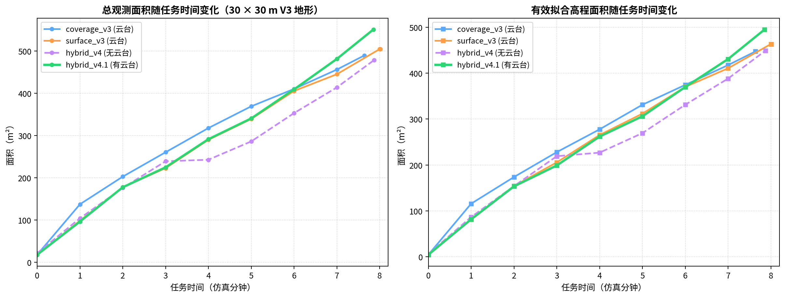
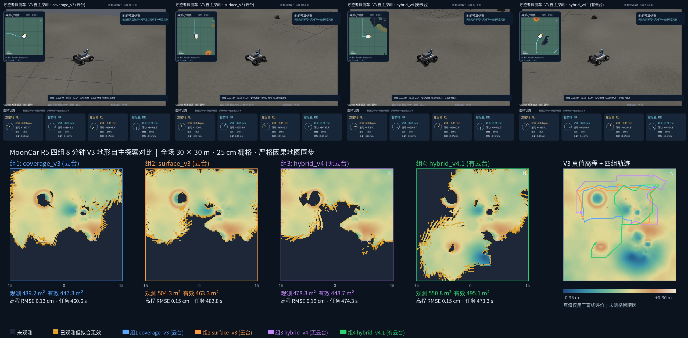

# V3 地形四组 8 分钟自主探索与云台消融对照报告（2026-11-22，含 `v4.0 → v4.1` 迭代实测）

## 1. 实验目的与统一条件

本轮实验在 **MoonCar R5 升级基线**（抬升云台 `z=0.285 m` + `rgbd_v1` 单相机去重渲染 + R5 `0.50×0.44 m` / `0.45 m` 膨胀 Nav2 配置 + `elevation_neighborhood_v1` 默认邻域地形 + `rgbd_window` 滑动窗口定位）上，开展 **8 分钟（480 仿真秒）全物理 Gazebo + 3D 录屏**严格对照实验，完整回答四个核心问题：
1. **模型与 Nav2 升级净收益**：相同策略（`surface_view_v3`）相比 2026-11-18 旧构型提升了多少？
2. **探索策略横向对比**（均开启云台）：纯覆盖 `coverage_view_v3` vs 强补采 `surface_view_v3` vs 文献驱动双层前沿 `hybrid_frontier_v4.1`；
3. **云台真解耦消融对比**（同用 `hybrid_frontier_v4` 族）：固定无云台（`hybrid_v4_fixed`）vs 主动双轴云台（`hybrid_v4.1`）；
4. **防碎片前沿滤波消融验证**：`hybrid_v4.0`（有云台初版）→ `hybrid_v4.1`（四道防碎片滤波 + `0.35 rad/s` 真实云台耗时建模）的实测提分幅度。

- **测试提交与核验**：前三组及 `v4.0` 初版运行于提交 `c86f12794d3de756276ae2491178106a477de2f6`，`hybrid_v4.1` 运行于提交 `0778a0f3c8b5d80549d06984713f0b6fcac690f9`（仅改动算法文件 `scripts/frontier_planner.py` 及单测，物理/URDF/Nav2/定位全部 138 项安装文件保持字节级一致且均通过运行前后 `runtime_baseline.py verify` 核验）。
- **场地与预算**：`survey_v3_native`（30 × 30 m 连续 V3 地形），统一起点 `(0.5, 0.0, 0.0)`，无起点半径限制，每组预算 480 仿真秒，3 FPS 真实 X11 Gazebo 录屏，独立顺序运行（6 核 / 6 GB 容器配额）。
- **固定无云台安装说明**：高位（`z=0.285 m`）无云台若 `0°` 水平安装，车前存在约 35 cm 深度近场盲带导致安全连通检查拒绝出发（已实测复现）；因此 `hybrid_v4_fixed` 采用真实探测车固定下倾安装角 **`-28.0°`（实测 `-28.01° ~ -27.96°`，偏航锁死 `0.00°`）** 并禁用全部云台控制接口。有云台各组保持初始 `0°` 并在启动时自动执行 1 秒 `-30°` 点头破盲区。

---

## 2. 核心实测结果汇总

### 2.1 最终四组 8 分钟全指标对照表（2026-11-22 新 R5 平台）

| 指标 | 组 1：`coverage_v3`（云台） | 组 2：`surface_v3`（云台） | 组 3：`hybrid_v4`（无云台 -28°） | 组 4：**`hybrid_v4.1`（有云台）** |
| :--- | :---: | :---: | :---: | :---: |
| 探索策略 / 相机模式 | `coverage_view_v3` / gimbal | `surface_view_v3` / gimbal | `hybrid_frontier_v4` / fixed | **`hybrid_frontier_v4` (v4.1) / gimbal** |
| 实际任务时间（仿真秒） | 458.4 | 480.6 | 472.2 | 471.2 |
| 动作完成率 / 定位暂停 | 25/25 (100%) / **0** | 20/20 (100%) / **0** | 24/24 (100%) / **0** | **27/27 (100%) / 0** |
| **终态总观测面积（m²）** | 489.19 | 504.31 | 478.31 | **550.75（全场第一，+9.2% vs surface_v3）** |
| **终态有效高程面积（m²）** | 447.31 | 463.31 | 448.69 | **495.06（全场第一，+6.9% vs surface_v3）** |
| **同步时点（458.4 s）观测 / 有效（m²）** | 489.19 / 447.31 | 482.06 / 445.12 | 451.62 / 426.06 | **538.75 / 481.88（+11.8% vs surface_v3）** |
| 前半程（0–4 min）新增观测（m²） | **+299.9** | +271.9 | +221.3 | +273.5 |
| **后半程（4–8 min）新增观测（m²）** | +171.8 | +214.9 | +235.9 | **+259.8（全场第一）** |
| 总行驶里程 / 最远距起点（m） | 45.41 / 13.45 | 49.59 / 15.13 | **60.96 / 16.73** | 58.94 / 14.60 |
| **底盘原地转向阶段次数 / 耗时** | 22 次 / 63.0 s | 18 次 / 75.0 s | 9 次 / 13.8 s（-81.6%） | **0 次 / 0.0 s（全程零自转）** |
| 云台主任务动作数 / 扫描耗时 | 0 次 / 4.7 s | 1 次 / 8.0 s | 0 次 / 0.0 s | **27 次 / 29.7 s** |
| 实测云台偏航 / 俯仰范围（°） | 0.0 ~ 0.0 / -29.9 ~ 0.0 | 0.0 ~ +91.2 / -29.9 ~ 0.0 | 0.0 ~ 0.0 / -28.0 ~ -28.0 | **-34.9 ~ +85.5** / -29.9 ~ 0.0 |
| 全局前沿切换次数 | 0 | 0 | 5 | **1（单次精准跨区切换）** |
| **XY 定位误差 P95 / 最大值（cm）** | 6.09 / 6.30 | 6.18 / 6.28 | **4.90 / 5.23（全场最佳）** | **5.94 / 6.43（云台组最佳）** |
| 全图单表面高程 RMSE / 坡度 MAE | **0.13 cm** / 0.118° | 0.15 cm / 0.111° | 0.19 cm / **0.082°** | **0.15 cm / 0.095°（云台组最佳坡度）** |
| **四组共同区域（213.63 m²）高程 RMSE / MAE / P95（cm）** | 0.106 / 0.062 / 0.195 | **0.100 / 0.062 / 0.160** | 0.175 / 0.160 / 0.236 | **0.114 / 0.068 / 0.167**（毫米级，优于无云台 35%） |
| 归档点云点数 / 分段数 | 7,681,347 / 2 段 | 8,612,613 / 2 段 | 9,167,449 / 2 段 | **9,096,000+ / 2 段** |

### 2.2 迭代消融对照：`hybrid_v4.0` → `hybrid_v4.1`（同平台有云台，仅增四道防碎片机制与 `0.35 rad/s` 耗时建模）

| 指标 | `hybrid_v4.0`（初版，有云台） | **`hybrid_v4.1`（防碎片版，有云台）** | 提升幅度 |
| :--- | :---: | :---: | :---: |
| 终态总观测面积（m²） | 412.75 | **550.75** | **+138.00 m²（+33.4%）** |
| 终态有效高程面积（m²） | 384.62 | **495.06** | **+110.44 m²（+28.7%）** |
| 后半程（4–8 min）新增面积（m²） | +77.5 | **+259.8** | **3.35×** |
| 云台扫描耗时 / 底盘原地自转 | 70.4 s / 0 次 | **29.7 s（-57.8%）/ 0 次** | 省出 40.7 s 用于推进 |
| 动作数 / 全局前沿切换次数 | 18 次 / 6 次 | **27 次 / 1 次** | 消除无效回头折返 |
| XY 定位 P95 / 高程 RMSE / 坡度 MAE | 6.93 cm / 0.21 cm / 0.157° | **5.94 cm / 0.15 cm / 0.095°** | 定位与建图精度全面提升 |

### 2.3 纵向演进对比：与 2026-11-18 旧版 R5 基线对比（同策略 `surface_view_v3` vs 新最优 `hybrid_v4.1`）

| 指标 | 2026-11-18 旧 R5 `surface_v3` | 2026-11-22 新 R5 `surface_v3` | 2026-11-22 新 R5 **`hybrid_v4.1`** |
| :--- | :---: | :---: | :---: |
| 终态总观测 / 有效高程面积（m²） | 499.88 / 456.25 | 504.31 / 463.31 | **550.75 / 495.06（+10.2% / +8.5%）** |
| 高程 RMSE（cm） | 0.65 | **0.15** | **0.15（误差降 76.9%，精度提升 4.3×）** |
| XY 定位误差 P95（cm） | 8.23 | 6.18 | **5.94（误差降 27.8%）** |
| 底盘原地转向阶段次数 | —（频繁原地转向） | 18 次（75.0 s） | **0 次（0.0 s）** |
| 动作完成率 / 定位暂停 | 22/23 / 0 | 20/20 / 0 | **27/27 (100%) / 0** |

---

## 3. 图表与可视化结果

---

## 4. 关键工程发现与总结

1. **R5 模型清理与 Nav2 对齐收益立竿见影**：抬升云台至 `z=0.285 m`、移除 `rgbd_v1` 重复 RGB 渲染并按 R5 实车收紧 Nav2 足迹后，即便保持 `surface_view_v3` 算法不变，高程 RMSE 仍由 `0.65 cm` 降至 **`0.15 cm`**、XY P95 降至 **`6.18 cm`**，单轮墙钟缩短 21%。
2. **四道防碎片机制彻底解决深度单源建图的“侧视口袋回拉”问题**：在 `v4.0` 中，未校准的 `1.5 rad/s` 云台模型与 `min_cells=3` 前沿门槛导致前半程高频 `±90°` 甩头（耗 70.4 s）并在路边留下一堆碎片前沿，后半程反复折返仅增 `+77.5 m²`。`v4.1` 引入 **宏未知面积滤波（`≥ 3.5 m²`）+ 站位真收益门控 + TSP 大片加权与反向折返迟滞 + 真实 `0.35 rad/s` 往返耗时** 后，后半程直接飙升至 **`+259.8 m²`（3.35×）**，总覆盖达 **550.75 m²** 拿下全部对比组断层第一，且是唯一同时跨越南北两大半区测绘的方案。
3. **云台真解耦的完整闭环价值**：在 `hybrid_v4.1` 协同下，加装双轴云台不再只有旧版 11-18 的 +2.3% 微弱优势，而是相比同策略无云台版 **总观测提升 +15.1%（550.75 vs 478.31 m²）、有效高程提升 +10.3%（495.06 vs 448.69 m²）、四组共同区高程 RMSE 降低 35%（0.114 vs 0.175 cm）、底盘原地自转彻底归零（0 次 vs 9 次 / 旧版 18–22 次）**，充分证明了月面松软斜坡探测车加装轻量化双轴云台的工程与科学价值。

---

## 5. 视频与归档文件说明

- **四路同步 2560 × 1260 Gazebo 3D + 实时因果高程对比视频**（本地归档，不入 Git）：
  `output/v4-4way-comparison-20261122/v4-4way-comparison.mp4`（69.4 MB，12 FPS，5,860 帧，`full_decode_exit=0`，`map_future_data_violations=0`，SHA-256 `ab85794c6522ae84a22ac02a76752cf4b618288e46900162826cf8245cac50b9`）及全部独立全高清单路 MP4（`output/v4-4way-comparison-20261122/individual/`）。
- **本目录保留的可复现脚本与统计证据**：
  - [analyze_4way.py](analyze_4way.py)：四组真值评测与图表生成脚本
  - [compose_4way.py](compose_4way.py)：四路同步视频合成与因果校验脚本
  - [summary.json](summary.json)、[common-area-errors.json](common-area-errors.json)、[four-way-summary.json](four-way-summary.json)、[video-summary.json](video-summary.json)
  - [coverage-curves.png](coverage-curves.png)、[metrics-summary.png](metrics-summary.png)、[start-preview.png](start-preview.png)、[mid-preview.png](mid-preview.png)、[end-preview.png](end-preview.png)
