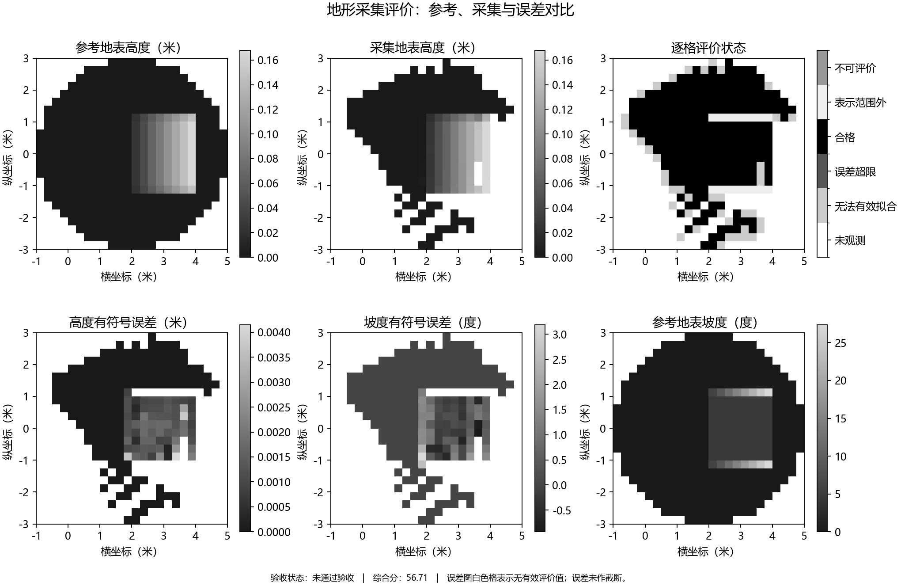

# MoonCar 地形采集评价报告

状态：**未通过验收**。这是评价流程的真实记录示例，不是三策略优劣结论或实物验收。
未通过项：全部区域：有效覆盖率低于门槛；平地：有效覆盖率低于门槛。

| 指标 | 结果 |
| --- | ---: |
| 达标地表覆盖分 S（0–100） | 56.7130 |
| 原始观测覆盖率（0–1） | 0.6644 |
| 有效重建覆盖率 C（0–1） | 0.5671 |
| 几何达标率 P（0–1） | 1.0000 |
| 高度均方根误差（米） | 0.0008 |
| 坡度平均绝对误差（度） | 0.2093 |
| 评价面积（平方米） | 27.0000 |
| 表示范围外面积（平方米） | 1.0000 |
| 首帧分数 S₀ | 6.9444 |
| 本次分数增量 | 49.7685 |

S = 100 × 几何达标采集面积 / 固定评价面积。高度和坡度必须同时满足冻结阈值；未观测和错误估计不从分母删除。
高度容差 0.05 米，坡度容差 5.0 度，均为暂定仿真目标。
安全记录未在本评价器中认证，因此几何达标也不自动代表整体验收通过。

黑白图中深色“合格”表示达到暂定几何门槛，浅灰或空白不意味着合格。高度/坡度误差图保留全部有效估计的误差；没有可信对应时不画达标结论。

中文指标、分区结果及证据核验见《移动采集评价汇总.json》，中文表头的逐格数据见《移动采集逐格数据.csv》。程序复算使用的原始字段格式另行保留。
记录每约 0.5 秒选帧；不宣称覆盖前端所有关键帧。
参考来自冻结 SDF 的解析视觉几何与中央 80% 网格采样；曲面网格化、细于采样间距的特征仍有近似误差。
本结果保留估计相机位姿误差，未使用真值位姿替换，也未对最终地图进行配准修正。

证据问题：未发现阻止几何计分的证据缺口；安全状态仍未认证。
