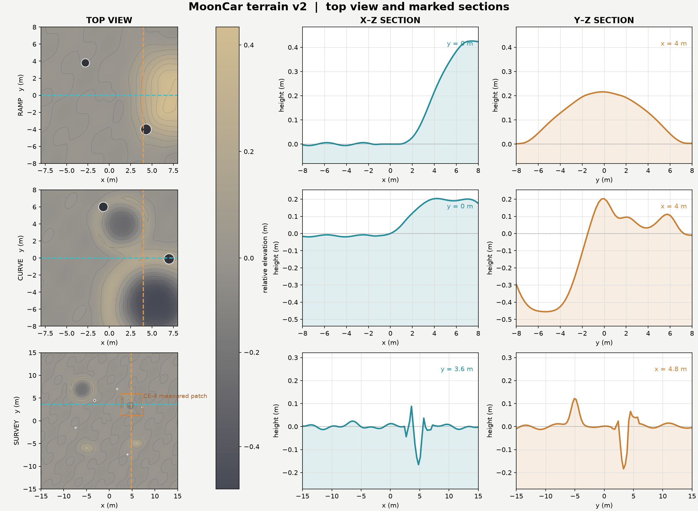
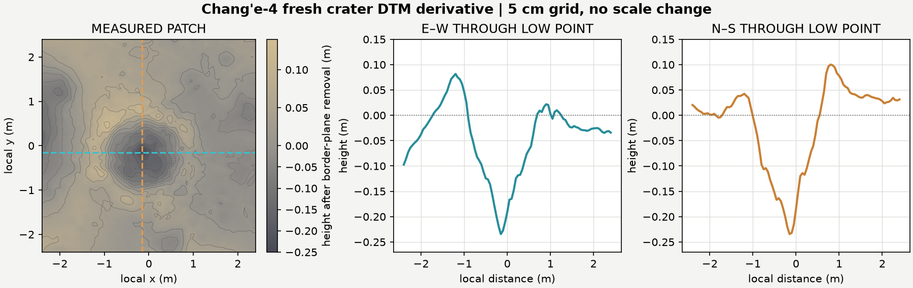

# mooncar_gazebo

Gazebo simulation package for the MoonCar ROS2 stack.

## Worlds

- `worlds/lunar_yard.sdf`: 50 m lunar-like yard with low gravity, a stable spawn area, a gentle ramp, a shallow crater, a ridge, and scattered rocks for mobility and mapping tests.

## Launch

The proposed R5 body is opt-in and uses its own RGB bridge configuration. Its
0.3311 m odometry track width is the estimated wheel-center separation; skid
steering requires later calibration. Existing runs keep the legacy defaults.

```bash
ros2 launch mooncar_gazebo simulation.launch.py \
  model_file:=mooncar_r5.urdf.xacro \
  bridge_config_file:=ros_gz_bridge_r5.yaml \
  odom_wheel_radius:=0.076 odom_track_width:=0.3311
```

This selects the new car model and exposes `/mooncar/rgb/image` and
`/mooncar/rgb/camera_info`. Existing Nav2 footprints and terrain planner
dimensions still describe the legacy car; R5 navigation and new benchmark
results require their own calibrated configuration.

Start the M2 simulation stack:

```bash
ros2 launch mooncar_gazebo simulation.launch.py
```

For a server-only VM smoke test:

```bash
ros2 launch mooncar_gazebo simulation.launch.py gz_args:="-r -s -v 3 --render-engine ogre"
```

The launch starts Gazebo, publishes the MoonCar description, spawns the rover into the `lunar_yard` world, and bridges `/clock` into ROS2.

Gazebo's per-step clock is bridged to `/mooncar/clock_raw`. A standard
`topic_tools` throttle forwards it to `/clock` at up to 100 Hz of simulation
time, so every ROS node need not process all 1,000 physics ticks per second.
The throttle reads the raw clock itself; pause and backward time jumps remain
simulation-time driven. The physical integration step stays at 1 ms.

The launch selects Ogre for both GUI and sensors. VMware defaults to CPU
software rendering because the virtual GPU previously produced invalid sensor
measurements. Server-only rendering still requires an X display; acceptance
scripts provide Xvfb when needed.

M3 control topics bridged by this launch:

- `/mooncar/cmd_vel_safe` from ROS2 to Gazebo `/cmd_vel`
- `/mooncar/joint_states_raw` from Gazebo, then `/joint_states` through the
  standard `topic_tools` throttle at up to 30 Hz of simulation time. Gazebo 8.11
  ignores the model's `JointStatePublisher/update_rate`; without the throttle,
  every physics iteration propagates through wheel odometry. Message timestamps
  and positions are preserved. `ros2 topic hz` measures wall-time arrival rate,
  so it reports less than 30 Hz when the simulation runs slower than real time.

M3 ROS control nodes started by this launch:

- `mooncar_cmd_vel_safety_relay`: clamps `/cmd_vel` and times out stale commands.
- `mooncar_wheel_odometry`: integrates `/joint_states` and publishes `/odom` plus `odom -> base_footprint` TF.

## M2 sensor topics

Gazebo sensor placeholders are attached to frames from `mooncar_description` and bridged into ROS2:

- `/mooncar/scan` from `lidar_link`
- `/mooncar/imu` from `imu_link`
- `/mooncar/depth/image` from `depth_camera_optical_frame`
- `/mooncar/depth/camera_info` from `depth_camera_optical_frame`

## Verify on the Ubuntu VM

From the active VM clone:

```bash
cd ~/MoonCar
git pull --ff-only origin main
cd ros2_ws
source /opt/ros/jazzy/setup.bash
colcon build --symlink-install --packages-select mooncar_description mooncar_gazebo
source install/setup.bash
```

Run a server-only smoke test:

```bash
ros2 launch mooncar_gazebo simulation.launch.py gz_args:="-r -s -v 3 --render-engine ogre"
```

In a second terminal:

```bash
source /opt/ros/jazzy/setup.bash
cd ~/MoonCar/ros2_ws
source install/setup.bash
ros2 topic list | grep -E '/clock|/mooncar'
ros2 topic echo --once /clock
```

For M3 drive control checks, see `mooncar_control/README.md`.

Expected early M2 behavior:

- Gazebo loads `lunar_yard.sdf`.
- `spawn_mooncar` reports entity creation successful.
- `/clock` is available in ROS2.
- Sensor topics are expected to appear after Gazebo sensor systems initialize; rendering-backed topics may require a graphical or headless-rendering capable VM session.

## Troubleshooting

- If Gazebo cannot find the world file, rebuild `mooncar_gazebo` and source `install/setup.bash`.
- If `/clock` is missing, confirm `mooncar_gazebo/config/ros_gz_bridge.yaml` is installed and that `mooncar_gz_bridge` started.
- If sensor topics are missing in server-only mode, rerun with GUI or a headless rendering setup before treating it as a model failure.
- If the rover does not spawn, confirm `/robot_description` is being published by `robot_state_publisher`.

## Follow-up dependencies

- M3 control should attach wheel control to the existing four wheel joints.
- M4 SLAM should use `/mooncar/scan` and `lidar_link`.
- Nav2 work should treat `base_footprint` as the planar robot base frame.
- Hardware selection should replace placeholder sensor rates, noise values, masses, and poses.

## Terrain v2 scenes (separate from the acceptance worlds)

`worlds/mooncar_{ramp,curve,survey}_v2.sdf` are opt-in worlds for the next scene-development stage. They do not replace `lunar_yard.sdf` or the worlds and data used by the earlier strategy comparisons.

| World | Terrain feature | Surface classes |
| --- | --- | --- |
| `ramp` | Continuous 0.42 m ascent; maximum sampled ground slope about 6.8° | Regolith, soft sand, gravel, rock |
| `curve` | Route between 6.1 m and 11.2 m craters | Regolith, gravel, crater floor |
| `survey` | One measured fresh-crater patch, one parameterized crater and mounds | All five classes |





The dashed lines in each plan view locate its two sections; profile vertical scales are expanded for legibility. The outlined 4.8 m square in `survey` is derived from an actual Chang'e-4 rover-camera DTM. The rest of the ground is a synthetic 2.5D height surface. None of these worlds is a complete reconstruction of a lunar landing site.
The shared top-view colour bar shows relative elevation in metres: dark grey is lower, neutral grey is near zero, and pale tan is higher. It uses one scale across all three scenes. These colours do not identify surface materials; the separate `class_mask.png` files carry simulation class labels.

### Terrain evidence and its limits

| Parameter | Basis | What is implemented |
| --- | --- | --- |
| `ramp` slope | [Ding et al., Nature Communications 2024](https://doi.org/10.1038/s41467-024-46233-8) reports a maximum 8.86° slope in one Yutu-2 route segment | A separate engineered ascent with 6.8° maximum sampled slope; this is an analogue, not that route's geometry |
| `curve` crater diameters | The same route study reports adjacent craters of 6.1 m and 11.2 m diameter | Two parameterized bowls at those diameters; their positions and exact profiles are engineered |
| Typical crater depth | [Wu et al., Earth and Planetary Science Letters 2021](https://doi.org/10.1016/j.epsl.2020.116666) reports mean crater depth/diameter 0.061 at the Chang'e-4 site | Used for the parameterized `curve` and `survey` crater profiles, not for the measured fresh crater |
| Fresh crater geometry | [Ding et al., Geophysical Research Letters 2020](https://doi.org/10.1029/2020GL087361) reports a roughly 2.2 m crater with 0.35 m rim-to-floor depth; [the authors' source DTM](https://doi.org/10.5281/zenodo.3732816) is 5 mm/pixel | A valid 4.8 m square is cropped without changing horizontal or vertical scale, low-pass filtered and sampled at 5 cm, detrended against its border plane, then feathered over 0.35 m into `survey` |
| Site rock abundance | Wu et al. fits a size-frequency model with abundance parameter `k = 0.21%` | Five resolved `survey` boulders are a deterministic sample, not 0.21% total-area coverage. At the 0.25 m diameter cutoff, Equation 6 predicts 0.04078% area coverage by larger rocks; their elliptical-footprint proxy is 0.03848%. Smaller rocks are absent from collision geometry, and exact shapes and positions remain engineered |

The two `curve` boulders sit near crater rims, a qualitative placement consistent with [Watkins et al.'s boulder-distance study](https://doi.org/10.1029/2019JE005963). That study concerns much larger craters, so it does not supply a quantitative distribution for these metre-scale bowls.

[Guo et al. (2021)](https://doi.org/10.1029/2021GL094931) report a median RMS height of about 4 mm in 125 mm windows and publish a wider 5 mm/pixel Chang'e-4 DTM. A verified local copy is indexed under `reports/evidence/terrain-v2/20260930T170028+0900/`, but it contains a large central no-data region and is not inserted into these worlds. The 0.25–0.30 m coarse terrain meshes cannot represent that measured sub-decimetre roughness; the procedural normal maps are visual hypotheses, not a calibrated substitute.

The source file `data/terrain_sources/CE-4_Fresh_Crater_DEM.mat` is reproduced under its [CC BY 4.0 Zenodo record](https://doi.org/10.5281/zenodo.3732816), credited to Chunyu Ding, Zhiyong Xiao, Bo Wu, Yuan Li, Nils C. Prieur, Yuzhen Cai, Yan Su and Jun Cui. Its published MD5 is `39a21d550aa9376c2497b26324bb76b9`. `scripts/prepare_ce4_crater.py` verifies that hash and creates `data/terrain_sources/ce4_fresh_crater_5cm.npz`; it needs SciPy only for this conversion. The source image's north-up orientation is retained. The valid crop uses array rows 400–1360 and columns 150–1110 (zero-based); the resulting patch and its transform are recorded in `survey/manifest.json`.

The five surface classes are **simulation labels**, not material identifications from the DTM. Their contact coefficients, procedural textures, soft-ground patches, mounds, and standalone rock positions have not been calibrated against wheel-soil tests. The lunar soil internal friction angle and cohesion inferred by Ding et al. cannot be inserted directly as Gazebo/Bullet contact friction coefficients. The measured patch captures geometry only; its surrounding 30 m field is not measured terrain.
[Ding et al. (2024)](https://doi.org/10.1038/s41467-024-46233-8) infer a Chang'e-4 soil internal friction angle of 21.5–42.0°, cohesion of 520–3154 Pa, and lateral wheel–soil external friction angle of 8.3–16.5°. [Hurrell et al. (2025)](https://doi.org/10.1007/s11214-025-01164-8) measure single-wheel traction coefficient as drawbar force divided by normal load across slip ratios in lunar simulant. These are useful calibration targets, but none directly specifies a rigid-contact SDF `mu` or `mu2`. The current five terrain pairs (`mu` 0.52–1.00, `mu2` 0.48–0.92) and the R5 wheel's directional coefficients (0.20/0.85) are uncalibrated simulator choices. Before claiming mobility fidelity, compare wheel traction–slip and sinkage against tests at the rover's wheel geometry and load, then freeze a fitted contact model or adopt a deformable-soil model.
The source DTM was reconstructed from rover imagery using shape from shading. The selected crop contains no `-100` no-data cells, but the original study notes uncertainty in shadowed and blurred areas; its heights are not direct laser measurements.

The generator is `scripts/build_terrain_v2.py`. It writes each class's OBJ surface into `models/terrain_v2/<scene>/` and uses the same OBJ for rendering and collision. The class meshes meet along boundaries, forming one continuous ground surface. The measured patch replaces a square of the coarse survey mesh with a 5 cm mesh; their boundary heights match. Separate faceted boulders have matching visual and collision meshes; their poses and sizes are in `manifest.json`. Each scene also includes `height_grid.npz`, a north-up `class_mask.png` with class IDs from `manifest.json`, and hashes for the world, meshes and textures. The survey height grid contains a 30 cm sample of the patch; the full 5 cm shape is in `ce4_crater_patch.obj`. The mask labels ground only; boulders are separate objects. These are top-down simulation labels, not camera semantic-segmentation images. `materials/textures/` contains procedural albedo, normal and roughness maps with a restrained neutral palette. These are not calibrated lunar reflectance data. Model training still needs domain variation and real imagery; colour must not be treated as a reliable class key.

The v2 worlds select Gazebo's Bullet Featherstone engine in their SDF because it loads these mesh collisions. Run with the installed R5 model and RGB bridge, for example:

```bash
source /opt/ros/jazzy/setup.bash
source ros2_ws/install/setup.bash
world=$(ros2 pkg prefix mooncar_gazebo)/share/mooncar_gazebo/worlds/mooncar_ramp_v2.sdf
ros2 launch mooncar_gazebo simulation.launch.py \
  world:="$world" world_name:=mooncar_ramp_v2 \
  model_file:=mooncar_r5.urdf.xacro bridge_config_file:=ros_gz_bridge_r5.yaml \
  odom_wheel_radius:=0.076 odom_track_width:=0.3311
```

Change both `ramp` strings to `curve` or `survey` for the other worlds. A headless server needs Xvfb and software rendering in the current VM setup. The generator requires Python with NumPy and Pillow; rerun it after changing terrain shapes or class assignments, then rebuild `mooncar_gazebo`. If regenerating the measured patch from the original `.mat`, run `scripts/prepare_ce4_crater.py` first with SciPy.

The friction coefficients in each SDF are **simulation hypotheses**, not measured lunar soil properties. Bullet receives its own `<bullet>` friction settings; deformable soil, wheel sinkage, material aging and photorealistic lunar imagery are outside this version. Scene labels and geometry are independent of the old 54-run and later 18-run results; new evaluations need their own frozen protocol and evidence folder.
